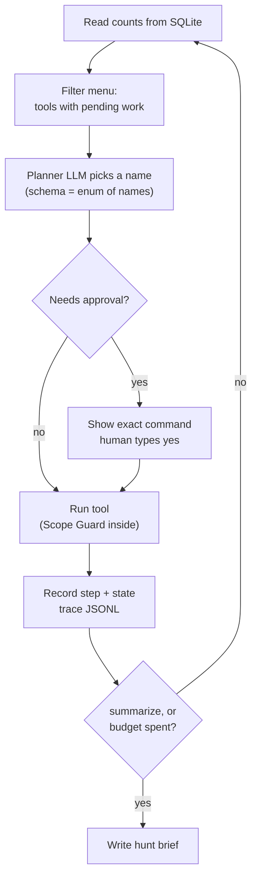

# Putting it together: the agent loop

You now have a Scope Guard, a recon pipeline and five analysis modules. This lesson wires them into `hunt.py`: a small agent where the LLM picks the next step from a fixed menu, noisy tools wait for your approval, state lives in SQLite so a run can resume, every decision is traced to JSONL, and the run ends with a Markdown hunt brief for you to work from.

> [!GOALS]
> - Build a fixed tool menu where each tool enforces scope internally and decides its own arguments
> - Write a planner loop with a step budget, a no-progress guard and a deterministic fallback
> - Put nuclei and ffuf behind an approval gate that shows the exact command
> - Persist state for resume and write JSONL traces you can query with jq
> - Generate a hunt brief and run the whole thing end to end on Juice Shop

## The shape of the loop

You built a loop like this in [Build an agent from scratch](#/agents/agent-from-scratch): observe, decide, act, repeat. The differences here are all about safety and a small model:



| Property | How it is achieved |
|---|---|
| The model never chooses targets or arguments | It outputs a tool **name** from an enum; Python builds the command from the database and scope |
| Every tool is safe in every state | Each tool checks `require_test`, filters targets with the Guard, applies rate limit and headers |
| Noisy tools need a human | `scan_nuclei` and `fuzz_content` print the exact command and wait for `yes`; no terminal means no |
| No infinite loops | Step budget, tools only offered when they have pending work, no-progress guard, error limit |
| Small models fail gracefully | Invalid planner output falls back to the first available tool in canonical order |
| Injection cannot steer the planner | The planner sees counts and our own numeric summaries, never target text |
| Resumable | Each step writes its state to `agent_steps`; tools are idempotent because pending work lives in the DB |

## `active.py`: noisy tools behind an approval gate

nuclei and ffuf send many requests. Each gets a **plan** (targets plus argument list) that is shown to you before anything runs.

```python title="active.py"
"""Noisy tools (nuclei, ffuf): build a plan, ask a human, then run."""
from __future__ import annotations

import sys
from dataclasses import dataclass
from urllib.parse import urlsplit

import db
from analysis import nuclei as nuclei_mod
from config import ROOT
from recon import header_args, jsonl, save_raw, targets_file
from scope import Scope
from tools import run


@dataclass
class Plan:
    tool: str
    test_type: str
    targets: list[str]
    argv: list[str]   # "{targets}" = targets file, "{target}" = one run per target

    def describe(self) -> str:
        shown = " ".join("<targets.txt>" if a == "{targets}" else a for a in self.argv)
        return (f"{self.tool} | test type {self.test_type} | {len(self.targets)} target(s)\n"
                f"  {shown}\n  targets: {self.targets[:5]}{' ...' if len(self.targets) > 5 else ''}")


def ask_approval(plan: Plan, trace) -> bool:
    print("\n=== APPROVAL REQUIRED ===\n" + plan.describe())
    if not sys.stdin.isatty():                    # unattended runs never approve noisy tools
        trace("approval", tool=plan.tool, approved=False, reason="no terminal")
        return False
    ok = input("Type 'yes' to run, anything else to skip: ").strip().lower() == "yes"
    trace("approval", tool=plan.tool, approved=ok, targets=len(plan.targets), argv=plan.argv)
    return ok


def _services(scope: Scope, conn, limit: int = 50) -> list[str]:
    rows = conn.execute("SELECT url FROM urls WHERE is_service=1 "
                        "ORDER BY COALESCE(score, 0) DESC LIMIT ?", (limit,)).fetchall()
    return [r["url"] for r in rows if scope.check_url(r["url"]).allowed]


def nuclei_plan(scope: Scope, conn) -> Plan | None:
    scope.require_test("vuln_scan")
    targets = _services(scope, conn)
    if not targets:
        return None
    return Plan("nuclei", "vuln_scan", targets, [
        "nuclei", "-l", "{targets}", "-tags", "exposure,misconfig,tech",
        "-etags", "dos,intrusive,fuzz", "-rl", str(scope.rate_limit), "-c", "5", "-bs", "5",
        "-dr", "-ni", "-duc", "-jsonl", "-silent", *header_args(scope)])


def ffuf_plan(scope: Scope, conn, top: int = 3) -> Plan | None:
    scope.require_test("content_discovery")
    targets = _services(scope, conn, limit=top)
    if not targets:
        return None
    # remove words that would hit excluded paths: ffuf cannot enforce our scope itself
    words = (ROOT / "wordlists" / "small.txt").read_text().split()
    keep = [w for w in words if all(scope.check_url(t.rstrip("/") + "/" + w).allowed for t in targets)]
    filtered = db.program_dir(scope.program) / "wordlist-filtered.txt"
    filtered.write_text("\n".join(keep) + "\n")
    return Plan("ffuf", "content_discovery", targets, [
        "ffuf", "-u", "{target}/FUZZ", "-w", str(filtered), "-rate", str(scope.rate_limit),
        "-t", "5", "-ac", "-mc", "all", "-fc", "404", "-maxtime", "600", "-json",
        *header_args(scope)])


def _ingest_ffuf(scope: Scope, conn, text: str) -> str:
    kept = denied = 0
    for rec in jsonl(text):
        url = rec.get("url", "")
        if not scope.check_url(url).allowed:
            denied += 1
            continue
        db.upsert_url(conn, url, urlsplit(url).hostname, "ffuf",
                      status=rec.get("status"), length=rec.get("length"))
        kept += 1
    conn.commit()
    return f"ffuf: {kept} paths stored, {denied} denied"


def execute(plan: Plan, scope: Scope, conn) -> str:
    scope.require_test(plan.test_type)            # re-check at execution time
    outputs = []
    if "{targets}" in plan.argv:
        with targets_file(plan.targets) as path:
            outputs.append(run([path if a == "{targets}" else a for a in plan.argv],
                               timeout=7200).stdout)
    else:
        for t in plan.targets:
            scope.require_url(t)
            outputs.append(run([a.replace("{target}", t.rstrip("/")) for a in plan.argv],
                               timeout=1800).stdout)
    text = "\n".join(outputs)
    save_raw(scope, plan.tool, text)
    if plan.tool == "nuclei":
        added, denied = nuclei_mod.ingest(conn, scope, text)
        return f"nuclei: {added} results stored, {denied} denied"
    return _ingest_ffuf(scope, conn, text)
```

Flag choices for nuclei: a conservative tag set (`exposure,misconfig,tech`), excluded `dos,intrusive,fuzz` tags, `-dr` so templates do not follow redirects off the host, `-ni` so no out-of-band callbacks go to public interactsh servers, low concurrency (`-c 5 -bs 5`), and the program rate limit. You can widen the tags for a program that allows it; you do it by editing this file, not by asking the model.

> [!WARNING] Scanners and excluded paths
> ffuf gets a wordlist filtered through the Guard, so it never requests an excluded path. nuclei templates request their own paths, and nuclei has no notion of your `excluded_paths`. If a program forbids certain paths or is strict about automated scanning, put `vuln_scan` in `banned_tests` and the tool disappears from the menu.

## `agent_tools.py`: the fixed menu

Each tool has a name, a one-line description for the planner, an availability check based on counts and run state, and a `run` function. Availability means "has pending work", so a finished stage drops off the menu by itself.

```python title="agent_tools.py"
"""The fixed tool menu. The planner picks a name; this code decides everything else."""
from __future__ import annotations

from dataclasses import dataclass, field
from typing import Callable

import active
import recon
from analysis import hosts, hypotheses, js, nuclei, params
from scope import Scope


@dataclass
class Ctx:
    scope: Scope
    conn: object
    trace: Callable
    state: dict = field(default_factory=dict)


@dataclass
class Tool:
    name: str
    description: str
    available: Callable[[dict, dict, Scope], bool]   # (counts, state, scope) -> bool
    run: Callable[[Ctx], str]
    needs_approval: bool = False


def _subdomains(ctx: Ctx) -> str:
    return "; ".join([recon.stage_seed(ctx.scope, ctx.conn),
                      recon.stage_subdomains(ctx.scope, ctx.conn),
                      recon.stage_resolve(ctx.scope, ctx.conn)])


def _probe(ctx: Ctx) -> str:
    return "; ".join([recon.stage_resolve(ctx.scope, ctx.conn),
                      recon.stage_probe(ctx.scope, ctx.conn)])


def _crawl(ctx: Ctx) -> str:
    return "; ".join([recon.stage_crawl(ctx.scope, ctx.conn),
                      recon.stage_fetch_js(ctx.scope, ctx.conn)])


def _analyze_js(ctx: Ctx) -> str:
    res = js.analyze_pending(ctx.conn, ctx.scope, limit=3)
    eps = sum(r.get("endpoints", 0) for r in res)
    hints = sum(1 for r in res if r.get("injection_hint"))
    return f"analyzed {len(res)} JS files: {eps} endpoints, {hints} files with injection hints"


def _triage(ctx: Ctx) -> str:
    return (f"scored {hosts.triage_services(ctx.conn)} services; "
            f"triaged {nuclei.triage(ctx.conn)} finding groups")


def _hypotheses(ctx: Ctx) -> str:
    ctx.state["urls_at_hyp"] = ctx.conn.execute("SELECT COUNT(*) FROM urls").fetchone()[0]
    n_params = params.classify_params(ctx.conn)
    return f"classified {n_params} parameters; {hypotheses.generate(ctx.conn)} new hypotheses"


def _gated(name: str, make_plan) -> Callable[[Ctx], str]:
    def runner(ctx: Ctx) -> str:
        plan = make_plan(ctx.scope, ctx.conn)
        if plan is None:
            return "no targets"
        if not active.ask_approval(plan, ctx.trace):
            ctx.state.setdefault("declined", []).append(name)
            return "declined by human"
        return active.execute(plan, ctx.scope, ctx.conn)
    return runner


def _allowed_test(scope: Scope, test_type: str) -> bool:
    return test_type not in scope.banned_tests


TOOLS = [
    Tool("run_subdomains", "Seed hosts from scope, passive subdomain discovery, DNS resolution.",
         lambda c, s, sc: c["hosts"] == 0, _subdomains),
    Tool("probe_hosts", "Probe known hosts for live web services (httpx).",
         lambda c, s, sc: c["hosts_unprobed"] > 0, _probe),
    Tool("crawl", "Crawl live services (katana) and download JavaScript files.",
         lambda c, s, sc: c["services_uncrawled"] > 0 or c["js_unfetched"] > 0, _crawl),
    Tool("analyze_js", "Analyze up to 3 downloaded JS files for endpoints and secrets.",
         lambda c, s, sc: c["js_unanalyzed"] > 0, _analyze_js),
    Tool("triage_findings", "Score live services and triage scanner findings.",
         lambda c, s, sc: c["services_unscored"] > 0 or c["findings_untriaged"] > 0, _triage),
    Tool("generate_hypotheses", "Classify parameters and generate testable hypotheses.",
         lambda c, s, sc: c["urls"] > c["services"] and s.get("urls_at_hyp") != c["urls"],
         _hypotheses),
    Tool("scan_nuclei", "Run nuclei exposure/misconfiguration templates. Noisy: asks the human.",
         lambda c, s, sc: c["services"] > 0 and _allowed_test(sc, "vuln_scan")
         and "scan_nuclei" not in s.get("done", []) + s.get("declined", []),
         _gated("scan_nuclei", active.nuclei_plan), needs_approval=True),
    Tool("fuzz_content", "Run ffuf with a small wordlist on the top 3 services. Noisy: asks the human.",
         lambda c, s, sc: c["services"] > 0 and _allowed_test(sc, "content_discovery")
         and "fuzz_content" not in s.get("done", []) + s.get("declined", []),
         _gated("fuzz_content", active.ffuf_plan), needs_approval=True),
    Tool("summarize", "Write the hunt brief for the human and finish.",
         lambda c, s, sc: True, lambda ctx: "brief requested"),
]
```

Notice the tool summaries: they are strings our code builds from numbers. That is all the planner ever reads about previous steps.

## `brief.py`: the hunt brief

The brief is the review queue: everything a human needs to start testing, ranked, with evidence. It is also an **output sink** for target-controlled text (page titles, URLs, JS notes), so it escapes Markdown and HTML characters. A title like `` should render as text in whatever Markdown previewer you use, not as HTML.

```python title="brief.py"
"""Render the Markdown hunt brief from the database."""
from __future__ import annotations

import json

import db
from config import BRIEF_DIR, MODEL
from scope import Scope


def md(text, limit: int = 160) -> str:
    """Escape target-controlled text for a Markdown table cell."""
    s = str(text or "").replace("\n", " ").replace("|", "\\|").replace("`", "'")
    s = s.replace("<", "&lt;").replace(">", "&gt;")
    return s[:limit] + ("..." if len(s) > limit else "")


def write_brief(scope: Scope, conn, run_id: str):
    c = db.counts(conn)
    out = [f"# Hunt brief: {scope.program}", "",
           f"Run `{run_id}`, generated {db.now()}, model `{MODEL}`.", "",
           "> Machine-generated and unverified. Every item is a lead, not a finding. "
           "Verify by hand, within scope, before reporting.", "",
           "## Scope recap", "",
           f"- In scope: {', '.join(md(r.raw) for r in scope.in_scope)}",
           f"- Out of scope: {', '.join(md(r.raw) for r in scope.out_of_scope) or 'none listed'}",
           f"- Ports: {sorted(scope.ports) if scope.ports else 'any'}; rate limit {scope.rate_limit}/s; "
           f"banned tests: {', '.join(sorted(scope.banned_tests)) or 'none'}", "",
           "## Attack surface", "", "| Item | Count |", "|---|---|"]
    out += [f"| {k} | {v} |" for k, v in c.items()]

    out += ["", "## Services by priority", "", "| Score | URL | Title | Reasons |", "|---|---|---|---|"]
    for r in conn.execute("SELECT url, title, score, score_json FROM urls WHERE is_service=1 "
                          "ORDER BY COALESCE(score, -1) DESC LIMIT 25"):
        reasons = json.loads(r["score_json"])["reasons"] if r["score_json"] else []
        out.append(f"| {r['score']} | `{md(r['url'])}` | {md(r['title'], 60)} | {md('; '.join(reasons), 300)} |")

    out += ["", "## Sensitive endpoints from JavaScript", "", "| URL | Model's note |", "|---|---|"]
    for r in conn.execute("SELECT url, notes FROM urls WHERE sensitive=1 LIMIT 30"):
        out.append(f"| `{md(r['url'])}` | {md(r['notes'], 250)} |")

    out += ["", "## Findings", "", "| Source | Name | URL | Triage |", "|---|---|---|---|"]
    for r in conn.execute("SELECT source, name, url, detail, triage_json FROM findings "
                          "ORDER BY source, severity LIMIT 60"):
        t = json.loads(r["triage_json"] or "{}")
        d = json.loads(r["detail"] or "{}")
        note = (f"FP {t['false_positive_likelihood']}: {t['reasoning']}"
                if "false_positive_likelihood" in t else d.get("masked") or d.get("note") or "")
        out.append(f"| {r['source']} | {md(r['name'], 60)} | `{md(r['url'], 90)}` | {md(note, 250)} |")

    out += ["", "## Hypotheses to test", ""]
    rows = conn.execute("""SELECT h.*, u.url, u.method FROM hypotheses h JOIN urls u ON u.id = h.url_id
                           WHERE h.status='open' ORDER BY h.priority, h.id""").fetchall()
    for h in rows:
        out += [f"### H{h['id']} [{h['wstg_id']}] {md(h['title'], 120)}", "",
                f"- Endpoint: `{md(h['method'])} {md(h['url'], 200)}`"
                + (f", parameter `{md(h['param'], 60)}`" if h["param"] else ""),
                f"- Priority {h['priority']}, test risk: {h['test_risk']}",
                f"- Why: {md(h['rationale'], 400)}", f"- Evidence: {md(h['evidence'], 200)}", ""]
        out += [f"- [ ] {md(step, 300)}" for step in json.loads(h["test_plan"])] + [""]

    v = conn.execute("SELECT COUNT(*), SUM(valid), AVG(latency_ms) FROM llm_runs").fetchone()
    out += ["## Before you test", "",
            "- [ ] Re-read the program policy; confirm each target is still in scope",
            "- [ ] Use only accounts you own; stop at minimal proof of impact",
            "- [ ] Check findings with source `injection-hint` by reading the file yourself", "",
            "## Run statistics", "",
            f"LLM calls: {v[0]}, valid: {v[1] or 0}, average latency: {int(v[2] or 0)} ms.", ""]
    path = BRIEF_DIR / f"{run_id}.md"
    path.write_text("\n".join(out))
    return path
```

## `hunt.py`: the planner loop

```python title="hunt.py"
"""Agent loop: the LLM picks the next step from a fixed menu until summarize or budget."""
from __future__ import annotations

import argparse
import json
import time
from typing import Literal

from pydantic import Field, create_model

import db
from agent_tools import TOOLS, Ctx
from brief import write_brief
from config import MODEL, TRACE_DIR
from llm import call_with_schema
from scope import OutOfScope, Scope

PROMPT_VERSION = "planner-v1"
STEPS_SQL = """CREATE TABLE IF NOT EXISTS agent_steps (
    id INTEGER PRIMARY KEY, run_id TEXT NOT NULL, step INTEGER NOT NULL, tool TEXT NOT NULL,
    status TEXT NOT NULL, summary TEXT, state TEXT, started_at TEXT, finished_at TEXT)"""

PLANNER = """You are the planner of a bug bounty recon assistant. Choose the next step from the
available tools using only the counts and history given. Usual order: discover hosts, probe,
crawl, analyze JS, triage, generate hypotheses, then summarize. Tools marked 'asks the human'
are noisy: propose them only after the cheaper steps are done. Choose summarize when nothing
useful is left or few steps remain. Keep the reason to one sentence."""


class Tracer:
    def __init__(self, run_id: str):
        self.path = TRACE_DIR / f"{run_id}.jsonl"

    def __call__(self, event: str, **fields) -> None:
        with open(self.path, "a") as f:
            f.write(json.dumps({"ts": db.now(), "event": event, **fields}, default=str) + "\n")


def decide(conn, counts: dict, history: list, available: list, steps_left: int):
    names = tuple(t.name for t in available)
    # reason comes first so the model writes a sentence before committing to a choice
    Decision = create_model("Decision", reason=(str, Field(max_length=300)),
                            tool=(Literal[names], ...))
    menu = "\n".join(f"- {t.name}: {t.description}" for t in available)
    user = (f"Counts: {json.dumps(counts)}\nSteps left: {steps_left}\n"
            f"History (most recent last): {json.dumps(history[-8:])}\nAvailable tools:\n{menu}")
    return call_with_schema(Decision, PLANNER, user, module="planner",
                            prompt_version=PROMPT_VERSION, conn=conn,
                            temperature=0.2, max_tokens=300)


def main() -> None:
    ap = argparse.ArgumentParser(description="Local bug bounty hunting agent")
    ap.add_argument("scope_file")
    ap.add_argument("--max-steps", type=int, default=12)
    ap.add_argument("--resume", metavar="RUN_ID")
    args = ap.parse_args()

    scope = Scope.load(args.scope_file)
    conn = db.connect(scope.program)
    conn.execute(STEPS_SQL)
    run_id = args.resume or f"{scope.program}-{time.strftime('%Y%m%d-%H%M%S')}"
    trace = Tracer(run_id)
    prior = conn.execute("SELECT * FROM agent_steps WHERE run_id=? ORDER BY step", (run_id,)).fetchall()
    state = json.loads(prior[-1]["state"]) if prior else {"done": [], "declined": [], "errors": {}}
    history = [{"step": r["step"], "tool": r["tool"], "status": r["status"],
                "summary": r["summary"] if r["status"] == "ok" else r["status"]} for r in prior]
    step = len(prior)
    ctx = Ctx(scope, conn, trace, state)
    trace("run_start", run_id=run_id, resumed=bool(prior), max_steps=args.max_steps, model=MODEL)
    print(f"run {run_id} (resume with: --resume {run_id})")

    finished = False
    try:
        while step < args.max_steps and not finished:
            step += 1
            counts = db.counts(conn)
            last = state.get("last", {})
            available = [t for t in TOOLS
                         if t.available(counts, state, scope)
                         and state["errors"].get(t.name, 0) < 2                       # error limit
                         and not (last.get("tool") == t.name and last.get("counts") == counts)]  # no progress
            names = [t.name for t in available]
            steps_left = args.max_steps - step + 1
            if steps_left == 1 or names == ["summarize"]:
                choice, reason = "summarize", "budget spent or nothing else to do"
            else:
                d = decide(conn, counts, history, available, steps_left)
                choice, reason = (d.tool, d.reason) if d else (names[0], "fallback: invalid planner output")
            trace("decision", step=step, tool=choice, reason=reason, available=names, counts=counts)
            tool = next(t for t in available if t.name == choice)

            started, t0, status = db.now(), time.monotonic(), "ok"
            try:
                summary = tool.run(ctx)
            except OutOfScope as exc:
                status, summary = "blocked", f"scope guard: {exc}"[:300]
            except Exception as exc:  # a failing tool must not kill the run
                status, summary = "error", f"{type(exc).__name__}: {exc}"[:300]
                state["errors"][tool.name] = state["errors"].get(tool.name, 0) + 1
            if tool.name not in state["done"]:
                state["done"].append(tool.name)
            state["last"] = {"tool": tool.name, "counts": db.counts(conn)}
            trace("tool_end", step=step, tool=tool.name, status=status, summary=summary,
                  duration_s=round(time.monotonic() - t0, 1))
            conn.execute("""INSERT INTO agent_steps(run_id, step, tool, status, summary, state,
                            started_at, finished_at) VALUES (?,?,?,?,?,?,?,?)""",
                         (run_id, step, tool.name, status, summary, json.dumps(state), started, db.now()))
            conn.commit()
            # the planner only ever sees our own summaries, and only for successful steps
            history.append({"step": step, "tool": tool.name, "status": status,
                            "summary": summary if status == "ok" else status})
            print(f"[{step}/{args.max_steps}] {tool.name}: {status} - {summary}")
            finished = tool.name == "summarize"
    except KeyboardInterrupt:
        trace("interrupted", step=step)
        print(f"\ninterrupted; resume with: python hunt.py {args.scope_file} --resume {run_id}")
    path = write_brief(scope, conn, run_id)
    trace("run_end", step=step, brief=str(path))
    print(f"brief: {path}")


if __name__ == "__main__":
    main()
```

What to notice:

- **The schema is the menu.** `Literal[names]` turns the available tool names into a JSON-schema enum, so LM Studio's grammar can only produce one of them. The model cannot answer `run_shell` because that token sequence is not allowed.
- **Deterministic fallback.** If the planner output is invalid after retries, the first available tool in canonical order runs. The agent degrades into a pipeline instead of stopping.
- **No-progress guard.** A tool that just ran and left the counts unchanged is not offered again immediately, which breaks the "pick the same tool forever" loop small models fall into.
- **Errors are contained.** A crashing tool becomes a step with status `error`; two errors remove it from the menu for this run.
- **Resume** reads the last saved state for the run id. Because pending work is stored in the database (unprobed hosts, unanalyzed JS), re-running a half-finished step simply continues it.

> [!TIP] Why the planner is cheap to get right
> With availability filtering, the menu at any moment usually holds two to four tools. Choosing among three well-described options with counts in front of it is well within a 9B model's ability, and even a bad choice only costs one step. This is the [reliability lesson's](#/agents/reliability) advice in practice: shrink the decision until the model cannot get it badly wrong.

## End-to-end run on Juice Shop

> [!LAB] A full hunt against your lab
> 1. Juice Shop running, LM Studio serving the model with 32K context and thinking off, venv active, `pytest -q -m "not llm"` green.
> 2. Start fresh so the agent does all the work: `mv data/juice-shop/hunt.db data/juice-shop/hunt-old.db` (keep the old one as a backup).
> 3. Run the agent:
>    ```bash
>    python hunt.py programs/juice-shop/scope.yaml --max-steps 12
>    ```
>    You should see steps like `run_subdomains`, `probe_hosts`, `crawl`, then `analyze_js` (possibly several times, three files per step), `triage_findings` and `generate_hypotheses`. At some point the planner may pick `scan_nuclei` or `fuzz_content`: read the printed command, check the target list is only `http://localhost:3000/`, and type `yes`, or anything else to decline.
> 4. Interrupt a second run with <kbd>Ctrl</kbd>+<kbd>C</kbd> during a crawl, then resume it with the printed `--resume` command. Confirm the step numbers continue.
> 5. Open the brief in `briefs/` and work through the top three hypotheses in Burp. Tick the checkboxes as you go and note which were real.
> 6. Run once more with stdin not attached to a terminal (`python hunt.py programs/juice-shop/scope.yaml < /dev/null`) and confirm in the trace that approvals were refused automatically.

## Reading the trace

Each run writes `traces/<run_id>.jsonl`, one event per line. jq turns it into answers:

```bash
# Every decision with the planner's reason
jq -c 'select(.event=="decision") | {step, tool, reason, available}' traces/juice-shop-*.jsonl

# Time spent per tool
jq -s 'map(select(.event=="tool_end")) | group_by(.tool)
       | map({tool: .[0].tool, runs: length, secs: (map(.duration_s) | add)})' traces/<run_id>.jsonl

# Anything that was blocked, failed, or needed approval
jq -c 'select(.status=="blocked" or .status=="error" or .event=="approval")' traces/<run_id>.jsonl
```

And the LLM side from SQLite:

```bash
sqlite3 -header -column data/juice-shop/hunt.db \
  "SELECT module, COUNT(*) calls, SUM(valid) ok, ROUND(AVG(latency_ms)) avg_ms, SUM(completion_tokens) out_tokens FROM llm_runs GROUP BY module"
```

Things to look for: fallbacks (planner output invalid), the same tool chosen twice in a row, a `summarize` chosen while work was still pending, and modules with low validity. Each points at a prompt or schema to fix in the [evaluation lesson](#/bugbounty/evaluate).

> [!DANGER] Before you point it at a real program
> Write the program's `scope.yaml` from the policy page and have the tests pass for its specific entries (add the program's hosts to a test). Check the rate limit and required header. Run with a small `--max-steps` first and read the trace. Decline every approval prompt until you have read the command. The agent is only as safe as the scope file you give it.

## Recap

- The planner picks a tool name from an enum of currently available tools; Python decides targets, flags and rate.
- Tools are offered only when they have pending work; a step budget, no-progress guard, error limit and fallback keep a small model from looping or stalling.
- nuclei and ffuf show their exact command and need a typed `yes`; unattended runs refuse them.
- State is in SQLite (`agent_steps` plus the data tables), so runs resume; traces are JSONL for jq.
- The brief is the human review queue, and it escapes target-controlled text because it is an output sink too.

## Check yourself

1. Why does the planner's history contain our summaries only for successful steps, and only the status otherwise?
   <details><summary>Answer</summary>

   Successful summaries are strings our code builds from counts. Error messages can contain target-derived text (a URL, a server message), which would let target content reach the planner prompt. Passing only the status keeps the planner's input free of attacker-controlled text.

   </details>
2. The model keeps choosing `analyze_js` even though the last run analyzed nothing new. What stops the loop?
   <details><summary>Answer</summary>

   The no-progress guard: a tool that just ran and left the counts unchanged is removed from the menu for the next decision. Also, `analyze_js` is only available while `js_unanalyzed > 0`, and every analyzed file is marked, so the pending count falls.

   </details>
3. What happens if you run `hunt.py` from a cron job and the planner chooses `scan_nuclei`?
   <details><summary>Answer</summary>

   `ask_approval` sees there is no terminal on stdin, records a refused approval in the trace, and the tool is added to `declined`, so it is not offered again in that run. Noisy tools never run unattended.

   </details>
4. Why does `ffuf_plan` filter the wordlist through the Scope Guard?
   <details><summary>Answer</summary>

   ffuf will request every word it is given and has no knowledge of `excluded_paths`. Filtering each candidate URL through `check_url` before the run means excluded paths (for example `/logout`) are never requested.

   </details>
5. Why does `brief.py` escape `<` and `>`?
   <details><summary>Answer</summary>

   Page titles, URLs and model notes are target-controlled. If the brief is opened in a Markdown previewer that renders HTML, unescaped markup could execute script or load remote content. The brief is an output sink and gets the same output encoding you would ask a developer to apply.

   </details>

## Go deeper

- [nuclei](https://github.com/projectdiscovery/nuclei) — tags, severity filters and rate options for tuning the gated scan
- [jq manual](https://jqlang.org/manual/) — everything you need for slicing JSONL traces
- [Pydantic: dynamic model creation](https://docs.pydantic.dev/latest/concepts/models/#dynamic-model-creation) — `create_model`, used for the per-step tool enum
- [OWASP LLM06: Excessive Agency](https://genai.owasp.org/llmrisk/llm062025-excessive-agency/) — the risk the fixed menu and approval gates address
