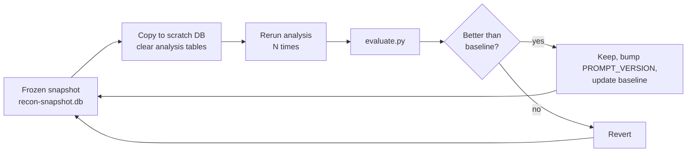

# Evaluate and improve your agent

You have a working assistant. Is it any good? "It found some stuff" is not an answer you can improve on. This lesson measures the system against Juice Shop's own list of vulnerabilities, defines metrics that match how you actually use it, sets up a repeatable loop for improving prompts, adds regression tests, compares models and settings, and points at the next upgrades.

> [!GOALS]
> - Use Juice Shop's challenge list as ground truth and build a small labelled set
> - Measure hypothesis recall, triage precision, false-positive rate, LLM health and time saved
> - Read traces and logs to find the weakest component
> - Iterate on prompts against a frozen snapshot, with regression tests that catch backsliding
> - Compare the 9B and 4B models and thinking on/off fairly
> - Plan next steps: RAG over your own notes, fine-tuning on your own reports

## Why Juice Shop is a good yardstick

Juice Shop ships with its vulnerabilities documented as challenges. Each running instance exposes them as JSON at `/api/Challenges`, with fields including `key`, `name`, `category`, `difficulty`, `description`, `solved` and `disabledEnv`. The challenges are loaded at startup from `data/static/challenges.yml` in the repository, which calls itself the single source of truth for challenges. When this lesson was written the master branch listed 116 challenges across 16 categories (Injection, Broken Access Control, XSS, Sensitive Data Exposure, Unvalidated Redirects, Improper Input Validation, and others); your instance's endpoint is authoritative for your version.

Two cautions before using it as ground truth:

- **Some challenges are disabled in Docker.** Around 18 "danger zone" challenges (XXE, RCE, some XSS variants) carry `disabledEnv: Docker`. Exclude them.
- **Not everything is reachable by this agent.** Black-box recon plus analysis cannot "find" challenges that need code review, OSINT, or social puzzles. Measure against the subset the pipeline could plausibly surface, and say so when you report numbers.

> [!NOTE] Spoilers
> The [companion guide](https://pwning.owasp-juice.shop/) has full solutions. For practising, hunt first and read later. For evaluation, using it to label ground truth is fine; that is what it is for.

## Ground truth in two layers

**Layer 1: categories.** Map Juice Shop categories to the WSTG IDs the hypothesis generator can emit. This mapping is our judgment, not an official crosswalk:

| Juice Shop category | WSTG IDs that count as a hit |
|---|---|
| Injection | WSTG-INPV-05, WSTG-INPV-12, WSTG-INPV-18 |
| Broken Access Control | WSTG-ATHZ-02, WSTG-ATHZ-03, WSTG-ATHZ-04, WSTG-INPV-19 |
| XSS | WSTG-INPV-01, WSTG-INPV-02, WSTG-CLNT-01 |
| Unvalidated Redirects | WSTG-CLNT-04 |
| Sensitive Data Exposure | WSTG-INFO-05, WSTG-CONF-04 |
| Broken Authentication | WSTG-ATHN-04, WSTG-ATHN-09 |
| Improper Input Validation | WSTG-BUSL-01, WSTG-BUSL-08, WSTG-ATHZ-03 |
| Security Misconfiguration | WSTG-ERRH-01, WSTG-CONF-05 |
| Observability Failures | WSTG-CONF-05, WSTG-INFO-05 |

(Juice Shop files its SSRF challenge under Broken Access Control, which is why WSTG-INPV-19 appears there.)

**Layer 2: labelled endpoints.** A dozen specific (endpoint, vulnerability) pairs, each tied to a challenge key. These come from the challenge list and companion guide; verify each against your instance before trusting it:

```yaml title="eval/labels.yaml"
# path_regex is matched against the URL path; any listed WSTG id counts as a hit
- key: unionSqlInjectionChallenge     # "User Credentials", Injection
  path_regex: ^/rest/products/search
  wstg: [WSTG-INPV-05]
- key: loginAdminChallenge            # "Login Admin", Injection
  path_regex: ^/rest/user/login
  wstg: [WSTG-INPV-05, WSTG-ATHN-04]
- key: basketAccessChallenge          # "View Basket", Broken Access Control
  path_regex: ^/rest/basket/
  wstg: [WSTG-ATHZ-04]
- key: basketManipulateChallenge      # "Manipulate Basket", Broken Access Control
  path_regex: ^/api/BasketItems
  wstg: [WSTG-ATHZ-04, WSTG-BUSL-01]
- key: forgedFeedbackChallenge        # "Forged Feedback", Broken Access Control
  path_regex: ^/api/Feedbacks
  wstg: [WSTG-ATHZ-04, WSTG-ATHZ-02]
- key: registerAdminChallenge         # "Admin Registration", Improper Input Validation
  path_regex: ^/api/Users
  wstg: [WSTG-ATHZ-03, WSTG-BUSL-01]
- key: redirectChallenge              # "Allowlist Bypass", Unvalidated Redirects
  path_regex: ^/redirect
  wstg: [WSTG-CLNT-04]
- key: directoryListingChallenge      # "Confidential Document", Sensitive Data Exposure
  path_regex: ^/ftp
  wstg: [WSTG-CONF-04, WSTG-INFO-05]
- key: exposedMetricsChallenge        # "Exposed Metrics", Observability Failures
  path_regex: ^/metrics
  wstg: [WSTG-CONF-05, WSTG-INFO-05]
- key: ssrfChallenge                  # "SSRF", Broken Access Control (difficulty 6)
  path_regex: ^/profile/image/url
  wstg: [WSTG-INPV-19]
- key: changePasswordBenderChallenge  # "Change Bender's Password", Broken Authentication
  path_regex: ^/rest/user/change-password
  wstg: [WSTG-ATHN-09]
- key: uploadSizeChallenge            # "Upload Size", Improper Input Validation
  path_regex: ^/file-upload
  wstg: [WSTG-BUSL-08]
```

Some of these endpoints only appear after login or via JS analysis; if the crawl never sees one, that is a recon miss, which is useful to know separately from an analysis miss.

## Metrics

| Metric | Definition | What it tells you |
|---|---|---|
| Surface recall | Labelled endpoints present in `urls` / all labelled endpoints | Did recon (crawl + JS analysis) even see the endpoint? |
| Hypothesis recall | Labelled pairs matched by a hypothesis (path + accepted WSTG id) / labelled pairs | Did analysis turn the endpoint into the right lead? |
| Recall@k | Same, counting only the top-k hypotheses by priority | Is the right lead near the top, where you will actually look? |
| Category coverage | Ground-truth categories with at least one matching hypothesis / reachable categories | Breadth across vulnerability classes |
| Hypothesis precision | Confirmed / (confirmed + rejected), from your manual labels | How much of your testing time leads somewhere |
| Triage precision and FP rate | Of nuclei groups the model rated `low` FP likelihood, the share you verified as real; of those rated `high`, the share that were actually real (missed) | Whether you can trust the ordering |
| LLM health | Validity rate, mean attempts, latency, tokens per call from `llm_runs` | Whether a prompt or schema is fighting the model |
| Time saved | (Your manual time to reach an equivalent lead list) minus (agent wall time + your review time) | The number that justifies the whole project |

> [!CONCEPT] Precision and recall
> **Recall** asks "of the things that are really there, how many did we find?" **Precision** asks "of the things we flagged, how many were real?" A system that flags every endpoint for every class has perfect recall and terrible precision; one that flags a single sure thing has the opposite. For a hunting assistant, recall@k (the right leads in the first 10 to 15 items) is usually the metric that matches your experience best.

Time saved is the softest number: measure it honestly by timing yourself once on a manual pass and once with the agent, on fresh containers, and treat it as an estimate with a large error bar.

## Label your results

Precision needs your judgment. A tiny helper walks through open hypotheses after you test them:

```python title="label.py"
"""Record manual verdicts for hypotheses: c = confirmed, r = rejected, s = skipped."""
import sys

import db

if __name__ == "__main__":
    conn = db.connect(sys.argv[1] if len(sys.argv) > 1 else "juice-shop")
    rows = conn.execute("""SELECT h.id, h.wstg_id, h.title, u.url FROM hypotheses h
                           JOIN urls u ON u.id = h.url_id WHERE h.status = 'open'
                           ORDER BY h.priority, h.id""").fetchall()
    verdicts = {"c": "confirmed", "r": "rejected", "s": "skipped"}
    for r in rows:
        ans = input(f"H{r['id']} [{r['wstg_id']}] {r['title']}\n   {r['url']}\n   c/r/s/q? ").strip()
        if ans == "q":
            break
        if ans in verdicts:
            conn.execute("UPDATE hypotheses SET status=? WHERE id=?", (verdicts[ans], r["id"]))
            conn.commit()
```

Do the same for nuclei findings with SQL when you verify them: `UPDATE findings SET status='verified' WHERE id=...` or `'rejected'`.

## `evaluate.py`

```python title="evaluate.py"
"""Score a hunt database against Juice Shop ground truth and manual labels."""
from __future__ import annotations

import argparse
import json
import re
from pathlib import Path
from urllib.parse import urlsplit

import yaml

import db
from config import ROOT
from net import ScopedClient
from scope import Scope

CATEGORY_WSTG = {
    "Injection": {"WSTG-INPV-05", "WSTG-INPV-12", "WSTG-INPV-18"},
    "Broken Access Control": {"WSTG-ATHZ-02", "WSTG-ATHZ-03", "WSTG-ATHZ-04", "WSTG-INPV-19"},
    "XSS": {"WSTG-INPV-01", "WSTG-INPV-02", "WSTG-CLNT-01"},
    "Unvalidated Redirects": {"WSTG-CLNT-04"},
    "Sensitive Data Exposure": {"WSTG-INFO-05", "WSTG-CONF-04"},
    "Broken Authentication": {"WSTG-ATHN-04", "WSTG-ATHN-09"},
    "Improper Input Validation": {"WSTG-BUSL-01", "WSTG-BUSL-08", "WSTG-ATHZ-03"},
    "Security Misconfiguration": {"WSTG-ERRH-01", "WSTG-CONF-05"},
    "Observability Failures": {"WSTG-CONF-05", "WSTG-INFO-05"},
}


def ground_truth(scope: Scope, base: str) -> list[dict]:
    """Fetch /api/Challenges through the scoped client and drop Docker-disabled ones."""
    res = ScopedClient(scope, "crawl").get(base.rstrip("/") + "/api/Challenges")
    data = json.loads(res.body)["data"]
    return [c for c in data if "Docker" not in json.dumps(c.get("disabledEnv"))]


def evaluate(conn, labels: list[dict], challenges: list[dict], k: int) -> dict:
    hyps = conn.execute("""SELECT h.wstg_id, h.priority, h.status, u.url FROM hypotheses h
                           JOIN urls u ON u.id = h.url_id ORDER BY h.priority, h.id""").fetchall()
    paths = [urlsplit(r["url"]).path for r in conn.execute("SELECT url FROM urls")]

    def hit(label, rows):
        rx = re.compile(label["path_regex"])
        return any(rx.search(urlsplit(h["url"]).path) and h["wstg_id"] in label["wstg"] for h in rows)

    surface = [l["key"] for l in labels if any(re.search(l["path_regex"], p) for p in paths)]
    found = [l["key"] for l in labels if hit(l, hyps)]
    found_k = [l["key"] for l in labels if hit(l, hyps[:k])]
    emitted = {h["wstg_id"] for h in hyps}
    reachable = {c["category"] for c in challenges} & set(CATEGORY_WSTG)
    covered = {cat for cat in reachable if CATEGORY_WSTG[cat] & emitted}
    conf = sum(1 for h in hyps if h["status"] == "confirmed")
    rej = sum(1 for h in hyps if h["status"] == "rejected")

    tri = conn.execute("SELECT status, triage_json FROM findings WHERE source='nuclei' "
                       "AND status IN ('verified','rejected')").fetchall()
    def fp(r):
        return json.loads(r["triage_json"] or "{}").get("false_positive_likelihood")
    low = [r for r in tri if fp(r) == "low"]
    high = [r for r in tri if fp(r) == "high"]
    runs = conn.execute("SELECT module, COUNT(*) n, AVG(valid) ok, AVG(attempts) att, "
                        "AVG(latency_ms) ms FROM llm_runs GROUP BY module").fetchall()
    ratio = lambda a, b: round(a / b, 2) if b else None
    return {
        "labelled_pairs": len(labels),
        "surface_recall": ratio(len(surface), len(labels)),
        "hypothesis_recall": ratio(len(found), len(labels)),
        f"recall_at_{k}": ratio(len(found_k), len(labels)),
        "missed": sorted({l["key"] for l in labels} - set(found)),
        "category_coverage": ratio(len(covered), len(reachable)),
        "hypotheses": len(hyps),
        "precision_confirmed": ratio(conf, conf + rej),
        "triage_low_fp_precision": ratio(sum(r["status"] == "verified" for r in low), len(low)),
        "triage_high_fp_but_real": ratio(sum(r["status"] == "verified" for r in high), len(high)),
        "llm": {r["module"]: {"calls": r["n"], "valid": round(r["ok"], 2),
                              "attempts": round(r["att"], 2), "ms": int(r["ms"])} for r in runs},
    }


if __name__ == "__main__":
    ap = argparse.ArgumentParser()
    ap.add_argument("scope_file")
    ap.add_argument("--base", default="http://localhost:3000")
    ap.add_argument("--db", help="evaluate a specific database file (e.g. a snapshot copy)")
    ap.add_argument("-k", type=int, default=10)
    args = ap.parse_args()
    scope = Scope.load(args.scope_file)
    conn = db.connect(scope.program)
    if args.db:
        import sqlite3
        conn = sqlite3.connect(args.db)
        conn.row_factory = sqlite3.Row
    labels = yaml.safe_load((ROOT / "eval" / "labels.yaml").read_text())
    print(json.dumps(evaluate(conn, labels, ground_truth(scope, args.base), args.k), indent=2))
```

The ground-truth request goes through `ScopedClient`, so even the evaluator obeys the scope file.

> [!LAB] Your first scorecard
> 1. Create `eval/labels.yaml` from above. Check two or three labels against your instance in Burp.
> 2. After a full `hunt.py` run and your manual testing, label hypotheses: `python label.py juice-shop`.
> 3. Score it: `python evaluate.py programs/juice-shop/scope.yaml -k 10`.
> 4. Write the numbers into a `eval/RESULTS.md` table with the date, model, prompt versions and settings. This is your baseline.
> 5. Look at `missed`. For each, ask: was the endpoint in `urls` (surface) or did analysis fail to connect it to the right class? Those need different fixes.
> 6. Open the score board at `http://localhost:3000/#/score-board` and see which challenges you solved while testing; cross-check against confirmed hypotheses.

## Reading traces and logs to find the weak link

Measure first, then look at where things went wrong:

```bash
# planner fallbacks and odd choices
jq -c 'select(.event=="decision" and (.reason | test("fallback")))' traces/*.jsonl
# which module produces invalid JSON or needs retries
sqlite3 -header -column data/juice-shop/hunt.db \
  "SELECT module, prompt_version, AVG(valid) ok, AVG(attempts) att FROM llm_runs GROUP BY module, prompt_version"
# what did the model say in its failed outputs?
sqlite3 data/juice-shop/hunt.db "SELECT module, substr(error,1,200) FROM llm_runs WHERE valid=0 LIMIT 10"
# endpoints the JS analyzer dropped for unverifiable evidence (from analyze_pending stats in the trace)
jq -c 'select(.event=="tool_end" and .tool=="analyze_js") | .summary' traces/*.jsonl
```

Typical patterns and fixes:

| Symptom | Likely cause | Fix to try |
|---|---|---|
| Surface recall low | Crawl too shallow, endpoints only after login | Increase depth, add authenticated crawling (session header in scope `headers` for your test account), improve JS regexes |
| Surface fine, hypothesis recall low | Too many endpoints per call, weak prompt guidance | Smaller batches, sort sensitive endpoints first, add one worked example to the prompt |
| Recall fine, recall@10 low | Priorities poorly calibrated | Ask for priorities relative to each other; re-rank in code by parameter class |
| Validity below ~0.9 | Schema too complex or `max_tokens` too small | Flatten the schema, cap list lengths, raise `max_tokens` |
| Many dropped JS endpoints | Model paraphrases evidence | Shorter evidence limit, prompt "copy, do not rewrite", give an example |

## The iteration loop



The key is the **frozen snapshot** from the recon lesson: rerunning recon every time would change the input and hide the effect of a prompt change. Clear only the analysis outputs and rerun the modules:

```bash
cp data/juice-shop/recon-snapshot.db data/juice-shop/hunt.db
sqlite3 data/juice-shop/hunt.db "DELETE FROM hypotheses; DELETE FROM param_classes; \
  UPDATE urls SET score=NULL, score_json=NULL; UPDATE js_files SET analyzed_at=NULL; \
  DELETE FROM urls WHERE source='js'; DELETE FROM llm_runs;"
python analyze.py programs/juice-shop/scope.yaml hosts js params hypotheses
python evaluate.py programs/juice-shop/scope.yaml
```

Because sampling is random, one run proves little. Run each configuration at least three times and compare the mean and the spread. A change that moves recall from one run to another by one labelled pair out of twelve is within noise.

> [!TIP] One change at a time
> Change one prompt, one parameter or one model per experiment, and bump that module's `PROMPT_VERSION`. The `llm_runs` table then tells you exactly which version produced which numbers. This is the same discipline as changing one variable when tuning a WAF bypass.

## Regression tests

Deterministic guarantees get hard tests; model behaviour gets threshold tests marked `llm` so they run only when LM Studio is up.

```python title="tests/test_regression.py"
"""Regression checks. Deterministic tests always run; llm tests need LM Studio."""
import json
import re
import shutil
import sqlite3
from pathlib import Path

import pytest
import yaml

import db
from analysis import hypotheses, params
from evaluate import evaluate
from scope import Scope

ROOT = Path(__file__).resolve().parents[1]
SNAPSHOT = ROOT / "data" / "juice-shop" / "recon-snapshot.db"
LAB = Scope.from_dict({"program": "juice-shop", "in_scope": ["localhost"], "ports": [3000]})


def test_param_rules():
    for name, cls in [("to", "redirect_url"), ("imageUrl", "fetch_url"), ("q", "search_query"),
                      ("BasketId", "object_id"), ("page", "pagination_sort")]:
        rule = next(c for c, rx in params.RULES if re.search(rx, name, re.I))
        assert rule == cls, name


def test_wstg_enum_is_closed():
    schema = json.dumps(hypotheses.HypothesisSet.model_json_schema())
    assert "WSTG-ATHZ-04" in schema and "WSTG-FAKE-99" not in schema


@pytest.mark.llm
@pytest.mark.skipif(not SNAPSHOT.exists(), reason="no recon snapshot")
def test_hypothesis_recall_floor(tmp_path):
    work = tmp_path / "hunt.db"
    shutil.copy(SNAPSHOT, work)
    conn = sqlite3.connect(work)
    conn.row_factory = sqlite3.Row
    conn.executescript("DELETE FROM hypotheses; DELETE FROM param_classes;")
    params.classify_params(conn)
    hypotheses.generate(conn)
    labels = yaml.safe_load((ROOT / "eval" / "labels.yaml").read_text())
    result = evaluate(conn, labels, challenges=[], k=10)
    # set the floor from your own baseline (for example 80% of it), not from this lesson
    assert result["hypothesis_recall"] is not None and result["hypothesis_recall"] >= 0.3
```

The `0.3` floor is a placeholder: replace it with a value derived from your own baseline runs. The point of the test is to catch a prompt edit that quietly halves recall.

Run the suite before and after every change:

```bash
pytest -q -m "not llm"      # fast, deterministic: scope, redaction, injection prefilter, rules
pytest -q -m llm            # slower: model behaviour against the snapshot
```

## Comparing models and settings

The same harness compares configurations. Change one thing, rerun the analysis three times on the snapshot, record the scorecard.

| Configuration | How to set it | What to watch |
|---|---|---|
| 9B Q4_K_M, thinking off (baseline) | Your current setup | All metrics |
| 9B Q4_K_M, thinking on | Thinking toggle or chat-template setting in LM Studio ([prompts and templates](#/lmstudio/prompts-templates)) | Recall vs latency and validity (thinking output can break schema calls) |
| 4B Q4_K_M | Load Qwen3.5-4B, `export BB_MODEL=<its id>` | How much recall you lose for roughly half the memory and higher speed |
| 9B Q6_K | Load the 6.9 GB quant | Whether higher precision helps; check memory headroom with Docker and Burp running |
| Temperature 0.3 vs 0.7 | `temperature=` in `call_with_schema` | Spread across runs as well as the mean |

Make a results table like this and fill it from your own runs only:

| Config | Surface recall | Hyp. recall | Recall@10 | Precision | Validity | Mean latency/call |
|---|---|---|---|---|---|---|
| 9B Q4, think off, T=0.3 | | | | | | |
| 9B Q4, think on | | | | | | |
| 4B Q4, think off | | | | | | |

Surface recall should not change between models unless JS analysis contributes endpoints, which it does here; that makes it a useful check on the JS module specifically.

> [!MAC] Fair comparisons on a fanless Air
> Your MacBook Air throttles under sustained load, so the third run of a long batch can be slower than the first for thermal reasons alone. Compare latency on similar-length runs, let the machine cool between configurations, and keep Docker and Burp in the same state for every run. Memory pressure matters too: if Activity Monitor shows swap growing during the 9B Q6_K run, its latency numbers say more about memory than about the model.

## Next improvements

Once the baseline is stable, these are the upgrades with the best payoff:

1. **RAG over your own knowledge.** Index your past writeups, PortSwigger Academy notes and favourite disclosed reports, and retrieve the most relevant ones into the hypothesis prompt ("similar endpoints you have seen before"). [RAG: give your model your knowledge](#/using/rag) builds the retrieval pipeline; embeddings can also upgrade the lexical duplicate check in `report.py`. Retrieved notes are your own text, but still pass them as data blocks.
2. **Fine-tuning on your own past reports.** If you have dozens of your own verified reports, a small LoRA adapter can teach the model your report style and your sense of what is worth testing. [Training 101 and when not to fine-tune](#/finetune/concepts) explains when this beats better prompts (often it does not) and how to evaluate it with exactly the harness you built here.
3. **Authenticated recon.** Many Juice Shop labels only appear when logged in. Add a test-account session header to `scope.yaml` for your own lab account and compare surface recall.
4. **Diffing between runs.** Store per-run snapshots and brief only what is new (new hosts, new JS endpoints): on long-running programs, change is where bugs appear.
5. **Better re-ranking in code.** Combine the model's priority with deterministic signals (parameter class, JS sensitivity flag, status codes) to stabilize recall@k across models.
6. **Exposing tools via MCP.** Read-only tools such as "query the hunt database" can be exposed to LM Studio as MCP servers ([MCP: plugging tools into LM Studio](#/using/mcp)), letting you chat with your recon data. Keep anything that sends traffic out of that interface.

## Recap

- Juice Shop's `/api/Challenges` (from `challenges.yml`) is ground truth; exclude Docker-disabled challenges and measure only what the pipeline could reach.
- Separate surface recall (did recon see it) from hypothesis recall (did analysis call it), and track recall@k because that is what you read.
- Precision needs your manual labels; time saved needs honest timing.
- Iterate against a frozen snapshot, one change at a time, at least three runs per configuration, with prompt versions logged.
- Regression tests keep the deterministic guarantees hard and model behaviour above a floor you set from your own baseline.
- Compare 9B vs 4B and thinking on/off with the same harness; mind thermals and memory pressure on the Air.

## Check yourself

1. Hypothesis recall is low but surface recall is high. Where do you look first?
   <details><summary>Answer</summary>

   At the analysis stage: the endpoints are in the database but the hypothesis generator did not connect them to the right class. Check whether they were included in the prompt (endpoint selection and batch limits), whether their parameters were classified, and what the model returned for them in `llm_runs`.

   </details>
2. Why evaluate prompt changes against a frozen recon snapshot instead of a fresh run?
   <details><summary>Answer</summary>

   A fresh run changes the input (crawl order, timing, discovered URLs), so you cannot tell whether a metric moved because of your prompt change or because recon found different things. The snapshot holds input constant so only the analysis varies.

   </details>
3. A change raises hypothesis recall from 6/12 to 7/12 in a single run. Is it an improvement?
   <details><summary>Answer</summary>

   Not yet. One labelled pair in one run is within sampling noise. Run both configurations at least three times and compare means and spread before keeping the change.

   </details>
4. Why does the regression test's recall floor come from your own baseline rather than a number in this lesson?
   <details><summary>Answer</summary>

   Results depend on your Juice Shop version, crawl, model build, quant and settings. A floor derived from your own measured baseline detects regressions in your setup; an outside number would be either meaningless or invented.

   </details>
5. When would fine-tuning on your past reports be worth it compared with RAG?
   <details><summary>Answer</summary>

   RAG is the first choice for knowledge (specific past findings, techniques) because it is cheap and updatable. Fine-tuning helps with behaviour and style the model consistently gets wrong despite good prompts, and only when you have enough verified examples and an evaluation harness like this one to prove it helped.

   </details>

## Go deeper

- [Pwning OWASP Juice Shop](https://pwning.owasp-juice.shop/) — the companion guide, including the challenge list and solutions used for labels
- [Juice Shop challenges.yml](https://github.com/juice-shop/juice-shop/blob/master/data/static/challenges.yml) — the source of truth for challenge keys and categories
- [OWASP Web Security Testing Guide](https://owasp.org/www-project-web-security-testing-guide/) — the test catalogue the hypotheses map to
- [jq manual](https://jqlang.org/manual/) — for slicing traces
