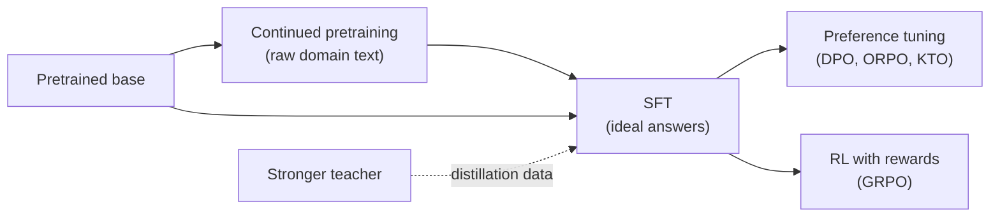

# Beyond SFT: DPO, distillation and more

Supervised fine-tuning teaches by example: "answer like this". The methods in this lesson teach by comparison, by imitation of a stronger model, by more raw reading, or by reward. You will learn what each one is, when it beats more SFT, what data it needs, and which ones are realistic on your 16 GB Mac versus a rented GPU.

> [!GOALS]
> - Explain preference tuning with DPO, and when ORPO or KTO fit better
> - Use distillation from a stronger teacher without tripping over licences and terms
> - Size continued pretraining honestly in data and compute
> - Explain GRPO and reinforcement learning with verifiable rewards, and write reward functions for security tasks
> - Place model merging, and decide what to run locally versus in the cloud

## Where SFT stops

SFT shows the model one good answer per prompt and pushes up its probability. It never shows the model what a *bad* answer looks like, so it cannot directly say "this hedged, disclaimer-heavy version is worse than that crisp one", or "this report overstates impact". It also cannot reward a model for *discovering* a better answer than your examples contain. The methods below fill those gaps.



## DPO: learn from better-versus-worse pairs

> [!CONCEPT] Preference pair
> A prompt plus two answers, one marked **chosen** (better) and one **rejected** (worse). The difference between them is the lesson: tone, accuracy, format, honesty about uncertainty.

> [!CONCEPT] DPO (Direct Preference Optimization)
> A training objective that raises the probability of the chosen answer *relative to* the rejected one, while a frozen copy of the starting model (the **reference model**) keeps it from drifting too far. A parameter called **beta** sets how strongly it is held to the reference: lower beta allows bigger moves. DPO replaced the older RLHF pipeline (train a reward model, then run PPO) for many teams because it is just a loss function over pairs, with no separate reward model.

The data, in the format TRL's `DPOTrainer` accepts (a conversational version with message lists also exists):

```json
{"prompt": "Write the impact section for an IDOR on /api/v2/orders/{id}; tested between my two test accounts.",
 "chosen": "Any authenticated user can read other customers' orders by changing the id... I confirmed this only between two test accounts I control.",
 "rejected": "This critical vulnerability allows attackers to steal all customer data and take over the platform..."}
```

When DPO helps more than more SFT:

- **Style corrections you can recognise but struggle to write from scratch.** Generate two answers from your fine-tune, pick the better one. Ranking is faster than authoring.
- **Removing a habit**: overclaiming severity, appending disclaimers, padding with generic advice. SFT cannot easily say "not this"; a rejected example can.
- **Calibrated honesty**: chosen answers that say "needs manual verification", rejected ones that invent a CVE.

Practical recipe: start from your SFT model, collect a few hundred pairs (sample two or more answers per prompt at temperature 0.7–1.0 and choose), train one epoch with a low learning rate. Evaluate with the same harness from [Evaluate your fine-tune](#/finetune/evaluate).

> [!NOTE]
> DPO keeps a reference model, which costs memory. With LoRA the reference is simply the base with the adapter switched off, so frameworks avoid a second copy. On a Mac, the third-party `mlx-lm-lora` package adds a `--train-mode dpo` option (also ORPO, GRPO and others) on top of MLX; on a GPU, TRL's `DPOTrainer` works with Unsloth.

### ORPO and KTO, briefly

| Method | Data | Difference from DPO | Use when |
|---|---|---|---|
| **ORPO** (Odds Ratio Preference Optimization) | Preference pairs | Combines the SFT loss and a preference term in one stage, with no reference model | You want one training run instead of SFT then DPO, with less memory |
| **KTO** (Kahneman-Tversky Optimization) | Single answers labelled good or bad, no pairs needed | Learns from unpaired thumbs-up and thumbs-down signals | You have a log of outputs you accepted or rejected (for example findings you kept or discarded), but not matched pairs |

## Distillation: borrow a stronger model's skill

> [!CONCEPT] Distillation
> Training a smaller **student** to imitate a stronger **teacher**. The simplest form is **sequence-level**: the teacher writes answers, you SFT the student on them (this is what the teacher step in [Build a cybersecurity dataset](#/finetune/dataset) already does). The original form (Hinton et al., 2015) trains on the teacher's full probability distribution over tokens, which carries more information but needs teacher and student to share a tokenizer and requires access to the teacher's logits.

Distillation is how many strong small models are made, and it is the most reliable way to lift a 9B on a narrow task: a strong teacher solves 2,000 representative JS-analysis or triage problems, you filter for correctness, and the 9B learns the pattern.

The constraints are legal and practical, not technical:

- **Terms of service.** Frontier providers restrict using outputs to build competing models (OpenAI's terms prohibit using Output "to develop models that compete with OpenAI"; Anthropic's commercial terms bar using the services to build a competing product, including training competing AI models). Read the current terms of any provider you use and decide with that in mind.
- **Licences of open teachers.** Open-weight models come with licences; some add conditions on derivatives. Qwen3.5 is Apache-2.0; check others individually.
- **Data you send.** Distilling via an API sends your prompts to a third party. Scrub as for any dataset.
- **Teacher errors.** The student learns the teacher's mistakes as faithfully as its skills. Verify facts, especially CVE IDs and versions.

> [!TIP]
> The fully local, licence-clean version: rent a GPU for a few hours, run a large Apache-2.0 open-weight model there as the teacher, generate and filter your data, shut it down, and train your 9B on the result.

## Continued pretraining: more reading, not more instructions

> [!CONCEPT] Continued pretraining
> Training on raw domain text (the `text` format) with the ordinary next-token loss, before or instead of SFT, so the model absorbs a domain's vocabulary and style. Also called domain-adaptive pretraining (Gururangan et al., 2020, "Don't Stop Pretraining").

It sounds like the way to "teach the model security". The reality check:

- **Data.** Meaningful continued pretraining uses hundreds of millions to billions of tokens of good domain text. Your writeups are perhaps a few hundred thousand tokens. Public security text at scale (advisories, RFCs, documentation) is mostly already in Qwen's multi-trillion-token pretraining mix.
- **Compute.** Training cost is about **6 × N × D** floating-point operations, for N parameters and D tokens. For the 9.65B model and 1 billion tokens:

```text
6 × 9.65e9 × 1e9 ≈ 5.8e19 FLOPs

datacenter GPU sustaining ~400 TFLOPS (assumption):  5.8e19 / 4e14 ≈ 1.4e5 s ≈ 40 hours
laptop GPU sustaining ~2 TFLOPS (assumption):        5.8e19 / 2e12 ≈ 2.9e7 s ≈ 11 months
```

  The throughput figures are rough assumptions for illustration, but the conclusion does not depend on them: continued pretraining of a 9B is a cloud job measured in GPU-days, and it is full training (or very high-rank LoRA) with all the memory costs from [Training 101](#/finetune/concepts).
- **Facts still do not stick reliably.** More reading shifts vocabulary and style more than it installs retrievable facts. Facts still belong in [RAG](#/using/rag).

Verdict: for a single security researcher, continued pretraining is rarely worth it. A well-built SFT set plus RAG gets you further for a tiny fraction of the cost.

## RL with verifiable rewards: GRPO

Some security tasks have answers a program can check: did the output parse as JSON with the right schema, did the solver find the right flag in your own CTF challenge, did the generated regex match all positive and no negative samples. When you can check the answer automatically, you can let the model try and **reward** it, instead of showing it what to write.

> [!CONCEPT] RL with verifiable rewards (RLVR)
> Reinforcement learning where the reward comes from a deterministic checker rather than a learned reward model or a human. The model generates answers, a program scores them, and training increases the probability of high-scoring behaviour. Reasoning-model training popularised it on math and code, where correctness is checkable.

> [!CONCEPT] GRPO (Group Relative Policy Optimization)
> An RL algorithm from the DeepSeekMath paper. For each prompt, sample a **group** of answers (say 8), score each, and compute each answer's **advantage** as its reward minus the group's mean reward, divided by the group's standard deviation. Answers better than their siblings are reinforced, worse ones discouraged. No separate value network is needed, which is a big memory saving compared with PPO.

A worked example of the advantage arithmetic, for one prompt and a group of four sampled triage answers:

```text
rewards:    1.0 (valid + correct severity), 0.5 (valid, wrong severity), 0.0 (invalid JSON), 0.5
mean = 0.5, standard deviation ≈ 0.35
advantages: +1.41, 0.0, -1.41, 0.0
```

The first answer's tokens get pushed up, the third's pushed down, the others stay put. Over many prompts, the model drifts toward whatever the checker rewards.

### Reward functions for security tasks

Reward functions are ordinary Python. TRL's `GRPOTrainer` (and Unsloth's GRPO notebooks, which wrap it) call your functions with the batch of completions and return one float per completion. This file is runnable on its own so you can test rewards before any training:

```python title="rewards.py"
"""Verifiable reward functions for GRPO-style training on security tasks."""
from __future__ import annotations

import json
import re

TRIAGE_KEYS = {"asset", "category", "severity", "confidence", "evidence", "next_steps",
               "in_scope_check_required"}
SEVERITIES = {"info", "low", "medium", "high", "critical"}


def _text(completion) -> str:
    """Completions arrive as strings, or as message lists for chat-format datasets."""
    if isinstance(completion, list):
        return completion[-1].get("content", "")
    return str(completion)


def json_schema_reward(completions, **kwargs) -> list[float]:
    """1.0 for exact triage schema, 0.3 for valid JSON with wrong shape, 0.0 otherwise."""
    scores = []
    for c in completions:
        text = re.sub(r"<think>[\s\S]*?</think>", "", _text(c)).strip()
        try:
            obj = json.loads(text)
        except json.JSONDecodeError:
            scores.append(0.0)
            continue
        ok = isinstance(obj, dict) and set(obj) == TRIAGE_KEYS and obj.get("severity") in SEVERITIES
        scores.append(1.0 if ok else 0.3)
    return scores


def ctf_flag_reward(completions, flag: list[str], **kwargs) -> list[float]:
    """1.0 if the completion contains the known flag for that challenge (your own CTF lab)."""
    return [1.0 if f in _text(c) else 0.0 for c, f in zip(completions, flag)]


def no_invented_cve_reward(completions, prompts=None, **kwargs) -> list[float]:
    """Penalise CVE IDs that do not appear in the prompt."""
    prompts = prompts or [""] * len(completions)
    scores = []
    for c, p in zip(completions, prompts):
        prompt_text = p if isinstance(p, str) else " ".join(m.get("content", "") for m in p)
        invented = set(re.findall(r"CVE-\d{4}-\d{4,}", _text(c))) - set(
            re.findall(r"CVE-\d{4}-\d{4,}", prompt_text))
        scores.append(-1.0 if invented else 0.0)
    return scores


if __name__ == "__main__":
    good = '{"asset": "a", "category": "c", "severity": "low", "confidence": "high", ' \
           '"evidence": [], "next_steps": [], "in_scope_check_required": true}'
    print(json_schema_reward([good, '{"sev": "low"}', "not json"]))         # [1.0, 0.3, 0.0]
    print(ctf_flag_reward(["got FLAG{demo_123}", "no idea"], flag=["FLAG{demo_123}"] * 2))
    print(no_invented_cve_reward(["See CVE-2099-0001"], prompts=["triage this"]))  # [-1.0]
```

In training you pass a list such as `reward_funcs=[json_schema_reward, no_invented_cve_reward]` to the trainer; extra dataset columns (like a `flag` column holding each challenge's known flag) are passed to reward functions as keyword arguments. Check the current TRL GRPO documentation for configuration options; they change between releases.

> [!WARNING]
> RL optimises exactly what you reward, including loopholes. Reward "contains the flag" and a model may learn to print flag-shaped strings for every challenge; reward "valid JSON" alone and it may emit `{}` with the right keys and empty content. This is **reward hacking**, the RL version of a bug bounty program paying for duplicates. Combine rewards, cap easy points, and read samples during training.

> [!DANGER]
> Only build RL environments around targets you own: your own CTF challenges, local vulnerable labs, synthetic data. Never point an RL loop at live third-party systems; a training run fires thousands of attempts with no human reviewing each one.

Where GRPO runs: it samples many completions per prompt, so it is generation-heavy and memory-hungry. Unsloth supports GRPO for Qwen3.5 (with `fast_inference=False`, using Unsloth's own inference) and publishes a Qwen3.5-4B GRPO Colab notebook. On the Mac, `mlx-lm-lora` offers a GRPO mode, practical only with small models (0.8B–2B) and short completions.

## Model merging

Instead of training, you can combine weights from models that share an architecture: average two fine-tunes, add a "task vector" (fine-tuned weights minus base weights) to another model, or blend adapters at chosen strengths. Tools like MergeKit do this in minutes on a CPU, with no gradients. You have already seen the simplest version: `llama-server --lora-scaled a.gguf:0.5,b.gguf:0.5` and `llama-export-lora` stacking adapters in [Merge, convert to GGUF, load in LM Studio](#/finetune/export-gguf). The methods, their failure modes, and how this connects to direct weight editing are covered in [Knowledge editing and model merging](#/weights/editing-merging).

## What is realistic on 16 GB versus the cloud

| Technique | On your 16 GB Air | On a rented GPU (24–80 GB) |
|---|---|---|
| SFT with LoRA | Qwen3.5-0.8B/2B comfortably, 4B borderline (MLX) | 9B bf16 LoRA (Unsloth, about 22 GB) |
| DPO, ORPO, KTO | Small models via `mlx-lm-lora` | 9B with TRL + Unsloth |
| Distillation (sequence-level) | Generating data with your local 9B as a weak teacher; training small students | Large open teacher for data, then 9B student |
| Continued pretraining | Not meaningful | Possible, costly: GPU-days per billion tokens for a 9B |
| GRPO / RLVR | 0.8B–2B toy runs with short outputs | 4B–9B with Unsloth |
| Model merging, adapter blending | Yes (CPU and disk, no training) | Not needed |
| Evaluation | Yes, always local | Optional |

The pattern that works for most individuals: **data work and evaluation locally, heavy training in short cloud sessions, inference back on your Mac.**

## Recap

- SFT shows good answers; preference methods show better versus worse. DPO trains on chosen/rejected pairs against a reference model; ORPO folds SFT and preference into one stage; KTO needs only good/bad labels.
- Distillation from a stronger teacher is the most reliable way to lift a 9B on a narrow task, but provider terms, model licences, privacy and teacher errors all apply.
- Continued pretraining costs about 6·N·D FLOPs (about 5.8e19 for 9.65B parameters and 1B tokens) and needs far more text than you have. Rarely worth it for one person.
- GRPO samples a group of answers, rewards each with a checker, and reinforces the above-average ones. Security tasks with checkable answers (schemas, your own CTF flags) suit it; guard against reward hacking and keep it to targets you own.
- Merging and adapter blending need no training. Do data and evals locally, heavy training in the cloud.

## Check yourself

1. Your fine-tune keeps overstating severity. Why might DPO fix this more efficiently than more SFT?
   <details><summary>Answer</summary>

   DPO can show the model a rejected, overstated answer next to a chosen, calibrated one, so it learns specifically to move away from overstatement. SFT only shows good answers and never names the behaviour to avoid. Ranking two samples is also faster than writing ideal answers.

   </details>
2. You have a log of 3,000 model findings you either kept or discarded, but no pairs. Which method fits?
   <details><summary>Answer</summary>

   KTO, which learns from unpaired good/bad labels.

   </details>
3. In a GRPO group, rewards are 1, 1, 1, 1. What are the advantages, and what does the model learn from this prompt?
   <details><summary>Answer</summary>

   All advantages are zero (every answer equals the mean), so this prompt teaches nothing. Prompts the model always solves (or always fails) give no signal; GRPO learns from prompts where some samples succeed and others fail.

   </details>
4. Estimate the training FLOPs for continued pretraining of the 9.65B model on 200 million tokens.
   <details><summary>Answer</summary>

   6 × 9.65e9 × 2e8 ≈ 1.16e19 FLOPs: about a fifth of the 1B-token example, still GPU-hours to GPU-days in the cloud and impractical on a laptop.

   </details>
5. Give one way a "contains the flag" reward can be hacked, and one mitigation.
   <details><summary>Answer</summary>

   The model prints many guessed flag-like strings, or repeats a flag seen elsewhere in the context, hoping one matches. Mitigations: require the flag in a specific final-answer field, penalise multiple candidate flags, use unique per-challenge flags not present in the prompt, and inspect samples during training.

   </details>

## Go deeper
- [Direct Preference Optimization (Rafailov et al., 2023)](https://arxiv.org/abs/2305.18290) — the DPO paper; section 4 derives why no reward model is needed
- [ORPO (Hong et al., 2024)](https://arxiv.org/abs/2403.07691) and [KTO (Ethayarajh et al., 2024)](https://arxiv.org/abs/2402.01306) — the single-stage and unpaired alternatives
- [DeepSeekMath (Shao et al., 2024)](https://arxiv.org/abs/2402.03300) — introduces GRPO
- [TRL GRPO trainer](https://huggingface.co/docs/trl/grpo_trainer) and [TRL DPO trainer](https://huggingface.co/docs/trl/dpo_trainer) — current APIs, data formats and reward function signatures
- [Unsloth reinforcement learning guide](https://unsloth.ai/docs/get-started/reinforcement-learning-rl-guide) — GRPO in practice, including Qwen3.5 notebooks
- [Don't Stop Pretraining (Gururangan et al., 2020)](https://arxiv.org/abs/2004.10964) — what domain-adaptive pretraining does and does not buy
