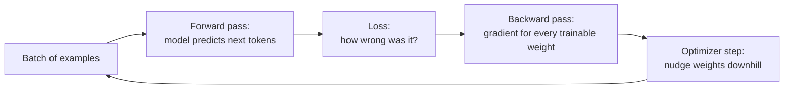
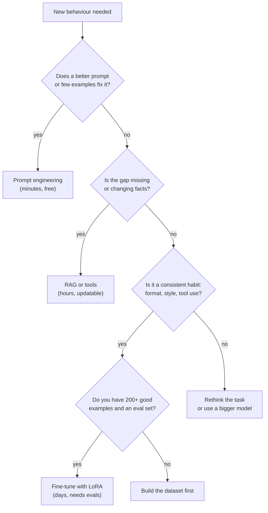

# Training 101 and when not to fine-tune

Fine-tuning changes a model's weights so its default behaviour shifts towards what you show it. Before you spend a weekend (or a cloud bill) on it, you need to know how training actually works, what it costs in memory, what LoRA is, and the cases where fine-tuning is the wrong tool. This lesson gives you all of that from zero.

> [!GOALS]
> - Explain loss, gradients, gradient descent, learning rate, batch, epoch and overfitting in plain words
> - Tell pretraining, supervised fine-tuning and preference tuning apart
> - Do the memory math that rules out full fine-tuning of a 9B model on 16 GB
> - Explain LoRA and QLoRA with the matrix picture, and count LoRA parameters yourself
> - Decide between prompting, RAG and fine-tuning for a given security task

## What "training" means, in one picture

You already know from [What is an LLM, really?](#/foundations/what-is-an-llm) that a model is a huge function: tokens go in, a probability for every possible next token comes out, and the behaviour of that function is set by billions of numbers called **weights**. Training is the process of nudging those numbers so that the model assigns higher probability to the text you want.

Here is the whole loop, which every training framework in this module (MLX, Unsloth, TRL) runs millions of times:



The rest of this section unpacks each box.

## Loss: a single number for "how wrong"

> [!CONCEPT] Loss
> A single number that measures how badly the model did on the current examples. Training is the search for weights that make this number small. For language models the loss is **cross-entropy**: for each position, take the probability the model gave to the token that actually came next, and compute minus its logarithm. Average over all positions that count.

A concrete example. Your training example says the assistant should write `Severity: High`. At the position after `Severity:` the model's softmax (see [How text gets generated](#/foundations/generation)) puts:

| Model's probability for " High" | Loss for this token (−ln p) |
|---|---|
| 0.90 | 0.105 |
| 0.50 | 0.693 |
| 0.25 | 1.386 |
| 0.01 | 4.605 |

Confident and right costs almost nothing; confident and wrong is punished hard. The training loss you will watch scroll by in MLX or Unsloth is this number averaged across every target token in a batch. A loss around 2–3 at the start of fine-tuning an instruct model on new-looking text is normal; dropping towards 1 or below means the model now finds your examples predictable.

> [!TIP]
> `exp(loss)` is called **perplexity**: roughly "how many tokens the model is torn between". Loss 0.69 means perplexity 2, as if choosing between two equally likely tokens. `mlx_lm.lora --test` reports both.

## Gradients and gradient descent: walking downhill blindfolded

Picture the loss as a landscape: every possible setting of the weights is a point on the ground, and the height is the loss. You want the lowest valley. You cannot see the landscape (it has billions of dimensions), but at the spot where you stand you can feel the slope under your feet.

> [!CONCEPT] Gradient
> For each trainable weight, the gradient says: "if you increase this weight a tiny bit, the loss goes up (or down) by this much". Together, all those numbers point uphill. Computing them for every weight at once is the **backward pass** (backpropagation), which reuses the intermediate values saved during the forward pass.

> [!CONCEPT] Gradient descent
> Take a small step in the opposite direction of the gradient (downhill), recompute the slope, repeat. Modern trainers use **Adam/AdamW**, a gradient descent variant that keeps a running average of each weight's recent gradients (momentum) and of their squared size, so every weight gets its own adaptive step size. Remember those two running averages: they cost memory.

If you have done fuzzing with coverage feedback, the shape is familiar: mutate, measure, keep what moves the metric. The difference is that gradients tell you *exactly* which direction to move every one of billions of knobs, instead of guessing.

## Learning rate, batch, epoch

> [!CONCEPT] Learning rate
> How big each downhill step is. Too small and training crawls; too large and you overshoot the valley and the loss explodes (or the model forgets everything it knew). LoRA fine-tunes typically use 1e-5 to 2e-4; you will see why those differ between tools in the MLX lesson.

> [!CONCEPT] Batch, step, epoch
> A **batch** is the group of examples the model sees before one weight update. One update is a **step** (MLX calls it an *iteration*). One **epoch** is one full pass over your training set. With 800 examples and batch size 4, one epoch is 200 steps. **Gradient accumulation** fakes a bigger batch on small memory: run 4 batches of 1, add up their gradients, then take one step.

Bigger batches give smoother, more reliable gradient estimates but cost memory, because every example in the batch has its activations held in memory for the backward pass. On a 16 GB Mac you will almost always use batch size 1 or 2 with accumulation.

## Overfitting: memorising the answer key

> [!CONCEPT] Overfitting
> The model gets better and better on the training examples while getting worse on new ones, because it is memorising specifics instead of learning the pattern. You detect it with a **validation set**: examples held out from training whose loss you check periodically. Training loss still falling while validation loss turns upward is the classic signature.

The security analogy: a junior who memorised last year's OSCP exam answers. Perfect on those boxes, lost on a new one. In fine-tuning, overfitting shows up as the model parroting phrases from your examples, copying hostnames that appeared in training data into unrelated answers, or getting rigid about format when a question is slightly different.

The usual defences: fewer epochs (1–3), a lower learning rate, more diverse data, smaller LoRA rank, and always keeping a validation and test split (covered in [Build a cybersecurity dataset](#/finetune/dataset)).

> [!LAB] Watch gradient descent work (5 minutes, no dependencies)
> 1. Create the workspace: `mkdir -p ~/ai-lab/finetune && cd ~/ai-lab/finetune`
> 2. Save the script below as `gd.py`. It fits a two-weight "model" `y = w·x + b` to noisy points generated from `y = 3x + 1`.
> 3. Run `python3 gd.py` (learning rate 0.05), then `python3 gd.py 0.005`, then `python3 gd.py 0.8`.
> 4. Note which run converges, which crawls, and which explodes. Why does the loss stop at about 0.048 instead of reaching 0? (Answer in Check yourself.)
>
> ```python title="gd.py"
> """Watch gradient descent learn y = 3x + 1 from noisy points. No dependencies."""
> import random
> import sys
>
>
> def main(lr: float) -> None:
>     random.seed(0)
>     xs = [i / 10 for i in range(-20, 21)]                  # 41 inputs from -2.0 to 2.0
>     ys = [3 * x + 1 + random.gauss(0, 0.2) for x in xs]    # the "training data"
>
>     w, b = 0.0, 0.0                                         # two weights, starting at zero
>     for step in range(101):
>         preds = [w * x + b for x in xs]                     # forward pass
>         loss = sum((p - y) ** 2 for p, y in zip(preds, ys)) / len(xs)
>         dw = sum(2 * (p - y) * x for p, y, x in zip(preds, ys, xs)) / len(xs)  # gradient for w
>         db = sum(2 * (p - y) for p, y in zip(preds, ys)) / len(xs)             # gradient for b
>         w -= lr * dw                                        # step downhill
>         b -= lr * db
>         if step % 10 == 0:
>             print(f"step {step:3d}  loss {loss:10.4f}  w {w:8.3f}  b {b:8.3f}")
>
>
> if __name__ == "__main__":
>     main(float(sys.argv[1]) if len(sys.argv) > 1 else 0.05)
> ```

Expected output for the default run (abridged):

```text
step   0  loss    13.7221  w    0.422  b    0.098
step  20  loss     0.0933  w    2.886  b    0.877
step  50  loss     0.0486  w    3.011  b    0.980
step 100  loss     0.0485  w    3.012  b    0.984
```

At 0.8 the weights blow up to around 8 billion by step 100: the steps are so large that each one overshoots further than the last. That is a *divergent* run, and the same thing happens to an LLM (loss shoots up or becomes `nan`) when the learning rate is too high. An LLM fine-tune is exactly this loop with 9 billion weights instead of two.

## Three kinds of training

Your model went through several training stages before you downloaded it. Knowing which stage you are imitating tells you what data you need.

| Stage | Data | What it teaches | Who does it |
|---|---|---|---|
| **Pretraining** | Trillions of tokens of raw text and code | Language, world knowledge, reasoning patterns | The Qwen team, on thousands of GPUs |
| **Supervised fine-tuning (SFT)** | Thousands to millions of (prompt, ideal answer) pairs in the chat template | Following instructions, answer format, tone, tool calls | Qwen team; this is also what *you* will do |
| **Preference tuning** (RLHF, DPO, RL with rewards) | Pairs of better/worse answers, or a reward signal | Which of several plausible answers to prefer: helpfulness, refusals, style | Qwen team; optional for you, see [Beyond SFT](#/finetune/beyond) |

The refusals that HauhauCS removed were mostly installed in that last stage (see [Alignment, refusals and "uncensored"](#/foundations/alignment-uncensored)). Your fine-tunes in this module are SFT: you show the model ideal conversations and minimise the loss on the assistant's turns.

> [!NOTE]
> "Supervised" just means every example comes with the correct answer attached. In SFT the loss is usually computed only on the assistant's tokens (prompt tokens are **masked**), because you want the model to learn how to answer, not how to write questions. Both `mlx_lm.lora --mask-prompt` and Unsloth's `train_on_responses_only` do this.

## Why full fine-tuning a 9B model is out of reach on 16 GB

**Full fine-tuning** means every weight is trainable. Count the bytes per parameter you need to hold in memory at once with the standard mixed-precision AdamW recipe:

| What | Bytes per parameter | Why |
|---|---|---|
| Weights (bf16) | 2 | The model itself, for the forward pass |
| Gradients (bf16) | 2 | One gradient per trainable weight |
| Master copy of weights (fp32) | 4 | Tiny updates get lost in bf16 rounding, so the optimizer updates an fp32 copy |
| Adam first moment (fp32) | 4 | Running average of gradients (momentum) |
| Adam second moment (fp32) | 4 | Running average of squared gradients |
| **Total** | **16** | Before activations |

The `Qwen/Qwen3.5-9B` checkpoint holds about 9.65 billion parameters (that count includes the vision encoder and the multi-token-prediction head). So:

```text
9.65e9 params × 16 bytes = 154 GB      standard mixed-precision AdamW
9.65e9 params ×  8 bytes =  77 GB      aggressive: bf16 everything, bf16 Adam states
9.65e9 params ×  2 bytes =  19.3 GB    just the bf16 weights, no training at all
your Mac: 16 GB unified, about 10-11 GB usable by the GPU by default
```

Even the bare bf16 weights do not fit, and that is before **activations**: the intermediate values from the forward pass that the backward pass needs, which grow with batch size and sequence length. Full fine-tuning a 9B model needs a multi-GPU server. Even Unsloth says full fine-tuning Qwen3.5 uses roughly 4x the memory of its bf16 LoRA path. You need a trick that trains far fewer numbers. That trick is LoRA.

## LoRA: train a small patch, not the binary

> [!CONCEPT] LoRA (Low-Rank Adaptation)
> Freeze every original weight. Next to each chosen weight matrix W, add two small trainable matrices B and A whose product has the same shape as W. The layer computes `W·x + scale · B·A·x`. Only A and B are trained. The pair (A, B) is the **adapter**: a few tens of megabytes you can ship, swap or merge back into W later.

The security analogy is exact: the base model is a signed binary you do not touch, and the adapter is a patch file. You can apply it, remove it, keep several for different jobs, and "merge" it to produce a patched binary.

### The matrix picture

Take one projection from your model, a 4096 × 4096 matrix (the hidden size of Qwen3.5-9B is 4096). Full fine-tuning would learn a change ΔW of the same size: 16.8 million numbers. LoRA bets that the *useful* change is low-rank, meaning it can be written as the product of a tall-thin and a short-wide matrix:

```text
           W (frozen)                 ΔW = B · A (trained)
      4096 x 4096 = 16,777,216      B: 4096 x 16    A: 16 x 4096

  y  =  W·x   +   (alpha / r) · B·(A·x)

  x (4096) --A--> 16 numbers --B--> 4096 numbers   (the "bottleneck" has width r = 16)
```

> [!CONCEPT] Rank r and alpha
> **Rank r** is the width of the bottleneck: how many independent "directions of change" the adapter can express per matrix. Typical values are 8–64. **Alpha** is a scaling knob: the adapter's output is multiplied by `alpha / r` (PEFT and Unsloth convention). Doubling alpha is roughly like doubling the adapter's learning rate. MLX skips alpha and asks for the multiplier directly, called `scale`.

Worked count for the 4096 × 4096 matrix at r = 16:

```text
A: 16 × 4096   =  65,536
B: 4096 × 16   =  65,536
LoRA total     = 131,072 trainable numbers   (0.78% of 16,777,216)
```

B starts at all zeros, so at step 0 the adapter changes nothing and the model behaves exactly like the base. Training grows B and A only as far as the loss asks.

Scale that to the whole model. Applying r = 16 LoRA to just the three MLP projections (gate 4096→12288, up 4096→12288, down 12288→4096) in all 32 layers:

```text
per layer: 16·(4096+12288) + 16·(4096+12288) + 16·(12288+4096) = 786,432
32 layers: 25,165,824 trainable params  =  0.26% of 9.65 B  =  about 50 MB in bf16
```

Adding the attention and linear-attention projections adds a few million more. The optimizer state for 25 million parameters at 16 bytes each is about 0.4 GB instead of 154 GB. That is the entire reason fine-tuning is possible for individuals.

> [!TIP]
> Save this as `lora_count.py` and change the rank to see how adapter size scales linearly with r. You will reuse the arithmetic when choosing ranks in the MLX and Unsloth lessons.
>
> ```python title="lora_count.py"
> """LoRA parameter arithmetic for Qwen3.5-9B (numbers from its config.json)."""
> HIDDEN = 4096          # hidden size
> INTER = 12288          # MLP intermediate size
> LAYERS = 32
> TOTAL = 9_653_104_368  # parameter count reported for the Qwen/Qwen3.5-9B safetensors
>
>
> def lora_params(d_in: int, d_out: int, r: int) -> int:
>     """A is r x d_in, B is d_out x r."""
>     return r * d_in + d_out * r
>
>
> def main() -> None:
>     full = HIDDEN * HIDDEN
>     lora = lora_params(HIDDEN, HIDDEN, 16)
>     print(f"4096x4096 matrix: {full:,} weights; LoRA r=16 adds {lora:,} ({lora / full:.2%})")
>     for r in (8, 16, 32, 64):
>         per_layer = (lora_params(HIDDEN, INTER, r)      # gate_proj
>                      + lora_params(HIDDEN, INTER, r)    # up_proj
>                      + lora_params(INTER, HIDDEN, r))   # down_proj
>         n = per_layer * LAYERS
>         print(f"r={r:>2}: MLP-only LoRA = {n:>12,} params = {n / TOTAL:.3%} of the model, "
>               f"{n * 2 / 1e6:6.1f} MB in bf16")
>
>
> if __name__ == "__main__":
>     main()
> ```

### Which matrices get adapters

Recall from [Inside the transformer](#/foundations/transformer) that each block has an attention part and an MLP part, each built from linear projections. In Qwen3.5 the 24 Gated DeltaNet layers have projections named `in_proj_qkv`, `in_proj_z`, `in_proj_a`, `in_proj_b` and `out_proj`; the 8 full-attention layers have `q_proj`, `k_proj`, `v_proj`, `o_proj`; every layer has the MLP's `gate_proj`, `up_proj`, `down_proj`. The setting called **target modules** chooses which of these get adapters. Current practice (and Unsloth's Qwen3.5 recipe) is to target attention and MLP projections together, which tends to beat attention-only LoRA at the same budget.

## QLoRA: shrink the frozen part too

LoRA fixed the optimizer problem, but the frozen base still has to sit in memory for the forward and backward passes: 19.3 GB in bf16 for the 9B.

> [!CONCEPT] QLoRA
> LoRA on top of a base model stored in 4-bit. The frozen weights are quantized (see [Precision, quantization and file formats](#/foundations/quantization)), dequantized on the fly for each matrix multiply, and the small LoRA matrices stay in 16-bit and receive all the gradient updates. A 9B base drops from about 19 GB to about 5–6 GB.

Two honest caveats for your model specifically:

- **The adapter learns relative to the quantized weights.** That is usually fine, but it is one more source of error.
- **Unsloth's Qwen3.5 guide says it does not recommend QLoRA (4-bit) training for Qwen3.5**, citing larger-than-normal quantization differences, and recommends bf16 LoRA instead (about 22 GB of GPU memory for the 9B). On your Mac, MLX uses 4-bit bases for LoRA routinely; you will compare both routes in [Fine-tune on your Mac with MLX](#/finetune/mlx-mac) and [Fine-tune in the cloud with Unsloth](#/finetune/unsloth-cloud).

> [!MAC]
> Rough memory for a QLoRA step on your Air: 4-bit base (about 5.3 GB for 9B, 2.6 GB for 4B, 1.3 GB for 2B) + adapter and Adam states (well under 1 GB) + activations (grows with sequence length, batch size and number of trained layers). With macOS letting the GPU wire roughly 10–11 GB by default, the 9B leaves almost nothing for activations. The MLX lesson shows what actually fits, including a Qwen3.5-specific slowdown in MLX's training path.

## What fine-tuning is good at, and what it is bad at

This is the most important section of the lesson. Fine-tuning changes **habits**. It is a weak and dangerous way to add **facts**.

| Good fit for fine-tuning | Why it works |
|---|---|
| **Style and voice**: your report tone, severity wording, CVSS justifications written the way your team writes them | Style is a consistent, learnable pattern across thousands of tokens |
| **Format**: always emit a strict JSON triage object, a fixed Markdown report skeleton | The model sees the same structure in every example |
| **Task specialization**: summarising JS bundles into endpoints and secrets-to-check, classifying recon output | Narrow input → output mapping repeated many times |
| **Tool-call habits**: call `httpx` before `nuclei`, always check scope first, emit valid tool-call syntax | Agents fail on habits; SFT teaches habits (see [Making a 9B agent reliable](#/agents/reliability)) |
| **Domain phrasing**: using "IDOR", "SSRF to IMDS", "authz bypass" correctly instead of generic language | Vocabulary and register shift easily |

| Bad fit for fine-tuning | Use instead |
|---|---|
| **Adding new facts reliably**: this month's CVEs, your client's asset list, a new framework's API | [RAG](#/using/rag): retrieve the facts at question time and cite them |
| **Facts that change** | RAG or tools (an NVD API call beats a memorised CVSS score) |
| **One-off behaviour you can just ask for** | A better system prompt (see [Security personas and system prompts](#/security/system-prompts)) |
| **Making a 9B model as smart as a frontier model** | It will not happen; pick tasks a 9B can do and train it to do them consistently |

Why are facts so bad? A few hundred examples mentioning a CVE do not reliably store it; the model learns *that* it should sound confident about CVE details, and then invents details for CVEs it never saw. Research has found that fine-tuning on new knowledge the model did not already know tends to increase hallucination (Gekhman et al., linked below). For a security workflow that is the worst possible failure: fabricated CVE numbers and payload details stated with total confidence. Keep facts in retrieval, where they are inspectable and updatable, and use fine-tuning to teach the model *how* to work with them.

## The decision tree

Go through these in order. Each step is cheaper and more reversible than the next.



In practice the best systems combine all three: a fine-tuned model that has the right habits, prompted with a solid system prompt, reading facts retrieved at runtime.

## Catastrophic forgetting

> [!CONCEPT] Catastrophic forgetting
> When training on a narrow dataset overwrites general abilities the model had before. A model fine-tuned hard on JSON triage might get worse at writing prose, following unrelated instructions, multilingual tasks, or reasoning.

Why it happens: gradient descent only cares about the loss on *your* data. Nothing in the loss says "and stay good at everything else", so any weight change that helps your examples is taken, even if it damages unrelated skills.

How to limit it:

- **Use LoRA with a modest rank.** A 2024 study titled "LoRA Learns Less and Forgets Less" found LoRA forgets less of the base model's abilities than full fine-tuning (at the cost of learning less from the new data).
- **Few epochs and a modest learning rate.** One to three epochs is the normal range for SFT.
- **Mix in general data.** A slice (say 10–20%) of ordinary instruction examples keeps general skills exercised. If you want to keep Qwen3.5's thinking mode working, Unsloth suggests keeping at least 75% of examples in reasoning style.
- **Measure it.** Keep a small general-capability regression set and run it before and after. [Evaluate your fine-tune](#/finetune/evaluate) builds one.

> [!WARNING]
> Fine-tuning an uncensored model can also *re-introduce* refusals or disclaimers if your teacher data contains them, and fine-tuning a censored model on security data can partially erode its refusals. Either way, behaviour you did not train for can move. Evaluate for it explicitly.

## Recap

- Training repeats: forward pass, compute loss, backward pass for gradients, optimizer step. Loss for LLMs is cross-entropy on the next token.
- Learning rate is the step size; batch is how many examples per update; an epoch is one pass through the data; validation loss rising while training loss falls means overfitting.
- Pretraining teaches language and knowledge, SFT teaches format and behaviour, preference tuning teaches which answer to prefer. You will do SFT.
- Full fine-tuning needs about 16 bytes per parameter with mixed-precision AdamW: about 154 GB for the 9.65B checkpoint. Impossible on 16 GB.
- LoRA freezes W and trains B·A (rank r, scaled by alpha/r). A 4096×4096 matrix at r=16 needs 131,072 trainable numbers instead of 16.8 million. QLoRA additionally keeps the frozen base in 4-bit.
- Fine-tune for habits (style, format, task, tool use, phrasing). Use RAG for facts. Try prompting first.
- Narrow fine-tunes can erase general skills; use LoRA, few epochs, mixed data and a regression eval.

## Check yourself

1. In the `gd.py` lab, why does the loss level off at about 0.048 instead of reaching zero?
   <details><summary>Answer</summary>

   The data was generated as `3x + 1` plus Gaussian noise with standard deviation 0.2. No straight line can predict random noise, so the best possible mean squared error is about the noise variance, 0.2² = 0.04 (0.048 on this particular sample). Real LLM losses also have a floor: some next tokens are genuinely unpredictable.

   </details>
2. Your training loss keeps falling, but validation loss has risen for the last three evaluations. What is happening and what do you change?
   <details><summary>Answer</summary>

   Overfitting: the model is memorising training examples. Stop earlier (use the checkpoint from when validation loss was lowest), reduce epochs or learning rate, lower the rank, or add more diverse data.

   </details>
3. Compute the trainable parameters for LoRA rank 8 on a 4096 × 12288 matrix (the MLP up projection).
   <details><summary>Answer</summary>

   A is 8 × 4096 = 32,768 and B is 12288 × 8 = 98,304, so 131,072 in total, versus 50,331,648 for the full matrix (0.26%).

   </details>
4. A teammate wants to fine-tune the model on the last 12 months of NVD entries "so it knows recent CVEs". What do you tell them?
   <details><summary>Answer</summary>

   Fine-tuning does not reliably add facts and tends to make the model confidently invent details for CVEs it has not memorised. Put the CVE data behind RAG or an NVD lookup tool, and if anything, fine-tune the habit of calling that tool and citing what it returns.

   </details>
5. Why does LoRA make B start at zero?
   <details><summary>Answer</summary>

   So that B·A = 0 at the start and the adapted model behaves exactly like the base model at step 0. Training then moves away from the base only as much as the loss requires, which also helps limit forgetting.

   </details>

## Go deeper
- [LoRA: Low-Rank Adaptation of Large Language Models (Hu et al., 2021)](https://arxiv.org/abs/2106.09685) — the original paper; sections 4 and 7 explain the low-rank bet
- [QLoRA: Efficient Finetuning of Quantized LLMs (Dettmers et al., 2023)](https://arxiv.org/abs/2305.14314) — how 4-bit frozen bases plus LoRA made single-GPU fine-tuning practical
- [LoRA Learns Less and Forgets Less (Biderman et al., 2024)](https://arxiv.org/abs/2405.09673) — careful measurements of the learning versus forgetting trade-off
- [Does Fine-Tuning LLMs on New Knowledge Encourage Hallucinations? (Gekhman et al., 2024)](https://arxiv.org/abs/2405.05904) — evidence for "fine-tune habits, retrieve facts"
- [Adam: A Method for Stochastic Optimization (Kingma and Ba, 2014)](https://arxiv.org/abs/1412.6980) — the optimizer whose two running averages dominate full fine-tuning memory
- [Unsloth LoRA hyperparameters guide](https://unsloth.ai/docs/get-started/fine-tuning-llms-guide/lora-hyperparameters-guide) — practical rank, alpha and learning rate advice
