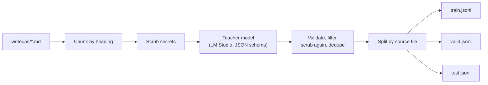

# Build a cybersecurity dataset

Your fine-tune can never be better than its data. This lesson covers the file formats the trainers expect, how much data you need, where security data can legally come from, how to generate examples with a teacher model, how to clean and split them, and ends with a script that turns your own Markdown writeups into train/valid/test files.

> [!GOALS]
> - Write training data in the chat, completions and text formats that mlx-lm and Unsloth/TRL accept
> - Judge how many examples a task needs and why quality beats quantity
> - Pick security data sources with their licences and terms in mind
> - Generate synthetic examples with a local teacher model, then clean, scrub and split them
> - Build `make_dataset.py` and produce your first `train.jsonl`, `valid.jsonl` and `test.jsonl`

## What a training example is

A fine-tuning dataset is a list of example conversations that show the model the exact behaviour you want. Each example becomes one string through the model's chat template (see [Base, instruct, thinking and chat templates](#/foundations/model-types)), and the trainer minimises the loss on the assistant part. If your examples are sloppy, the model learns sloppy. If 10% of them contain a hallucinated CVE ID, the model learns that inventing CVE IDs is part of the job.

So think of your dataset as **the specification of a behaviour**, written as examples. The same discipline you use for a test suite applies: every example should be one you would sign off on.

> [!CONCEPT] JSONL
> "JSON Lines": one complete JSON object per line, no commas between lines, no surrounding array. Trainers stream it line by line. A pretty-printed JSON file with newlines inside an object is *not* valid JSONL.

## The formats trainers accept

Both toolchains in this module read JSONL and detect the format from the keys.

### Chat format (use this one)

```json
{"messages": [{"role": "system", "content": "You are a senior application security engineer..."}, {"role": "user", "content": "Triage this httpx line..."}, {"role": "assistant", "content": "{\"asset\": \"...\"}"}]}
```

- **mlx-lm** calls this the `chat` format. The final message is treated as the completion; with `--mask-prompt` the loss is computed only on it. A `tools` variant adds a `tools` list and lets assistant messages contain `tool_calls`, for teaching tool use.
- **TRL / Unsloth** call it *conversational language modeling*. Unsloth's notebooks usually render it to a `text` column with `tokenizer.apply_chat_template(...)` and then mask everything except assistant turns with `train_on_responses_only`. TRL can do the masking itself with `assistant_only_loss=True`.

Chat format is the right default because the chat template, the special tokens and the system prompt all get rendered exactly the way LM Studio will render them at inference time.

### Completions (prompt and completion)

```json
{"prompt": "Summarise the impact of this IDOR: ...", "completion": "An authenticated user can read..."}
```

mlx-lm wraps `prompt` as a user message and `completion` as the assistant message, then applies the chat template. TRL accepts both a plain-string version and a conversational one where `prompt` and `completion` are message lists; by default it computes loss on the completion only. Handy when your data is naturally input → output pairs, but you lose the system prompt.

### Text

```json
{"text": "Any raw text. The model learns to continue it."}
```

No chat template, no masking (mlx-lm refuses `--mask-prompt` on text data). This is for continued pretraining on raw documents (see [Beyond SFT](#/finetune/beyond)), not for teaching an assistant behaviour.

### Files and splits

Put three files in one directory:

```text
~/ai-lab/finetune/data/
  train.jsonl   required: what the model learns from
  valid.jsonl   checked during training to spot overfitting (mlx-lm reports validation loss if present)
  test.jsonl    never trained on; used once at the end (mlx_lm.lora --test, and eval.py)
```

`mlx_lm.lora --data ~/ai-lab/finetune/data` looks for exactly these names. For Unsloth you load the same files with `datasets.load_dataset("json", data_files=...)`. Both ignore extra keys, so you can keep bookkeeping fields such as `task` and `source` next to `messages`.

> [!WARNING]
> Examples longer than the trainer's maximum sequence length are truncated, which can cut off the end of the assistant's answer, so the model learns answers that stop mid-sentence. mlx-lm defaults to `--max-seq-length 2048`; on a 16 GB Mac you will use 512–1,024 (see [Fine-tune on your Mac with MLX](#/finetune/mlx-mac)). Filter or split long examples *before* training. A rough rule for English and code: 1 token ≈ 4 characters (see [Tokens and tokenization](#/foundations/tokens)).

## Quality over quantity

The best-known demonstration is LIMA (Meta, 2023): a strong base model fine-tuned on only 1,000 carefully curated examples produced responses that held up well against far larger instruction datasets. The lesson generalises: a few hundred consistent, correct examples beat ten thousand noisy ones, because every inconsistency is also learned.

Rules of thumb (community experience, not laws):

| Goal | Typical size | Notes |
|---|---|---|
| Lock in a format or house style (report skeleton, strict JSON) | 100–500 | Consistency matters more than count |
| Narrow task skill (JS bundle triage, recon classification) | 500–3,000 | Cover the variety of inputs you will really see |
| Broad domain assistant | 5,000+ | Mix in general data to limit forgetting |

What "quality" means concretely:

- **Correct.** Every technical claim true; no invented CVEs, versions or payload outcomes.
- **Consistent.** Same severity scale, same headings, same JSON keys, same tone in every example.
- **Representative.** Inputs look like what you will actually paste: real httpx lines, real minified JS, real messy notes.
- **Diverse.** Many targets, vulnerability classes, lengths and phrasings, so the model learns the pattern rather than the instance.
- **Honest about uncertainty.** Include examples where the right answer is "not enough evidence; verify manually". Otherwise you train a model that always finds something.

## Where security data can come from

| Source | Terms (check the current text yourself) | How to use it |
|---|---|---|
| **Your own writeups, notes, CTF solutions** | Yours, unless written under a client contract | The best source: it is your voice and your workflow. Client reports usually belong to the client or are under NDA: do not use them unless the contract allows it, and scrub them even then |
| **MITRE ATT&CK** ([STIX data on GitHub](https://github.com/mitre-attack/attack-stix-data)) | MITRE grants a royalty-free licence for research, development and commercial use, provided you reproduce MITRE's copyright designation and the licence | Technique descriptions for "map this behaviour to ATT&CK" examples |
| **CAPEC and CWE** ([CWE downloads](https://cwe.mitre.org/data/downloads.html), [CAPEC downloads](https://capec.mitre.org/data/downloads.html)) | MITRE terms of use with a similar royalty-free licence and copyright-notice condition | Root-cause and weakness classification examples |
| **OWASP Cheat Sheet Series** ([repo](https://github.com/OWASP/CheatSheetSeries)) | CC BY-SA 4.0: attribution, and adaptations you share must carry the same licence | Remediation-writing examples. If you ever publish a dataset derived from it, it must be CC BY-SA. Whether model weights count as an "adaptation" is legally unsettled |
| **CVE List and NVD** ([cvelistV5](https://github.com/CVEProject/cvelistV5), NVD API) | CVE Program terms of use on cve.org; the NVD API terms ask apps to show "This product uses the NVD API but is not endorsed or certified by the NVD", forbid attributing modified data to NVD, and rate-limit to 5 requests per 30 s (50 with a free API key) | Teach *formats* (CVSS rationale, advisory summaries), not memorised facts; facts belong in [RAG](#/using/rag) |
| **Public disclosed reports** (HackerOne Hacktivity, Bugcrowd, vendor advisories) | Public is not the same as licensed: the text belongs to its authors, and I found no licence granting reuse. Platform terms also restrict automated access that bypasses their controls | Read them for structure and patterns, write your own examples in your own words; do not bulk-scrape |
| **Security benchmarks** (CTIBench, CyberMetric...) | Various; CTIBench is CC BY-NC-SA 4.0 | **Never train on them.** They are your evaluation yardstick (see [Evaluate your fine-tune](#/finetune/evaluate)); training on them makes the scores meaningless |

> [!DANGER]
> Never put client data, credentials, session tokens, internal hostnames or personal data of real people into a training set. A model can regurgitate training text verbatim, an adapter is a file that gets copied around, and a rented cloud GPU is someone else's computer. Scrub first; when in doubt, leave it out.

## Synthetic data with a teacher model

Writing 1,000 examples by hand is slow. The standard shortcut is **synthetic data**: a model drafts examples, you filter and review them.

> [!CONCEPT] Teacher model
> The model that writes your training examples. The model being trained is the **student**. If the teacher is stronger than the student, this is a form of **distillation** (more in [Beyond SFT](#/finetune/beyond)). If the teacher is the student itself, it mostly reformats and restructures what you give it: still useful, but it cannot teach skills it does not have.

Your teacher options:

| Teacher | Pros | Cons |
|---|---|---|
| Your local Qwen3.5-9B in LM Studio | Private, free, already running | Quality ceiling of a 9B: needs strong grounding in your source text and careful review |
| A larger open-weight model on a rented GPU | Better drafts, still under your control | Costs money; read that model's licence for conditions on using outputs |
| A frontier API (OpenAI, Anthropic, Google...) | Best drafts | Sends your text to a third party. Provider terms restrict using outputs to build competing models: OpenAI's terms prohibit using Output "to develop models that compete with OpenAI", and Anthropic's commercial terms bar using the services to build a competing product, including training competing AI models. Whether your private model counts is a legal question; read the current terms before you do it |

The pattern that works best with a 9B teacher is **grounded generation**: give it a chunk of *your* writeup and ask it to produce question/answer pairs whose facts come only from that chunk. The writeup supplies correctness; the model supplies phrasing and variety.

### Self-instruct

> [!CONCEPT] Self-instruct
> A bootstrapping recipe (Wang et al., 2022): start from a small seed set of hand-written examples, ask a model to invent new instructions in the same spirit, have it answer them, filter out low-quality and near-duplicate results, add the survivors to the pool, repeat.

For security work, self-instruct is good at broadening *inputs* (new httpx lines, new JS snippets, new report notes) and dangerous for *answers* (a 9B will invent findings). A safe hybrid: let the model generate varied inputs, and produce the answers yourself or with a stronger teacher, then review.

## Cleaning

Raw synthetic output is roughly 60–80% usable in practice. Clean it in this order:

1. **Parse and validate.** Drop anything that is not valid JSON or is missing fields. For triage examples, the assistant answer itself must parse as JSON with exactly your keys.
2. **Length filters.** Drop answers that are suspiciously short (fewer than about 40 characters) or longer than your training sequence budget.
3. **Secrets and PII scrubbing.** Regexes for private keys, AWS keys, JWTs, GitHub and Slack tokens, `password=`/`api_key=` values, email addresses, IP addresses, plus a list of client domains you replace with `target.example`. Run this on source text *before* it goes to any model, and again on the output.
4. **Deduplicate.** Exact duplicates after normalising case and whitespace, then near-duplicates (for example word-shingle overlap above 80%). Duplicates silently up-weight one example.
5. **Style consistency.** One system prompt for the whole dataset, consistent severity vocabulary, consistent headings. Fix or drop outliers.
6. **Human review.** Read a random sample of at least 30–50 examples. Nothing replaces this step.

## Train, valid and test splits

A common split is 80/10/10. The subtle part is **leakage**: if one writeup produces ten examples and they land in both train and test, the test set measures memorisation, not skill. Split **by source document**: all examples generated from one writeup go into the same split.



## The system prompt question

Whatever system prompt is in your training examples becomes part of the behaviour. If you train with "You are a senior application security engineer..." and then chat with no system prompt, you are testing a slightly different situation than the one you trained. Two sane choices:

- **One fixed system prompt** in every example, and use the same one in LM Studio and in your agents. Simple and predictable. This lesson does that.
- **A mix**: most examples with the system prompt, some with none or with variations, so the behaviour generalises.

Also decide about thinking. Qwen3.5's chat template renders an assistant turn with an empty `<think>` block when there is no reasoning, so examples without reasoning teach the model to answer directly, which suits format-heavy tasks such as JSON triage. If you want to keep the thinking mode strong, include reasoning in most examples (Unsloth suggests at least 75%) and evaluate with thinking on.

## Lab: make_dataset.py

> [!LAB] Turn your writeups into a dataset
> 1. Set up the workspace and dependencies:
>    `mkdir -p ~/ai-lab/finetune/writeups ~/ai-lab/finetune/data && cd ~/ai-lab/finetune`
>    `python3 -m venv .venv && source .venv/bin/activate && pip install openai`
> 2. Copy at least three of your own Markdown writeups or notes (CTF solutions, lab notes, your own bug bounty reports) into `~/ai-lab/finetune/writeups/`. Optionally create `redact.txt` with one real domain or name per line to be replaced with `target.example`.
> 3. In LM Studio, load your model, start the server, and confirm the model id with `lms ls` (update `MODEL` in the script if needed).
> 4. Save the script below as `make_dataset.py` and run `python make_dataset.py --per-chunk 4`.
> 5. Check the counts it prints, then open `data/train.jsonl` and read 30 random lines: `shuf -n 30 data/train.jsonl | python -m json.tool --json-lines | less` (install `shuf` via `brew install coreutils` if it is missing, or use `gshuf`).
> 6. Fix or delete bad lines by hand. Re-run whenever you add writeups; the split is deterministic per file name.

```python title="make_dataset.py"
#!/usr/bin/env python3
"""Turn your own Markdown writeups into chat-format fine-tuning data.

Reads ~/ai-lab/finetune/writeups/*.md, asks the local model in LM Studio to draft
instruction/response pairs grounded in each section, cleans them, and writes
data/train.jsonl, data/valid.jsonl and data/test.jsonl, split by source file.
"""
from __future__ import annotations

import argparse
import hashlib
import json
import random
import re
import sys
from pathlib import Path

from openai import OpenAI

BASE_URL = "http://localhost:1234/v1"
MODEL = "qwen3.5-9b-uncensored-hauhaucs-aggressive"  # check yours: `lms ls`
ROOT = Path.home() / "ai-lab" / "finetune"

SYSTEM_PROMPT = (
    "You are a senior application security engineer helping with authorized testing "
    "(bug bounty scope, own labs, CTFs). Be precise, base claims on the evidence given, "
    "never invent CVE IDs or results, and say when something needs manual verification."
)

TASKS = ["report", "js", "triage", "explain"]
TRIAGE_KEYS = {"asset", "category", "severity", "confidence", "evidence", "next_steps",
               "in_scope_check_required"}

# JSON schema the teacher must follow (LM Studio enforces it via response_format).
PAIRS_SCHEMA = {
    "type": "object",
    "properties": {
        "pairs": {
            "type": "array",
            "items": {
                "type": "object",
                "properties": {
                    "task": {"type": "string", "enum": TASKS},
                    "instruction": {"type": "string"},
                    "response": {"type": "string"},
                },
                "required": ["task", "instruction", "response"],
            },
        }
    },
    "required": ["pairs"],
}

TEACHER_PROMPT = """Below is one section of a security writeup written by me.
Create up to {n} training examples for an assistant that helps with authorized security testing.
Each example has:
- task: one of "report" (write or rewrite a report section from rough notes),
  "js" (analyse a JavaScript snippet: endpoints, parameters, secrets to check, next steps),
  "triage" (classify recon tool output), "explain" (explain a technique, root cause or fix).
- instruction: what a user would type, INCLUDING any input data (notes, code, tool output)
  copied or adapted from the section.
- response: the ideal answer.
Rules:
- Use only facts present in the section. Never invent CVE IDs, versions, hostnames or results.
- Keep placeholders such as target.example as they are.
- For "triage", the response must be ONE JSON object with exactly these keys:
  asset, category, severity (info|low|medium|high|critical), confidence (low|medium|high),
  evidence (list of strings), next_steps (list of strings), in_scope_check_required (boolean).
- Only produce task types the section genuinely supports.

SECTION (from {source}):
---
{chunk}
---"""

SECRET_PATTERNS = [
    (re.compile(r"-----BEGIN [A-Z ]*PRIVATE KEY-----[\s\S]+?-----END [A-Z ]*PRIVATE KEY-----"),
     "[REDACTED_PRIVATE_KEY]"),
    (re.compile(r"\b(?:AKIA|ASIA)[0-9A-Z]{16}\b"), "[REDACTED_AWS_KEY]"),
    (re.compile(r"\beyJ[A-Za-z0-9_-]{10,}\.[A-Za-z0-9_-]{10,}\.[A-Za-z0-9_-]{10,}\b"), "[REDACTED_JWT]"),
    (re.compile(r"\bgh[pousr]_[A-Za-z0-9]{36,}\b"), "[REDACTED_GITHUB_TOKEN]"),
    (re.compile(r"\bxox[abprs]-[A-Za-z0-9-]{10,}\b"), "[REDACTED_SLACK_TOKEN]"),
    (re.compile(r"(?i)\b(api[_-]?key|secret|token|passw(?:or)?d)(\s*[:=]\s*)['\"]?[^\s'\"]{6,}"),
     r"\1\2[REDACTED]"),
    (re.compile(r"\b[A-Za-z0-9._%+-]+@[A-Za-z0-9.-]+\.[A-Za-z]{2,}\b"), "user@example.com"),
    (re.compile(r"\b(?:\d{1,3}\.){3}\d{1,3}\b"), "192.0.2.10"),  # RFC 5737 documentation IP
]


def load_redactions(path: Path) -> list[str]:
    if not path.exists():
        return []
    return [line.strip() for line in path.read_text().splitlines() if line.strip()]


def scrub(text: str, redactions: list[str]) -> str:
    for word in redactions:  # client names and domains first
        text = re.sub(re.escape(word), "target.example", text, flags=re.IGNORECASE)
    for pattern, replacement in SECRET_PATTERNS:
        text = pattern.sub(replacement, text)
    return text


def chunk_markdown(text: str, max_chars: int = 6000) -> list[str]:
    """Split on level-2/3 headings, then hard-split anything still too long."""
    parts = re.split(r"\n(?=#{2,3} )", text)
    chunks: list[str] = []
    for part in parts:
        part = part.strip()
        while len(part) > max_chars:
            chunks.append(part[:max_chars])
            part = part[max_chars:]
        if len(part) > 200:  # skip tiny fragments
            chunks.append(part)
    return chunks


def ask_teacher(client: OpenAI, chunk: str, source: str, n: int) -> list[dict]:
    resp = client.chat.completions.create(
        model=MODEL,
        messages=[{"role": "user",
                   "content": TEACHER_PROMPT.format(n=n, source=source, chunk=chunk)}],
        temperature=0.7,  # some variety in phrasing
        max_tokens=4000,
        response_format={"type": "json_schema",
                         "json_schema": {"name": "pairs", "schema": PAIRS_SCHEMA}},
    )
    content = resp.choices[0].message.content or ""
    content = re.sub(r"<think>[\s\S]*?</think>", "", content).strip()  # in case thinking leaks
    try:
        return json.loads(content).get("pairs", [])
    except json.JSONDecodeError:
        return []


def valid_pair(p: dict) -> bool:
    if p.get("task") not in TASKS:
        return False
    ins, out = p.get("instruction", "").strip(), p.get("response", "").strip()
    if not (10 <= len(ins) <= 4000 and 40 <= len(out) <= 6000):
        return False
    if p["task"] == "triage":  # the answer itself must be strict JSON with our keys
        try:
            obj = json.loads(out)
        except json.JSONDecodeError:
            return False
        return isinstance(obj, dict) and set(obj) == TRIAGE_KEYS
    return True


def normalise(text: str) -> str:
    return re.sub(r"\W+", " ", text.lower()).strip()


def shingles(text: str, k: int = 5) -> set[str]:
    words = normalise(text).split()
    return {" ".join(words[i:i + k]) for i in range(max(1, len(words) - k + 1))}


def dedupe(records: list[dict], threshold: float = 0.8) -> list[dict]:
    seen_hashes: set[str] = set()
    kept: list[dict] = []
    kept_shingles: list[set[str]] = []
    for rec in records:
        key = normalise(rec["instruction"] + " " + rec["response"])
        h = hashlib.sha256(key.encode()).hexdigest()
        if h in seen_hashes:
            continue
        sh = shingles(rec["instruction"])
        if any(len(sh & other) / max(1, len(sh | other)) > threshold for other in kept_shingles):
            continue  # near-duplicate instruction
        seen_hashes.add(h)
        kept_shingles.append(sh)
        kept.append(rec)
    return kept


def to_chat(rec: dict) -> dict:
    return {
        "messages": [
            {"role": "system", "content": SYSTEM_PROMPT},
            {"role": "user", "content": rec["instruction"]},
            {"role": "assistant", "content": rec["response"]},
        ],
        "task": rec["task"],      # bookkeeping fields; trainers ignore them
        "source": rec["source"],
    }


def split_files(files: list[str], seed: int) -> dict[str, str]:
    """Assign whole source files to splits so no writeup leaks across them."""
    files = sorted(files)
    random.Random(seed).shuffle(files)
    n = len(files)
    n_test = max(1, round(n * 0.1))
    n_valid = max(1, round(n * 0.1))
    assignment = {}
    for i, f in enumerate(files):
        assignment[f] = "test" if i < n_test else "valid" if i < n_test + n_valid else "train"
    return assignment


def main() -> None:
    ap = argparse.ArgumentParser(description=__doc__)
    ap.add_argument("--writeups", type=Path, default=ROOT / "writeups")
    ap.add_argument("--out", type=Path, default=ROOT / "data")
    ap.add_argument("--per-chunk", type=int, default=4)
    ap.add_argument("--seed", type=int, default=42)
    args = ap.parse_args()

    files = sorted(args.writeups.glob("*.md"))
    if len(files) < 3:
        sys.exit(f"Need at least 3 .md files in {args.writeups} (one each for train/valid/test).")

    redactions = load_redactions(ROOT / "redact.txt")
    client = OpenAI(base_url=BASE_URL, api_key="lm-studio")
    raw: list[dict] = []
    for path in files:
        chunks = chunk_markdown(path.read_text(encoding="utf-8", errors="ignore"))
        print(f"{path.name}: {len(chunks)} chunks")
        for chunk in chunks:
            for p in ask_teacher(client, scrub(chunk, redactions), path.name, args.per_chunk):
                p = {k: scrub(str(v), redactions) for k, v in p.items()}  # scrub outputs again
                p["source"] = path.name
                raw.append(p)

    good = [p for p in raw if valid_pair(p)]
    unique = dedupe(good)
    print(f"generated {len(raw)}, valid {len(good)}, after dedupe {len(unique)}")

    assignment = split_files([f.name for f in files], args.seed)
    args.out.mkdir(parents=True, exist_ok=True)
    counts = {"train": 0, "valid": 0, "test": 0}
    handles = {s: open(args.out / f"{s}.jsonl", "w", encoding="utf-8") for s in counts}
    try:
        for rec in unique:
            split = assignment[rec["source"]]
            handles[split].write(json.dumps(to_chat(rec), ensure_ascii=False) + "\n")
            counts[split] += 1
    finally:
        for h in handles.values():
            h.close()
    print(counts)


if __name__ == "__main__":
    main()
```

Expected output with five writeups (your numbers will differ):

```text
idor-orders.md: 4 chunks
js-recon-notes.md: 6 chunks
...
generated 112, valid 87, after dedupe 79
{'train': 61, 'valid': 9, 'test': 9}
```

That is a starter set, not a finished dataset. Grow it by adding writeups, by hand-writing examples for gaps you notice, and by repeating the review step.

> [!TIP]
> With only a handful of writeups the split is lumpy (one file might hold 30% of all examples). Once you have 20+ source files the 80/10/10 file split evens out. Until then, check that `test.jsonl` covers all four task types; if not, move a file by hand.

> [!NOTE]
> `response_format` with `json_schema` asks LM Studio to constrain generation to your schema (see [Structured output and tool calling](#/using/structured-output-tools)). The script still parses defensively and strips `<think>` blocks, because a malformed or truncated response should cost you one chunk, not crash the run.

## Three example records

These are what good records look like, shown pretty-printed. In the JSONL file each is a single line, and each carries the same system prompt as the script (omitted here for space).

**1. Report writing (`task: report`)**

```json
{
  "messages": [
    {"role": "system", "content": "You are a senior application security engineer..."},
    {"role": "user", "content": "Turn these notes into the Impact section of a bug bounty report:\n- GET /api/v2/orders/{id} returns any order if you change id\n- tested only between my two test accounts (attacker, victim)\n- response has full name, shipping address, phone, card last4\n- ids look sequential"},
    {"role": "assistant", "content": "## Impact\n\nAny authenticated user can read other customers' orders by changing the numeric `id` in `GET /api/v2/orders/{id}`. The endpoint verifies that the caller is logged in but not that the order belongs to them (an insecure direct object reference).\n\nEach order exposes the customer's full name, shipping address, phone number and the last four digits of the payment card. Because order IDs appear to be sequential, an attacker could enumerate them and collect this data at scale.\n\nI confirmed the issue only between two test accounts I control and did not access any other customer's data. Enumeration at scale was not attempted."}
  ],
  "task": "report",
  "source": "idor-orders.md"
}
```

**2. JS analysis (`task: js`)**

```json
{
  "messages": [
    {"role": "system", "content": "You are a senior application security engineer..."},
    {"role": "user", "content": "Analyse this snippet from main.4f2a.js:\n\nconst API=\"https://api.target.example\";\nfetch(`${API}/internal/v1/users/${uid}/export?format=csv`,{headers:{Authorization:`Bearer ${t}`}});\nconst MAPS_KEY=\"[REDACTED]\";\nif(user.role===\"admin\"){router.push(\"/admin/billing\")}"},
    {"role": "assistant", "content": "### Endpoints\n- `GET https://api.target.example/internal/v1/users/{uid}/export?format=csv` (bearer token)\n- Client route `/admin/billing`\n\n### Parameters\n- `uid` (path): user identifier, candidate for IDOR testing\n- `format` (query): `csv` seen; test other values such as `json` or `xlsx`\n\n### Secrets to check\n- `MAPS_KEY` is embedded in the bundle. Check its restrictions (HTTP referrer, API scope) before reporting; many map keys are meant to be public.\n\n### Client-side authorization\n- The admin route is gated only by `user.role` in the browser. That proves nothing about the server; check whether the API endpoints behind `/admin/billing` enforce the role.\n\n### Next steps\n1. Confirm `api.target.example` and `/internal/` paths are in scope.\n2. With two test accounts, request the export with the other account's `uid`.\n3. Call the billing API endpoints as a non-admin test user."}
  ],
  "task": "js",
  "source": "js-recon-notes.md"
}
```

**3. Recon triage as strict JSON (`task: triage`)**

```json
{
  "messages": [
    {"role": "system", "content": "You are a senior application security engineer..."},
    {"role": "user", "content": "Triage this httpx result. Return JSON only.\nhttps://jenkins.dev.target.example [200] [Dashboard [Jenkins]] [Jetty(10.0.13)] [Jenkins:2.387]"},
    {"role": "assistant", "content": "{\"asset\": \"jenkins.dev.target.example\", \"category\": \"exposed-admin-interface\", \"severity\": \"medium\", \"confidence\": \"medium\", \"evidence\": [\"HTTP 200 on / with title 'Dashboard [Jenkins]'\", \"Jenkins 2.387 detected on Jetty 10.0.13\"], \"next_steps\": [\"Confirm the host is in scope in the program policy\", \"Check whether the dashboard is readable without authentication, without creating accounts or running jobs\", \"Look up advisories for the detected version in NVD; do not assume a CVE applies without confirming\"], \"in_scope_check_required\": true}"}
  ],
  "task": "triage",
  "source": "recon-dev-hosts.md"
}
```

Notice what these teach beyond format: stating the testing boundary, refusing to claim impact that was not demonstrated, checking scope first, and not inventing CVEs for a version string. Those habits are exactly what fine-tuning is good at.

## Recap

- Use chat-format JSONL (`{"messages": [...]}`) in `train.jsonl`, `valid.jsonl`, `test.jsonl`. mlx-lm and TRL/Unsloth both accept it; completions and text formats exist for other cases.
- A few hundred correct, consistent examples beat thousands of noisy ones. Include "needs manual verification" answers.
- Check terms per source: MITRE data under a royalty-free licence with attribution, OWASP Cheat Sheets under CC BY-SA 4.0, NVD API terms with a notice and rate limits, disclosed reports are not licensed for reuse, benchmarks are for evaluation only.
- Generate with a teacher grounded in your own text. Frontier API terms restrict training competing models on their outputs.
- Clean in order: validate, filter length, scrub secrets and PII, dedupe, enforce style, review by hand. Split by source document to avoid leakage.

## Check yourself

1. Why should all examples generated from one writeup land in the same split?
   <details><summary>Answer</summary>

   Examples from the same writeup share facts and phrasing. If some are in train and others in test, the test set rewards memorisation and overstates how well the model generalises to new material.

   </details>
2. Your triage examples sometimes use `"sev"` and sometimes `"severity"`. What will the fine-tuned model do, and how does `make_dataset.py` prevent it?
   <details><summary>Answer</summary>

   It will learn both and switch between them unpredictably, breaking any parser downstream. The script requires triage answers to parse as JSON with exactly the `TRIAGE_KEYS` set and drops everything else.

   </details>
3. You want to use OWASP Cheat Sheet text and publish the resulting dataset on Hugging Face. What licence obligation applies?
   <details><summary>Answer</summary>

   CC BY-SA 4.0: give attribution, and release your adapted dataset under the same licence (share-alike).

   </details>
4. Why is it a bad idea to put CTIBench questions into your training data?
   <details><summary>Answer</summary>

   You would be training on your own exam. The benchmark score would then measure memorisation instead of capability, so you lose your only independent yardstick. (CTIBench's licence is also non-commercial share-alike.)

   </details>
5. Name three things that must be scrubbed before a writeup goes to any teacher model.
   <details><summary>Answer</summary>

   Any of: credentials and tokens (API keys, JWTs, private keys, passwords), client names and domains, personal data such as emails, and internal IP addresses or hostnames.

   </details>

## Go deeper
- [LIMA: Less Is More for Alignment (Zhou et al., 2023)](https://arxiv.org/abs/2305.11206) — the 1,000-example result behind "quality over quantity"
- [Self-Instruct (Wang et al., 2022)](https://arxiv.org/abs/2212.10560) — the bootstrapping recipe for synthetic instructions, with its filtering steps
- [TRL dataset formats](https://huggingface.co/docs/trl/dataset_formats) — every format TRL and Unsloth accept, including tool calling and preference data
- [mlx-lm LoRA guide](https://github.com/ml-explore/mlx-lm/blob/main/mlx_lm/LORA.md) — the data section lists the chat, tools, completions and text formats
- [MITRE ATT&CK terms of use](https://attack.mitre.org/resources/legal-and-branding/terms-of-use/) — the licence text to reproduce if you use ATT&CK content
