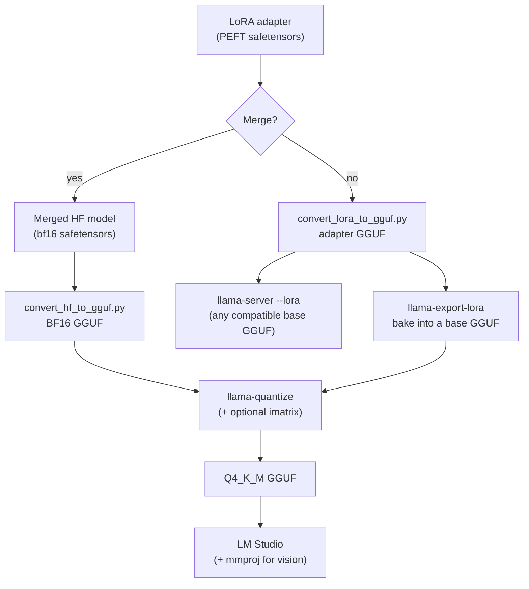

# Merge, convert to GGUF, load in LM Studio

You have an adapter. LM Studio runs GGUF files. This lesson is the bridge: merging the adapter into full weights, converting to GGUF with llama.cpp, quantizing to Q4_K_M (optionally with an importance matrix), keeping the chat template and vision encoder intact, and importing the result into LM Studio. It also covers the route where the adapter stays a separate file, which is how you can try your fine-tune on top of the HauhauCS model.

> [!GOALS]
> - Choose between merged models and separate adapters, and know which tools accept which
> - Merge a LoRA into its base with PEFT, and know why MLX-fused Qwen3.5 is a dead end for GGUF
> - Convert with `convert_hf_to_gguf.py`, quantize with `llama-quantize`, and optionally build an imatrix
> - Convert an adapter with `convert_lora_to_gguf.py` and use it in `llama-server`, including on the HauhauCS GGUF
> - Import into LM Studio with the chat template and `mmproj` intact, then sanity-test

## The map



Unsloth's `save_pretrained_gguf` (previous lesson) runs the left-hand path for you in one call. If you already have a `Q4_K_M.gguf` from the cloud, you can jump to the "Import into LM Studio" section below. Read the rest anyway: you will need it for importance matrices, for the HauhauCS experiment, and when an export goes wrong.

> [!NOTE]
> As far as I could verify, LM Studio's documentation does not describe loading a separate LoRA adapter file onto a model. Plan to **merge** for LM Studio, and use llama.cpp's `llama-server` when you want hot-swappable adapters.

## Why merge at all

> [!CONCEPT] Merging an adapter
> Computing `W' = W + (alpha / r) · B·A` for every adapted matrix and saving W' as ordinary weights. The merged model is the same size and speed as the base and needs no adapter support from the runtime. You lose the ability to switch the adapter off, so keep the adapter file too.

Merge **into a 16-bit base**, then quantize once. If you merge into an already-quantized base, the adapter's small changes get rounded again on top of the original quantization error.

## Route 1: merge with PEFT

**PEFT** (Hugging Face's adapter library) can load your adapter on its base and merge it. Where to run it matters:

> [!MAC]
> Merging the 9B means holding about 19 GB of bf16 weights in RAM. On a 16 GB Mac that pushes into swap and can take a very long time. Merge the 9B on the cloud instance where you trained it (Unsloth's `save_pretrained_merged(..., save_method="merged_16bit")` does exactly this), or on any machine with 32 GB or more of RAM. Merging a 2B or 4B adapter on your Mac is fine.

```python title="merge_lora.py"
"""Merge a PEFT LoRA adapter into Qwen3.5 and save full bf16 weights."""
import sys

import torch
from peft import PeftModel
from transformers import AutoProcessor, Qwen3_5ForConditionalGeneration

BASE = "Qwen/Qwen3.5-9B"          # must be the exact base you trained on
ADAPTER = "qwen35-9b-sec-lora"    # folder with adapter_config.json + adapter_model.safetensors
OUT = "qwen35-9b-sec-merged"


def main() -> None:
    # The full multimodal class keeps the vision weights, which the mmproj export needs later.
    base = Qwen3_5ForConditionalGeneration.from_pretrained(BASE, dtype=torch.bfloat16)
    model = PeftModel.from_pretrained(base, ADAPTER)

    # PEFT matches adapter tensors to module names. If the names did not match
    # (e.g. the adapter was trained on a different model class), nothing is injected.
    n_lora = sum(1 for name, _ in model.named_modules() if name.endswith("lora_A"))
    if n_lora == 0:
        sys.exit("No LoRA layers were injected: module names did not match. Merge where you trained.")
    print(f"LoRA layers injected: {n_lora}")

    merged = model.merge_and_unload()           # W + scale * B @ A, adapter removed
    merged.save_pretrained(OUT)                 # safetensors
    AutoProcessor.from_pretrained(BASE).save_pretrained(OUT)  # tokenizer, chat template, image config


if __name__ == "__main__":
    main()
```

The injected-layer check matters more than it looks. Adapter weights are keyed by module path, and Qwen3.5 can be loaded as a text-only class (`Qwen3_5ForCausalLM`) or the full multimodal class (`Qwen3_5ForConditionalGeneration`), which nest the language model under different names. If the class differs from the one used in training, PEFT may silently attach nothing and you would ship the unmodified base. When in doubt, merge in the same environment that trained the adapter.

### Why not the MLX-fused model?

`mlx_lm.fuse` works, but for Qwen3.5 its output is in mlx-lm's internal layout: keys renamed, linear-attention convolution weights transposed, norm weights stored with an offset folded in, vision and multi-token-prediction weights dropped. llama.cpp's converter expects the original Hugging Face layout and will produce a broken model from it. For an MLX-trained Qwen3.5 adapter, run the fused model in MLX (LM Studio's MLX engine or `mlx_lm.server`, see [Fine-tune on your Mac with MLX](#/finetune/mlx-mac)), and use the PEFT/Unsloth route when you need a GGUF.

## Route 2: convert to GGUF with llama.cpp

### Build llama.cpp

You need the repository anyway (the converter scripts live in it), so build from source. Metal is enabled by default on macOS.

```bash
mkdir -p ~/ai-lab/tools && cd ~/ai-lab/tools
git clone https://github.com/ggml-org/llama.cpp
cd llama.cpp
cmake -B build
cmake --build build --config Release -j
```

Set up the converter's Python environment:

```bash
python3 -m venv .venv && source .venv/bin/activate
pip install -r requirements.txt
pip install -U transformers
```

The second install is deliberate: llama.cpp's quantize README notes that its requirements pin Transformers 4 for compatibility while newer models need Transformers 5, and Qwen3.5 is one of them.

> [!NOTE]
> Recent llama.cpp releases also ship a single `llama` command with subcommands (`llama cli`, `llama serve`, `llama quantize`...). The source build still produces the classic `build/bin/llama-quantize`, `llama-imatrix`, `llama-server` and `llama-export-lora` binaries used below. Run any of them with `--help` to confirm flags on your version.

### Convert to a 16-bit GGUF

`convert_hf_to_gguf.py` supports Qwen3.5 (it registers `Qwen3_5ForConditionalGeneration` and `Qwen3_5ForCausalLM`).

```bash
mkdir -p ~/ai-lab/finetune/gguf
python convert_hf_to_gguf.py ~/ai-lab/finetune/cloud/qwen35-9b-sec-merged \
  --outtype bf16 \
  --outfile ~/ai-lab/finetune/gguf/qwen35-9b-sec-BF16.gguf
```

- `--outtype` accepts `f32`, `f16`, `bf16`, `q8_0` (plus ternary types and `auto`). Use `bf16` to match the training precision; `auto` picks the highest-fidelity 16-bit type and also works.
- The converter reads tensors lazily, so it runs on a 16 GB Mac; budget about 19 GB of disk for the 9B's output.
- It copies the tokenizer and the **chat template** from the model folder into the GGUF metadata. That is why the merge script saves the processor files next to the weights.

> [!TIP]
> Add `--dry-run` first to see what the converter plans to write without writing anything. If it complains about an unknown architecture, your llama.cpp checkout is too old: `git pull` and rebuild.

### Quantize to Q4_K_M

```bash
./build/bin/llama-quantize \
  ~/ai-lab/finetune/gguf/qwen35-9b-sec-BF16.gguf \
  ~/ai-lab/finetune/gguf/qwen35-9b-sec-Q4_K_M.gguf \
  Q4_K_M
```

Q4_K_M is the same quantization type your HauhauCS file uses (see [Precision, quantization and file formats](#/foundations/quantization)), so the result is about the same size (5.3–5.6 GB) and the same speed. Always quantize from the 16-bit file, never from another quantized file.

### Optional: an importance matrix

> [!CONCEPT] Importance matrix (imatrix)
> Statistics about which weights matter most, collected by running the model over sample text. `llama-quantize` uses it to spend its precision where it counts, which usually lowers the quality loss of 4-bit and smaller quants. The sample text is called **calibration data**.

For a fine-tune, calibrate on text that looks like its job: your rendered training conversations plus some general text.

```bash
python - <<'EOF'
import json, pathlib
src = pathlib.Path.home() / "ai-lab/finetune/data/train.jsonl"
out = pathlib.Path.home() / "ai-lab/finetune/gguf/calibration.txt"
with out.open("w") as f:
    for line in src.open():
        for m in json.loads(line)["messages"]:
            f.write(m["content"] + "\n\n")
print(out, out.stat().st_size, "bytes")
EOF
```

Then compute the matrix and quantize with it:

```bash
./build/bin/llama-imatrix -m ~/ai-lab/finetune/gguf/qwen35-9b-sec-BF16.gguf \
  -f ~/ai-lab/finetune/gguf/calibration.txt -o ~/ai-lab/finetune/gguf/imatrix.gguf -ngl 99
./build/bin/llama-quantize --imatrix ~/ai-lab/finetune/gguf/imatrix.gguf \
  ~/ai-lab/finetune/gguf/qwen35-9b-sec-BF16.gguf \
  ~/ai-lab/finetune/gguf/qwen35-9b-sec-Q4_K_M.gguf Q4_K_M
```

> [!MAC]
> `llama-imatrix` has to run the model, and a 19 GB BF16 file does not fit in 16 GB. Either compute it on the cloud box before you tear it down, or (common community practice, with a small accuracy cost) make a Q8_0 first (`llama-quantize ... Q8_0`, about 9.5 GB) and run `llama-imatrix` on that, then still quantize from the BF16 file. Mixing in some general text keeps the imatrix from over-specialising.

### The vision encoder (mmproj)

Your LoRA trained only language layers, so the vision encoder and projector are unchanged from the base model. To keep image input working, you need an `mmproj` GGUF next to the model. Two options:

- **Export it from the HF weights.** The merge script kept the vision weights, so:

```bash
python convert_hf_to_gguf.py ~/ai-lab/finetune/cloud/qwen35-9b-sec-merged --mmproj \
  --outtype bf16 --outfile ~/ai-lab/finetune/gguf/mmproj-qwen35-9b-sec-BF16.gguf
```

  If your merged folder has no vision weights (some text-only exports drop them), run the same command on the official `Qwen/Qwen3.5-9B` download instead; the vision weights are identical.
- **Reuse an existing Qwen3.5-9B mmproj**, such as the one you already downloaded for HauhauCS. It encodes the same vision tower. A projector must come from the same base model family and size; one from a different model will not work.

Either way, test it with a real image afterwards.

## Route 3: keep the adapter separate

A merged model is easiest for LM Studio. A separate adapter is better when you want to toggle it, scale it, stack several, or apply it to a *different* base GGUF.

### Convert the adapter

```bash
python convert_lora_to_gguf.py ~/ai-lab/finetune/cloud/qwen35-9b-sec-lora \
  --base-model-id Qwen/Qwen3.5-9B \
  --outtype f16 \
  --outfile ~/ai-lab/finetune/gguf/qwen35-9b-sec-lora-F16.gguf
```

- The positional argument is the PEFT adapter folder (`adapter_config.json` plus `adapter_model.safetensors`).
- The converter needs only the base model's **config**, not its weights: `--base-model-id` fetches it from the Hub, or `--base <folder>` points at a local folder with `config.json` and tokenizer files. Without either it tries `base_model_name_or_path` from `adapter_config.json`.
- `--outtype` accepts `f32` (the default), `f16`, `bf16`, `q8_0` or `auto`. The adapter is small, so `f16` is fine.
- Qwen3.5's linear-attention layers need a head reordering during conversion; llama.cpp's converter applies the matching reordering to LoRA tensors too.

### Use it with llama-server

```bash
./build/bin/llama-server -m ~/models/Qwen3.5-9B-Q4_K_M.gguf \
  --lora ~/ai-lab/finetune/gguf/qwen35-9b-sec-lora-F16.gguf \
  --host 127.0.0.1 --port 8081
```

`--lora-scaled FILE:SCALE` applies an adapter at a chosen strength (0.5 = half effect), comma-separated values stack several adapters, and `--lora-init-without-apply` loads adapters at scale 0 so you can switch them per request through the server's `/lora-adapters` endpoint or the `lora` field of a request. The base GGUF must be the same model the adapter was trained on: an official Qwen3.5-9B quant (Unsloth and lmstudio-community both publish `Qwen3.5-9B-GGUF` repos) or one you quantized yourself.

### Bake it into a GGUF

`llama-export-lora` merges a GGUF adapter into a GGUF base and writes a new GGUF (16-bit by default), which you then quantize as before:

```bash
./build/bin/llama-export-lora -m ~/models/Qwen3.5-9B-BF16.gguf \
  --lora ~/ai-lab/finetune/gguf/qwen35-9b-sec-lora-F16.gguf \
  -o ~/ai-lab/finetune/gguf/qwen35-9b-sec-exported-F16.gguf
```

## Your fine-tune on top of HauhauCS (experimental)

This is the question you have been waiting for. You cannot train on HauhauCS (GGUF only), but HauhauCS is the official Qwen3.5-9B with comparatively small weight edits to remove refusals. An adapter learns a *difference* from the official base, so it can be applied to a close derivative. Whether it behaves well is an empirical question, not a guarantee.

Three ways to get an uncensored model with your fine-tuned habits:

| Approach | How | Trade-off |
|---|---|---|
| **Adapter on HauhauCS at runtime** | `llama-server -m Qwen3.5-9B-Uncensored-HauhauCS-Aggressive-Q4_K_M.gguf --lora qwen35-9b-sec-lora-F16.gguf` | Quick to try and easy to compare against scale 0; needs llama-server, not LM Studio |
| **Bake the adapter into HauhauCS** | `llama-export-lora -m Qwen3.5-9B-Uncensored-HauhauCS-Aggressive-BF16.gguf --lora ... -o ...`, then `llama-quantize` to Q4_K_M, then import to LM Studio | Works in LM Studio. Needs the 17.9 GB BF16 download plus about the same again for the output |
| **Train on an uncensored safetensors base** | Use `huihui-ai/Huihui-Qwen3.5-9B-abliterated` as the Unsloth `model_name` | Clean train/merge/convert path; a different uncensoring method, so different behaviour |
| **Abliterate your own fine-tune** | Fine-tune the official model, then remove the refusal direction yourself | Full control; covered in [Direction ablation: editing weights](#/weights/direction-ablation) |

> [!WARNING]
> Whatever route you take, evaluate two things separately: did the trained habits survive (task score), and did the uncensoring survive (does it still answer your legitimate security prompts without refusals or new disclaimers)? An adapter trained on the official base learned in the presence of the base's refusal behaviour and may partly pull it back. Measure; do not assume. [Evaluate your fine-tune](#/finetune/evaluate) builds the harness.

## Import into LM Studio

LM Studio keeps models in `~/.lmstudio/models/<publisher>/<model>/` (the same structure as Hugging Face). The easiest way to place a file there is `lms import`:

```bash
lms import ~/ai-lab/finetune/gguf/qwen35-9b-sec-Q4_K_M.gguf --copy --user-repo sethu/qwen35-9b-sec
```

- `--copy` keeps the original (the default is to move the file); `--symbolic-link` leaves it where it is.
- `--user-repo` sets the `<publisher>/<model>` folder and skips the interactive questions; `--dry-run` shows what would happen.

Put the vision encoder in the same folder:

```bash
cp ~/ai-lab/finetune/gguf/mmproj-qwen35-9b-sec-BF16.gguf ~/.lmstudio/models/sethu/qwen35-9b-sec/
ls -lh ~/.lmstudio/models/sethu/qwen35-9b-sec/
```

LM Studio detects an `mmproj` file sitting next to the model (community-reported behaviour; keep `mmproj` in the file name and avoid non-ASCII folder names). A quick way to get the layout right is to copy whatever your existing HauhauCS install looks like: `ls -R ~/.lmstudio/models | grep -i -B2 hauhau`.

Then confirm LM Studio sees it and load it:

```bash
lms ls
lms load qwen35-9b-sec
```

(Use the exact key `lms ls` prints.) In the app, the model should show the same vision indicator as your HauhauCS model if the mmproj was picked up.

## Keep the chat template intact

The template is stored inside the GGUF as metadata, copied from the model folder at conversion time. Check it before you trust any output:

```python title="show_template.py"
"""Print the chat template stored in a GGUF file."""
import sys

from gguf import GGUFReader  # pip install gguf (or use llama.cpp/gguf-py)


def main() -> None:
    reader = GGUFReader(sys.argv[1])
    field = reader.fields.get("tokenizer.chat_template")
    if field is None:
        sys.exit("No chat template in this GGUF: LM Studio will fall back to a guess.")
    template = field.contents()
    print(template[:1500])
    print("...\nlength:", len(template))


if __name__ == "__main__":
    main()
```

```bash
python show_template.py ~/ai-lab/finetune/gguf/qwen35-9b-sec-Q4_K_M.gguf
```

You should see the Qwen3.5 template with `<|im_start|>`, the `<think>` handling and the `enable_thinking` branch. Then watch what LM Studio actually sends to the model:

```bash
lms log stream
```

Send one message in the chat and read the formatted prompt in the log. If LM Studio's template differs from the one you trained with, override it in the model's settings (My Models, gear icon, Prompt Template) as described in [System prompts, templates, thinking and presets](#/lmstudio/prompts-templates).

## Sanity tests

> [!LAB] Ship-readiness checklist for your fine-tuned GGUF
> 1. **Size and speed.** The Q4_K_M file should be about the size of HauhauCS's (5.3–5.6 GB) and generate at a similar speed in LM Studio.
> 2. **Template.** `show_template.py` prints the Qwen3.5 template; `lms log stream` shows `<|im_start|>` markers and the system prompt you trained with.
> 3. **Stopping.** Ask a short question. The answer must end cleanly. Rambling past the answer or printing `<|im_end|>` as text means an end-of-sequence mismatch.
> 4. **Thinking.** With thinking off, there should be no reasoning text. With it on, check reasoning still appears if you trained to keep it.
> 5. **Trained habits.** Rerun your baseline prompts from the MLX lesson: exact JSON keys, scope checks, no invented CVEs.
> 6. **General ability.** Ask three unrelated questions (an explanation, a short Python function, a summary). A sharp drop signals catastrophic forgetting.
> 7. **Vision.** Attach a screenshot of an HTTP response and ask what it shows (only if you placed the mmproj).
> 8. **Run the evaluation harness** from the next lesson before you replace your daily model.

## Recap

- For LM Studio, merge the adapter into a 16-bit base, convert, then quantize once. Keep the adapter file as well.
- Merge with PEFT `merge_and_unload()` (or Unsloth `save_pretrained_merged`), on a machine with enough RAM for the 9B, and verify that LoRA layers were actually injected. MLX-fused Qwen3.5 is not a valid GGUF source.
- `convert_hf_to_gguf.py --outtype bf16 --outfile ...` then `llama-quantize in out Q4_K_M`; optionally `llama-imatrix` with calibration text close to the model's job.
- `convert_lora_to_gguf.py` produces an adapter GGUF for `llama-server --lora`, or for `llama-export-lora` to bake into any compatible base, including the HauhauCS BF16 (experimental; evaluate it).
- `lms import --copy --user-repo you/model`, put `mmproj-*.gguf` next to the model, verify the chat template, then run the sanity checklist.

## Check yourself

1. Why should you merge into a bf16 base and quantize afterwards rather than merging into a Q4_K_M base?
   <details><summary>Answer</summary>

   The adapter's changes are small. Merging into already-quantized weights and re-quantizing rounds them on top of the existing quantization error, which can wash them out. Merging in 16-bit and quantizing once keeps them as intact as possible.

   </details>
2. Your merge script prints "LoRA layers injected: 0". What happened?
   <details><summary>Answer</summary>

   PEFT could not match the adapter's module names to the loaded model, usually because the model class (text-only versus multimodal) differs from the one used in training. Without the check, you would have saved the unmodified base. Merge in the training environment or load the matching class.

   </details>
3. You want image input to keep working with your fine-tune. What file do you need, and why can you reuse the HauhauCS one?
   <details><summary>Answer</summary>

   An `mmproj` GGUF (the vision encoder and projector) in the same folder as the model. Your LoRA only changed language layers, so the vision tower is the official Qwen3.5-9B one, which is the same tower the HauhauCS mmproj encodes.

   </details>
4. Why does `llama-imatrix` on the BF16 9B struggle on your Mac, and what are two workarounds?
   <details><summary>Answer</summary>

   The BF16 file is about 19 GB and has to be run, which exceeds 16 GB of unified memory. Compute the imatrix on the cloud instance, or compute it on a Q8_0 copy (about 9.5 GB) and still quantize from the BF16 file.

   </details>
5. How would you check whether your adapter works on HauhauCS without committing disk space to a baked model?
   <details><summary>Answer</summary>

   Convert it with `convert_lora_to_gguf.py` and run `llama-server -m <HauhauCS Q4_K_M> --lora <adapter.gguf>`, comparing against the same server with the adapter at scale 0 (`--lora-init-without-apply` or `--lora-scaled`). Evaluate task quality and refusals separately.

   </details>

## Go deeper
- [llama.cpp quantize README](https://github.com/ggml-org/llama.cpp/blob/master/tools/quantize/README.md) — conversion and quantization walkthrough, all `llama-quantize` options, quality tables
- [llama.cpp imatrix README](https://github.com/ggml-org/llama.cpp/blob/master/tools/imatrix/README.md) — calibration data, options and examples
- [llama.cpp server README](https://github.com/ggml-org/llama.cpp/blob/master/tools/server/README.md) — `--lora`, `--lora-scaled` and the `/lora-adapters` endpoint
- [PEFT LoRA developer guide](https://huggingface.co/docs/peft/main/en/developer_guides/lora) — merging, unloading and combining adapters
- [Unsloth: deploying to LM Studio](https://unsloth.ai/docs/basics/inference-and-deployment/lm-studio) — `lms import` options and template troubleshooting
