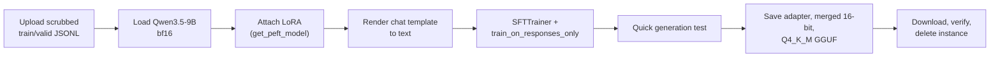

# Fine-tune in the cloud with Unsloth

Your Mac can train the 2B; the 9B you actually use needs a bigger GPU. This lesson rents one for a few hours, trains a bf16 LoRA on Qwen3.5-9B with Unsloth using the dataset you already built, and brings back a small adapter and a ready-to-run GGUF, without leaking anything you would not want on someone else's computer.

> [!GOALS]
> - Choose between Colab and rented GPUs, and size the GPU for each Qwen3.5 model
> - Apply a threat model to cloud training: what goes up, who can see it, what you delete
> - Run the Unsloth flow for Qwen3.5: load, attach LoRA, format chat data, mask prompts, train
> - Explain every hyperparameter you set
> - Save the LoRA adapter, a merged 16-bit model and a Q4_K_M GGUF, and bring them home

## Why cloud

Two reasons: memory and speed.

- **Memory.** Unsloth's Qwen3.5 guide lists approximate GPU memory for bf16 LoRA: 0.8B about 3 GB, 2B about 5 GB, 4B about 10 GB, **9B about 22 GB**. Your Mac's GPU can wire about 10–11 GB by default. The 9B does not fit, and as you saw in [Fine-tune on your Mac with MLX](#/finetune/mlx-mac), MLX's training path for Qwen3.5's linear-attention layers is slow even when it does.
- **Speed.** On NVIDIA GPUs the Gated DeltaNet layers have optimized training kernels, and Unsloth adds its own. A run that would take a night on the Air (if it fit) takes tens of minutes on a datacenter GPU.

> [!CONCEPT] Unsloth
> An open-source library that patches Hugging Face Transformers, PEFT and TRL with faster kernels and memory savings for fine-tuning. You write ordinary TRL code (`SFTTrainer`, `SFTConfig`) with Unsloth's model loader in front. It also exports straight to GGUF. It targets NVIDIA (and AMD) GPUs, not Apple Silicon training.

> [!NOTE]
> Why not QLoRA to squeeze the 9B onto a 16 GB GPU? Unsloth's Qwen3.5 guide explicitly says it does not recommend QLoRA (4-bit) training for Qwen3.5, dense or MoE, because of larger-than-normal quantization differences. Use bf16 LoRA (`load_in_16bit=True`). If you ever must use 4-bit, evaluate the result carefully against a bf16 run.

## Where to rent: Colab vs GPU clouds

| Option | What you get | Fits | Watch out for |
|---|---|---|---|
| **Google Colab (free)** | A notebook with a shared GPU (typically a 16 GB T4), session time limits | Qwen3.5-0.8B, 2B, 4B (Unsloth has free notebooks for these) | Not enough for the 9B in bf16; sessions disconnect; files vanish when the runtime ends |
| **Colab paid tiers** | Access to bigger GPUs such as L4 or A100 when available | 9B on A100 | Availability varies; still tied to your Google account and Drive |
| **RunPod, Lambda** | A whole GPU VM or container you SSH into, billed by the hour | Anything you pay for | You manage the box: SSH keys, open ports, teardown |
| **Vast.ai** | A marketplace of GPUs, many hosted by third parties | Anything, often cheaper | The host operator has physical access to the machine; treat it as untrusted |

GPU sizing for the 9B bf16 LoRA (about 22 GB by Unsloth's figure, before you lengthen sequences or raise the batch):

| GPU memory | Example cards | Verdict |
|---|---|---|
| 16 GB | T4, many consumer cards | Does not fit the 9B in bf16 |
| 24 GB | L4, A10, RTX 4090, RTX 3090 | Tight; batch 1, `max_seq_length` 1024–2048 |
| 40–48 GB | A100 40GB, L40S, RTX A6000 | Comfortable; recommended |
| 80 GB | A100 80GB, H100 | Room for long sequences and bigger batches |

Prices move constantly; compare on the providers' pricing pages and remember you also pay for storage while a stopped instance keeps its disk.

## Threat-model the run first

You are a security engineer; treat a rented GPU like any other third-party host (see [Threat-model your own AI setup](#/security/ai-threat-model)).

> [!DANGER]
> A rented GPU is someone else's computer. The provider (and on a marketplace, an individual host) can in principle read its disk and memory. **Never upload client data, engagement reports, credentials or anything under NDA.** Upload only the scrubbed dataset from [Build a cybersecurity dataset](#/finetune/dataset), and only if you would be comfortable with it leaking.

A checklist that takes five minutes:

- [ ] The dataset is scrubbed (rerun the scrubber; grep for your clients' domains).
- [ ] You connect with an SSH key you can revoke; no password logins.
- [ ] Jupyter or any web UI listens on `127.0.0.1` and you reach it through an SSH tunnel, not a public port.
- [ ] No Hugging Face token on the box unless needed. Qwen3.5 is Apache-2.0 and not gated, so downloads need no token. If you must push, use a fine-grained write token for one private repo and revoke it afterwards.
- [ ] Nothing is pushed to a public repo by accident (`push_to_hub` calls in copied notebooks).
- [ ] After download: checksums verified, then the instance **and** its volumes are deleted.

The SSH tunnel pattern, from your Mac:

```bash
ssh -i ~/.ssh/gpu_rental -L 8888:127.0.0.1:8888 user@<instance-ip>
```

Then start Jupyter (or Unsloth Studio) on the instance bound to localhost and open `http://localhost:8888` on your Mac. Unsloth's docs show `unsloth studio -H 0.0.0.0 -p 8888`; on a rented machine prefer `-H 127.0.0.1` plus the tunnel so the UI is never exposed to the internet.

## The Unsloth flow for Qwen3.5



### Step 0: environment

Unsloth's install steps change with CUDA, PyTorch and Transformers versions, and Qwen3.5 needs Transformers v5. The most reliable approach is to copy the install cell from Unsloth's current Qwen3.5 notebook (linked in Go deeper). On a fresh CUDA box the basic route is:

```bash
python3 -m venv .venv && source .venv/bin/activate
pip install --upgrade unsloth unsloth_zoo
python -c "import unsloth, transformers, trl; print(transformers.__version__, trl.__version__)"
```

> [!TIP]
> Unsloth warns that the first Qwen3.5 run can be slow to start because it compiles custom Triton kernels for the linear-attention layers. A long pause before the first training step is expected.

Copy your data up from the Mac:

```bash
rsync -av -e "ssh -i ~/.ssh/gpu_rental" ~/ai-lab/finetune/data/ user@<instance-ip>:~/finetune/data/
```

### Step 1: load the model

```python title="train_qwen35_9b.py (part 1)"
from unsloth import FastLanguageModel  # import unsloth before transformers/trl

MAX_SEQ_LENGTH = 2048

model, tokenizer = FastLanguageModel.from_pretrained(
    model_name="unsloth/Qwen3.5-9B",   # Unsloth's mirror; "Qwen/Qwen3.5-9B" also works
    max_seq_length=MAX_SEQ_LENGTH,
    load_in_4bit=False,                # no QLoRA for Qwen3.5 (Unsloth's advice)
    load_in_16bit=True,                # bf16 LoRA
    full_finetuning=False,
)
```

> [!NOTE]
> Unsloth has three loaders. `FastLanguageModel` is the one its Qwen3.5 guide uses for text fine-tuning of the dense models (0.8B–27B). `FastModel` is shown for the MoE variants. `FastVisionModel` is for training the vision side with image data. Qwen3.5 is natively multimodal, but text-only SFT goes through `FastLanguageModel`.

### Step 2: attach LoRA

```python title="train_qwen35_9b.py (part 2)"
model = FastLanguageModel.get_peft_model(
    model,
    r=16,
    lora_alpha=16,
    lora_dropout=0,
    bias="none",
    target_modules=[
        "q_proj", "k_proj", "v_proj", "o_proj",   # the 8 full-attention layers
        "gate_proj", "up_proj", "down_proj",      # the MLP in every layer
        "out_proj",                               # Gated DeltaNet output projection
    ],
    use_gradient_checkpointing="unsloth",       # Unsloth's lower-memory checkpointing
    random_state=3407,
    max_seq_length=MAX_SEQ_LENGTH,
)
model.print_trainable_parameters()
```

The target list is the one Unsloth's Qwen3.5 notebook uses. `out_proj` is the output projection of the linear-attention blocks (the Hugging Face weight names are `linear_attn.out_proj`), so the 24 Gated DeltaNet layers get adapters too, not only the 8 full-attention layers.

### Step 3: render the chat data

Unsloth's notebooks turn each conversation into one string with the model's own chat template, then train on that `text` column.

```python title="train_qwen35_9b.py (part 3)"
from datasets import load_dataset

ds = load_dataset("json", data_files={
    "train": "data/train.jsonl",
    "validation": "data/valid.jsonl",
})


def to_text(batch):
    texts = [
        tokenizer.apply_chat_template(msgs, tokenize=False, add_generation_prompt=False)
        for msgs in batch["messages"]
    ]
    return {"text": texts}


ds = ds.map(to_text, batched=True, remove_columns=ds["train"].column_names)
print(ds["train"][0]["text"][:800])  # eyeball it: <|im_start|>system ... <|im_start|>assistant ...
```

Look at the printed sample. With Qwen3.5's template, the final assistant turn of an example without reasoning is rendered with an empty `<think>` block before the answer. That teaches the non-thinking style, which matches running the model with thinking off. If you want the fine-tune to keep its thinking ability, include reasoning in most examples (Unsloth suggests at least 75%) and evaluate with thinking on.

### Step 4: trainer, masking, train

```python title="train_qwen35_9b.py (part 4)"
from trl import SFTTrainer, SFTConfig
from unsloth.chat_templates import train_on_responses_only

trainer = SFTTrainer(
    model=model,
    tokenizer=tokenizer,                  # as in Unsloth's notebooks (plain TRL names this processing_class)
    train_dataset=ds["train"],
    eval_dataset=ds["validation"],
    args=SFTConfig(
        dataset_text_field="text",
        max_length=MAX_SEQ_LENGTH,
        per_device_train_batch_size=2,
        gradient_accumulation_steps=4,    # effective batch 8
        num_train_epochs=2,
        learning_rate=2e-4,
        warmup_steps=10,
        lr_scheduler_type="linear",
        optim="adamw_8bit",
        weight_decay=0.001,
        logging_steps=5,
        eval_strategy="steps",
        eval_steps=25,
        save_steps=25,
        output_dir="outputs_qwen35_9b",
        seed=3407,
        report_to="none",                 # no third-party experiment tracking
        dataset_num_proc=1,
    ),
)

# Compute loss only on assistant turns: everything up to "<|im_start|>assistant\n" is masked.
trainer = train_on_responses_only(
    trainer,
    instruction_part="<|im_start|>user\n",
    response_part="<|im_start|>assistant\n",
)

# Verify the masking on one example: only the answer should survive.
row = trainer.train_dataset[0]
print(tokenizer.decode([t for t, l in zip(row["input_ids"], row["labels"]) if l != -100]))

trainer.train()
```

> [!CONCEPT] Train on responses only
> Sets the label of every non-assistant token to -100, the value PyTorch's loss ignores. The model still *reads* the system prompt and the user message, it just is not graded on predicting them. Same idea as `--mask-prompt` in MLX and `assistant_only_loss=True` in plain TRL.

You should see `loss` decrease in the logs and `eval_loss` reported every 25 steps. The same reading rules as on the Mac apply: training loss falling with eval loss rising means overfitting, and `nan` means the learning rate is too high.

### Step 5: quick generation test

```python title="train_qwen35_9b.py (part 5)"
FastLanguageModel.for_inference(model)

messages = [
    {"role": "system", "content": "You are a senior application security engineer helping with "
     "authorized testing (bug bounty scope, own labs, CTFs). Be precise, base claims on the evidence "
     "given, never invent CVE IDs or results, and say when something needs manual verification."},
    {"role": "user", "content": "Triage this httpx result. Return JSON only. "
     "https://jenkins.dev.target.example [200] [Dashboard [Jenkins]] [Jetty(10.0.13)]"},
]
inputs = tokenizer.apply_chat_template(
    messages, add_generation_prompt=True, tokenize=True,
    return_tensors="pt", return_dict=True, enable_thinking=False,
).to("cuda")
out = model.generate(**inputs, max_new_tokens=400, temperature=0.7, top_p=0.8, top_k=20)
print(tokenizer.decode(out[0][inputs["input_ids"].shape[1]:], skip_special_tokens=True))
```

This is a smoke test, not an evaluation. The real comparison against the base model happens at home in [Evaluate your fine-tune](#/finetune/evaluate).

### Step 6: save three artifacts

```python title="train_qwen35_9b.py (part 6)"
# 1. The adapter: tens to hundreds of MB. Always keep this.
model.save_pretrained("qwen35-9b-sec-lora")
tokenizer.save_pretrained("qwen35-9b-sec-lora")

# 2. A merged 16-bit Hugging Face model (~19 GB). Optional: lets you run llama.cpp's
#    converter yourself, e.g. to build an importance-matrix quant.
model.save_pretrained_merged("qwen35-9b-sec-merged", tokenizer, save_method="merged_16bit")

# 3. A ready-to-run GGUF. Unsloth runs llama.cpp's converter and quantizer for you.
model.save_pretrained_gguf("qwen35-9b-sec-gguf", tokenizer, quantization_method="q4_k_m")
```

Other `quantization_method` values include `"q8_0"` and `"f16"`; you can also pass a list to produce several. Find the output with `ls -lh qwen35-9b-sec-gguf/` and look for the file ending in `Q4_K_M.gguf`.

> [!WARNING]
> Unsloth's most common "it got worse after export" cause is a chat template or end-of-sequence token mismatch at inference time: the runtime must use the same chat template you trained with. The next lesson shows how to check this in LM Studio.

### Step 7: bring it home and tear down

```bash
rsync -av --progress -e "ssh -i ~/.ssh/gpu_rental" \
  user@<instance-ip>:~/finetune/qwen35-9b-sec-lora ~/ai-lab/finetune/cloud/
rsync -av --progress -e "ssh -i ~/.ssh/gpu_rental" \
  user@<instance-ip>:~/finetune/qwen35-9b-sec-gguf ~/ai-lab/finetune/cloud/
```

Verify integrity by running `sha256sum` on the instance and `shasum -a 256` on the Mac over the same files and comparing. Then delete the instance and any attached volume in the provider's console, and revoke the SSH key and any token you used.

## The hyperparameters, explained

| Parameter | What it does | Starting value and why |
|---|---|---|
| `r` | LoRA rank: capacity of the adapter (see [Training 101](#/finetune/concepts)) | 16. Style and format tasks rarely need more; raise to 32 for a harder skill |
| `lora_alpha` | Scales the adapter output by `alpha / r` | Equal to `r` (Unsloth's Qwen3.5 example) or `2 × r`; higher alpha acts like a higher learning rate |
| `lora_dropout` | Randomly zeroes adapter inputs during training to fight overfitting | 0 (Unsloth's optimized path); raise to 0.05 if you overfit a small dataset |
| `target_modules` | Which projections get adapters | Attention + MLP + `out_proj`, as above |
| `learning_rate` | Step size | 2e-4 for short LoRA runs; Unsloth's notebooks suggest dropping toward 2e-5 for long runs |
| `warmup_steps` | Ramp the learning rate up from zero at the start, avoiding an early shock | 5–10% of total steps |
| `num_train_epochs` / `max_steps` | How long to train: whole passes, or a fixed number of updates | 1–3 epochs; `max_steps` for quick trials |
| `per_device_train_batch_size` × `gradient_accumulation_steps` | Effective batch size per optimizer update | 2 × 4 = 8; lower the first if you run out of memory |
| `max_length` | Token cap per example (longer ones are truncated) | 2048; must cover your longest example |
| `optim` | Optimizer. `adamw_8bit` stores Adam's running averages in 8-bit to save memory | `adamw_8bit` |
| `weight_decay` | Gently pulls weights toward zero, a mild regulariser | 0.001–0.01 |
| `lr_scheduler_type` | How the learning rate changes over the run | `linear` or `cosine` decay |
| `use_gradient_checkpointing` | Recompute activations instead of storing them | `"unsloth"` |
| `eval_steps` | How often to compute validation loss | Often enough to see a trend: 10–20 points per run |
| `seed` / `random_state` | Makes runs reproducible | Any fixed number |

Change one thing at a time between runs and keep notes; otherwise you cannot tell which change helped.

## Variations worth knowing

- **Smaller models first.** Swap `model_name` to `unsloth/Qwen3.5-4B` or `unsloth/Qwen3.5-2B` and the same script runs on a free Colab T4 (about 10 GB and 5 GB respectively by Unsloth's table). Good for checking your pipeline cheaply before paying for an A100 hour.
- **An uncensored training base.** HauhauCS publishes GGUF only, so you cannot train on it. `huihui-ai/Huihui-Qwen3.5-9B-abliterated` is published as safetensors under Apache-2.0 and is a drop-in `model_name`. It is a different uncensoring (its card calls the method a crude proof-of-concept), so its behaviour differs from HauhauCS; evaluate refusals and quality yourself. The other routes (apply your adapter to the HauhauCS GGUF, or abliterate your own fine-tune) are in the next lesson.
- **Unsloth Studio.** A web UI for the same workflow (pick model and dataset, set hyperparameters, train, export). Useful once you understand the code path above. Bind it to localhost and tunnel to it.
- **Reinforcement learning.** Unsloth supports GRPO on Qwen3.5 (with `fast_inference=False`, using Unsloth's own inference) and has a Qwen3.5-4B GRPO notebook. See [Beyond SFT](#/finetune/beyond).

## Recap

- The 9B needs about 22 GB for bf16 LoRA by Unsloth's figure: rent a 40–48 GB GPU for comfort, 24 GB if you keep sequences short. Free Colab handles up to the 4B.
- Unsloth advises against QLoRA for Qwen3.5; use `load_in_16bit=True`.
- Treat the rented box as untrusted: scrubbed data only, SSH keys, localhost-bound UIs over a tunnel, no stray tokens, delete instance and volumes afterwards.
- Flow: `FastLanguageModel.from_pretrained` → `get_peft_model` (attention, MLP and `out_proj`) → render the chat template to `text` → `SFTTrainer` + `train_on_responses_only` → test → save.
- Save the adapter (`save_pretrained`), optionally a merged 16-bit model (`save_pretrained_merged`, `"merged_16bit"`), and a GGUF (`save_pretrained_gguf`, `"q4_k_m"`).

## Check yourself

1. Why does a free Colab T4 work for the Qwen3.5-4B LoRA but not the 9B?
   <details><summary>Answer</summary>

   A T4 has 16 GB. Unsloth lists about 10 GB for a 4B bf16 LoRA and about 22 GB for the 9B, and it does not recommend 4-bit QLoRA for Qwen3.5 as a way to squeeze the 9B in.

   </details>
2. What does `train_on_responses_only` change about the data, and how do you check it worked?
   <details><summary>Answer</summary>

   It sets the labels of every token outside assistant responses to -100, so they are ignored by the loss. Check by decoding only the tokens whose label is not -100 for one example: you should see the assistant answer and nothing from the system or user turns.

   </details>
3. Your fine-tuned GGUF behaves noticeably worse in LM Studio than in the notebook's quick test. What is the first thing to check?
   <details><summary>Answer</summary>

   The chat template and end-of-sequence token used at inference. If LM Studio formats the conversation differently from training (or thinking is on when you trained without it), the model sees an unfamiliar prompt.

   </details>
4. Why add `out_proj` to `target_modules` for Qwen3.5 specifically?
   <details><summary>Answer</summary>

   It is the output projection of the Gated DeltaNet linear-attention blocks, which make up 24 of the 32 layers. Without it, attention-side adapters would land only on the 8 full-attention layers.

   </details>
5. Name three things you delete or revoke after the run.
   <details><summary>Answer</summary>

   The instance, its storage volumes, and the SSH key and any Hugging Face token you placed on it (plus any accidental pushes to a hub repo).

   </details>

## Go deeper
- [Unsloth Qwen3.5 fine-tuning guide](https://unsloth.ai/docs/models/qwen3.5/fine-tune) — the source for the VRAM table, the QLoRA warning, notebook links and export options
- [Unsloth LoRA hyperparameters guide](https://unsloth.ai/docs/get-started/fine-tuning-llms-guide/lora-hyperparameters-guide) — deeper discussion of rank, alpha, learning rate and epochs
- [Unsloth: saving to GGUF](https://unsloth.ai/docs/basics/inference-and-deployment/saving-to-gguf) — every export method and quantization option
- [TRL SFTTrainer documentation](https://huggingface.co/docs/trl/sft_trainer) — dataset formats, `assistant_only_loss`, `completion_only_loss` and all `SFTConfig` fields
- [Hugging Face PEFT](https://huggingface.co/docs/peft/index) — the adapter library underneath, including how LoRA weights are stored and merged
