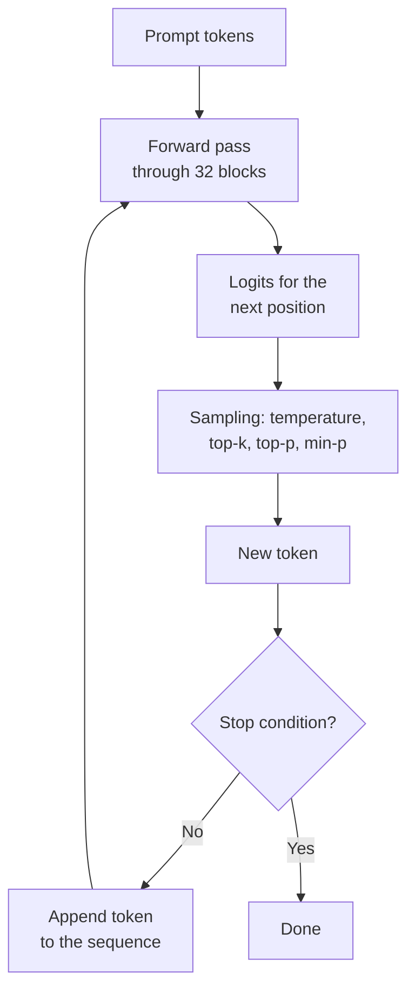

# How text gets generated

The transformer turns your prompt into 248,320 scores, one per possible next token. But a score isn't a word. This lesson covers everything between those scores and the text appearing in LM Studio: turning scores into probabilities, choosing a token (and what temperature, top-k, top-p and min-p really do), the loop that repeats this hundreds of times, why the first token takes longer than the rest, the KV cache, how generation stops, and why models sometimes get stuck repeating themselves forever.

> [!GOALS]
> - Convert logits to probabilities with softmax, by hand
> - Explain greedy decoding, sampling, temperature, top-k, top-p and min-p, with the math
> - Describe the autoregressive loop and the difference between prefill and decode
> - Estimate your Mac's generation speed from memory bandwidth, and explain time to first token
> - Explain what the KV cache saves, how generation stops, and why repetition loops happen
> - Measure the effect of temperature on diversity, quality and speed

## From logits to probabilities

At the end of [the transformer](#/foundations/transformer), the output head produces one number per vocabulary token.

> [!CONCEPT] Logits
> The raw scores the model outputs for every token in its vocabulary, before they're turned into probabilities. They can be any real number, positive or negative. Only their *differences* matter: a token with a logit 2 higher than another will end up about 7.4 times as likely (e² ≈ 7.39).

Say the prompt is `My go-to language for a quick exploit PoC is` and, of the 248,320 logits, these five are the ones that matter:

| Token | Logit |
|---|---|
| ` Python` | 4.0 |
| ` Bash` | 3.0 |
| ` Go` | 2.5 |
| ` Rust` | 2.0 |
| ` COBOL` | −1.0 |

To get probabilities, the model applies **softmax**: raise *e* (≈ 2.718) to the power of each logit, which makes everything positive and stretches the gaps, then divide by the total so it all sums to 1.

> [!CONCEPT] Softmax
> The function that turns logits into a probability distribution: `p_i = e^(logit_i) / sum of e^(logit_j)` over all tokens. Larger logits get exponentially larger shares. The results are all positive and sum to 1.

Worked through:

```text
e^4.0  = 54.60      ( Python)
e^3.0  = 20.09      ( Bash)
e^2.5  = 12.18      ( Go)
e^2.0  =  7.39      ( Rust)
e^-1.0 =  0.37      ( COBOL)
total  = 94.62

p( Python) = 54.60 / 94.62 = 0.577
p( Bash)   = 20.09 / 94.62 = 0.212
p( Go)     = 12.18 / 94.62 = 0.129
p( Rust)   =  7.39 / 94.62 = 0.078
p( COBOL)  =  0.37 / 94.62 = 0.004
```

In the real model, the total runs over all 248,320 tokens, but almost all of them have tiny probabilities, so a handful of candidates usually hold most of the mass. That long tail of tiny probabilities turns out to matter, as you'll see below.

## Choosing a token: greedy vs sampling

Now the model has a distribution. Which token comes out?

**Greedy decoding** always picks the most probable token: ` Python`, every time. It's deterministic: same prompt, same output. That's useful for extraction and classification, where you want consistency. Its weaknesses: the text tends to be bland, and it's prone to falling into repetition loops (more on that later), because nothing ever pushes it off a well-worn path.

**Sampling** picks randomly, weighted by the probabilities: ` Python` 57.7% of the time, ` Bash` 21.2%, and so on. Output varies from run to run and reads more naturally.

> [!CONCEPT] Sampling
> Choosing the next token at random according to its probability, like rolling a weighted die. The random number generator can be given a **seed**, so the same seed, prompt and settings reproduce the same output. All the knobs below (temperature, top-k, top-p, min-p) change the shape of the distribution before the die is rolled.

## Temperature

**Temperature** reshapes the distribution by dividing every logit by a number T before softmax:

```text
p_i = softmax(logit_i / T)
```

Here's the same example at three temperatures. At T = 0.5 the logits double (4.0 becomes 8.0, −1.0 becomes −2.0), so the gaps between them double too:

```text
T = 0.5:  logits  8.0,  6.0,  5.0,  4.0,  -2.0
          e^x     2981, 403.4, 148.4, 54.6, 0.14     total 3587.5
          p       0.831, 0.112, 0.041, 0.015, 0.000
```

| Token | T = 0.5 | T = 1.0 | T = 1.5 |
|---|---|---|---|
| ` Python` | 0.831 | 0.577 | 0.459 |
| ` Bash` | 0.112 | 0.212 | 0.235 |
| ` Go` | 0.041 | 0.129 | 0.169 |
| ` Rust` | 0.015 | 0.078 | 0.121 |
| ` COBOL` | 0.000 | 0.004 | 0.016 |

- **T < 1 sharpens** the distribution: the favourite gets more dominant. Output is more focused and repeatable.
- **T = 1** leaves the model's own distribution unchanged.
- **T > 1 flattens** it: unlikely tokens get a bigger share. Output is more varied, and riskier.
- **T = 0** would mean dividing by zero, so runtimes treat it as greedy decoding.

Look at ` COBOL`: at T = 1.5 it has a 1.6% chance, about 1 in 63. That sounds small, but a 500-token answer rolls the die 500 times. At high temperature, *some* low-probability tokens almost certainly get picked somewhere, and the model must then continue from whatever odd word it just produced. That's how high temperature derails into nonsense: not one big mistake, but a drift that compounds.

> [!CONCEPT] Temperature
> A divisor applied to the logits before softmax. Below 1 it makes the model more confident and deterministic; above 1 it makes it more adventurous and error-prone; 0 means greedy. Qwen recommends 0.6 in thinking mode and 0.7 in non-thinking mode for this model family.

## Cutting off the tail: top-k, top-p and min-p

Temperature alone has a problem. Even at sensible temperatures, the long tail of the 248,320-token distribution holds thousands of junk tokens. Each is tiny, but together they can add up to a few percent, enough to produce occasional garbage. **Truncation** methods remove the tail before sampling, then renormalize the survivors so they sum to 1 again.

### Top-k

Keep only the k most probable tokens. With k = 3 in the T = 1 example, ` Python`, ` Bash` and ` Go` survive. Simple, but blunt: k is fixed no matter how confident the model is. When one token has 99% probability, k = 20 still keeps 19 bad options; when 50 tokens are all reasonable, k = 20 cuts good ones. Qwen recommends top-k 20 for this model, mainly as a safety net.

### Top-p (nucleus sampling)

Sort tokens by probability and keep the smallest set whose probabilities add up to at least p. With p = 0.8 at T = 1:

```text
 Python  0.577   running total 0.577   (< 0.8, keep going)
 Bash    0.212   running total 0.789   (< 0.8, keep going)
 Go      0.129   running total 0.918   (>= 0.8, stop: Go is included)
 Rust, COBOL     dropped

renormalize over 0.918:   Python 0.628,  Bash 0.231,  Go 0.141
```

Unlike top-k, the number of survivors adapts. When the model is confident, a single token may pass 0.8 on its own. When it's unsure, many tokens are needed to reach it. Qwen recommends top-p 0.95 in thinking mode and 0.8 in non-thinking mode.

### Min-p

Keep every token whose probability is at least `min_p × (probability of the top token)`. With min-p = 0.1 at T = 1, the threshold is 0.1 × 0.577 = 0.0577:

```text
 Python 0.577  keep     Bash 0.212  keep     Go 0.129  keep
 Rust   0.078  keep     COBOL 0.004  drop   (below 0.0577)
```

Min-p scales with the model's confidence. If the top token has 0.95, the threshold becomes 0.095 and almost everything else is cut. If the top token has only 0.2, the threshold drops to 0.02 and many options stay. That property makes it popular for higher temperatures. Qwen's recommendation for this model is min-p 0, which turns it off.

| Method | Keeps | Adapts to confidence? | Qwen3.5 recommendation |
|---|---|---|---|
| Temperature | All tokens, reshaped | n/a | 0.6 thinking / 0.7 non-thinking |
| Top-k | The k most likely | No | 20 |
| Top-p | Smallest set summing to ≥ p | Yes | 0.95 thinking / 0.8 non-thinking |
| Min-p | Tokens with p ≥ min_p × p_max | Yes | 0 (off) |

> [!NOTE]
> Runtimes apply these steps in a particular order (llama.cpp uses a configurable "sampler chain"), and the order can change the result slightly, for example whether temperature is applied before or after truncation. You don't need to tune the order. Just know it exists if two tools give different results with "the same" settings. Where each knob lives in LM Studio, plus the penalty settings, is covered in [Sampling and inference settings](#/lmstudio/sampling-settings).

Play with it. The widget below shows a next-token distribution. Move temperature, top-k, top-p and min-p and watch which tokens survive and how their probabilities shift.

<div data-widget="sampler"></div>

Things to try: set temperature to 0.1 and watch one token take everything. Push it to 2.0 and see the tail come alive. Then, at 2.0, turn on min-p 0.1 and see how much of that tail it cuts.

## The autoregressive loop

One forward pass gives one token. To write a paragraph, the model runs a loop: predict a token, append it to the input, predict again.



> [!CONCEPT] Autoregressive generation
> Producing text one token at a time, where each new token is fed back in as input for the next step. The model never plans a whole sentence at once; any "plan" exists only as information in the residual stream at the current position. It also means an early bad token can't be taken back, and everything after it is conditioned on it.

## Prefill vs decode: why the first token is slow

The loop has two very different phases, and they explain almost everything about speed.

> [!CONCEPT] Prefill and decode
> **Prefill** is processing the whole prompt. All prompt tokens are known in advance, so they go through the model together, in parallel. It's limited by raw compute (GPU arithmetic). The time it takes is most of the **time to first token (TTFT)**. **Decode** is generating the answer, one token per forward pass, because each token depends on the previous one. It's limited by **memory bandwidth**, because every step has to read the model's weights from memory.

### Decode: one full read of the weights per token

To produce each token, every weight matrix in all 32 blocks is multiplied by that one token's vector. So every decode step reads essentially the whole model from memory: about 5.63 GB for your Q4_K_M file. The GPU can do the arithmetic for one token much faster than memory can deliver 5.63 GB, so the GPU spends most of its time waiting for data. That gives a simple estimate:

```text
max tokens per second  ≈  memory bandwidth  ÷  bytes read per token
```

| Chip | Bandwidth | Ceiling (÷ 5.63 GB) | Realistic (70–85%) |
|---|---|---|---|
| M1 | 68 GB/s | 12.1 tok/s | ~8–10 tok/s |
| M2 / M3 | 100 GB/s | 17.8 tok/s | ~12–15 tok/s |
| M4 | 120 GB/s | 21.3 tok/s | ~15–18 tok/s |
| M5 | 153 GB/s | 27.2 tok/s | ~19–23 tok/s |

Does this rule hold up? The community llama.cpp benchmark for Apple Silicon measured about 21.7 tok/s for a 7B model at Q4_0 (a ~3.8 GB file) on a base M2: the ceiling would be 100 ÷ 3.8 ≈ 26 tok/s, so that's about 83% of it. Two refinements make the real number move a little: the embedding table isn't fully read (only one row per token), which helps slightly, and at long contexts reading the KV cache adds traffic, which hurts slightly. Qwen3.5's linear-attention layers are newer in llama.cpp than classic attention, so your efficiency may be lower than the benchmark. You'll measure it.

The rule also explains things you'll see later. A Q8_0 file (9.53 GB) generates about 40% slower than Q4_K_M (5.63 GB), because there are more bytes to read per token. Sampling settings, on the other hand, barely affect speed: picking a token from a distribution is trivial compared with reading 5.6 GB.

### Prefill: compute-bound and parallel

During prefill, each weight read from memory gets used for *every* prompt token at once, so memory isn't the bottleneck; arithmetic is. On an Air, prompt processing for a model this size runs very roughly 100–250 tokens per second depending on the chip and its GPU core count (the same benchmark measured about 145–180 tok/s for a 7B model on M2s; a 9B model is somewhat slower). So:

```text
short question (50 tokens):         TTFT ≈ well under a second
pasted HTTP response (2,000 tokens): TTFT ≈ 2,000 ÷ (100 to 250) ≈ 8–20 s
large log file (20,000 tokens):      TTFT ≈ 1.5–3+ minutes
```

That's why trimming what you paste matters so much ([Tokens and tokenization](#/foundations/tokens)): prompt length mostly shows up as waiting time before the first word, and generation length shows up as tokens per second.

| You change... | Affects TTFT? | Affects tok/s? |
|---|---|---|
| Prompt length | Yes, roughly linearly | Slightly (longer KV reads) |
| Quantization (Q4 → Q8) | Somewhat | Yes, roughly in proportion to file size |
| Temperature, top-k, top-p | No | No (negligible) |
| Thinking mode on | No | No, but many more tokens are generated, so answers take longer |
| Thermal throttling | Yes | Yes |

## The KV cache

During decode, the new token's attention needs the keys and values of *every* earlier token ([Inside the transformer](#/foundations/transformer)). Thanks to the causal mask, those earlier keys and values never change when a new token is added. So instead of recomputing them for the whole sequence at every step, the runtime computes each token's keys and values once and stores them.

> [!CONCEPT] KV cache
> Stored keys and values for every token processed so far, kept per attention layer, so each decode step only computes the new token's keys and values and reuses the rest. Without it, generating token 1,000 would mean reprocessing all 999 before it, and generation cost would grow quadratically. Its price is memory that grows with context length.

Your model has a twist. Only its 8 full-attention layers keep a growing KV cache: 32 KiB per token, so 1 GiB at 32K context and 4 GiB at 128K. The 24 Gated DeltaNet layers don't need one: their fixed-size memory matrices (about 50 MB in total) already summarize everything seen so far, and they're simply carried forward from token to token. The full memory arithmetic, including how to pick a context length for 16 GB, is in [Memory math: will it fit?](#/foundations/memory-math).

The cache also explains a multi-turn effect. In a chat, each new message resends the whole conversation, but runtimes can reuse the cache for the part that hasn't changed, so only the new message needs prefilling and follow-up turns start quickly. Edit an early message or change the system prompt and everything after the change must be prefilled again. With hybrid models like Qwen3.5 there's an extra wrinkle: the DeltaNet memory can't be rewound to an arbitrary earlier point the way a KV cache can be truncated, so depending on the runtime version, regenerating or editing a reply may reprocess more of the prompt than you'd expect. If follow-ups are unexpectedly slow, that's a likely reason.

## How generation stops

The loop ends when one of these happens:

1. **End-of-sequence token.** The model generates a special token that means "I'm done". For your chat model that's `<|im_end|>` (id 248046), which closes the assistant's turn. `<|endoftext|>` (id 248044) also ends a document. Learning *when* to emit these is part of post-training.
2. **A stop string.** You can configure strings that end generation when they appear, for example `\n\nUser:` or the closing fence of a code block. Useful with raw completions, where the model has no natural "end of answer".
3. **A token limit.** A maximum number of tokens to generate (in the API, `max_tokens`). It's a safety net against runaway output.
4. **The context fills up.** When the conversation reaches the loaded context length, the runtime must stop or drop older content, depending on its settings ([Load settings](#/lmstudio/load-settings)).

LM Studio reports a **stop reason** with each reply. Get in the habit of glancing at it: "EOS" means the model finished naturally; hitting the token limit means the answer may be cut off, or the model was looping.

## Repetition loops

Sometimes a model repeats a sentence, a paragraph or a step of reasoning over and over until it hits the token limit. Thinking models are especially prone to it, because their reasoning can run for thousands of tokens.

Why does it happen? Several things reinforce each other:

- **Copying is easy.** Transformers are very good at continuing patterns found earlier in their own context (some attention heads specialize in exactly that). Once a phrase has appeared twice, "repeat it again" becomes one of the most likely continuations, and every repetition makes the pattern stronger.
- **Low temperature removes the escape route.** With greedy decoding or a very low temperature, once the loop's next token is the most likely one, it's chosen every time. Sampling at least gives the model a chance to roll its way out.
- **Small models get stuck more.** They have less capacity to track "I already said this, move on", and long reasoning chains give them more chances to get stuck.

There's a striking real example. In the [MIT weight-space programming study](#/weights/mit-study), researchers found that Qwen3.5-0.8B (a much smaller sibling of your model) looped badly on math problems: 85 of its first 96 practice answers ran all the way to the 32,768-token limit. They traced the looping to a single direction written into the residual stream by the MLPs in layers 15 and 19, and subtracted that direction from 64 output columns in each of those layers, about 131,000 weights or 0.016% of the model. MATH-500 accuracy went from 7.9% to 48.1%. The gain came mainly from the model finally *finishing* its answers rather than from new math ability, and the results are self-reported and not yet independently replicated. But it shows how much a repetition loop can hide, and that looping can be a specific, findable mechanism inside the weights.

Practical defences, in order:

1. **Use the recommended sampling settings** rather than greedy decoding for open-ended or thinking tasks.
2. **Add a presence penalty.** It subtracts a fixed amount from the logits of tokens that have already appeared in the output, nudging the model towards new words. Unsloth's Qwen3.5 guide suggests 1.5 for general use and 0 for precise coding (where repeating variable names is correct), with the classic repeat penalty left at 1.0 (off).
3. **Set a sensible token limit** so a loop costs you seconds, not ten minutes of a hot laptop.
4. **Watch the stop reason.** "Hit the token limit" plus repeated text means a loop, not a long answer.

Settings details are in [Sampling and inference settings](#/lmstudio/sampling-settings).

## Lab: temperature, diversity and speed

> [!LAB] Same prompt, three temperatures, five runs each
> **Part 1: in the LM Studio chat**
>
> 1. Load your model and open the sampling settings for the chat (see [Sampling and inference settings](#/lmstudio/sampling-settings) if you can't find them). Set **Top K** to 20, **Top P** to 0.8 and **Min P** to 0, and leave them there for the whole lab. Note whether thinking is on (a `<think>` block appears); either is fine, but don't change it mid-lab.
> 2. Set **Temperature** to 0. Start a new chat and send:
>
>    ```text
>    Suggest a name for a command-line tool that finds forgotten subdomains, and explain the name in one sentence.
>    ```
>
> 3. Regenerate the reply four times so you have five outputs. For each, record the suggested name, the tokens per second and the time to first token from LM Studio's stats.
> 4. Repeat steps 2–3 at temperature **0.7** and then **1.5**, each in a new chat.
> 5. Fill in this table in `~/ai-lab/NOTES.md`:
>
>    ```text
>    temp   distinct names (of 5)   quality 1-5   avg tok/s   avg TTFT   notes
>    0.0
>    0.7
>    1.5
>    ```
>
> 6. Compare with what the theory predicts:
>    - At 0 the five outputs should be identical (tiny numerical differences in GPU math can very occasionally make them diverge).
>    - At 0.7 you should get varied, sensible names.
>    - At 1.5 you should see more variety and also more oddities: strange word choices, broken formatting, sentences that wander.
>    - Tokens per second should be about the same at every temperature, because sampling is negligible next to reading 5.6 GB of weights per token. If it isn't, check for thermal throttling.
> 7. **Without the safety net.** At temperature 1.5, set Top P to 1.0 and raise Top K well above 20, then generate a few more times. How much worse does it get once the tail is no longer cut? Restore the settings afterwards.
> 8. **Measure prefill.** Paste about 1,500 words of text (a long blog post or documentation page) and ask for a three-bullet summary. Compare the time to first token with your short prompt. Estimate your prefill speed as prompt tokens ÷ TTFT (count tokens with your script from the [tokens lab](#/foundations/tokens), or estimate words ÷ 0.75). Then send a short follow-up question in the same chat and compare its TTFT: is the cached conversation being reused?
>
> **Part 2 (optional): automate it through the API**
>
> 9. Start the local server (Developer tab, or `lms server start`) and install the OpenAI client in your Part 1 venv:
>
>    ```bash
>    cd ~/ai-lab/foundations && source .venv/bin/activate
>    pip install openai
>    ```
>
> 10. Save this as `~/ai-lab/foundations/temperature_sweep.py`:
>
>     ```python title="temperature_sweep.py"
>     import time
>
>     from openai import OpenAI
>
>     BASE_URL = "http://localhost:1234/v1"
>     MODEL = "qwen3.5-9b-uncensored-hauhaucs-aggressive"  # check yours: `lms ls` or curl http://localhost:1234/v1/models
>     PROMPT = ("Suggest a name for a command-line tool that finds forgotten subdomains, "
>               "and explain the name in one sentence.")
>     TEMPERATURES = [0.0, 0.7, 1.5]
>     RUNS = 5
>
>     client = OpenAI(base_url=BASE_URL, api_key="lm-studio")
>
>
>     def run_once(temperature: float) -> tuple[str, float, float, int]:
>         """Stream one reply. Returns (text, time to first token, decode tok/s, chunks)."""
>         start = time.perf_counter()
>         first = None
>         parts: list[str] = []
>         stream = client.chat.completions.create(
>             model=MODEL,
>             messages=[{"role": "user", "content": PROMPT}],
>             temperature=temperature,
>             top_p=0.8,
>             max_tokens=1024,
>             stream=True,
>             extra_body={"top_k": 20},  # top_k isn't an OpenAI parameter, but LM Studio accepts it
>         )
>         for chunk in stream:
>             if not chunk.choices:
>                 continue
>             delta = chunk.choices[0].delta
>             # If LM Studio is set to separate reasoning, thinking arrives in reasoning_content
>             piece = (delta.content or "") + (getattr(delta, "reasoning_content", None) or "")
>             if piece:
>                 if first is None:
>                     first = time.perf_counter()
>                 parts.append(piece)
>         end = time.perf_counter()
>         ttft = (first or end) - start
>         n = len(parts)  # roughly one streamed chunk per token
>         speed = (n - 1) / (end - first) if first is not None and n > 1 and end > first else 0.0
>         return "".join(parts), ttft, speed, n
>
>
>     def main() -> None:
>         for temperature in TEMPERATURES:
>             print(f"\n=== temperature {temperature} ===")
>             outputs = []
>             for i in range(RUNS):
>                 text, ttft, speed, n = run_once(temperature)
>                 outputs.append(text.strip())
>                 preview = " ".join(text.split())[-100:]  # the end of the reply holds the answer
>                 print(f"run {i + 1}: TTFT {ttft:.2f}s  ~{speed:.1f} tok/s  {n} chunks | ...{preview}")
>             print(f"distinct outputs: {len(set(outputs))} of {RUNS}")
>
>
>     if __name__ == "__main__":
>         main()
>     ```
>
> 11. Run it with `python temperature_sweep.py` and compare the numbers with your manual run. Streamed chunks are only approximately one per token, so treat its tok/s as an estimate and LM Studio's own stats as the reference.

> [!MAC]
> Fifteen generations back to back is a sustained load for a fanless Air. If tokens per second drifts down across the lab regardless of temperature, that's thermal throttling, not the sampler. Note the trend, and compare your first and last runs at the same temperature.

## Recap

- The model outputs **logits**; **softmax** (exponentiate, then divide by the total) turns them into probabilities.
- **Greedy** decoding takes the top token every time; **sampling** rolls a weighted die.
- **Temperature** divides logits before softmax: below 1 sharpens, above 1 flattens, 0 means greedy. High temperature derails because rare tokens eventually get picked and the model continues from them.
- **Top-k** keeps a fixed number of tokens, **top-p** the smallest set reaching probability p, **min-p** everything above a fraction of the top token's probability. Qwen recommends temp 0.7, top-p 0.8, top-k 20, min-p 0 (non-thinking) or temp 0.6, top-p 0.95 (thinking).
- Generation is **autoregressive**: one token per forward pass, fed back in.
- **Prefill** processes the prompt in parallel and is compute-bound; it sets time to first token. **Decode** is memory-bandwidth-bound: tok/s ≈ bandwidth ÷ 5.63 GB, roughly 12–22 tok/s on recent Airs.
- The **KV cache** stores past keys and values so each step only computes the new token. Qwen3.5 caches only in its 8 full-attention layers (32 KiB/token); its DeltaNet layers carry a fixed state.
- Generation stops at an **end-of-sequence token** (`<|im_end|>`), a **stop string**, the **token limit**, or a full context.
- **Repetition loops** come from easy copying plus low randomness. Defend with recommended sampling, a presence penalty and token limits. The MIT study traced one model's loops to a single direction in its weights.

## Check yourself

1. Two tokens have logits 5.0 and 3.0, and nothing else matters. What are their probabilities at T = 1 and at T = 2?
   <details><summary>Answer</summary>

   At T = 1: e^5 = 148.4, e^3 = 20.1, total 168.5, so 0.881 and 0.119. At T = 2 the logits become 2.5 and 1.5: e^2.5 = 12.18, e^1.5 = 4.48, total 16.66, so 0.731 and 0.269. Doubling the temperature halves the logit gap (from 2 to 1), so the less likely token becomes much more likely.

   </details>
2. With probabilities 0.50, 0.30, 0.15 and 0.05, which tokens survive top-p 0.9, and which survive min-p 0.2?
   <details><summary>Answer</summary>

   Top-p 0.9: running totals are 0.50, 0.80, then 0.95, which crosses 0.9, so the first three survive and the 0.05 token is dropped. Min-p 0.2: the threshold is 0.2 × 0.50 = 0.10, so 0.50, 0.30 and 0.15 survive and 0.05 is dropped. Same result here, by different rules.

   </details>
3. Your friend's M4 Air generates at 16 tok/s with Q4_K_M. Roughly what should they expect with the Q8_0 file (9.53 GB), and why?
   <details><summary>Answer</summary>

   Decode is memory-bandwidth-bound, so speed scales roughly with 1 / file size: 16 × 5.63 / 9.53 ≈ 9.5 tok/s. Every token has to read the whole (larger) set of weights from memory.

   </details>
4. You paste a 6,000-token log and wait 40 seconds before anything appears, then the answer streams at a normal speed. Which phase was slow, and what's the best fix?
   <details><summary>Answer</summary>

   Prefill: the whole prompt must be processed before the first token, and it's compute-bound at roughly 100–250 tokens/s on an Air, so 6,000 tokens take tens of seconds. The best fix is to send fewer tokens: filter the log (grep, jq, cut out noise) before pasting. Changing sampling settings won't help.

   </details>
5. Why are low temperatures and greedy decoding more prone to repetition loops, and what does the MIT study suggest about where looping can come from?
   <details><summary>Answer</summary>

   Once text starts repeating, the context makes the repeated continuation the most likely next token (models copy patterns from their own context easily). Greedy or near-greedy decoding then picks it every time, with no randomness to escape. The MIT study traced Qwen3.5-0.8B's looping to a specific direction written by the MLPs in layers 15 and 19; removing it let the model finish its answers and raised MATH-500 from 7.9% to 48.1% (self-reported, not yet independently replicated).

   </details>

## Go deeper

- [Holtzman et al., The Curious Case of Neural Text Degeneration](https://arxiv.org/abs/1904.09751) — the paper that introduced nucleus (top-p) sampling and explains why greedy text degenerates into repetition.
- [Nguyen et al., Turning Up the Heat: Min-p Sampling for Creative and Coherent LLM Outputs](https://arxiv.org/abs/2407.01082) — the min-p paper, with clear comparisons against top-p at high temperatures.
- [Performance of llama.cpp on Apple Silicon M-series](https://github.com/ggml-org/llama.cpp/discussions/4167) — prompt processing and generation speeds for every M-series chip, the data behind the bandwidth rule.
- [Sparks of Weight-Space Programming (MIT CSAIL)](https://rikiyat.github.io/blog/weight-space-programming/) — the study that traced and removed a repetition loop inside Qwen3.5-0.8B; read it after Part 8's introduction.
- [LM Studio documentation](https://lmstudio.ai/docs) — sampling parameters supported by the local server and the app.
