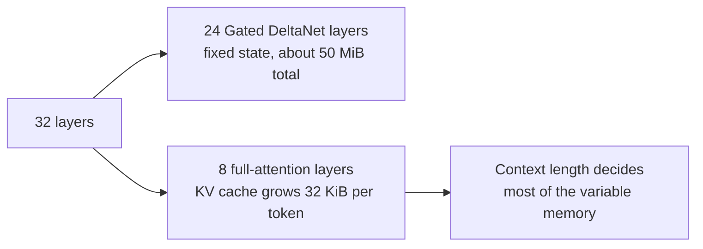

# Memory math: will it fit?

"Will it fit?" is the question you will ask every time you change a model, a quant or a context length. This lesson gives you the formulas, works them through for your exact model at every context size from 8K to 262K, explains the macOS GPU memory limit and why swap kills speed, and ends with a decision table and a lab where you check the math against real measurements.

> [!GOALS]
> - List everything that consumes memory when a model runs, and roughly how much each costs
> - Compute KV-cache size per token and per context length for any transformer from its config
> - Explain why your hybrid Qwen3.5 model handles long context far more cheaply than a classic transformer
> - Explain the macOS GPU wired-memory limit, swap, and how to read Activity Monitor
> - Pick a context length and KV-cache precision for a given task, and verify the numbers on your Mac

## Where the memory goes

When LM Studio loads your model and you chat with it, memory is consumed by:

| Item | What it is | Size for you |
|---|---|---|
| **Weights** | The model file, memory-mapped | 5.24 GiB (Q4_K_M) |
| **KV cache** | Saved attention keys and values for every token in the context | 32 KiB per token at FP16, reserved for the *whole* context length at load |
| **Linear-attention state** | Fixed-size memory of the 24 Gated DeltaNet layers | about 50 MiB per conversation slot |
| **Compute buffers** | Scratch space for intermediate results during a forward pass | roughly 0.5 to 1 GiB (estimate; grows with batch size) |
| **Vision encoder** | The `mmproj` file, only if loaded | about 0.86 GiB plus its own scratch space |
| **macOS and your apps** | Everything else | often 6 to 10 GB with Chrome, Burp and Docker open |

> [!NOTE] GB vs GiB
> 1 GB = 10^9 bytes; 1 GiB = 2^30 bytes = 1.074 GB. Your Mac's "16 GB" is really 16 GiB of RAM. Memory math is cleaner in GiB because cache sizes are powers of two, so this lesson uses GiB; Finder and Hugging Face show file sizes in decimal GB (your Q4_K_M is 5.63 GB = 5.24 GiB).

### Weights

Weights cost roughly their file size. Q4_K_M: 5,627,044,224 bytes = **5.24 GiB**. Q6_K: 6.85 GiB. Q8_0: 8.87 GiB. Why the sizes differ is in [Quantization](#/foundations/quantization).

### KV cache

Recall from [How text gets generated](#/foundations/generation): for every token in the context, each attention layer stores a **key** vector and a **value** vector so it does not have to recompute them for each new token. That store is the KV cache.

> [!CONCEPT] KV cache size
> Per token: 2 (one K, one V) x number of attention layers x number of KV heads x head dimension x bytes per value. Multiply by the context length. The runtime reserves the whole thing when the model loads, whether or not you ever fill the context.

All four numbers come from the model's `config.json` (or the GGUF metadata).

### Linear-attention state

Qwen3.5 is a hybrid (see [Inside the transformer](#/foundations/transformer)): of its 32 layers, only 8 are full softmax-attention layers with a growing KV cache. The other 24 are **Gated DeltaNet** linear-attention layers. Instead of remembering every past token, each keeps a fixed-size matrix "summary" that is updated in place as tokens stream through. Its size does not depend on context length at all.

From the config: 32 value heads, key and value head dimension 128, stored at FP32:

```text
24 layers x 32 heads x 128 x 128 values x 4 bytes = 50,331,648 bytes = 48 MiB
+ a small convolution state (about 2 MiB)
= about 50 MiB per sequence
```

If the runtime keeps several parallel conversation slots (recent LM Studio versions support parallel requests), each slot has its own state: 4 slots is about 200 MiB. Still small.

### Compute buffers

During a forward pass the runtime needs scratch memory for intermediate results. One big contributor here is the vocabulary: the final layer produces a score for each of 248,320 tokens, so scoring a 512-token batch at FP32 needs 512 x 248,320 x 4 bytes, about 0.5 GB of scratch if every position is scored. Runtimes reserve for the worst case. I use **0.7 GiB** as a working estimate below; your measurements in the lab will tell you the real number for your build and settings.

### The rest of your Mac

Look at Activity Monitor, but typical figures: macOS and background services 3 to 4 GB; Chrome with a dozen tabs 1 to 3 GB; Burp Suite (a Java app) 1 to 2 GB or more depending on project size and its memory setting; Docker Desktop's Linux VM can grow up to its memory limit, which **defaults to 50% of host memory: 8 GB on your Mac** (Settings, Resources, Advanced). Lower that limit while you run models.

## The formulas

```text
total ≈ weights + KV cache + linear state + compute buffers (+ mmproj)

KV bytes per token = 2 x n_attention_layers x n_kv_heads x head_dim x bytes_per_value
KV cache           = KV bytes per token x context_length
```

Bytes per value: FP16 = 2, Q8_0 = 1.0625 (8.5 bits), Q4_0 = 0.5625 (4.5 bits).

## Worked example: your model

From Qwen3.5-9B's `config.json`: 8 full-attention layers (every 4th: layers 3, 7, 11, ..., 31), 4 KV heads, head_dim 256.

```text
KV per token (FP16) = 2 x 8 x 4 x 256 x 2 bytes = 32,768 bytes = 32 KiB
KV per token (Q8_0) = 32 KiB x 8.5 / 16       = 17 KiB
```

Now multiply by the context length (1K = 1,024 tokens):

| Context | Tokens | KV at FP16 | KV at Q8_0 |
|---|---|---|---|
| 8K | 8,192 | 8,192 x 32 KiB = 256 MiB = 0.25 GiB | 0.13 GiB |
| 32K | 32,768 | 1.0 GiB | 0.53 GiB |
| 64K | 65,536 | 2.0 GiB | 1.06 GiB |
| 128K | 131,072 | 4.0 GiB | 2.13 GiB |
| 262K (native max) | 262,144 | 8.0 GiB | 4.25 GiB |

Add the fixed parts, 5.24 (weights) + 0.05 (linear state) + 0.7 (compute, estimated) = **about 6.0 GiB**, to get the model's total footprint:

| Context | Total, FP16 KV | Total, Q8_0 KV |
|---|---|---|
| 8K | 6.2 GiB | 6.1 GiB |
| 32K | 7.0 GiB | 6.5 GiB |
| 64K | 8.0 GiB | 7.1 GiB |
| 128K | 10.0 GiB | 8.1 GiB |
| 262K | 14.0 GiB | 10.2 GiB |

Sanity check from the field: a llama.cpp user running Qwen3.5-9B with a 16-bit KV cache reported a 512 MiB KV buffer for 16,384 tokens across 8 layers. 16,384 x 32 KiB = 512 MiB. The formula holds.

<div data-widget="memory"></div>

### Compared with a classic transformer

Qwen3-8B, the previous generation, uses full attention in all 36 layers with 8 KV heads of dimension 128:

```text
KV per token (FP16) = 2 x 36 x 8 x 128 x 2 bytes = 147,456 bytes = 144 KiB
```

That is 4.5 times your model's 32 KiB.

| Context | Qwen3.5-9B KV (FP16) | Qwen3-8B KV (FP16) |
|---|---|---|
| 8K | 0.25 GiB | 1.1 GiB |
| 32K | 1.0 GiB | 4.5 GiB |
| 128K | 4.0 GiB | 18 GiB |

With Qwen3-8B Q4_K_M (4.68 GiB of weights), 32K of context already puts the footprint near 10 GiB; 128K is impossible on 16 GB (and beyond its 40,960-token native window anyway). Your model at 128K uses less KV than Qwen3-8B at 32K. That is the practical payoff of the hybrid architecture.



> [!MAC] Weights choice changes the baseline
> With Q6_K weights (6.85 GiB) the fixed part becomes about 7.6 GiB, so 32K of FP16 KV totals about 8.6 GiB. With the `mmproj` loaded for images, add about 0.9 GiB plus vision scratch space.

## The macOS GPU memory limit

Unified memory means the GPU uses the same RAM as everything else, but macOS does not let the GPU take all of it. Metal lets the GPU **wire** (pin in RAM so it cannot be paged out) only up to a limit: roughly two-thirds of memory on a 16 GB Mac, around **10 to 11 GB**. llama.cpp prints the value it sees as `recommendedMaxWorkingSetSize` in its startup log.

Compare that with the tables: up to 64K at FP16 (8.0 GiB) you are comfortable; 128K at FP16 (10.0 GiB) is right at the edge; 262K only approaches fitting with a quantized KV cache.

What happens when you go over depends on which limit you hit:

- **Over the GPU limit:** the allocation fails. LM Studio's resource guardrails may refuse to load the model, the load errors out, or (if GPU offload is set below max) part of the model runs on the CPU, which is much slower.
- **Over physical RAM** (model plus everything else): macOS first compresses memory, then starts **swapping**: writing memory pages to the SSD and reading them back when needed.

> [!WARNING] Why swap destroys speed
> Decode reads every weight for every token, at about 100 to 120 GB/s from RAM. If some of those weights or the KV cache live in swap, they come from the SSD instead, which is an order of magnitude slower, and with extra paging overhead. Tokens per second can collapse from about 15 to below 1, and the whole Mac stutters. If you see swap growing while the model generates, reduce context, quantize the KV cache, close apps, or drop to a smaller quant.

> [!DANGER] Raising the GPU limit (advanced, optional)
> You can raise the wired limit until the next reboot:
>
> ```bash
> sysctl iogpu.wired_limit_mb                  # 0 means the macOS default
> sudo sysctl iogpu.wired_limit_mb=12288       # allow 12 GiB, leaving about 4 GiB for macOS
> ```
>
> It resets at reboot. Set it too high and macOS itself runs out of memory: freezes, kernel panics, or apps killed. Leave at least about 4 GB for the system, close other apps first, and only do this when a specific workload needs it. Most of the time, quantizing the KV cache is the better fix.

## Reading Activity Monitor

Open Activity Monitor, then the **Memory** tab. The panel at the bottom is what matters:

| Field | What it tells you |
|---|---|
| **Memory Pressure** graph | Overall health. Apple: green means memory is used efficiently, yellow means the Mac might eventually need more RAM, red means it needs more RAM. Red while generating = you are swapping |
| **Physical Memory** | Installed RAM (16 GB) |
| **Memory Used** | Total in use, split into App Memory, Wired Memory and Compressed |
| **Wired Memory** | Memory that cannot be paged out, including system memory and what the GPU has pinned |
| **Compressed** | Memory macOS squeezed to avoid swapping: the early warning |
| **Cached Files** | File data kept in otherwise-free RAM; macOS drops it when needed. Memory-mapped model files can be accounted here |
| **Swap Used** | Data pushed to the SSD. Non-zero and *growing* during generation is the red flag |

The same numbers from the terminal:

```bash
sysctl vm.swapusage        # total, used and free swap
memory_pressure            # current statistics; the last line is the system-wide free percentage
```

> [!TIP]
> The best single reading is the **change** in Memory Used before and after loading a model, plus whether Swap Used moves while it generates. How macOS attributes mapped files to processes varies, so the per-process "Memory" column for LM Studio can look smaller than the model.

## Decision table

These assume Q4_K_M weights, no `mmproj`, and the estimates above. "Headroom" is what is left of 16 GiB for macOS and your apps.

| I want to... | Context | KV cache | Model footprint | Headroom | Notes |
|---|---|---|---|---|---|
| Ask quick questions, triage, run batch jobs | 8K | FP16 | about 6.2 GiB | about 9.8 GiB | Fastest loads; plenty of room for Burp and Docker |
| Daily driver: long chats, paste code files and HTTP traffic | 32K | FP16 | about 7.0 GiB | about 9 GiB | Recommended default |
| Read big logs, long docs, long agent runs | 64K | FP16 (or Q8_0) | about 8.0 (7.1) GiB | about 8 (8.9) GiB | Close Docker or lower its limit |
| Follow Qwen's advice of at least 128K for long thinking tasks | 128K | Q8_0 | about 8.1 GiB | about 7.9 GiB | Feasible; FP16 would be about 10 GiB, at the GPU limit |
| Use the full native window | 262K | Q8_0 | about 10.2 GiB | about 5.8 GiB | At the GPU limit; needs everything else closed; not recommended |
| Precision work with Q6_K weights | 32K | FP16 | about 8.6 GiB | about 7.4 GiB | Good for code review and PoCs |
| Image input | 32K | FP16 | about 7.9 GiB + vision scratch | about 8 GiB | Load the `mmproj`; each 1024 x 1024 image is about 1,024 tokens |

About Qwen's "keep at least 128K" advice: it comes from the model card and is about preserving *thinking quality on long, complex tasks*, where the reasoning itself can run to tens of thousands of tokens. On 16 GB it costs real headroom, and filling 128K also means minutes of prompt processing. My recommendation: run 32K day to day, and switch to 128K with a Q8_0 KV cache when you start a long agentic or deep-reasoning job.

> [!NOTE] KV-cache quantization
> Storing the cache as Q8_0 roughly halves it, and is generally considered close to lossless; Q4_0 quarters it with a more noticeable quality cost (community experience; test on your own tasks). In llama.cpp, quantizing the V cache requires Flash Attention to be on. LM Studio exposes these as K and V cache quantization settings in the load options; labels move between versions, and [Load settings](#/lmstudio/load-settings) walks through them.

## A calculator you can reuse

```python title="kv_calc.py"
"""Estimate model memory for different context lengths and KV-cache precisions."""

GIB = 2**30
BYTES_PER_VALUE = {"f16": 2.0, "q8_0": 8.5 / 8, "q4_0": 4.5 / 8}


def kv_bytes_per_token(attn_layers: int, kv_heads: int, head_dim: int, dtype: str) -> float:
    return 2 * attn_layers * kv_heads * head_dim * BYTES_PER_VALUE[dtype]


def main() -> None:
    weights_gib = 5_627_044_224 / GIB   # your Q4_K_M file
    fixed_gib = 0.05 + 0.7              # linear-attention state + compute buffers (estimate)
    models = {
        # name: (full-attention layers, KV heads, head_dim)
        "Qwen3.5-9B": (8, 4, 256),
        "Qwen3-8B": (36, 8, 128),
    }
    for name, (layers, heads, dim) in models.items():
        per_tok = kv_bytes_per_token(layers, heads, dim, "f16")
        print(f"{name}: {per_tok / 1024:.0f} KiB per token at FP16")

    print(f"\n{'context':>8} {'KV f16':>8} {'KV q8_0':>8} {'total f16':>10} {'total q8_0':>11}  (Qwen3.5-9B, GiB)")
    for ctx in (8_192, 32_768, 65_536, 131_072, 262_144):
        kv16 = kv_bytes_per_token(8, 4, 256, "f16") * ctx / GIB
        kv8 = kv_bytes_per_token(8, 4, 256, "q8_0") * ctx / GIB
        base = weights_gib + fixed_gib
        print(f"{ctx:>8} {kv16:8.2f} {kv8:8.2f} {base + kv16:10.2f} {base + kv8:11.2f}")


if __name__ == "__main__":
    main()
```

```text
Qwen3.5-9B: 32 KiB per token at FP16
Qwen3-8B: 144 KiB per token at FP16

 context   KV f16  KV q8_0  total f16  total q8_0  (Qwen3.5-9B, GiB)
    8192     0.25     0.13       6.24        6.12
   32768     1.00     0.53       6.99        6.52
   65536     2.00     1.06       7.99        7.05
  131072     4.00     2.12       9.99        8.12
  262144     8.00     4.25      13.99       10.24
```

## Lab

> [!LAB] Measure memory at 8K, 32K and 64K
> 1. Quit or pause heavy apps (Docker Desktop especially). Open Activity Monitor on the Memory tab. Unload any model: `lms unload --all`. Write down the baseline Memory Used, Wired Memory and Swap Used.
> 2. Get your model's key:
>
> ```bash
> lms ls
> ```
>
> 3. Ask LM Studio for its own estimate at each size, without loading (replace the key with yours):
>
> ```bash
> lms load --estimate-only qwen3.5-9b-uncensored-hauhaucs-aggressive --context-length 8192
> lms load --estimate-only qwen3.5-9b-uncensored-hauhaucs-aggressive --context-length 32768
> lms load --estimate-only qwen3.5-9b-uncensored-hauhaucs-aggressive --context-length 65536
> ```
>
> 4. Load at 8K with full GPU offload, then send one short chat message so all buffers are allocated:
>
> ```bash
> lms load qwen3.5-9b-uncensored-hauhaucs-aggressive --context-length 8192 --gpu max
> lms ps
> ```
>
> 5. Record Memory Used, Wired Memory, Swap Used and the memory pressure colour. Then `lms unload --all`, wait a few seconds, and repeat steps 4 and 5 at 32768 and 65536.
> 6. Fill in this table in your notebook:
>
> | Context | My calculation (GiB) | LM Studio estimate | Memory Used change | Wired change | Swap moved? |
> |---|---|---|---|---|---|
> | 8K | 6.2 | | | | |
> | 32K | 7.0 | | | | |
> | 64K | 8.0 | | | | |
>
> 7. The cleanest check cancels out the unknowns: the difference between your 64K and 8K measurements should be close to 2.0 - 0.25 = **1.75 GiB** (pure KV cache), because weights, state and compute buffers are the same in both. If it is, your KV formula is confirmed. The 8K total minus 5.24 GiB of weights tells you what your compute buffers really are; update the 0.7 estimate in `kv_calc.py`.
> 8. Optional: in the LM Studio load settings, turn on Flash Attention and set the K and V cache quantization to Q8_0, reload at 64K, and confirm the KV part drops by roughly half (about 0.94 GiB saved).

## Recap

- Memory = weights + KV cache + linear-attention state + compute buffers (+ mmproj) + everything else on your Mac.
- KV per token = 2 x attention layers x KV heads x head_dim x bytes. For your model: 2 x 8 x 4 x 256 x 2 = 32 KiB at FP16, so 1 GiB per 32K tokens. Qwen3-8B needs 144 KiB.
- Only 8 of your model's 32 layers keep a KV cache; the 24 linear-attention layers keep a fixed state of about 50 MiB. That is why long context is cheap on Qwen3.5.
- The KV cache is reserved for the full context length when the model loads.
- macOS lets the GPU wire roughly two-thirds of 16 GB (about 10 to 11 GB). Exceed RAM and you swap, and swap turns bandwidth-bound decode into SSD-bound crawling.
- Day to day: 32K with FP16 KV (about 7 GiB). Long thinking jobs: 128K with Q8_0 KV (about 8.1 GiB).

## Check yourself

1. Compute the FP16 KV cache for your model at 48K (49,152 tokens).
   <details><summary>Answer</summary>

   49,152 x 32 KiB = 1,572,864 KiB = 1.5 GiB. (Or: 32K is 1 GiB, so 48K is 1.5 GiB.)

   </details>
2. A colleague's model has 28 layers, all full attention, 8 KV heads, head_dim 128. What is its FP16 KV cost per token, and at 32K?
   <details><summary>Answer</summary>

   2 x 28 x 8 x 128 x 2 = 114,688 bytes = 112 KiB per token. At 32,768 tokens: 112 KiB x 32,768 = 3.5 GiB.

   </details>
3. You set context to 128K but your conversations rarely exceed 5K tokens. Does the large setting cost memory anyway?
   <details><summary>Answer</summary>

   Yes. The runtime reserves the KV cache for the full configured context when it loads the model (4 GiB at FP16 here), whether or not you use it. Set the context to what your task needs.

   </details>
4. During a long generation, tokens per second drops from 15 to 1, and Activity Monitor shows memory pressure red and Swap Used climbing. What is happening and what are three fixes?
   <details><summary>Answer</summary>

   Total memory demand exceeded physical RAM, so macOS is swapping and part of the working set is read from the SSD instead of RAM, which is far slower. Fixes: reduce context length, quantize the KV cache (Q8_0), close or limit other apps (lower Docker's memory limit), unload the mmproj, or use a smaller quant.

   </details>
5. Why does your 9B model handle 128K of context more cheaply than Qwen3-8B handles 32K?
   <details><summary>Answer</summary>

   Only 8 of its 32 layers are full-attention layers with a KV cache, and they have only 4 KV heads, giving 32 KiB per token (128K = 4 GiB). Qwen3-8B caches all 36 layers with 8 KV heads, 144 KiB per token (32K = 4.5 GiB). The other 24 layers of Qwen3.5 use a fixed-size linear-attention state.

   </details>

## Go deeper
- [Qwen3.5-9B config.json](https://huggingface.co/Qwen/Qwen3.5-9B/blob/main/config.json) — every number used in this lesson's KV math
- [LM Studio CLI: lms load](https://lmstudio.ai/docs/cli/load) — `--estimate-only`, `--context-length` and `--gpu`
- [Apple: View memory usage in Activity Monitor](https://support.apple.com/guide/activity-monitor/view-memory-usage-actmntr1004/mac) — official definitions of each memory field
- [Docker Desktop settings](https://docs.docker.com/desktop/settings-and-maintenance/settings/) — where to cap the Docker VM's memory
- [Gated Delta Networks paper (Yang et al., 2024)](https://arxiv.org/abs/2412.06464) — the linear-attention design behind the fixed-size state
