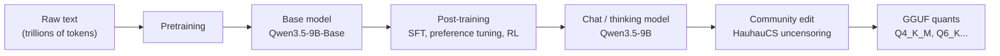
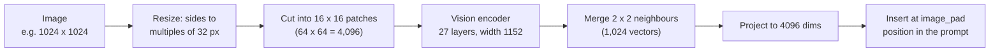

# Base, instruct, thinking and chat templates

Your model is not really a chatbot. It is a document completer that was trained on documents that *look like* chat transcripts, written in a special format full of control tokens. This lesson shows you that format byte for byte, the training stages that turn a raw text predictor into an assistant (and then into a "thinking" assistant), and how to read model names and Hugging Face model cards so you know what you are downloading.

> [!GOALS]
> - Explain how base, instruct and thinking models differ, and how each one is produced
> - Read a raw Qwen3.5 prompt and name every special token in it
> - Control thinking with `enable_thinking`, and know what it costs you
> - Explain where the chat template lives (Jinja in GGUF metadata) and what breaks when it is wrong
> - Explain what the `mmproj` file does and how an image becomes tokens
> - Decode a model name and read a Hugging Face model card like an auditor

## One pretraining run, three kinds of model

Recall from [What is an LLM, really?](#/foundations/what-is-an-llm) that a language model does exactly one thing: given a sequence of [tokens](#/foundations/tokens), it predicts a probability for every possible next token. Everything in this lesson is about *which documents* the model was trained to continue.



That is the real lineage of the file you run. Each arrow changes the weights (except the last, which compresses them; see [Quantization](#/foundations/quantization)).

### Stage 1: pretraining makes a base model

> [!CONCEPT] Base model
> A model trained only on "predict the next token" over a huge pile of internet text, books and code. It has absorbed grammar, facts and skills, but it has no notion of "user" or "assistant". It continues documents. Qwen publishes one: `Qwen/Qwen3.5-9B-Base`.

Give a base model this text:

```text
Q: What is cross-site scripting?
A:
```

A plausible continuation (illustrative, not a recorded output) is a one-line answer followed by `Q: What is CSRF?`, another answer, and so on, because that is what FAQ pages look like. The model is not being difficult; it is doing what it was trained to do: produce the most likely continuation of *this kind of document*.

Base models are still valuable. They are the starting point for fine-tuning ([Training 101](#/finetune/concepts)), they make good autocomplete engines, and they are the "clean" reference for interpretability work. They are just bad at conversation.

### Stage 2: post-training makes an instruct (chat) model

> [!CONCEPT] Instruct model (chat model)
> A base model further trained on conversations. First **supervised fine-tuning (SFT)**: thousands to millions of example dialogues, written in a fixed format with role markers, where the model learns to produce the assistant's part. Then **preference tuning** and **reinforcement learning (RL)**, where answers people (or reward models) prefer are made more likely. Details are in [Alignment, refusals and "uncensored"](#/foundations/alignment-uncensored).

The key insight: **the instruct model is still a document completer.** It has simply seen so many transcripts in one exact format that, when you hand it a transcript ending with "assistant's turn starts here", the most likely continuation is a helpful answer followed by an end-of-turn marker. "The assistant" is a character in a document. Your chat app's job is to build that document correctly every turn. The recipe it uses is the **chat template**, covered below.

### Stage 3: reasoning ("thinking") models

> [!CONCEPT] Reasoning model (thinking model)
> A chat model further trained, mostly with reinforcement learning on problems whose answers can be checked automatically (maths, code, logic), to write a private scratchpad before answering. Answers that end correct are rewarded, so the model learns that "think out loud, check, then answer" pays off. The scratchpad is wrapped in `<think>` ... `</think>`.

A Qwen3.5 response in thinking mode looks like this in raw form:

```text
<think>
The user asks whether a JWT signed with "none" should be accepted. alg=none means no signature...
Check: the library must reject alg=none unless explicitly allowed...
</think>

No. A token with "alg": "none" carries no signature...
```

Thinking is not free. Every thinking token is generated one at a time at decode speed (see [How text gets generated](#/foundations/generation)) and occupies context.

Worked example: a medium-hard question triggers 1,500 thinking tokens. At roughly 15 to 20 tokens per second (a rough figure for a 9B Q4 model on a MacBook Air; measure yours in [Performance tuning](#/lmstudio/performance)), that is 75 to 100 seconds before the first word of the actual answer. On a fanless Air that also means heat and throttling on long sessions.

| Thinking helps | Thinking wastes time |
|---|---|
| Multi-step logic: "is this auth flow exploitable, and how?" | Lookups: "what port does Redis use?" |
| Code that must be correct: a regex, a parser, a PoC request | Reformatting, summarising, translating |
| Maths, counting, comparing many options | Classification with a fixed label set (agents, triage) |
| Ambiguous requirements where planning matters | High-volume batch jobs where latency adds up |
| Reviewing its own draft for mistakes | Structured output where you validate anyway |

> [!NOTE]
> Older Qwen generations shipped separate models for each mode (for example `Qwen3-30B-A3B-Instruct-2507` and `Qwen3-30B-A3B-Thinking-2507`). Qwen3.5 is **one hybrid model**: the same weights do both, and a switch in the chat template chooses the mode. The Qwen3.5 card also states that Qwen3's in-prompt soft switches `/think` and `/nothink` are **not officially supported** any more.

## The `enable_thinking` switch

Here is the very end of the official Qwen3.5-9B chat template (from `chat_template.jinja` in the `Qwen/Qwen3.5-9B` repo). It runs after all the messages have been written out, to open the assistant's turn:

```jinja

    {{- '<|im_start|>assistant\n' }}
    
        {{- '<think>\n\n</think>\n\n' }}
    
        {{- '<think>\n' }}
    

```

Read it like code, because it is code:

- If nobody sets `enable_thinking`, or sets it to `true`, the prompt ends with `<think>` and a newline. The model's first generated token is already *inside* the scratchpad, so it thinks.
- If `enable_thinking` is explicitly `false`, the template writes an **empty, already-closed** think block. The model sees that thinking "already happened" and goes straight to the answer.

So thinking is not a mode inside the model. It is a **prefill trick**: the template starts the assistant's message for it, and the model continues from there.

### Why the docs disagree about the default

You will read two contradictory claims: the HauhauCS card (and Qwen's own card) say thinking is the default; Unsloth's Qwen3.5 guide says the small models (0.8B to 9B) have reasoning disabled by default. Both are right about *their own files*, because the default lives in the template, and different publishers ship different templates:

| File | Template default | Verified how |
|---|---|---|
| `Qwen/Qwen3.5-9B` (official) | Thinking **on** unless `enable_thinking=false` | `chat_template.jinja` in the repo |
| `HauhauCS/...-Aggressive` GGUFs (yours) | Thinking **on**: byte-identical to the official template | GGUF `tokenizer.chat_template` via the Hugging Face API |
| `lmstudio-community/Qwen3.5-9B-GGUF` | Thinking **on**: identical to official | same |
| `unsloth/Qwen3.5-9B-GGUF` | Thinking **off** unless `enable_thinking=true` | Unsloth's template flips the `if` |

(Checked in November 2026; uploaders can change their files. Always check your own copy.)

How to tell what *your* setup is doing:

1. **Look at the output.** If LM Studio shows a collapsible reasoning section, or raw output contains `</think>`, thinking is on.
2. **Look at the prompt.** `lms log stream` shows the exact rendered prompt (lab below). Ending in `<think>` plus a newline means thinking; ending in an empty `<think></think>` pair means no thinking.
3. **Read the template** inside the GGUF ([Quantization lab](#/foundations/quantization)).

> [!TIP] The missing opening tag
> Because the template puts `<think>` into the *prompt*, the raw completion the model generates contains only the closing `</think>`. If you call a runtime that does not parse reasoning and you see a stray `</think>` with no opening tag, that is why. LM Studio and llama.cpp's server separate reasoning from the answer for you when they recognise the format.

How to switch it:

| Where | How |
|---|---|
| LM Studio chat | A Think toggle appears for some models; it may not appear for every GGUF ([System prompts, templates, thinking](#/lmstudio/prompts-templates)) |
| LM Studio, no toggle | Edit the model's Prompt Template and add `` as the first line (reversible; verify with `lms log stream`) |
| llama.cpp server | `--chat-template-kwargs '{"enable_thinking":false}'` |
| vLLM / SGLang API (from the Qwen card) | `extra_body={"chat_template_kwargs": {"enable_thinking": False}}` |
| Python `transformers` | `tok.apply_chat_template(..., enable_thinking=False)` |

> [!NOTE] Thinking is stripped from history
> Look at how the template handles earlier assistant turns (example below): it **removes** their `<think>` blocks and keeps only the final answers. Qwen's card lists this as a best practice ("No Thinking Content in History"). It saves context and stops the model from over-weighting old reasoning. If you build your own prompt strings instead of using the template, you must do the same.

## Chat templates in depth

> [!CONCEPT] Chat template
> A small program that turns a list of messages (`[{"role": "user", "content": "..."}]`) into the single flat string the model was trained on. For almost all open models it is written in **Jinja**, a Python-style templating language, and ships with the model.

### Roles

| Role | Who writes it | What it is for |
|---|---|---|
| `system` | You, the operator | Standing instructions: persona, rules, output format. Must be first (Qwen's template raises an error otherwise) |
| `user` | The human or your app | The request |
| `assistant` | The model (or you, when replaying history) | Answers, reasoning, tool calls |
| `tool` | Your code | Results of a tool the model asked to run |

Security analogy: the system prompt is like a policy file, but enforcement is *by training*, not by a parser. Roles are just text markers inside one document, which is why prompt injection works: it is in-band signalling, the same class of bug as SQL injection or CRLF injection. That gets its own lesson in [Threat-model your own AI setup](#/security/ai-threat-model).

### Special tokens

> [!CONCEPT] Special token
> A token ID reserved for control, not for ordinary text. `<|im_start|>` is a single token (ID 248045 in Qwen3.5), not the eleven characters it looks like. The model learned during post-training what each one means ("a new message begins", "this message ends").

These are the ones you will meet, with IDs from Qwen3.5-9B's `tokenizer_config.json`:

| Token | ID | Meaning |
|---|---|---|
| `<\|endoftext\|>` | 248044 | End of a document (pretraining); also the padding token |
| `<\|im_start\|>` | 248045 | Start of a message; followed by the role name and a newline |
| `<\|im_end\|>` | 248046 | End of a message. Also the tokenizer's `eos_token`: generating it stops the reply |
| `<think>` / `</think>` | 248068 / 248069 | Open / close the reasoning scratchpad |
| `<tool_call>` / `</tool_call>` | 248058 / 248059 | Wrap a function call the model wants run |
| `<tool_response>` / `</tool_response>` | 248066 / 248067 | Wrap the result your code sends back |
| `<\|vision_start\|>` `<\|image_pad\|>` `<\|vision_end\|>` | 248053 / 248056 / 248054 | Mark where image embeddings go |

"im" stands for "input message". This format, with `<|im_start|>role` and `<|im_end|>`, is called **ChatML**; Qwen has used a ChatML-style format for several generations.

A subtle detail: `<|im_start|>` and `<|im_end|>` are flagged `special: true`, but `<think>`, `<tool_call>` and friends are flagged `special: false`. They are still single tokens, but decoders print them as normal text, which is why you can see `</think>` in raw output.

> [!WARNING] Special-token injection
> Qwen's tokenizer config sets `split_special_tokens: false`, meaning a literal `<|im_start|>` *typed inside text* is recognised as the real control token when the rendered prompt is tokenized, and many runtimes tokenize the whole rendered prompt that way. An app that pastes untrusted text (a scraped page, an HTTP response) into a prompt without stripping these strings lets that text forge a new `system` turn. Treat it like CRLF injection: sanitise at the boundary.

### A real rendered conversation

Here is a conversation as your code would send it (the earlier assistant turn still contains the reasoning the model produced):

```json
[
  {"role": "system", "content": "You are a concise web security assistant."},
  {"role": "user", "content": "What does HTTP 403 mean?"},
  {"role": "assistant", "content": "<think>\nThe user wants the meaning of 403.\n</think>\n\nForbidden: the server understood the request but refuses to authorize it."},
  {"role": "user", "content": "And 401?"}
]
```

And here is the exact string Qwen3.5's template produces with `add_generation_prompt=True` and the default (thinking on). I traced it line by line from the template; the lab has you reproduce it.

```text
<|im_start|>system
You are a concise web security assistant.<|im_end|>
<|im_start|>user
What does HTTP 403 mean?<|im_end|>
<|im_start|>assistant
Forbidden: the server understood the request but refuses to authorize it.<|im_end|>
<|im_start|>user
And 401?<|im_end|>
<|im_start|>assistant
<think>
```

(There is a newline after the final `<think>`.) Notice:

- Each message is `<|im_start|>` + role + newline + content + `<|im_end|>` + newline.
- The old reasoning ("The user wants the meaning of 403.") is **gone**. The template split on `</think>` and kept only the answer, because that turn came before the latest user message.
- The string ends mid-message: an open assistant turn, already inside `<think>`. The model's job is to continue it.

With `enable_thinking=False`, only the tail changes:

```text
<|im_start|>assistant
<think>

</think>

```

### Tool calls in the template

When you pass tool definitions, the template writes them into the system message as JSON and teaches the format in plain English. Qwen3.5 uses an XML-style call format (the card's vLLM/SGLang examples use the `qwen3_coder` tool-call parser). Here is a single-tool exchange rendered in full: the user asks, the model calls `http_status`, your code returns the result, and the model is prompted to continue.

```text
<|im_start|>system
# Tools

You have access to the following functions:

<tools>
{"type": "function", "function": {"name": "http_status", "description": "Fetch a URL and return only the HTTP status line", "parameters": {"type": "object", "properties": {"url": {"type": "string"}}, "required": ["url"]}}}
</tools>

If you choose to call a function ONLY reply in the following format with NO suffix:

<tool_call>
<function=example_function_name>
<parameter=example_parameter_1>
value_1
</parameter>
<parameter=example_parameter_2>
This is the value for the second parameter
that can span
multiple lines
</parameter>
</function>
</tool_call>

<IMPORTANT>
Reminder:
- Function calls MUST follow the specified format: an inner <function=...></function> block must be nested within <tool_call></tool_call> XML tags
- Required parameters MUST be specified
- You may provide optional reasoning for your function call in natural language BEFORE the function call, but NOT after
- If there is no function call available, answer the question like normal with your current knowledge and do not tell the user about function calls
</IMPORTANT><|im_end|>
<|im_start|>user
Is https://example.com up?<|im_end|>
<|im_start|>assistant
<think>

</think>

<tool_call>
<function=http_status>
<parameter=url>
https://example.com
</parameter>
</function>
</tool_call><|im_end|>
<|im_start|>user
<tool_response>
HTTP/1.1 200 OK
</tool_response><|im_end|>
<|im_start|>assistant
<think>
```

Three things worth noticing as an engineer:

1. Tool results go back as a **`user`** message wrapped in `<tool_response>`. There is no separate tool role at the token level.
2. Assistant turns *after* the last real user question keep their think block (here, empty), because they are part of the current agentic step. Only turns before the last user question are stripped.
3. If you supply a system prompt as well, it is appended after the `</IMPORTANT>` block, inside the same system message.

The runtime's job is to spot `<tool_call>` in the output, parse it into JSON, and hand it to your code. How to do that robustly is in [Structured output and tool calling](#/using/structured-output-tools).

### Where the template lives

> [!CONCEPT] Jinja template
> A text template with `{{ expressions }}` and `` (loops, ifs, macros). Chat templates are Jinja programs that receive `messages`, `tools`, `add_generation_prompt` and any extra variables (like `enable_thinking`) and print the prompt string.

- **Hugging Face repos** store it in `chat_template.jinja` and/or the `chat_template` field of `tokenizer_config.json` (for Qwen3.5-9B the two are identical).
- **GGUF files** embed it in the metadata key `tokenizer.chat_template`. LM Studio and llama.cpp read it from there and render it with their own Jinja implementations. Those support most of Jinja, not necessarily all of it, which is one reason uploaders sometimes ship edited templates (Unsloth's copy, besides flipping the thinking default, also rewrites one loop to avoid the `items` filter).
- **Overrides**: LM Studio lets you replace the template per model (My Models, model settings, Prompt Template). LM Studio's docs describe two modes: a Jinja template, or a "manual" one where you type role prefixes and suffixes.

> [!DANGER] Templates are code, and GGUFs are untrusted input
> CVE-2024-34359 ("Llama Drama"): `llama-cpp-python` before 0.2.72 rendered the chat template from GGUF metadata in a non-sandboxed Jinja2 environment, so a malicious GGUF could run code on the machine that loaded it. Sandboxed renderers fix that class of bug, but the lesson stands: a model file from an unknown uploader is attacker-controlled input to a parser. Keep LM Studio and its runtimes updated, and prefer well-known uploaders.

### What breaks with a wrong template

The model was trained on *exactly* one format. Deviate and you are feeding it out-of-distribution text.

| Symptom | Likely cause |
|---|---|
| Model writes "User:" lines and answers its own follow-up questions | Wrong role markers or stop token: it does not know its turn ended |
| Output never stops, or prints `<\|im_end\|>` literally | EOS / stop token not configured for `<\|im_end\|>` |
| Thinking text shows up as part of the answer | Runtime does not recognise the reasoning format (or the opening tag lives in the prompt; see the tip above) |
| Tool calls appear as plain text and nothing executes | Template and tool-call parser disagree on the format |
| Load error like "error rendering prompt with jinja template" | The runtime's Jinja engine cannot parse the template; update, or override it in Prompt Template |
| Everything "works" but answers are a bit dumber | A subtle mismatch: missing newline after the role, wrong format family (ChatML vs Llama 3), old thinking left in history. This is the nastiest failure: no error, just quality loss |

## Multimodal: the `mmproj` file

Qwen3.5 is natively multimodal (text, image, video). In GGUF land the vision part ships separately:

> [!CONCEPT] mmproj (multimodal projector) file
> A second GGUF containing the **vision encoder** (a separate neural network that reads pixels) and the **projector** that maps its output into the language model's embedding space. HauhauCS ships `mmproj-...-BF16.gguf` at about 880 MB (921,704,448 bytes, so roughly 461 million BF16 parameters). You need it only for image or video input.

How an image becomes "tokens", using the numbers in Qwen3.5-9B's `config.json` and `preprocessor_config.json`:



1. The image is resized so each side is a multiple of 32 pixels (patch size 16 times merge size 2), within a minimum and maximum pixel budget.
2. It is cut into 16 by 16 pixel patches. Each patch is a vector of raw pixel values.
3. The vision encoder (27 transformer layers, hidden size 1152) turns patches into contextual feature vectors.
4. Each 2 by 2 group of neighbouring patches is merged into one vector, so **one final "image token" covers 32 by 32 pixels**.
5. The projector maps each vector to 4096 dimensions, the language model's hidden size, so it can sit in the sequence exactly like a word embedding.
6. In the text, the template wrote `<|vision_start|><|image_pad|><|vision_end|>`; the runtime replaces that placeholder with as many image embeddings as the image needs.

Worked example: a 1024 by 1024 screenshot becomes (1024 / 32) times (1024 / 32) = 32 times 32 = **1,024 tokens** of context. A few big screenshots can eat a lot of your context window. Exact counts depend on the runtime's resize limits. Video works the same way, with pairs of frames merged (`temporal_patch_size` 2).

> [!MAC]
> Loading the mmproj costs roughly another 0.9 GB plus the vision encoder's working memory. On 16 GB, load it only when you actually need images. Budgeting is in [Memory math](#/foundations/memory-math).

## Decoding model names

Names are informal, but the parts are consistent across the ecosystem:

| Part | Example | Meaning |
|---|---|---|
| Family and generation | `Qwen3.5` | Model family and version |
| Size | `9B` | About 9 billion parameters |
| Mixture-of-experts sizes | `Qwen3.5-35B-A3B` | 35B total parameters, about 3B **active** per token (only some "experts" run each step) |
| Stage | `-Base` | Pretrained only. No suffix on Qwen3.5 means the post-trained chat model |
| Instruct / thinking variants | `-Instruct-2507`, `-Thinking-2507`, Gemma's `-it` | Older or other families that ship modes as separate models. `2507` is a date tag (July 2025) |
| Derivation | `-Distill`, `-abliterated`, `-Uncensored` | Trained to imitate a bigger model; refusal direction removed; refusals removed by an unstated method |
| Uploader and flavour | `HauhauCS-Aggressive` | Who made it; "Aggressive" = more thorough refusal removal |
| Weight format / quant | `Q4_K_M`, `UD-Q4_K_XL`, `-FP8`, `-GPTQ-Int4`, `-4bit` (MLX), `i1` | How the weights are stored; see [Quantization](#/foundations/quantization) |
| File type | `.gguf`, `.safetensors` | Container format |

So `Qwen3.5-9B-Uncensored-HauhauCS-Aggressive-Q4_K_M.gguf` reads: Qwen 3.5, 9B dense, refusals removed by HauhauCS in the aggressive variant, K-quant 4-bit medium mix, GGUF container.

## Reading a Hugging Face model card

A model card is the repo's `README.md`. Read it like you would read a vendor security advisory: what is claimed, what is evidenced, what is missing.

1. **YAML metadata** (top of the file; also rendered as tags). For HauhauCS: `license: apache-2.0`, `base_model: Qwen/Qwen3.5-9B`, tags `uncensored`, `gguf`. `pipeline_tag` says the task (Qwen3.5-9B is tagged `image-text-to-text`).
2. **Model tree** (right sidebar). Built from `base_model`. Hugging Face infers the relation (`finetune`, `adapter`, `quantized` or `merge`) or the author sets `base_model_relation`. Follow it upward: HauhauCS's model points to `Qwen/Qwen3.5-9B`, which points to `Qwen/Qwen3.5-9B-Base`. Follow it downward to find "Quantizations" and "Finetunes" of any model.
3. **Files tab.** File names, sizes, formats. Sizes are in decimal GB: the Q4_K_M shows 5.63 GB while the card's table says 5.3 GB (closer to GiB). A repo full of `.bin` or `.pt` files is a pickle risk (see [file formats](#/foundations/quantization)).
4. **Claims vs evidence.** HauhauCS claims "0/465 refusals" and "zero capability loss" but publishes neither the test prompts, the benchmark results, nor the method. That is not proof of a problem; it is an **unverified claim**. Treat it like an unaudited vendor statement.
5. **Community tab.** Bug reports, template fixes and "this quant is broken" threads often live here.
6. **License.** Derivatives inherit the base license's obligations.

| License | What it means for you |
|---|---|
| Apache-2.0 (Qwen3.5, HauhauCS) | Permissive: use commercially, modify, redistribute; keep the notice |
| MIT | Permissive, even simpler |
| Llama / Gemma community terms | Usable, with conditions (acceptable-use policy, attribution, some scale limits); read them |
| CC-BY-NC and similar | Non-commercial only: a problem for paid client work |
| `other` | Custom terms: click through and read before any professional use |

> [!TIP] A useful lineage check
> HauhauCS's Q4_K_M (5,627,044,224 bytes) is 32 bytes away from `lmstudio-community/Qwen3.5-9B-GGUF`'s Q4_K_M of the *official* model (5,627,044,256 bytes), and the same holds for Q6_K and Q8_0. Same tensor layout, same quant recipe; only the weight values and a few metadata strings differ. That makes the lmstudio-community file the cleanest "before" for comparing refusal behaviour in the [alignment lab](#/foundations/alignment-uncensored).

## Lab

> [!LAB] See the template LM Studio uses, then render it yourself
> **Part A: LM Studio**
> 1. Open the **My Models** tab (LM Studio's docs list <kbd>Cmd</kbd> <kbd>3</kbd> as the shortcut). Find your HauhauCS model and click its gear icon to open its default settings. Find **Prompt Template**. You should see Jinja beginning with ``. Scroll to the bottom and find the `add_generation_prompt` block shown earlier. Labels move between versions; if you cannot find it, search the LM Studio docs for "prompt template".
> 2. In a terminal, start streaming the exact strings LM Studio sends to the model:
>
> ```bash
> lms log stream --source model --filter input
> ```
>
> 3. Load the model, open a new chat, and send `hi`. The terminal prints the formatted prompt. Confirm it ends with `<|im_start|>assistant`, a newline, and `<think>` (thinking on). If you have a Think toggle, flip it, send another message and watch the ending change. Press <kbd>Ctrl</kbd> <kbd>C</kbd> to stop streaming.
>
> **Part B: Python** (needs Python 3.11 or newer; check with `python3 --version`, and `brew install python@3.12` if yours is older)
>
> 4. Create the workspace and install the tokenizer tooling. This downloads only tokenizer files (a few MB), not model weights.
>
> ```bash
> mkdir -p ~/ai-lab/foundations && cd ~/ai-lab/foundations
> python3 -m venv .venv && source .venv/bin/activate
> pip install -U transformers jinja2
> ```
>
> 5. Save the script below as `render_template.py` and run `python render_template.py`.
> 6. Check that the default rendering matches the transcript earlier in this lesson, that the only difference with `enable_thinking=False` is the empty think block, and that the old reasoning was stripped. Note how many tokens the template adds compared with the raw message text.
> 7. Record in your lab notebook: the token IDs printed, the token counts for both modes, and what LM Studio's log showed.

```python title="render_template.py"
"""Render Qwen3.5's chat template with thinking on and off, and compare."""
import difflib

from transformers import AutoTokenizer

MODEL_ID = "Qwen/Qwen3.5-9B"  # same template as the HauhauCS GGUF

MESSAGES = [
    {"role": "system", "content": "You are a concise web security assistant."},
    {"role": "user", "content": "What does HTTP 403 mean?"},
    {
        "role": "assistant",
        "content": "<think>\nThe user wants the meaning of 403.\n</think>\n\n"
        "Forbidden: the server understood the request but refuses to authorize it.",
    },
    {"role": "user", "content": "And 401?"},
]


def render(tok, **template_vars) -> str:
    # tokenize=False returns the prompt string instead of token IDs.
    # Extra keyword arguments (enable_thinking) become Jinja variables.
    return tok.apply_chat_template(
        MESSAGES, tokenize=False, add_generation_prompt=True, **template_vars
    )


def main() -> None:
    tok = AutoTokenizer.from_pretrained(MODEL_ID)

    default = render(tok)  # enable_thinking undefined -> template default
    no_think = render(tok, enable_thinking=False)

    print("=== default ===")
    print(default)
    print("=== enable_thinking=False ===")
    print(no_think)

    # Show the exact tail, with newlines visible.
    for name, text in [("default", default), ("no_think", no_think)]:
        tail = text[text.rfind("<|im_start|>assistant"):]
        print(f"{name} tail: {tail!r}")

    print("=== diff ===")
    for line in difflib.unified_diff(
        default.splitlines(), no_think.splitlines(), "default", "no_think", lineterm=""
    ):
        print(line)

    # How many tokens does each prompt cost?
    for name, text in [("default", default), ("no_think", no_think)]:
        ids = tok(text, add_special_tokens=False)["input_ids"]
        print(f"{name}: {len(ids)} tokens")

    for t in ["<|endoftext|>", "<|im_start|>", "<|im_end|>", "<think>", "</think>", "<tool_call>"]:
        print(f"{t:>15} -> {tok.convert_tokens_to_ids(t)}")


if __name__ == "__main__":
    main()
```

The tails and IDs you should see (the rest of the output is the transcript shown earlier):

```text
default tail: '<|im_start|>assistant\n<think>\n'
no_think tail: '<|im_start|>assistant\n<think>\n\n</think>\n\n'
  <|endoftext|> -> 248044
   <|im_start|> -> 248045
     <|im_end|> -> 248046
        <think> -> 248068
       </think> -> 248069
    <tool_call> -> 248058
```

Stretch goal: pass `tools=[...]` to `apply_chat_template` with the `http_status` schema from this lesson and confirm you get the tool block. Pass tool-call `arguments` as a dict, not a JSON string: Qwen's template iterates over it.

## Recap

- Pretraining produces a **base model** that continues documents. Post-training (SFT, preference tuning, RL) produces a **chat model** that continues *transcripts*. Reasoning RL produces a **thinking model** that writes a `<think>` scratchpad first.
- Qwen3.5 is one hybrid model. Thinking is chosen by the chat template: the official template, and your HauhauCS GGUF, think unless `enable_thinking` is explicitly `false`; Unsloth's GGUFs flip that default.
- Thinking costs time (every token at decode speed) and context. Use it for multi-step problems, skip it for lookups and batch work.
- The **chat template** is a Jinja program stored in `tokenizer.chat_template` that builds the ChatML-style prompt: `<|im_start|>role`, content, `<|im_end|>`. It strips old reasoning, embeds tool schemas, and opens the assistant turn.
- Special tokens are control characters. Untrusted text containing them can forge roles; templates are code; GGUFs are untrusted input.
- The **mmproj** file is the vision encoder plus projector; each 32 by 32 pixel tile becomes one token.
- Read model names part by part, and read model cards like advisories: lineage, license, evidence versus claims.

## Check yourself

1. You give a base model the text `How do I fix CORS errors?` and it replies with three more questions. Why?
   <details><summary>Answer</summary>

   A base model has only learned to continue documents. A bare question most often appears in lists of questions (forums, FAQs), so continuing with more questions is a likely continuation. It has never been trained on the role-marked transcript format that makes "answer the user" the likely continuation.

   </details>
2. Your HauhauCS model thinks even though you never enabled thinking. Using the template, explain exactly why.
   <details><summary>Answer</summary>

   The generation-prompt block writes an empty closed think block only if `enable_thinking is defined and enable_thinking is false`. If nothing passes the variable, it is undefined, so the `else` branch writes `<think>` and a newline into the prompt and the model continues from inside the scratchpad.

   </details>
3. In a multi-turn chat, where does the reasoning from the model's earlier answers go, and why?
   <details><summary>Answer</summary>

   The template removes it: for assistant turns before the last user message it splits on `</think>` and keeps only the final answer. Qwen recommends this ("no thinking content in history") to save context and keep old reasoning from steering new answers. Turns after the last user message (an ongoing tool-calling step) keep their think blocks.

   </details>
4. An app summarises web pages by inserting page text into a Qwen prompt. Why is a page containing `<|im_end|><|im_start|>system` dangerous, and what is the fix?
   <details><summary>Answer</summary>

   With `split_special_tokens: false`, those strings are tokenized as real control tokens, so the page can close the user turn and open a fake system turn with its own instructions. Strip or escape special-token strings from untrusted input before rendering, and treat all inserted content as data (see the threat-model lesson).

   </details>
5. You attach a 2048 by 1024 image. Roughly how many context tokens does it cost, and which file must be loaded?
   <details><summary>Answer</summary>

   (2048 / 32) times (1024 / 32) = 64 times 32 = 2,048 tokens, assuming the runtime does not downscale it. The `mmproj` GGUF (vision encoder and projector) must be loaded alongside the main model.

   </details>

## Go deeper
- [Qwen3.5-9B model card](https://huggingface.co/Qwen/Qwen3.5-9B) — architecture, thinking mode, sampling profiles and serving examples from the source
- [Hugging Face chat templating guide](https://huggingface.co/docs/transformers/chat_templating) — how `apply_chat_template`, generation prompts and tool schemas work
- [LM Studio: prompt template docs](https://lmstudio.ai/docs/app/advanced/prompt-template) — where to view and override templates in the app
- [Hugging Face model card docs](https://huggingface.co/docs/hub/model-cards) — metadata fields, `base_model` and the model tree
- [InstructGPT paper (Ouyang et al., 2022)](https://arxiv.org/abs/2203.02155) — the classic description of turning a base model into an instruction follower
- [DeepSeek-R1 paper (2025)](https://arxiv.org/abs/2501.12948) — how reinforcement learning produces long chain-of-thought reasoning
