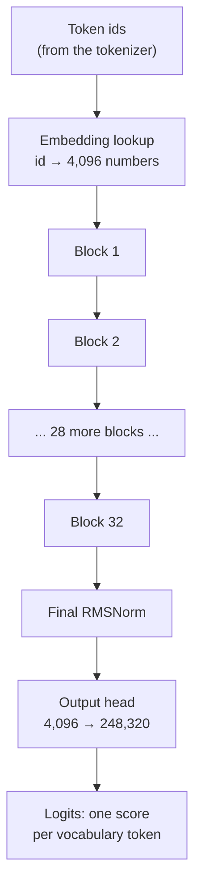
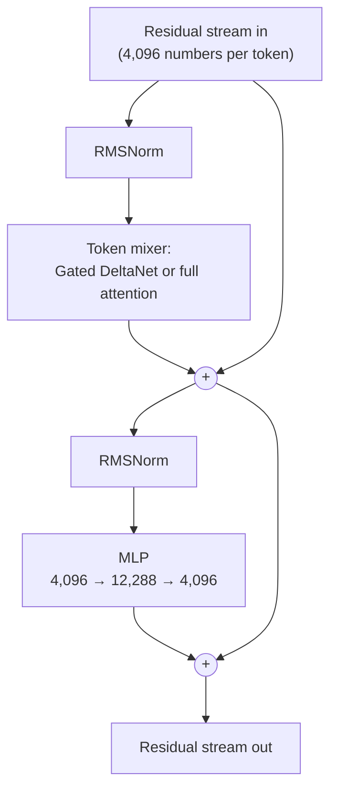
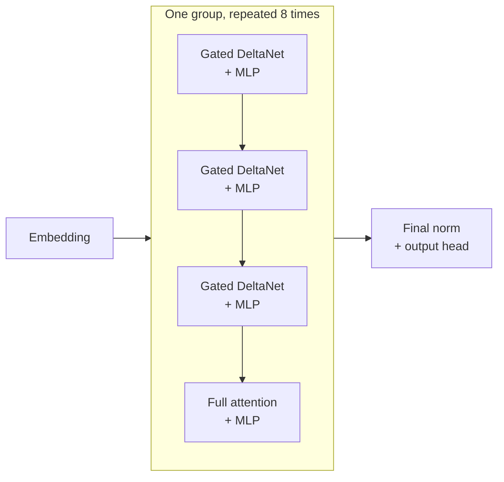

# Inside the transformer

You know a model is a big function with billions of learned numbers, fed token ids and producing a score for every possible next token. This lesson opens the box and follows one token through your model, piece by piece: the embedding table, the residual stream, attention, the MLP, normalization, position encoding, and the output head. Then it covers what makes Qwen3.5 unusual, a hybrid of two kinds of attention that makes long context cheap. By the end you'll count the parameters yourself and land within a rounding error of "9B".

> [!GOALS]
> - Trace a token from id to logits through embedding, 32 blocks and the output head
> - Explain the residual stream, attention (queries, keys, values), the MLP and RMSNorm in plain words
> - Work through a tiny attention calculation by hand
> - Explain grouped-query attention, RoPE, and Qwen3.5's 3:1 hybrid of Gated DeltaNet and full attention
> - Connect the architecture to the 32 KiB-per-token KV cache figure
> - Estimate the parameter count from the config and compare it with the real file

## The big picture

Here's the whole journey from text to a prediction, using your model's real dimensions:



Every token's position in the input carries a list of 4,096 numbers. Each of the 32 blocks reads those lists, computes something, and adds its result back. At the end, the list at the last position is turned into 248,320 scores, one for each token that could come next. Everything below fills in those boxes.

## Step 1: embedding lookup

A token id like 12,345 is just a label; you can't do meaningful math on it. So the first step is a lookup. The model has an **embedding table** with one row per vocabulary entry, and each row is a list of 4,096 learned numbers:

```text
embedding table: 248,320 rows x 4,096 columns   (~1.02 billion numbers)

token id 12345  ->  row 12345  ->  [0.013, -0.402, 0.077, ..., 0.215]   (4,096 numbers)
```

> [!CONCEPT] Vector (embedding)
> A list of numbers that represents something, here a token. You can think of it as a point in a space with 4,096 dimensions. The numbers aren't designed by anyone; they're learned in training, so that tokens used in similar ways end up with similar vectors.

What does a vector "mean"? Here's a toy with 3 dimensions instead of 4,096, using made-up features:

```text
             "is code?"  "is a protocol?"  "is plural?"
" HTTP"        0.6           0.9              0.0
" HTTPS"       0.6           0.9              0.0
" headers"     0.5           0.4              0.9
" banana"      0.0           0.0              0.0
```

` HTTP` and ` HTTPS` sit close together, and ` banana` sits far away. Real embeddings work similarly, with one big difference: the 4,096 directions aren't neatly labelled. Concepts are spread across many dimensions at once, and part of interpretability research (Part 8) is finding which *directions* in this space correspond to which concepts. That's exactly how "refusal" turns out to be a direction you can remove ([Mechanistic interpretability 101](#/weights/interpretability-101)).

## The residual stream: a shared bus

After the lookup, each position holds a 4,096-number vector. That vector is the **residual stream**, and it's the central idea of the transformer.

> [!CONCEPT] Residual stream
> The running 4,096-number vector at each token position that flows through all 32 blocks. Each block *reads* from it and *adds* its output back to it (`x = x + block(x)`), instead of replacing it. Think of it as a shared message bus or a blackboard: every layer can see what earlier layers wrote and append its own contribution, and nothing is overwritten.

Each block contains two sub-layers, each wrapped in the same read-normalize-compute-add pattern:



The **token mixer** (attention) is the only place where information moves *between* positions. The **MLP** works on each position separately. So a block is "first gather information from other tokens, then think about it locally", repeated 32 times.

Why add instead of replace? Two reasons. Training works much better, because gradients can flow straight down the bus through 32 blocks without fading. And it makes the model interpretable in a useful way: the final vector is literally the sum of everything every layer wrote. That's why researchers can find a single direction written by specific layers and subtract it, as in the [MIT weight-space study](#/weights/mit-study).

## RMSNorm: keeping the numbers in range

Before each sub-layer reads the stream, the vector is normalized. As 32 blocks keep adding to it, the numbers could drift to wildly different scales, which makes the math unstable. **RMSNorm** rescales the vector to a standard size:

```text
rms   = square root of the average of x_i squared
out_i = (x_i / rms) * g_i        (g = a learned gain per dimension)
```

For example, `[3, -4]` has squares 9 and 16, average 12.5, rms ≈ 3.54, so it becomes about `[0.85, -1.13]` before the gain is applied. Same direction, standard size. The learned gains let the model emphasize some dimensions over others. Your model also normalizes the queries and keys inside attention the same way, which helps keep attention scores stable.

## Attention: letting tokens look at each other

Consider: `The server rejected the token because it expired.` To predict well after `it`, the model needs to know what `it` refers to. The token, not the server. Information has to flow from earlier positions into the current one. That's what **attention** does.

> [!CONCEPT] Attention (queries, keys, values)
> At each position, the model computes three vectors from the residual stream: a **query** ("what am I looking for?"), a **key** ("what do I contain, as a label others can match against?") and a **value** ("what I hand over if someone matches me"). Each position compares its query with the keys of earlier positions; better matches get more weight; the output is a weighted blend of those positions' values.

A good analogy is a fuzzy search over a log. The query is your search term, each log entry has an index tag (key) and a body (value). A normal search returns the entries that match exactly. Attention returns a *blend* of all entries, weighted by how well each tag matches the search, so a strong match dominates but weaker matches still contribute a little.

The queries, keys and values are produced by multiplying the normalized residual vector by learned weight matrices. Those matrices are what training adjusted so that `it` learns to look for nouns that can expire.

### A worked example

Let's compute the attention weights for `it` over three earlier tokens, using tiny 2-number vectors instead of the real 256.

```text
query for "it":       q = [1.5, 0.5]

keys:   "server"   k = [1.0, 0.0]
        "rejected" k = [0.0, 1.0]
        "token"    k = [2.0, 1.0]
```

**1. Score each key** with a dot product (multiply matching entries and add). Bigger means a better match.

```text
"server":   1.5·1.0 + 0.5·0.0 = 1.5
"rejected": 1.5·0.0 + 0.5·1.0 = 0.5
"token":    1.5·2.0 + 0.5·1.0 = 3.5
```

**2. Scale** by the square root of the vector size (√2 ≈ 1.414 here, √256 = 16 in your model). This keeps scores from growing huge in high dimensions.

```text
1.5 / 1.414 = 1.061      0.5 / 1.414 = 0.354      3.5 / 1.414 = 2.475
```

**3. Softmax** turns scores into weights that are positive and sum to 1: raise *e* to each score, then divide by the total. (Softmax gets a full treatment in [How text gets generated](#/foundations/generation).)

```text
e^1.061 = 2.888    e^0.354 = 1.424    e^2.475 = 11.880     total = 16.193

weights:  "server" 0.178    "rejected" 0.088    "token" 0.734
```

**4. Blend the values.** If each token's value were a one-hot vector (server = `[1,0,0]`, rejected = `[0,1,0]`, token = `[0,0,1]`), the output would be `[0.178, 0.088, 0.734]`: mostly "token", a little "server". That blend is added to `it`'s residual stream, so later layers now "know" that `it` is about the token.

In the real model each position also attends to itself and to every other earlier token, and the vectors have 256 numbers per head, but the four steps are exactly these.

### The causal mask

A token may only attend to itself and *earlier* tokens, never later ones. Training is next-token prediction, so if position 5 could peek at position 6, it would simply copy the answer and learn nothing. This restriction is the **causal mask**:

```text
                 can attend to:
                 The   server  rejected  it
query "The"       *       -        -      -
query "server"    *       *        -      -
query "rejected"  *       *        *      -
query "it"        *       *        *      *
```

It's also why generation works left to right: earlier positions never change when you add a new token, which is what makes caching possible ([How text gets generated](#/foundations/generation)).

### Multi-head attention

One attention pattern can't capture every relationship at once. Which noun does `it` refer to? Which bracket closes this one? Which word came just before? So attention runs as several independent **heads** in parallel, each with its own query, key and value weights. Your model's full-attention layers have **16 heads**, each working with 256-number queries and keys. Research has found heads that specialize, for example in tracking the previous token, matching brackets or quotes, or copying a name seen earlier. The 16 head outputs (16 × 256 = 4,096 numbers) are joined and passed through one more matrix, the **output projection**, before being added to the stream.

### Grouped-query attention

Every past token's keys and values must be kept in memory during generation (the **KV cache**). With 16 heads, that would mean 16 sets of keys and values per token per layer. Your model uses **grouped-query attention (GQA)**: 16 query heads, but only **4** key/value heads. Each group of 4 query heads shares one set of keys and values.

> [!CONCEPT] Grouped-query attention (GQA)
> An attention variant where several query heads share the same key and value heads. Your model has 16 query heads and 4 KV heads, so each KV head serves 4 query heads. Quality stays close to full multi-head attention, while the KV cache shrinks 4x. It's one reason your KV cache is so small.

### Gated attention

Qwen3.5's full-attention layers add one more twist, which the model card calls **Gated Attention**. Alongside the queries, the model computes a **gate** for each head: a set of numbers between 0 and 1 that scales the attention output before it's added to the stream. It lets each head turn its own contribution up or down depending on the current token, so a head can effectively say "nothing useful to add here". You'll see its cost in the lab: the query projection is twice as wide as you'd expect because it produces the queries and the gate together.

## The MLP: where much of the knowledge lives

After attention has gathered information from other positions, the **MLP** (multi-layer perceptron, also called the feed-forward network) processes each position on its own. In your model it works like this:

```text
x (4,096)  --gate_proj-->  g (12,288)
x (4,096)  --up_proj---->  u (12,288)
h = SiLU(g) * u                         (element by element, 12,288 numbers)
h (12,288) --down_proj-->  out (4,096)  -> added to the residual stream
```

It expands the vector to three times its width, applies a non-linearity, and compresses it back.

> [!CONCEPT] Gated MLP (SiLU)
> SiLU is a smooth activation function: it passes large positive values through almost unchanged and squashes negative ones towards zero. "Gated" means the MLP computes two expansions: one goes through SiLU and acts as a gate, which then multiplies the other element by element. Each of the 12,288 middle units can switch itself on or off depending on the input. This design (often called SwiGLU) works better in practice than a plain single expansion.

A useful mental model, backed by interpretability research: each middle unit's input weights act like a **pattern detector** ("this looks like the start of a SQL query", "we're talking about Kerala"), and its output weights act like **what to write** when the pattern fires (push the stream towards tokens like `SELECT`, or towards facts about Kerala). In that sense the MLPs work like a huge key-value memory, and that's where much of the model's factual knowledge seems to be stored.

They're also most of your model: at 151 million parameters per layer across 32 layers, the MLPs account for about 54% of all language-model weights. When the MIT study found the direction responsible for Qwen3.5-0.8B's repetition loops, it was written by the MLPs in two specific layers ([The MIT weight-space programming study](#/weights/mit-study)).

## Stacking 32 blocks

One block gathers context and then computes. Stack 32 of them and the representation gets progressively richer. A rough picture from interpretability research (a trend, not a hard rule): early layers deal with surface features like token identity and local syntax; middle layers build more abstract features like meaning, entities and the task at hand; late layers turn all of that into a prediction about the next token. You'll test this yourself with the "logit lens" in [Mechanistic interpretability 101](#/weights/interpretability-101).

## The output: final norm and unembedding

After block 32, the vector at the last position goes through one final RMSNorm and then the **output head** (also called the unembedding or `lm_head`): a 4,096 × 248,320 matrix that turns the vector into 248,320 numbers called **logits**, one raw score per vocabulary token. Higher means "more likely next". How logits become an actual chosen token is the subject of [How text gets generated](#/foundations/generation).

Some models reuse the embedding table as the output head ("tied embeddings") to save parameters. Your model doesn't: its config sets `tie_word_embeddings` to false, so it carries two separate ~1-billion-parameter tables, one at each end.

## Position: how the model knows word order

Look back at the attention calculation: nothing in it depends on *where* the tokens are. Shuffle the earlier tokens and the weights come out the same. But word order obviously matters (`admin deleted user` vs `user deleted admin`), so the full-attention layers inject position with **RoPE** (rotary position embedding).

> [!CONCEPT] RoPE (rotary position embedding)
> Before queries and keys are compared, pairs of their numbers are rotated by an angle proportional to the token's position, like clock hands that turn as you move along the text. When a query and a key are compared, the rotations partly cancel, so the score depends on the *distance* between the two tokens rather than their absolute positions. Different pairs rotate at different speeds, giving both fine and coarse position information.

Your model's version has two details worth knowing:

- **Partial rotary (factor 0.25).** Only 64 of each head's 256 query and key dimensions are rotated. The other 192 carry no position signal at all, so heads can match purely on content ("find the token that defined this variable", wherever it is) as well as by distance.
- **A very large base (rope theta = 10,000,000).** This sets the slowest rotation speeds. A large base means some pairs rotate very slowly, so positions hundreds of thousands of tokens apart still get distinct angles. That's part of what supports a 262,144-token native context.

Because Qwen3.5 is natively multimodal, its rotary dimensions are also split between time, height and width, so image patches and video frames get sensible 2-D and 3-D positions. The linear-attention layers described next don't need RoPE at all: they process tokens in order, so order is built into how they work.

## Qwen3.5's hybrid design

Everything so far describes a classic transformer. Qwen3.5 changes one important thing: **only 8 of its 32 token mixers are the full attention described above.** The other 24 are **Gated DeltaNet**, a form of linear attention.

### The problem with full attention

Full attention compares the current token with *every* earlier token. That means two costs grow with context length:

- **Memory:** every layer must keep the keys and values of every past token (the KV cache), which grows linearly with context.
- **Compute:** each new token's attention work grows with the number of tokens before it.

At 200,000 tokens of context, every new token in every full-attention layer looks back at 200,000 keys. It's like grepping a full packet capture from the start every time a new packet arrives.

### Gated DeltaNet: a fixed-size running memory

Linear attention takes the opposite approach. Instead of keeping every past key and value, each head keeps a **fixed-size memory matrix** (in your model, 128 × 128 numbers per head) and updates it as each token goes by. It's less like a full packet capture and more like a connection-tracking table: constant size, updated per packet, never replayed.

> [!CONCEPT] Gated DeltaNet (linear attention)
> A token mixer that keeps a fixed-size memory per head instead of a growing cache. Each token *writes* a key → value association into the memory and *reads* from it with its query. The **delta rule** makes writes corrective: it first checks what the memory currently returns for this key and writes only the difference. The **gate** lets the memory fade old content when it's no longer relevant. Memory and compute per token stay constant no matter how long the context gets.

Here's the mechanism in plain steps, for one head at one token:

1. **Read.** Multiplying the memory matrix `S` by the query gives the output: `output = S · q`. Same idea as attention: get back the values whose keys match the query.
2. **Decay (the gate).** Scale the whole memory by a learned factor α between 0 and 1 that depends on the current token: `S ← α · S`. α near 1 keeps everything; α near 0 wipes the slate, which is useful when the topic changes.
3. **Check what's stored (the delta rule).** Ask the memory what it currently returns for this token's key: `old = S · k`.
4. **Write only the correction.** Nudge the stored value towards the new one, with a learned write strength β between 0 and 1: `S ← S + β · (v − old) · kᵀ`.

Step 4 is the clever part. Naive linear attention just keeps adding `v · kᵀ`, so similar keys pile conflicting values on top of each other and recall gets muddy. The delta rule behaves like *updating* a cache entry instead of appending a duplicate: if the memory already returns the right value for this key, `v − old` is near zero and almost nothing changes. Your model also runs a short convolution (looking at the last 4 tokens) over the queries, keys and values before all this, and gates the output, much like the gated attention above.

The size of this memory doesn't depend on context length. With 32 value heads per layer, each holding a 128 × 128 matrix, that's 524,288 numbers per layer, about 2 MiB at 32-bit precision. Across all 24 linear layers it comes to roughly 50 MB, whether your context is 100 tokens or 200,000.

The trade-off is precision. A fixed-size memory is a lossy summary. Ask "what was the exact session token on line 40 of that log?" and a pure linear-attention model may only have a blurry trace of it. Full attention, which keeps every key and value, can retrieve it exactly.

### The 3:1 layout

Qwen3.5 combines the two: three Gated DeltaNet layers, then one full-attention layer, repeated 8 times. Every layer has its own MLP.



Counting from 0, the full-attention layers are 3, 7, 11, 15, 19, 23, 27 and 31. The cheap linear layers do most of the token mixing; every fourth layer has exact access to the whole context and can recover any detail the running memories blurred.

### Why this makes long context cheap

Only the 8 full-attention layers keep a growing KV cache. Per token, at 16-bit precision:

```text
2 (key and value) x 8 layers x 4 KV heads x 256 numbers x 2 bytes = 32,768 bytes = 32 KiB per token
```

Compare a classic transformer of similar size, Qwen3-8B, with 36 full-attention layers, 8 KV heads and 128 numbers per head: `2 x 36 x 8 x 128 x 2 bytes = 144 KiB` per token, 4.5 times as much.

| Context length | Qwen3.5-9B KV cache | Qwen3-8B KV cache |
|---|---|---|
| 32K tokens | 1 GiB | 4.5 GiB |
| 64K tokens | 2 GiB | 9 GiB |
| 128K tokens | 4 GiB | 18 GiB |
| 262K tokens | 8 GiB | 36 GiB |

Add the fixed ~50 MB of DeltaNet memory and that's the whole picture. On a 16 GB Mac this is the difference between "long context is impossible" and "128K is a realistic option". [Memory math](#/foundations/memory-math) turns these numbers into load settings, including KV-cache quantization, which halves them again.

> [!NOTE]
> The 32 KiB figure assumes a 16-bit KV cache. LM Studio lets you quantize the KV cache (for example to Q8_0), which roughly halves it, at a small quality cost. See [Load settings](#/lmstudio/load-settings).

## What your model is not: dense vs mixture-of-experts

Your model is **dense**: every one of its ~9 billion parameters is used for every token. Many large modern models are **mixture-of-experts (MoE)** instead. In an MoE model, each block's single MLP is replaced by many smaller "expert" MLPs plus a small **router** that picks a few experts per token. A model might hold tens or hundreds of billions of parameters in total but use only a few billion for each token, so it runs as fast as a much smaller dense model. The larger Qwen3.5 models use this design (the Hugging Face `transformers` release that added Qwen3.5 also added a "Qwen3.5 MoE" architecture). The catch for you: all the experts still have to sit in memory, because any token might need any of them. MoE saves compute per token, not memory, so on a 16 GB machine a dense 9B is often the better fit. [Scaling up beyond 16 GB](#/infra/scaling) returns to this.

## Two extras: the vision encoder and MTP

**Vision encoder.** Qwen3.5 is natively multimodal. A separate 27-layer encoder (with its own 1,152-number internal width) turns an image or video frame into a sequence of vectors, which are projected to 4,096 numbers and inserted into the token sequence where `<|image_pad|>` placeholders sit. From then on, the language model treats them like token embeddings. In the GGUF world, this encoder is the separate `mmproj` file. You only need it for image or video input.

**Multi-token prediction (MTP).** The checkpoint also includes one extra layer trained to predict tokens *beyond* the next one. Runtimes can use it to speed up generation by guessing ahead and checking the guesses, a technique called speculative decoding. Hugging Face `transformers` skips these weights when loading, and whether your runtime uses them depends on the runtime and version. You can ignore MTP for this course.

## Lab: count the parameters yourself

> [!LAB] Estimate "9B" from the config
> 1. Read the real config numbers straight from Hugging Face (`config.json` is a small file):
>
>    ```bash
>    curl -sL https://huggingface.co/Qwen/Qwen3.5-9B/resolve/main/config.json \
>      | python3 -m json.tool \
>      | grep -E '"(vocab_size|hidden_size|intermediate_size|num_hidden_layers|num_attention_heads|num_key_value_heads|head_dim|linear_[a-z_]+|tie_word_embeddings)"'
>    ```
>
>    Find `hidden_size` 4096, `intermediate_size` 12288, `num_hidden_layers` 32, `num_attention_heads` 16, `num_key_value_heads` 4, `head_dim` 256, `vocab_size` 248320, `tie_word_embeddings` false, and the `linear_*` values for Gated DeltaNet (16 key heads, 32 value heads, 128 dims each, convolution kernel 4). Some keys appear twice, once for the language model and once for the vision encoder; use the language-model ones.
> 2. Before running any code, estimate by hand. A weight matrix from `a` inputs to `b` outputs has `a × b` parameters.
>    - Embedding: 248,320 × 4,096 = ?
>    - Output head (untied, so count it again): ?
>    - One MLP: three matrices of 4,096 × 12,288 = ? Then × 32 layers.
> 3. Save this as `~/ai-lab/foundations/param_count.py`. It adds the attention parts too:
>
>    ```python title="param_count.py"
>    # Numbers from Qwen/Qwen3.5-9B config.json (text_config)
>    VOCAB = 248_320          # vocab_size
>    D = 4096                 # hidden_size
>    FF = 12_288              # intermediate_size
>    N_LAYERS = 32            # num_hidden_layers
>    N_FULL = 8               # full-attention layers (every 4th)
>    N_LINEAR = N_LAYERS - N_FULL
>
>    HEADS, KV_HEADS, HEAD_DIM = 16, 4, 256          # full (gated) attention
>    LIN_K_HEADS, LIN_V_HEADS = 16, 32               # Gated DeltaNet
>    LIN_K_DIM, LIN_V_DIM, CONV_KERNEL = 128, 128, 4
>
>
>    def main() -> None:
>        embed = VOCAB * D                    # token embedding table
>        lm_head = VOCAB * D                  # output head (untied: a separate matrix)
>
>        mlp = 3 * D * FF                     # gate, up and down projections
>
>        q = D * (HEADS * HEAD_DIM * 2)       # queries plus the output gate
>        k = D * (KV_HEADS * HEAD_DIM)
>        v = D * (KV_HEADS * HEAD_DIM)
>        o = (HEADS * HEAD_DIM) * D
>        full_attn = q + k + v + o
>
>        key_dim = LIN_K_HEADS * LIN_K_DIM    # 2048
>        val_dim = LIN_V_HEADS * LIN_V_DIM    # 4096
>        in_qkv = D * (2 * key_dim + val_dim) # q, k, v projections
>        in_z = D * val_dim                   # output gate
>        in_ab = 2 * D * LIN_V_HEADS          # per-head decay (alpha) and write strength (beta)
>        conv = (2 * key_dim + val_dim) * CONV_KERNEL
>        out = val_dim * D
>        linear_attn = in_qkv + in_z + in_ab + conv + out
>
>        rows = [
>            ("token embedding", embed, 1),
>            ("output head (lm_head)", lm_head, 1),
>            ("MLP", mlp, N_LAYERS),
>            ("full attention", full_attn, N_FULL),
>            ("Gated DeltaNet", linear_attn, N_LINEAR),
>        ]
>        print(f"{'component':24s} {'per copy':>15} x {'n':>2} = {'subtotal':>15}")
>        total = 0
>        for name, per, count in rows:
>            subtotal = per * count
>            total += subtotal
>            print(f"{name:24s} {per:>15,} x {count:>2} = {subtotal:>15,}")
>        print(f"{'TOTAL (approx.)':24s} {'':>20} = {total:>15,}  (~{total / 1e9:.2f}B)")
>        for name, per, count in rows:
>            print(f"  {name:22s} {per * count / total:6.1%}")
>
>
>    if __name__ == "__main__":
>        main()
>    ```
>
> 4. Run it:
>
>    ```bash
>    python3 ~/ai-lab/foundations/param_count.py
>    ```
>
>    ```text
>    component                       per copy x  n =        subtotal
>    token embedding            1,017,118,720 x  1 =   1,017,118,720
>    output head (lm_head)      1,017,118,720 x  1 =   1,017,118,720
>    MLP                          150,994,944 x 32 =   4,831,838,208
>    full attention                58,720,256 x  8 =     469,762,048
>    Gated DeltaNet                67,403,776 x 24 =   1,617,690,624
>    TOTAL (approx.)                               =   8,953,528,320  (~8.95B)
>      token embedding         11.4%
>      output head (lm_head)   11.4%
>      MLP                     54.0%
>      full attention           5.2%
>      Gated DeltaNet          18.1%
>    ```
>
> 5. **Check it against the real file.** The BF16 GGUF in your model's repository is 17,920,696,704 bytes. At 2 bytes per parameter that's about 8.96 billion parameters, within 0.1% of the estimate. (The small gap is metadata, the tokenizer stored in the file, and tiny tensors like norm gains that the script skips.) Also check the Q4_K_M file: 5,627,044,224 bytes × 8 bits ÷ 8.95 billion ≈ **5.0 bits per weight**.
> 6. **Where does "9B" come from, then?** The ~8.95B above is just the language model. The full checkpoint also contains the vision encoder (the `mmproj` file is 921,704,448 bytes at BF16, so about 0.46B parameters) and the MTP layer (very roughly 0.25B by the same kind of estimate). That puts the whole package around 9.6–9.7B, which Hugging Face's file viewer rounds to "10B" and the model card calls 9B. Parameter counts in model names are approximate labels, not exact figures.
> 7. In your notebook, answer: Which component is largest? Why are the 24 linear-attention layers *bigger* in total than the 8 full-attention layers, even though they need far less memory at runtime? (Hint: parameters are the fixed weights; the KV cache is per-token working memory. They're different things.)

> [!NOTE]
> This count is approximate by design. It skips norm gains and a few small per-head parameters (a few hundred thousand numbers in total), and treats every matrix as a plain `inputs × outputs` grid. That's the right level for estimating size and memory. When you open the real tensors in [Open and inspect real weights](#/weights/inspect-weights), you can check every shape exactly.

## Recap

- A token id is looked up in a 248,320 × 4,096 **embedding table** to get a vector; directions in that 4,096-number space encode features.
- The **residual stream** is a shared bus: each of the 32 blocks reads it (after **RMSNorm**) and adds its output back.
- **Attention** moves information between positions: queries match keys, the softmax of the scaled scores weights a blend of values. The **causal mask** limits it to earlier tokens. **Multi-head** attention runs 16 patterns in parallel, and **GQA** shares 4 KV heads among them.
- The **gated MLP** (4,096 → 12,288 → 4,096 with SiLU) processes each position separately, holds about 54% of the weights, and stores much of the model's knowledge.
- The final norm and an untied **output head** turn the last vector into 248,320 logits.
- **RoPE** encodes position by rotating 64 of each head's 256 query and key dimensions; a huge base supports long context.
- Qwen3.5 is a **3:1 hybrid**: 24 Gated DeltaNet layers with fixed-size memories (about 50 MB total) and 8 full-attention layers, so the KV cache costs only 32 KiB per token.
- It's a **dense** model, not MoE. The language model is about 8.95B parameters; the vision encoder and MTP layer bring the package to roughly 9.6–9.7B.

## Check yourself

1. What does "the residual stream" mean, and why is adding (rather than replacing) useful?
   <details><summary>Answer</summary>

   It's the 4,096-number vector at each position that flows through all the blocks. Each block reads it and adds its output back (`x = x + block(x)`). Adding keeps earlier information available to later layers, lets training signals flow cleanly through 32 blocks, and means the final vector is a sum of contributions you can analyse and edit individually, for example by removing a direction written by specific layers.

   </details>
2. In the worked attention example, what would happen to the weight on "token" if its key were `[0.0, 0.0]` instead of `[2.0, 1.0]`?
   <details><summary>Answer</summary>

   Its dot product with the query would be 0, so its scaled score would be 0 instead of 2.475. After softmax (e^1.061 = 2.888, e^0.354 = 1.424, e^0 = 1, total 5.312) the weights become about 0.544 for "server", 0.268 for "rejected" and 0.188 for "token". "it" would mostly attend to "server" instead, a wrong reference.

   </details>
3. Your model has 16 query heads but only 4 KV heads. What does that save, and roughly by how much?
   <details><summary>Answer</summary>

   It saves KV-cache memory (and the bandwidth to read it), because keys and values are stored only for the 4 KV heads, each shared by 4 query heads. Compared with 16 KV heads, the cache is 4x smaller.

   </details>
4. Explain in your own words how Gated DeltaNet differs from full attention, and why Qwen3.5 still keeps some full-attention layers.
   <details><summary>Answer</summary>

   Full attention keeps every past token's keys and values and compares each new token with all of them, so memory and compute grow with context. Gated DeltaNet keeps a fixed-size memory matrix per head, updated each token: decay old content with a gate, check what the memory returns for the current key, and write only the correction (the delta rule). That makes cost constant per token but makes the memory a lossy summary. The 8 full-attention layers (one in every four) give exact access to any earlier token, so the model can still retrieve precise details.

   </details>
5. Show where the 32 KiB-per-token KV figure comes from, and what 128K context costs.
   <details><summary>Answer</summary>

   Only the 8 full-attention layers cache keys and values: 2 (K and V) × 8 layers × 4 KV heads × 256 dims × 2 bytes = 32,768 bytes = 32 KiB per token. At 131,072 tokens: 131,072 × 32 KiB = 4 GiB. The 24 DeltaNet layers add only their fixed ~50 MB.

   </details>

## Go deeper

- [Transformer Explainer](https://poloclub.github.io/transformer-explainer/) — an interactive visualization of a small GPT where you can watch embeddings, attention and logits change as you type.
- [Jay Alammar: The Illustrated Transformer](https://jalammar.github.io/illustrated-transformer/) — the classic diagram-heavy walkthrough of queries, keys, values and multi-head attention.
- [Andrej Karpathy: Let's build GPT from scratch](https://www.youtube.com/watch?v=kCc8FmEb1nY) — build a small transformer in code, line by line; ideal after this lesson.
- [Songlin Yang: DeltaNet Explained (Part I)](https://sustcsonglin.github.io/blog/2024/deltanet-1/) — the clearest explanation of linear attention and the delta rule, by one of its authors.
- [Gated Delta Networks: Improving Mamba2 with Delta Rule](https://arxiv.org/abs/2412.06464) — the paper (ICLR 2025) behind the linear-attention layers in your model.
- [Sebastian Raschka: Beyond Standard LLMs](https://magazine.sebastianraschka.com/p/beyond-standard-llms) — a readable survey of linear-attention hybrids like Qwen3-Next and Qwen3.5, with architecture diagrams.
