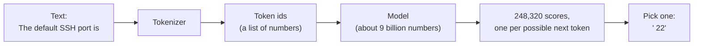
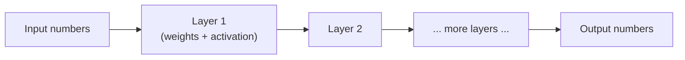

# What is an LLM, really?

Strip away the marketing and a large language model is a mathematical function with billions of adjustable numbers, tuned on a mountain of text until it gets very good at one job: predicting the next piece of text. This lesson builds that idea from zero, by hand and in code, because almost everything else in this course (hallucinations, context limits, fine-tuning, weight editing) follows directly from it.

> [!GOALS]
> - Explain what a model, a weight and a parameter are, in plain words
> - Describe how training adjusts weights using loss and gradient descent, and do it yourself in numpy
> - Explain why "predict the next token" is enough to make a model learn grammar, facts, code and reasoning patterns
> - Describe what is physically inside a model file, and why it is not a database of text
> - Explain why hallucinations and knowledge cutoffs follow from how models are trained

## A model is a function

Forget AI for a moment. A **function** takes numbers in and gives numbers out:

```text
f(x) = 3x        f(2) = 6        f(10) = 30
```

A **model**, in machine learning, is the same thing: a function that turns input numbers into output numbers. The only difference is that you don't write the rule by hand. The rule contains adjustable numbers, and those numbers are set automatically by showing the function lots of examples.

> [!CONCEPT] Model
> A function with adjustable internal numbers that maps inputs to outputs. "Training a model" means automatically finding values for those numbers so the outputs match examples. An LLM is a model whose input is a sequence of text pieces and whose output is a score for every possible next piece.

So where does text come in? Computers can't do arithmetic on words, so the text is first converted into numbers. A **tokenizer** chops it into pieces called **tokens** and gives each piece an id number (full details in [Tokens and tokenization](#/foundations/tokens)). The model takes that list of ids and outputs one score for each of the 248,320 tokens in its vocabulary: how likely each one is to come next.



That's the whole interface. Everything impressive an LLM does (writing code, explaining a vulnerability, holding a conversation) happens by running this loop over and over, one token at a time. How the scores become a chosen token is the subject of [How text gets generated](#/foundations/generation).

## Weights: the knobs

Take the simplest possible model:

```text
y = w · x
```

Here `x` is the input, `y` is the output, and `w` is a number the model gets to choose. If `w = 3`, this is `f(x) = 3x` from above. If `w = 0.5`, it halves its input. The rule's *shape* is fixed (multiply by something), but its *behaviour* depends entirely on `w`.

> [!CONCEPT] Weight
> An adjustable number inside a model. Think of it as a knob: turning it changes how the model maps inputs to outputs. "Weights" and "parameters" mean essentially the same thing: the learned numbers. Your model has about 9 billion of them, and every one was set by training, not by a human.

The key question is: **how do you find good values for the knobs?** For one knob you could guess. For 9 billion you need an automatic method. That method is the heart of all modern AI, and it's simple enough to do by hand.

## Learning a weight by hand

Suppose you don't know the rule, but you have some examples of inputs and the outputs you want:

| x | desired y |
|---|---|
| 1 | 3 |
| 2 | 6 |
| 3 | 9 |
| 4 | 12 |

(You can see the hidden rule is y = 3x, but pretend you can't. A real model never gets told the rule.)

### Step 1: measure how wrong you are

Start with a bad guess, `w = 0`. The model predicts 0 for everything. To improve it, you first need a single number for "how wrong is it?". That number is the **loss**.

> [!CONCEPT] Loss
> A single number measuring how bad the model's predictions are on the training examples. Lower is better, and zero means perfect. Training is nothing more than "change the weights to make the loss smaller".

A common choice is **mean squared error**: for each example, take (prediction − desired), square it so negatives don't cancel positives and big misses count extra, then average.

```text
w = 0:  predictions 0, 0, 0, 0
errors:            0-3   0-6   0-9   0-12   =  -3, -6, -9, -12
squared:              9    36    81    144
loss = (9 + 36 + 81 + 144) / 4 = 67.5
```

### Step 2: find which way is downhill

Should `w` go up or down, and by how much? Picture the loss as a landscape: for every possible value of `w` there's a loss value, and you want to walk to the lowest point. The **gradient** is the slope of that landscape where you're standing.

> [!CONCEPT] Gradient
> The slope of the loss with respect to a weight: how much the loss changes if you nudge that weight up a tiny bit. A negative gradient means "increasing this weight lowers the loss". A positive one means "decreasing it lowers the loss". The size says how steep it is.

For this loss, a little calculus gives the slope as the average of `2 × error × x`:

```text
gradient = average of 2 · (w·x − y) · x
at w = 0:  2·(-3)·1 = -6,  2·(-6)·2 = -24,  2·(-9)·3 = -54,  2·(-12)·4 = -96
gradient = (-6 - 24 - 54 - 96) / 4 = -45
```

Negative and large: increasing `w` will lower the loss quickly.

### Step 3: take a small step downhill, and repeat

The update rule is:

```text
w  ←  w − learning_rate × gradient
```

The **learning rate** controls the step size. With a learning rate of 0.02:

```text
w = 0 − 0.02 × (−45) = 0.9
```

Now recompute the loss at `w = 0.9` (it's 33.1, down from 67.5), recompute the gradient, step again, and keep going:

| Step | w | Loss |
|---|---|---|
| 0 | 0.0000 | 67.5000 |
| 1 | 0.9000 | 33.0750 |
| 2 | 1.5300 | 16.2067 |
| 3 | 1.9710 | 7.9413 |
| 5 | 2.4958 | 1.9067 |
| 10 | 2.9153 | 0.0539 |
| 20 | 2.9976 | 0.0000 |

The model has "discovered" that `w ≈ 3` without ever being told the rule. That's **gradient descent**, and it's how every model you'll use was trained.

> [!CONCEPT] Gradient descent
> The training loop: measure the loss, compute the gradient of the loss for every weight, nudge every weight a small step in the downhill direction, repeat. The learning rate sets the step size. Too small and training crawls; too large and the weights overshoot and the loss explodes. You'll see both in Lab A.

### From one knob to nine billion

A real LLM does exactly this, at enormous scale:

- Instead of 1 weight, there are about 9 billion, and each gets its own gradient at every step. An algorithm called **backpropagation** computes all 9 billion gradients efficiently in one backward pass through the model, using the chain rule from calculus. You don't need its details here.
- Instead of 4 examples, the training data is trillions of tokens. For reference, Qwen's previous generation (Qwen3) reported pretraining on about 36 trillion tokens.
- Instead of a laptop, training runs for weeks on clusters of thousands of data-center GPUs.

But the idea is identical: loss, gradient, nudge, repeat. When you fine-tune a model in Part 7, you'll run this same loop yourself on a much smaller scale ([Training 101](#/finetune/concepts)).

## Neurons and layers

One weight times one input can only learn "multiply by something". To learn something as rich as language, models combine many weights in a particular pattern.

A **neuron** takes several inputs, multiplies each by its own weight, adds them up (plus one extra learned number called a **bias**), and passes the result through a simple non-linear function:

```text
inputs:   x1 = 0.5    x2 = -1.0    x3 = 2.0
weights:  w1 = 0.8    w2 =  0.3    w3 = -0.5     bias b = 0.1

weighted sum = 0.8·0.5 + 0.3·(-1.0) + (-0.5)·2.0 + 0.1
             = 0.4 − 0.3 − 1.0 + 0.1 = -0.8
output = activation(-0.8)
```

The **activation function** bends the result: for example, it might pass positive values through and squash negative ones towards zero. That bend matters more than it looks. Without it, stacking any number of layers collapses into one big multiplication, which can only learn straight-line relationships. With it, stacked layers can approximate almost any pattern.

A **layer** is many neurons side by side, all reading the same inputs. Mathematically, a layer is one matrix multiplication followed by the activation: a grid of weights times a list of inputs. A **deep network** is layers stacked so that each one's output is the next one's input.



An LLM is a deep network with a specific, clever arrangement of layers called a **transformer**, covered piece by piece in [Inside the transformer](#/foundations/transformer). Your model stacks 32 transformer blocks.

## Parameters: 9 billion learned numbers

**Parameters** are all the learned numbers in a model: every weight and every bias. "9B" means about 9 billion of them.

Where do so many come from? Grids of weights get big fast. One layer inside your model reads a list of 4,096 numbers and expands it to 12,288 numbers. Every output is connected to every input, so that single grid has:

```text
4,096 × 12,288 = 50,331,648 weights   (about 50 million)
```

Your model has several grids that size in each of its 32 blocks, plus some huge ones at the input and output ends. Add them up and you reach about 8.95 billion for the language part. You'll do that count yourself in the lab of [Inside the transformer](#/foundations/transformer).

## Training vs inference

There are two very different phases in a model's life, and confusing them causes a lot of misunderstanding.

| | Training | Inference |
|---|---|---|
| What happens | Weights are adjusted by gradient descent | Weights are frozen; the model only computes outputs |
| Who does it | Qwen's team (and you, in Part 7) | You, in LM Studio, every time you chat |
| Hardware | Thousands of GPUs for weeks | Your MacBook Air |
| Direction | Forward pass, then backward pass to get gradients | Forward pass only |
| Changes the model? | Yes | **No** |

Training itself usually comes in stages. **Pretraining** on trillions of tokens of raw text produces a **base model** that can continue any document. **Post-training** (instruction tuning and reinforcement learning from human feedback) then teaches it to act as an assistant in a chat format, follow instructions and refuse certain requests. Your model is a post-trained chat model whose refusal behaviour has been removed afterwards. See [Base, instruct, thinking and chat templates](#/foundations/model-types) and [Alignment, refusals and "uncensored"](#/foundations/alignment-uncensored).

> [!WARNING]
> Your model does **not** learn from your conversations. Inference never changes the weights. When it seems to "remember" something you said ten messages ago, that's because LM Studio sends the whole conversation back in with every new message. Start a new chat and it's gone. In security terms, the model is a stateless service; the client resends the session every request. (Agents that seem to have long-term memory are built on top of this, in [Memory, context and state](#/agents/memory-state).)

## The training objective: predict the next token

Here's the single most important idea in this course. During pretraining, the model's only job is:

> Given the text so far, predict the next token.

> [!CONCEPT] Next-token prediction
> The training task for LLMs: at every position in a piece of text, the model outputs a probability for each possible next token, and the loss measures how much probability it gave to the token that actually came next. Low probability on the right answer means high loss ("surprise"). Gradient descent nudges the weights to make the model less surprised by real text.

A training example is just a piece of text. Take the sentence `The HTTP status code for Not Found is 404.` The model learns from every position at once:

```text
The                              -> predict " HTTP"
The HTTP                         -> predict " status"
The HTTP status code for Not     -> predict " Found"
The HTTP status code for Not Found is   -> predict " 404"
```

No labels, no human annotation. The text supplies its own answers, which is why training can use trillions of tokens scraped from books, the web, papers and code repositories.

### Why predicting text forces real learning

"Predict the next word" sounds like autocomplete. Why does it produce something that can explain a deserialization bug? Because **to predict text well, you have to model whatever produced the text.** Look at what each kind of prediction demands:

| To predict the next token in... | The model has to learn... |
|---|---|
| `The servers in the DMZ` → ` are` (not ` is`) | Grammar: agreement between subject and verb across several words |
| `The default port for SSH is` → ` 22` | Facts about the world, stored somewhere in the weights |
| `for (let i = 0; i < arr.length;` → ` i++)` | Programming syntax and common idioms |
| A worked solution's next line | The logic linking steps, or at least strong patterns of it |
| The next section of a security advisory | Document structure, tone and domain conventions |

There are only 9 billion numbers to cover trillions of tokens, so the model can't memorize everything. The most efficient way to reduce loss across that much text is to absorb the *rules and patterns* that generated it: grammar, facts, code structure, reasoning habits. Prediction at scale turns into compression, and compression turns into something that looks a lot like understanding. How deep that "understanding" really goes is an open research question. You'll probe it yourself in Part 8.

## What's physically inside a model file

Your GGUF file is not a program and not a database. It's mostly **tensors**: named grids of numbers, plus metadata.

> [!CONCEPT] Tensor
> A grid of numbers of any number of dimensions. A list is a 1-D tensor, a table a 2-D tensor (a matrix), and so on. Model weights are stored as tensors with a name and a shape, such as a 12,288 × 4,096 matrix for one layer's expansion step.

Here's a simplified picture of what's in the file (real tensor names vary by format; you'll list the actual ones in [Open and inspect real weights](#/weights/inspect-weights)):

```text
METADATA
  architecture: qwen3.5 (hybrid), 32 blocks, hidden size 4096, context 262,144
  tokenizer:    248,320-token vocabulary + merge rules
  chat template (the format conversations are wrapped in)
  quantization type per tensor

TENSORS (name, shape, numbers)
  token embedding table        [248320 x 4096]
  block 0  ... attention weights, MLP weights [12288 x 4096] ...
  block 1  ...
  ...
  block 31 ...
  output projection            [4096 x 248320]
```

That's it. No sentences, no documents, no lookup index. A quick back-of-envelope shows why it *can't* be a text archive:

```text
Training text:  ~36 trillion tokens × ~4 bytes per token  ≈ 144 TB   (Qwen3-scale)
Your model:                                                 5.6 GB
Ratio:                                                     ~25,000 : 1
```

The model keeps patterns, not the text itself. Some very frequently repeated text (software licenses, famous quotes, common boilerplate) can be reproduced nearly word for word, but there's no way to "look up" a document, and no record of where any fact came from.

## Why hallucinations happen

Now the uncomfortable consequence. The model was trained to produce **plausible continuations**, not true ones. Usually plausible and true are the same, because most training text is roughly accurate. But when the model has only weakly absorbed a fact, it doesn't output "I don't know". It outputs the most plausible-looking tokens, and a confident fake looks exactly as plausible as a real answer.

> [!CONCEPT] Hallucination
> Fluent, confident output that is false: an invented fact, citation, command flag, CVE id or package name. It isn't a bug in the usual sense. It follows from training on "produce likely text" rather than "produce true text", plus having no built-in way to check facts.

For security work, the usual suspects are:

- **CVE ids and details**: right format (`CVE-YYYY-NNNNN`), wrong or non-existent.
- **Tool flags**: an `nmap` or `ffuf` option that sounds right and doesn't exist.
- **Package names**: a Python or npm package that doesn't exist. Attackers have registered such hallucinated names to catch people who install them, sometimes called "slopsquatting".
- **Product behaviour**: a confident description of how a specific framework version handles a header, made up from general patterns.

Small models hallucinate more than large ones, because they store fewer facts, and your uncensored model has no trained habit of hedging. Post-training helps a model say "I'm not sure", but it never removes the problem. The real fixes are engineering: give the model the facts (retrieval, [RAG](#/using/rag)), let it call tools instead of guessing, and verify everything that matters ([Trust but verify](#/security/hallucination-verification)).

> [!WARNING]
> Never paste a model-suggested command, flag or payload into a terminal pointed at a real target without checking it against the tool's `--help` or docs. A hallucinated flag is usually harmless; a hallucinated "safe" option that actually does something destructive is not.

## Knowledge cutoff

Training data is collected up to some date, then frozen. The model knows nothing about anything after its **knowledge cutoff**: no later CVEs, tool releases, API changes or events. Qwen3.5 was released on 2 March 2026, so its training data ends some time before that. Check the model card for any stated date, and don't ask the model itself: it often states its cutoff wrongly, for the same reason it hallucinates anything else.

It's November 2026 as you read this, so at least eight months of security history is invisible to your model. It may describe an older version of a tool as current, or confidently explain a vulnerability that has since been reclassified. Uncensoring changes behaviour, not knowledge: the modified model knows exactly what the base model knew.

> [!TIP]
> The fix for a cutoff is the same as for hallucination: supply current information in the prompt (paste the advisory, the `--help` output, the docs page) and ask the model to work from that. Small models are much better at reasoning over text you give them than at recalling facts.

## Lab A: train a weight with gradient descent

> [!LAB] Watch the loss fall
> 1. Set up a workspace for Part 1 and install numpy:
>
>    ```bash
>    mkdir -p ~/ai-lab/foundations && cd ~/ai-lab/foundations
>    python3 -m venv .venv && source .venv/bin/activate
>    pip install numpy
>    ```
>
>    (If you use `uv`, `uv venv && source .venv/bin/activate && uv pip install numpy` works too.)
> 2. Save this as `~/ai-lab/foundations/gradient_descent.py`:
>
>    ```python title="gradient_descent.py"
>    import numpy as np
>
>
>    def main() -> None:
>        # Training data. The hidden rule is y = 3x, but the model is never told that.
>        x = np.array([1.0, 2.0, 3.0, 4.0])
>        y = np.array([3.0, 6.0, 9.0, 12.0])
>
>        w = 0.0    # the model's only weight, starting from a bad guess
>        lr = 0.02  # learning rate: how big each nudge is
>
>        for step in range(31):
>            pred = w * x                   # forward pass: the model's guesses
>            error = pred - y               # how wrong each guess is
>            loss = np.mean(error ** 2)     # mean squared error: one number for "how bad"
>            grad = np.mean(2 * error * x)  # slope of the loss with respect to w
>            if step in (0, 1, 2, 3, 5, 10, 15, 20, 30):
>                print(f"step {step:2d}   w = {w:.4f}   loss = {loss:9.4f}   grad = {grad:8.3f}")
>            w = w - lr * grad              # nudge w downhill
>
>        print(f"\nlearned w = {w:.4f} (the hidden rule used 3)")
>        print(f"prediction for x = 10: {w * 10:.2f}")
>
>
>    if __name__ == "__main__":
>        main()
>    ```
>
> 3. Run it:
>
>    ```bash
>    python gradient_descent.py
>    ```
>
>    ```text
>    step  0   w = 0.0000   loss =   67.5000   grad =  -45.000
>    step  1   w = 0.9000   loss =   33.0750   grad =  -31.500
>    step  2   w = 1.5300   loss =   16.2067   grad =  -22.050
>    step  3   w = 1.9710   loss =    7.9413   grad =  -15.435
>    step  5   w = 2.4958   loss =    1.9067   grad =   -7.563
>    step 10   w = 2.9153   loss =    0.0539   grad =   -1.271
>    step 15   w = 2.9858   loss =    0.0015   grad =   -0.214
>    step 20   w = 2.9976   loss =    0.0000   grad =   -0.036
>    step 30   w = 2.9999   loss =    0.0000   grad =   -0.001
>
>    learned w = 3.0000 (the hidden rule used 3)
>    prediction for x = 10: 30.00
>    ```
>
>    Notice how the gradient shrinks as you approach the bottom: steps get smaller on their own.
> 4. **Too big a step.** Change `lr` to `0.1` and rerun. `w` overshoots to 4.5, then swings back and forth around 3 before settling. Now try `lr = 0.14`: the swings grow every step and the loss explodes into the thousands. This is **divergence**, and it's a real failure mode when fine-tuning with too high a learning rate.
> 5. **Two knobs.** Change the data to `y = np.array([5.0, 8.0, 11.0, 14.0])` (that's y = 3x + 2). Add a bias `b = 0.0`, make the prediction `w * x + b`, add `grad_b = np.mean(2 * error)` and update `b = b - lr * grad_b`. Run for 2,000 steps and print both. Does it find `w ≈ 3, b ≈ 2`? That's the same loop over 2 parameters instead of 1; your LLM ran it over 9 billion.
> 6. In `~/ai-lab/NOTES.md`, record what each learning rate did.

## Lab B: be the model

> [!LAB] Watch next-token prediction from the outside
> **Part 1: in the LM Studio chat**
>
> 1. Start a new chat with your model and send this unfinished document, with no instructions:
>
>    ```text
>    # Incident report: INC-2291
>
>    ## Summary
>    At 02:14 UTC our WAF began blocking requests to /api/v2/export because
>    ```
>
>    Does it continue the sentence, or reply *about* your text ("It looks like you're writing an incident report...")? A chat model usually does the second. Its post-training taught it that text in the user slot is a request to answer, and LM Studio wraps your message in a chat template that marks it as such.
> 2. Now send the same text with one line on top: `Continue the following document exactly where it stops. Output only the continuation.` Compare. You're steering a next-token predictor with context: the instruction makes "a continuation" the most likely next text.
> 3. Try a document type with strong conventions, such as the start of an `nmap` scan report, a Python file that stops mid-function, or a CVSS vector string. Notice how much structure the model reproduces from just a few lines.
>
> **Part 2 (optional): raw completion, no chat wrapper**
>
> 4. Start LM Studio's local server: toggle it on in the **Developer** tab, or run `lms server start`. (Full details in [Local server, API and the lms CLI](#/lmstudio/server-api).)
> 5. Send raw text to the completions endpoint, which skips the chat template entirely and just predicts what comes next:
>
>    ```bash
>    curl -s http://localhost:1234/v1/completions \
>      -H "Content-Type: application/json" \
>      -d '{
>        "model": "qwen3.5-9b-uncensored-hauhaucs-aggressive",
>        "prompt": "# Nmap cheat sheet\n\n## Scan the top 1000 TCP ports with service detection\n\nCommand: nmap",
>        "max_tokens": 60,
>        "temperature": 0
>      }' | python3 -c "import sys, json; print(json.load(sys.stdin)['choices'][0]['text'])"
>    ```
>
>    Check your model id with `lms ls` or `curl http://localhost:1234/v1/models` if it differs. With no chat wrapper, the model behaves like the document-continuer it was pretrained to be. It may keep writing more cheat-sheet sections until it hits `max_tokens`, because nothing tells it the "answer" is over.
> 6. **Provoke a hallucination.** CVE ids include the year, so a 2031 CVE can't exist yet. Change the prompt to `"CVE-2031-0001 is a critical vulnerability in"` and run it again. The model will happily describe a vulnerability that doesn't exist, because a fluent description is the most plausible continuation. Remember this output the next time it gives you a CVE id.
> 7. Record both experiments in your notebook: what you sent, what came back, and whether the model continued or answered.

## Recap

- A model is a function with adjustable numbers (weights or parameters). An LLM maps a list of token ids to a score for each of the 248,320 possible next tokens.
- Training finds weight values with **gradient descent**: measure the loss, compute each weight's gradient, nudge downhill, repeat. Your LLM did this over about 9 billion weights and trillions of tokens.
- Neurons compute weighted sums plus a non-linear activation. Layers are matrix multiplications. Deep networks stack layers.
- Training changes weights; inference (what your Mac does) never does. The model doesn't learn from your chats.
- The training objective is **next-token prediction**. Doing it well across enormous amounts of text forces the model to absorb grammar, facts, code and reasoning patterns.
- A model file is tensors plus metadata: compressed patterns, not a database of text.
- Hallucinations follow from optimizing for plausible text, and the knowledge cutoff from frozen training data. Supply facts and verify.

## Check yourself

1. In the y = w·x example, the gradient at w = 0 was −45. What does the sign tell you, and what would a learning rate of 0.02 do to w?
   <details><summary>Answer</summary>

   A negative gradient means increasing w lowers the loss. The update is w ← w − 0.02 × (−45) = 0 + 0.9 = 0.9, a step towards the true value of 3.

   </details>
2. You chat with your model for an hour about a target's API, then open a new chat and it knows nothing about it. Explain why, in terms of training and inference.
   <details><summary>Answer</summary>

   Chatting is inference, and inference never changes the weights. The model only "knew" about the API because LM Studio resent the whole conversation as input with every message. A new chat starts with an empty context, so that information is gone.

   </details>
3. Why does training on "predict the next token" produce a model that knows facts like default port numbers, rather than just grammar?
   <details><summary>Answer</summary>

   Because many next tokens can only be predicted correctly if you know the fact. After "The default port for SSH is", the loss is only low if the model puts high probability on " 22". Across trillions of tokens, storing common facts (and patterns of grammar, code and reasoning) in the weights is the most efficient way to reduce the loss.

   </details>
4. Someone claims "the model file secretly contains its training data, you just need to search it". Give a quick numerical argument against this.
   <details><summary>Answer</summary>

   Qwen3-scale training data is about 36 trillion tokens, roughly 144 TB of text, while your model file is about 5.6 GB, around 25,000 times smaller. The file holds tensors of learned numbers that encode patterns. Some very common text can be reproduced almost verbatim, but there's no stored, searchable copy of the training documents.

   </details>
5. Your model confidently gives you a CVE id and a fix version for a library bug. Why should you not trust it, and what should you do?
   <details><summary>Answer</summary>

   The model is optimized to produce plausible text, and a correctly formatted but invented CVE id is very plausible. Small models store fewer facts, its knowledge stops before its March 2026 release, and the uncensored model has no habit of hedging. Check the id and versions against an authoritative source (NVD, the vendor advisory, the project's changelog), or give the model the real advisory text and ask it to work from that.

   </details>

## Go deeper

- [3Blue1Brown: Neural networks](https://www.3blue1brown.com/topics/neural-networks) — beautiful visual explanations of neurons, gradient descent and backpropagation, ending with how GPTs work.
- [Andrej Karpathy: Intro to Large Language Models](https://www.youtube.com/watch?v=zjkBMFhNj_g) — a one-hour overview of pretraining, post-training and what a model file is.
- [Andrej Karpathy: Deep Dive into LLMs like ChatGPT](https://www.youtube.com/watch?v=7xTGNNLPyMI) — the longer version, including a very clear treatment of hallucinations and why they happen.
- [Hugging Face LLM Course](https://huggingface.co/learn/llm-course) — a free, hands-on course for when you want to go further with the `transformers` library.
