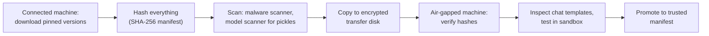

# Hardening and air-gapping

The offline stack works. Now make it defensible: services that cannot be reached from the network, outbound traffic you control, model files whose integrity you can prove, agents that cannot touch your real account, and a procedure for moving all of it into an air-gapped environment. This is the lesson you point to when a client asks how you protect their data on your AI tooling.

> [!GOALS]
> - Bind every AI service to localhost and verify it
> - Configure the macOS application firewall, outbound control with LuLu, and basic pf rules
> - Prove model provenance with Hugging Face commit hashes, SHA-256 and a trusted-file manifest
> - Describe LM Studio's actual network behavior and switch off telemetry elsewhere
> - Isolate agent tool execution, keep secrets out of prompts, and audit-log agent actions
> - Run an air-gap transfer and a sane update strategy, with a checklist

## Layer 1: nothing listens on the network

The cheapest control is not exposing anything. Check what is listening:

```bash
lsof -nP -iTCP -sTCP:LISTEN
```

For the AI stack you want lines like `127.0.0.1:1234` (LM Studio), `127.0.0.1:3000` (Open WebUI) and `127.0.0.1:8888` (SearXNG). Anything bound to `*` or a LAN address is reachable by every device on the same network.

| Service | How to keep it on localhost |
|---|---|
| LM Studio server | **Serve on Local Network** off (Developer > Server Settings). From the CLI, `lms server start` binds `127.0.0.1` by default; `--bind 0.0.0.0` would expose it |
| LM Studio authentication | Turn on **Require Authentication** (LM Studio 0.4.0+) if anything other than you could ever reach the port; create tokens under Manage Tokens and send them as `Authorization: Bearer <token>` |
| LM Studio MCP over API | Leave **Allow per-request MCPs** and **Allow calling servers from mcp.json** off unless a local script needs them |
| llama-server | `--host 127.0.0.1` (the default) plus `--api-key-file` |
| Docker containers | Publish ports as `127.0.0.1:3000:8080`, never `3000:8080` (that binds all interfaces) |

> [!TIP]
> Turning on Require Authentication even on localhost is cheap defense in depth: any other local process (a malicious npm postinstall script, a compromised browser extension talking to localhost) then needs the token too. Store the token in an environment variable such as `LM_API_TOKEN`, which the scripts in this course already read.

## Layer 2: the macOS application firewall

The built-in firewall filters **inbound** connections per application. Turn it on with stealth mode (no replies to probes):

```bash
sudo /usr/libexec/ApplicationFirewall/socketfilterfw --setglobalstate on
sudo /usr/libexec/ApplicationFirewall/socketfilterfw --setstealthmode on
/usr/libexec/ApplicationFirewall/socketfilterfw --getglobalstate
```

The same settings are in System Settings > Network > Firewall. On hostile networks (conferences, hotels, client sites) you can block all incoming connections with `--setblockall on`. The application firewall does nothing about **outbound** traffic, which is where exfiltration happens.

## Layer 3: outbound control with LuLu

[LuLu](https://objective-see.org/products/lulu.html) from Objective-See is a free, open-source macOS firewall for outgoing connections. When a program makes a new connection, it alerts you and you allow or block it, creating a rule per process (optionally per remote endpoint, permanent, per process lifetime, or with an expiry).

For an AI workstation, the useful policy is:

| Program | Rule |
|---|---|
| LM Studio | Allow only when you are deliberately downloading or updating; otherwise block. Chat, RAG and the local server do not need the internet |
| Docker Desktop / containers | Block by default; allow temporarily (with an expiry) for image pulls; allow SearXNG's traffic only if you use web search |
| Python (your venvs) | Block by default; allow per run for downloads or for in-scope testing |
| Agents | Never get blanket internet access; they go through a sandbox network or a scope-checking proxy |

LuLu also has a **Block** mode that blocks everything routed through it except your allow list, useful during an engagement where the rules say the laptop may only talk to the test network. Two caveats from its documentation: it filters outbound only, and some traffic bypasses macOS network extensions entirely, so LuLu is a strong control, not a perfect one.

> [!MAC]
> LuLu needs you to approve a System Extension and a Network Filter in System Settings after install. Install it from the DMG on the Objective-See site and check the signature like any other security tool.

## Layer 4: pf basics

macOS ships OpenBSD's packet filter, **pf**. It works below applications, by interface, address and port. You do not need it for daily use; it is useful for one hard rule that must hold regardless of app settings, such as "nothing on the LAN reaches port 1234, ever".

The stock `/etc/pf.conf` loads sub-rulesets from the `com.apple` anchor, so add yours as a named sub-anchor instead of editing that file (macOS updates can overwrite it):

```text title="/etc/pf.anchors/ai-lab"
# Block inbound to AI service ports on all non-loopback interfaces
block in quick proto tcp from any to any port { 1234, 3000, 8080, 8081, 8888 }
pass  in quick on lo0 all
```

```bash
sudo pfctl -vnf /etc/pf.anchors/ai-lab                     # syntax check only
sudo pfctl -a com.apple/ai-lab -f /etc/pf.anchors/ai-lab   # load into a sub-anchor
sudo pfctl -E                                              # enable pf (prints a reference token)
sudo pfctl -a com.apple/ai-lab -s rules                    # show what is loaded
```

> [!WARNING]
> pf rules loaded this way do not survive a reboot unless you add a LaunchDaemon, and a wrong rule can cut off your own connectivity. Always run the `-vnf` syntax check first, and keep a terminal open to remove the anchor (`sudo pfctl -a com.apple/ai-lab -F all`) while testing.

## Layer 5: model provenance

A model file is a dependency you execute (or at least parse) with full trust. Treat it like a binary from a vendor: know where it came from, pin the version, verify the hash.

### What to record

- **Repository and commit.** Hugging Face repos are Git repositories; each commit has a hash. For your model, the `main` branch of `HauhauCS/Qwen3.5-9B-Uncensored-HauhauCS-Aggressive` pointed at commit `0a41c68809d375475f954be12ba7c40efa56c2a9` (last modified 2026-06-05) when this lesson was written.
- **File SHA-256.** Large files are stored via Git LFS / Xet, and the Hub publishes each file's SHA-256 (shown on the file page and returned by the API). For `Qwen3.5-9B-Uncensored-HauhauCS-Aggressive-Q4_K_M.gguf` it was `2ca636d9e81d3d23ca9b60c234fe185d30ec082eeba69ce770fdb0c76559a4f5`, size 5,627,044,224 bytes.

Do not trust those values because a lesson printed them; fetch them yourself:

```bash
curl -s https://huggingface.co/api/models/HauhauCS/Qwen3.5-9B-Uncensored-HauhauCS-Aggressive/revision/main | python3 -c "import sys, json; print(json.load(sys.stdin)['sha'])"
curl -s https://huggingface.co/api/models/HauhauCS/Qwen3.5-9B-Uncensored-HauhauCS-Aggressive/tree/main | python3 -c "import sys, json; [print(f['lfs']['oid'], f['size'], f['path']) for f in json.load(sys.stdin) if f.get('lfs')]"
```

Then hash your local copy and compare:

```bash
shasum -a 256 ~/.lmstudio/models/HauhauCS/Qwen3.5-9B-Uncensored-HauhauCS-Aggressive/*.gguf
```

When you download with the `hf` CLI, pin the commit instead of a moving branch: `hf download <repo> <file> --revision <commit-hash> --local-dir <dir>` (check `hf download --help` on your version).

> [!NOTE]
> A matching hash proves you have the file the uploader published, not that the uploader is trustworthy or the weights are benign. Provenance answers "is this the file I decided to trust?"; the decision to trust a publisher is separate. See [Threat-model your own AI setup](#/security/ai-threat-model) for what a malicious file can do.

### A manifest of trusted files

Keep a JSON manifest of every model file you trust, and verify against it before loading, after transfers and after restores.

```python title="model_manifest.py"
#!/usr/bin/env python3
"""Trusted-model manifest: record expected SHA-256 from Hugging Face, verify local files.

usage:
  python3 model_manifest.py add <repo> <file> <local_path> [--revision <commit>]
  python3 model_manifest.py verify
"""
import argparse
import hashlib
import json
import sys
from pathlib import Path

import requests

MANIFEST = Path.home() / "ai-lab/weights/trusted-models.json"


def sha256(path: Path) -> str:
    h = hashlib.sha256()
    with path.open("rb") as f:
        for block in iter(lambda: f.read(8 * 1024 * 1024), b""):  # 8 MiB blocks: constant memory
            h.update(block)
    return h.hexdigest()


def hub_entry(repo: str, filename: str, revision: str) -> dict:
    commit = requests.get(f"https://huggingface.co/api/models/{repo}/revision/{revision}", timeout=30)
    commit.raise_for_status()
    tree = requests.get(f"https://huggingface.co/api/models/{repo}/tree/{revision}", timeout=30)
    tree.raise_for_status()
    for f in tree.json():
        if f["path"] == filename and f.get("lfs"):
            return {"repo": repo, "file": filename, "commit": commit.json()["sha"],
                    "sha256": f["lfs"]["oid"], "size": f["size"]}
    sys.exit(f"{filename} not found as an LFS file in {repo}@{revision}")


if __name__ == "__main__":
    ap = argparse.ArgumentParser()
    sub = ap.add_subparsers(dest="cmd", required=True)
    add = sub.add_parser("add")
    add.add_argument("repo")
    add.add_argument("file")
    add.add_argument("local_path")
    add.add_argument("--revision", default="main")
    sub.add_parser("verify")
    args = ap.parse_args()

    manifest = json.loads(MANIFEST.read_text()) if MANIFEST.exists() else {}
    if args.cmd == "add":
        entry = hub_entry(args.repo, args.file, args.revision)
        local = Path(args.local_path).expanduser()
        actual = sha256(local)
        if actual != entry["sha256"]:
            sys.exit(f"MISMATCH: local {actual} != hub {entry['sha256']}; not adding")
        manifest[str(local)] = entry
        MANIFEST.parent.mkdir(parents=True, exist_ok=True)
        MANIFEST.write_text(json.dumps(manifest, indent=2))
        print(f"trusted: {local.name} @ {entry['commit'][:12]}")
    else:
        bad = 0
        for path, entry in manifest.items():
            p = Path(path)
            status = "MISSING" if not p.exists() else ("OK" if sha256(p) == entry["sha256"] else "MODIFIED")
            bad += status != "OK"
            print(f"{status:<9} {p.name}")
        sys.exit(1 if bad else 0)
```

`add` is the only online step (it asks the Hub for the expected hash); `verify` works fully offline, which is exactly what you need on the far side of an air gap. Hashing a 5.6 GB file takes a while on an Air; that is normal.

## Layer 6: telemetry and privacy settings

Describe what tools actually do, from their own documentation, rather than assuming.

**LM Studio.** Its [privacy policy](https://lmstudio.ai/app-privacy) states that the application does not include telemetry or user-specific tracking, and that messages, chat history and documents used with local models are never transmitted from your system. The app does make network requests for update checks (sending app version, OS and your IP as seen by the CDN), for model search (queries sent in anonymized form) and for downloads. Optional paid cloud features, if you buy and use them, send prompts to third-party processors. The [offline docs](https://lmstudio.ai/docs/app/offline) list which features need the internet: model search, model downloads, runtime downloads and app updates. In practice: everything you care about stays local, and you can block LM Studio's outbound traffic with LuLu except when updating. Policies change, so reread them when you update.

**Hugging Face libraries.** Set `HF_HUB_DISABLE_TELEMETRY=1` (or `DO_NOT_TRACK=1`) and `HF_HUB_OFFLINE=1` as shown in [Design a private offline AI stack](#/infra/offline-stack).

**Open WebUI.** `OFFLINE_MODE=true` disables update checks and automatic model downloads; its docs note this does not block outbound connections, so enforce at the network layer.

**macOS itself.** Review System Settings > Privacy & Security > Analytics & Improvements, and decide deliberately whether iCloud Drive syncs your Desktop and Documents. Keep engagement data and `~/ai-lab` out of synced folders.

## Layer 7: FileVault

Everything in this module assumes an encrypted disk: chat histories, RAG indexes, model manifests, sanitizer maps and logs are all client data at rest.

```bash
fdesetup status
```

If it does not say `FileVault is On`, enable it in System Settings > Privacy & Security > FileVault, and store the recovery key somewhere that is not this laptop. Encrypt external disks used for model mirrors or transfers too (Disk Utility, APFS Encrypted).

## Layer 8: isolate agent tool execution

An agent's tools run with someone's privileges. Make sure that someone is not you.

**Option A: Docker sandbox (preferred for tools).** Each tool call runs in a throwaway container with no network, a read-only root filesystem and no extra capabilities (the full command is in [Threat-model your own AI setup](#/security/ai-threat-model)). Mount only a per-task work folder. If a tool needs the network, attach it to a network that can reach only an egress proxy enforcing your scope allowlist.

**Option B: a separate macOS user (for whole agent processes).** Create a standard (non-admin) account, for example `agentrunner`, in System Settings > Users & Groups. Run the agent under that account: it has its own home directory, so no access to your SSH keys, browser profiles, cloud CLI credentials or Keychain. Combine it with LuLu rules for that user's processes. It is coarser than Docker but needs no VM.

Either way, keep the rule from the threat model: tools that write, send or delete require human approval.

## Layer 9: secrets hygiene

- **Never paste live secrets into prompts.** They end up in chat history, logs and possibly reports. The redaction in the [HTTP analysis recipe](#/security/workflows) exists for this reason.
- **Never put secrets in system prompts.** They can be extracted (OWASP LLM07:2025).
- **Tools hold credentials, the model does not.** If an agent needs an API key for a recon service, the tool reads it from the environment or the macOS Keychain at call time; the model only ever sees results.
- **Scope tokens tightly.** LM Studio API tokens have selectable permissions; create one per client app and revoke it when done. Use read-only tokens for third-party APIs wherever possible.
- **Rotate after exposure.** If a secret was pasted into a chat, delete the chat and rotate the secret. Deleting alone is not enough if logs or backups caught it.

## Layer 10: audit logging of agent actions

When an agent acts on an engagement, you need to show afterwards exactly what it did: which requests, to which hosts, approved by whom. Log every tool call as an append-only JSON line, and chain each entry to the previous one with a hash so tampering or deletion is detectable.

```python title="audit_log.py"
"""Append-only, hash-chained audit log for agent tool calls.

usage (from your agent):  from audit_log import log_action
                           log_action("http_get", {"url": url}, approved_by="sethu", result_summary="200, 4.1 kB")
verify:                   python3 audit_log.py
"""
import hashlib
import json
import sys
import time
from pathlib import Path

LOG = Path.home() / "ai-lab/agents/audit.jsonl"


def _last_hash() -> str:
    if not LOG.exists() or LOG.stat().st_size == 0:
        return "0" * 64
    return json.loads(LOG.read_text().splitlines()[-1])["hash"]


def log_action(tool: str, args: dict, approved_by: str | None, result_summary: str) -> None:
    entry = {"ts": time.strftime("%Y-%m-%dT%H:%M:%S%z"), "tool": tool, "args": args,
             "approved_by": approved_by, "result": result_summary, "prev": _last_hash()}
    entry["hash"] = hashlib.sha256(json.dumps(entry, sort_keys=True).encode()).hexdigest()
    LOG.parent.mkdir(parents=True, exist_ok=True)
    with LOG.open("a") as f:
        f.write(json.dumps(entry, sort_keys=True) + "\n")


def verify() -> bool:
    prev = "0" * 64
    for n, line in enumerate(LOG.read_text().splitlines(), 1):
        entry = json.loads(line)
        claimed = entry.pop("hash")
        if entry["prev"] != prev or hashlib.sha256(json.dumps(entry, sort_keys=True).encode()).hexdigest() != claimed:
            print(f"chain broken at line {n}")
            return False
        prev = claimed
    print("audit log intact")
    return True


if __name__ == "__main__":
    sys.exit(0 if verify() else 1)
```

A hash chain on the same disk detects accidental or naive tampering; an attacker with full control could rewrite the whole chain. For stronger guarantees, periodically copy the latest hash somewhere else (your engagement notes, a ticket). Never log secrets in `args`; log the redacted form.

## The air-gap transfer procedure

Moving models and tools into an isolated environment is a classic supply-chain checkpoint. Do it the same way every time:



1. **Download on a connected staging machine**, pinned by commit hash (models), version (wheels) and digest (Docker images). Prefer GGUF and safetensors; refuse pickle formats.
2. **Hash everything** into a manifest: `shasum -a 256` for every file, plus `model_manifest.py add` for model files.
3. **Scan.** Run your usual malware scanner over the bundle. For any non-GGUF model artifacts, run a model scanner such as `modelscan -p <path>` (Protect AI's tool, `pip install modelscan`), which detects unsafe operations in serialized model formats. Scanners are blocklists (remember nullifAI); they reduce risk, they do not certify.
4. **Copy to an encrypted transfer disk**, together with the manifest. Sign or separately record the manifest hash (for example in your engagement log) so the manifest itself cannot be swapped.
5. **Verify on the far side** before anything is loaded: `shasum -a 256 -c` or `model_manifest.py verify`. Any mismatch means the file does not cross.
6. **Inspect and test**: print GGUF chat templates with `inspect_gguf.py` from the threat model lesson, then load the model and run your [persona test suite](#/security/system-prompts) to confirm it behaves like the one you tested.
7. **Promote** the files into the trusted manifest on the air-gapped side and wipe the transfer disk.

```bash
cd /Volumes/TRANSFER && shasum -a 256 -c SHA256SUMS
```

## Update strategy

Updates fix security bugs (the llama.cpp parser CVEs were fixed by updating) and also change behavior. Handle them like any production dependency:

- **Pin by default.** Know your LM Studio version, runtime version, model commit and container digests at all times (the reproducibility table in [Why local AI](#/security/why-local)).
- **Watch the right feeds.** LM Studio release notes, the [llama.cpp security advisories](https://github.com/ggml-org/llama.cpp/security/advisories), Open WebUI releases.
- **Security fixes fast, features slow.** A parser CVE in the runtime that loads untrusted files is a prompt update. A new feature release can wait for a quiet week.
- **Stage, test, promote.** Update on a non-engagement day, rerun your persona tests and a workflow or two, compare outputs, then carry the update across the air gap.
- **Never update mid-engagement** unless a security fix forces it; if it does, note the change in your engagement log because outputs may differ.
- **Re-verify after updates and restores.** Run `model_manifest.py verify` and the listener check again.

## Hardening checklist

> [!LAB] Work through the checklist on your Mac
> Tick each item as you verify it (verification means you ran the command or looked at the setting, not that you remember setting it).

- [ ] `lsof -nP -iTCP -sTCP:LISTEN` shows AI services only on `127.0.0.1`
- [ ] LM Studio: Serve on Local Network off; MCP-over-API settings off; Require Authentication on (with `LM_API_TOKEN` exported for scripts)
- [ ] Docker ports published as `127.0.0.1:<port>:<port>`
- [ ] Application firewall on, stealth mode on
- [ ] LuLu installed; LM Studio, Docker and Python blocked outbound by default
- [ ] (Optional) pf anchor blocking inbound AI ports, syntax-checked and tested
- [ ] Model files hashed and recorded in `trusted-models.json`; `model_manifest.py verify` passes
- [ ] Chat templates of every GGUF inspected once
- [ ] `HF_HUB_OFFLINE`, `HF_HUB_DISABLE_TELEMETRY`, `DO_NOT_TRACK` set in `~/.zshrc`
- [ ] Open WebUI `OFFLINE_MODE=true`; sign-ups disabled after creating the admin
- [ ] `fdesetup status` says FileVault is On; transfer disks encrypted
- [ ] `~/ai-lab` and engagement folders outside iCloud-synced locations
- [ ] Agent tools run in a Docker sandbox or as a separate standard user
- [ ] No secrets in system prompts; API keys read by tools from env or Keychain
- [ ] Agent tool calls written to the hash-chained audit log; `python3 audit_log.py` passes
- [ ] Air-gap procedure written down; last transfer verified with `shasum -a 256 -c`
- [ ] Versions pinned and recorded: LM Studio, runtime, model commit, container digests
- [ ] Retention rule per engagement: chats, RAG indexes, logs and sanitizer maps deleted at close

## Recap
- Layer the controls: localhost binding and authentication, inbound firewall, outbound control (LuLu), and pf for rules that must hold regardless of apps.
- Provenance is commit hash plus SHA-256 plus a manifest; `verify` must work offline. A matching hash proves integrity, not trustworthiness.
- LM Studio's documented behavior: no telemetry, chats and documents stay local; network only for updates, model search and downloads.
- FileVault, no synced folders, and per-engagement retention protect data at rest.
- Agent tools run sandboxed (Docker or a separate user), secrets stay in tools not prompts, and every action is audit-logged with a hash chain.
- Air-gap transfers follow a fixed procedure: pin, hash, scan, encrypt, verify, inspect, promote. Updates are staged, tested and recorded.

## Check yourself
1. Your Docker compose file says `ports: ["3000:8080"]`. What is the exposure, and what is the fix?
   <details><summary>Answer</summary>

   Docker publishes the port on all interfaces, so Open WebUI is reachable from the LAN. Use `"127.0.0.1:3000:8080"` to bind it to loopback only.

   </details>
2. Why is the macOS application firewall alone not enough for an AI workstation?
   <details><summary>Answer</summary>

   It filters inbound connections only. Prompt injection and malicious tools exfiltrate data through outbound connections, which need an outbound control such as LuLu, Docker networks without internet, or pf egress rules.

   </details>
3. The SHA-256 of your local GGUF matches the Hub's published hash. What have you proven, and what have you not?
   <details><summary>Answer</summary>

   You have proven the file is byte-for-byte the one the uploader published at that commit (integrity, no corruption or tampering in transit). You have not proven the uploader or the weights are trustworthy, or that the file is safe for your parser version.

   </details>
4. Why does `model_manifest.py verify` deliberately not contact Hugging Face?
   <details><summary>Answer</summary>

   It must work on an air-gapped machine, and it should check against the decision you recorded when you trusted the file, not against whatever the Hub serves today (which could change if the repo is updated or compromised).

   </details>
5. An agent's audit log verifies as intact. An attacker had full control of your user account for a day. Can you trust the log?
   <details><summary>Answer</summary>

   Not fully. A hash chain on the same disk detects partial edits, but an attacker with full control could rewrite the entire chain consistently. That is why you periodically record the latest hash outside the machine and compare.

   </details>

## Go deeper
- [Objective-See LuLu](https://objective-see.org/products/lulu.html) — outbound firewall modes, rules and limitations
- [LM Studio server settings](https://lmstudio.ai/docs/developer/core/server/settings) and [authentication](https://lmstudio.ai/docs/developer/core/authentication) — the exact switches discussed here
- [LM Studio privacy policy](https://lmstudio.ai/app-privacy) — what the app sends and does not send
- [llama.cpp security advisories](https://github.com/ggml-org/llama.cpp/security/advisories) — the feed to watch for runtime updates
- [Hugging Face: pickle scanning](https://huggingface.co/docs/hub/security-pickle) — what the Hub scans and why pickle is risky
