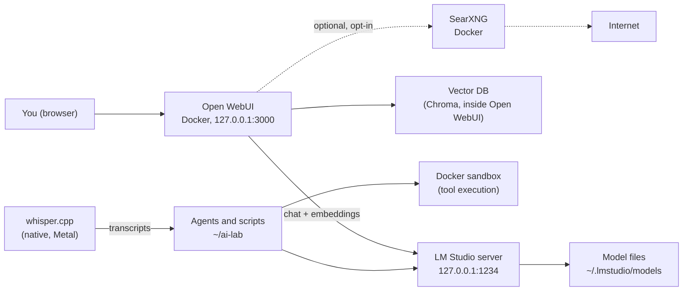

# Design a private offline AI stack

So far you have used pieces: LM Studio's chat, its server, scripts, a RAG index, agents. This lesson assembles them into one designed system that keeps every byte of data on your Mac, keeps working with Wi-Fi off, and can be rebuilt from local mirrors. Think of it as the reference architecture for your engagement laptop.

> [!GOALS]
> - Design a private, offline-capable AI stack with clear components, ports and data flows
> - Run Open WebUI in Docker against LM Studio for both chat and embeddings
> - Add optional controlled web search (SearXNG) and local speech-to-text (whisper.cpp)
> - Configure offline caches and mirror wheels, images and model files
> - Know what can and cannot run at the same time on 16 GB

## Three properties to design for

"Private and offline" is really three separate requirements. Write them down the way you would write security requirements for a client system:

1. **Private**: no prompt, document or output leaves the machine. Verified, not assumed.
2. **Offline-capable**: everything works with the network unplugged. Things that need the internet (updates, model downloads, web search) are explicit, optional and isolated.
3. **Rebuildable**: you can reinstall the stack on a fresh or air-gapped machine from local copies: model files, Python wheels, Docker images, each with a hash.

## The architecture



Solid arrows work offline. Dotted arrows are the only paths to the internet, and they are optional.

### Components

| Role | Choice | Alternative | Runs as | Listens on |
|---|---|---|---|---|
| Inference server | LM Studio server | `llama-server` from llama.cpp | macOS app | 127.0.0.1:1234 |
| Chat UI | Open WebUI | LM Studio's own chat | Docker container | 127.0.0.1:3000 |
| Embeddings | LM Studio (embedding model, same server) | sentence-transformers in Python | macOS app | same as inference |
| Vector DB | Chroma built into Open WebUI | Your own Chroma from [RAG](#/using/rag) | inside the container | none (embedded) |
| Document ingestion | Open WebUI uploads, or your RAG scripts | | container / Python | none |
| Agents | Your Python agents | [frameworks](#/agents/frameworks) | Python venv | none |
| Tool sandbox | Docker with `--network none` | separate macOS user | Docker | none |
| Web search (optional) | SearXNG | none (stay offline) | Docker container | 127.0.0.1:8888 |
| Speech to text | whisper.cpp | Open WebUI's built-in Whisper | native CLI | none |

Every listener binds to `127.0.0.1`. That single decision removes the LAN from your threat model (see [Threat-model your own AI setup](#/security/ai-threat-model)).

## The inference server

**LM Studio** is the default: you already know it, it serves the OpenAI-compatible API on `http://localhost:1234/v1`, it can serve a chat model and an embedding model at the same time, and its documentation states that chatting, document processing and the local server all work without internet ([offline docs](https://lmstudio.ai/docs/app/offline)). Start it from the Developer tab or with `lms server start`. Keep **Serve on Local Network** off.

**llama-server** is the alternative when you want a headless, scriptable process with every flag visible. It is the server from llama.cpp, the engine LM Studio's GGUF runtime is built on.

```bash
brew install llama.cpp
llama-server -m ~/.lmstudio/models/HauhauCS/Qwen3.5-9B-Uncensored-HauhauCS-Aggressive/Qwen3.5-9B-Uncensored-HauhauCS-Aggressive-Q4_K_M.gguf \
  --host 127.0.0.1 --port 8081 -c 32768 --jinja --offline \
  --chat-template-kwargs '{"enable_thinking":false}'
```

`--host` defaults to `127.0.0.1` (stated explicitly anyway), `-c` sets the context, `--jinja` uses the model's chat template, `--offline` forbids network access for model fetching, and `--api-key` or `--api-key-file` add authentication. Defaults change between builds (the README now documents a default port of 9931, older builds used 8080), so pass `--port` explicitly and check `llama-server --help`. Adjust the model path to where your file actually is.

> [!TIP]
> Do not run both servers with the same model loaded: you would pay for the weights twice. Pick one per session.

## Chat UI: Open WebUI against LM Studio

Open WebUI is a self-hosted, ChatGPT-style interface with users, chat history, document upload and RAG. Run it in Docker and point it at LM Studio through `host.docker.internal`, the special hostname Docker Desktop provides for reaching the Mac from inside a container.

The relevant environment variables (from the [Open WebUI environment reference](https://docs.openwebui.com/reference/env-configuration)):

| Variable | Value here | Why |
|---|---|---|
| `OPENAI_API_BASE_URL` | `http://host.docker.internal:1234/v1` | LM Studio's OpenAI-compatible endpoint |
| `OPENAI_API_KEY` | `lm-studio` (or your LM Studio token) | Any string works unless authentication is on |
| `ENABLE_OLLAMA_API` | `false` | No Ollama here; avoids pointless connection attempts |
| `RAG_EMBEDDING_ENGINE` | `openai` | Get embeddings from an OpenAI-compatible server (LM Studio) instead of downloading a model |
| `RAG_OPENAI_API_BASE_URL` | `http://host.docker.internal:1234/v1` | Where to send embedding requests |
| `RAG_EMBEDDING_MODEL` | your LM Studio embedding model id | Check `lms ls`; LM Studio typically lists its Nomic model as `text-embedding-nomic-embed-text-v1.5` |
| `OFFLINE_MODE` | `true` | Disables update checks and automatic model downloads |
| `HF_HUB_OFFLINE` | `1` | Hugging Face libraries inside the container use only cached files |
| `WEBUI_SECRET_KEY` | a long random value | Signs session tokens; set it explicitly so sessions survive restarts |

> [!WARNING]
> Many Open WebUI settings (including the `RAG_*` and web-search variables) are **persistent config**: their values are saved in Open WebUI's database on first launch, and later changes to the environment variable are ignored. Set them before the first start, or change them in the Admin Panel afterwards (or set `ENABLE_PERSISTENT_CONFIG=false` to make environment variables always win).

> [!NOTE]
> Open WebUI's docs are explicit that the offline variables **do not block outbound connections**; they only stop the app from trying. Actual isolation comes from the network layer: a firewall rule, or a Docker network without internet access. The [hardening lesson](#/infra/hardening) adds that layer.

Using LM Studio for embeddings is a deliberate choice: Open WebUI's default embedding engine (sentence-transformers) downloads a model from Hugging Face on first use, which fails offline unless you pre-seed its cache. Pointing it at LM Studio means one fewer model to mirror and one fewer download to block.

## Embeddings, vector DB and ingestion

> [!CONCEPT] Embedding model
> A model that turns text into a fixed-length vector of numbers such that similar meanings land close together. RAG uses it to find the chunks of your documents most relevant to a question. It is small and separate from your chat model. The full explanation is in [RAG: give your model your knowledge](#/using/rag).

Open WebUI embeds uploaded documents and stores the vectors in its built-in Chroma database (`VECTOR_DB` defaults to `chroma`), inside its data volume. For engagement work, two rules:

- **One knowledge base per client.** Mixing clients in one index is how client A's data shows up in an answer about client B (OWASP LLM08:2025 Vector and Embedding Weaknesses).
- **The index is client data.** It contains your documents in chunked form. Delete it when the engagement closes.

For scripted ingestion (large document sets, your own chunking), use the pipeline from the RAG lesson against the same LM Studio embedding endpoint, so both paths produce compatible vectors.

## Agents

Your agents from [Part 5](#/agents/what-is-an-agent) talk to the same server. The stack adds one rule: **tool execution happens in a sandbox, not on your host**. Run tools in a Docker container with `--network none` (or a network that only reaches a scope-checking proxy), read-only root filesystem and dropped capabilities, as shown in the [threat model lesson](#/security/ai-threat-model).

## Optional: controlled web search with SearXNG

Sometimes you want fresh information (a new advisory, a vendor's docs page) without handing your queries to a search provider's account. SearXNG is a self-hosted metasearch engine: it queries public search engines for you and returns the results as JSON. Open WebUI supports it as a web-search engine.

"Controlled" means three things here:

1. **Opt-in per query.** Web search is a toggle in Open WebUI's chat box; it is off by default (`ENABLE_WEB_SEARCH` defaults to `false`).
2. **Only SearXNG talks to the internet.** It runs as a separate container and you can stop it (`docker compose stop searxng`) to go fully offline.
3. **Snippets, not pages, if you are cautious.** By default Open WebUI also fetches the full result pages, from its own container. `BYPASS_WEB_SEARCH_WEB_LOADER=true` makes it use only the search snippets. Fetched pages are attacker-controlled content flowing into your model's context, with all the [prompt injection](#/security/ai-threat-model) consequences.

> [!WARNING]
> Your search queries still leave the machine (to the search engines SearXNG queries) and can reveal what you are working on. Never search for client hostnames, internal product names or unpublished vulnerability details.

SearXNG needs JSON output enabled. Create `~/ai-lab/stack/searxng/settings.yml` before first start:

```yaml title="searxng/settings.yml"
use_default_settings: true
server:
  secret_key: "replace-with-output-of-openssl-rand-hex-32"
  limiter: false          # single local user; no bot protection needed
search:
  formats:
    - html
    - json                # Open WebUI requests format=json; without this SearXNG returns 403
```

## Speech: whisper.cpp

whisper.cpp runs OpenAI's Whisper speech-recognition models natively on Apple Silicon, on the GPU via Metal. Use it to turn recorded client interviews, walkthrough calls or your own voice notes into text for the rest of the stack.

```bash
brew install whisper-cpp            # current formula name is whisper.cpp; whisper-cpp is the older alias
git clone https://github.com/ggml-org/whisper.cpp.git ~/ai-lab/whisper.cpp
sh ~/ai-lab/whisper.cpp/models/download-ggml-model.sh base.en
ffmpeg -i interview.m4a -ar 16000 -ac 1 -c:a pcm_s16le interview.wav   # 16 kHz mono WAV
whisper-cli -m ~/ai-lab/whisper.cpp/models/ggml-base.en.bin -f interview.wav -otxt
```

The model download is the online step; afterwards transcription is fully offline. Model sizes from the whisper.cpp README:

| Model | Disk | Memory |
|---|---|---|
| base | 142 MiB | about 388 MB |
| small | 466 MiB | about 852 MB |
| medium | 1.5 GiB | about 2.1 GB |
| large | 2.9 GiB | about 3.9 GB |

On 16 GB next to a loaded 9B model, stay at `small` or below.

## The memory budget: what runs together on 16 GB

Everything shares the same 16 GB of unified memory, and the GPU can wire roughly two-thirds of it (about 10.7 GiB) by default. Here is a realistic all-in configuration. The chat-model numbers come from [Memory math](#/foundations/memory-math); the container figures are rough estimates, so measure your own with Activity Monitor and `docker stats`.

| Component | Memory | Notes |
|---|---|---|
| macOS, browser, terminal | about 4 GB | Keep this headroom; more if you run Burp |
| Chat model weights (Q4_K_M) | 5.24 GiB | 5.63 GB file |
| KV cache at 32K context | 1 GiB | 32 KiB per token |
| Compute buffers | about 0.5 GiB | Varies with settings |
| Embedding model in LM Studio | a few hundred MB at most | Small encoder model |
| Docker Desktop VM (Open WebUI + SearXNG) | 2 to 3 GB | Cap it in Docker Desktop's resource settings |
| whisper.cpp `base` | about 0.4 GB | Only while transcribing |
| **Total** | **about 13 to 14 GB** | Fits, with little to spare |

What that means in practice:

| Combination | Verdict |
|---|---|
| 9B at 32K + embeddings + Open WebUI + SearXNG + whisper `base`/`small` | Fits. This is the reference stack. |
| Same, with the 9B at 128K context | Tight: KV grows to 4 GiB and the GPU budget is nearly used up. Drop Docker or reduce context. |
| Two 9B-class chat models loaded at once | No. Two times about 6.8 GiB exceeds the GPU budget before macOS gets anything. |
| 9B chat + whisper `large` + Docker stack | Swapping. Transcribe first, then load the chat model. |
| Serving the model while fine-tuning with MLX | No. Training needs the memory for itself (see [Fine-tune on your Mac with MLX](#/finetune/mlx-mac)). |

> [!MAC]
> When memory runs short, macOS compresses memory and then swaps to the SSD instead of crashing, so the symptom is that everything becomes slow, not that something fails. Watch the **Memory Pressure** graph in Activity Monitor: yellow means you are at the edge, red means unload something. The 16 GB Air rewards running one heavy thing at a time.

## The compose file

Create the stack folder and a secret, then save the compose file.

```bash
mkdir -p ~/ai-lab/stack/searxng && cd ~/ai-lab/stack
printf 'WEBUI_SECRET_KEY=%s\n' "$(openssl rand -hex 32)" > .env && chmod 600 .env
```

```yaml title="docker-compose.yml"
services:
  open-webui:
    image: ghcr.io/open-webui/open-webui:main   # pin a digest once it works, see below
    container_name: open-webui
    restart: unless-stopped
    ports:
      - "127.0.0.1:3000:8080"          # loopback only: not reachable from the LAN
    environment:
      - OPENAI_API_BASE_URL=http://host.docker.internal:1234/v1
      - OPENAI_API_KEY=lm-studio        # your LM Studio token if Require Authentication is on
      - ENABLE_OLLAMA_API=false
      - RAG_EMBEDDING_ENGINE=openai
      - RAG_OPENAI_API_BASE_URL=http://host.docker.internal:1234/v1
      - RAG_OPENAI_API_KEY=lm-studio
      - RAG_EMBEDDING_MODEL=text-embedding-nomic-embed-text-v1.5   # must match `lms ls`
      - OFFLINE_MODE=true
      - HF_HUB_OFFLINE=1
      - WEBUI_SECRET_KEY=${WEBUI_SECRET_KEY}
      # Web search via SearXNG (persistent config: set before first start or in the Admin Panel)
      # - ENABLE_WEB_SEARCH=true
      # - WEB_SEARCH_ENGINE=searxng
      # - SEARXNG_QUERY_URL=http://searxng:8080/search?q=<query>
      # - BYPASS_WEB_SEARCH_WEB_LOADER=true
    volumes:
      - open-webui-data:/app/backend/data

  searxng:
    image: docker.io/searxng/searxng:latest
    profiles: ["search"]                # only starts with --profile search
    restart: unless-stopped
    ports:
      - "127.0.0.1:8888:8080"
    volumes:
      - ./searxng:/etc/searxng

volumes:
  open-webui-data:
```

```bash
docker compose up -d                     # Open WebUI only
docker compose --profile search up -d    # plus SearXNG, when you want web search
```

Open `http://localhost:3000`, create your admin account (the first account becomes the admin), then disable new sign-ups in the Admin Panel. In Admin Panel > Settings > Connections you should see the LM Studio connection and your model in the model list.

> [!WARNING]
> Confirm the container can reach LM Studio before debugging anything else:
> ```bash
> docker run --rm curlimages/curl -s http://host.docker.internal:1234/v1/models
> ```
> On Docker Desktop for Mac this normally works with LM Studio bound to `127.0.0.1`. If it fails with your Docker runtime, the fallback is to enable **Serve on Local Network** in LM Studio, but then also enable **Require Authentication** and block inbound port 1234 from the LAN with the firewall (see [Hardening and air-gapping](#/infra/hardening)). Do not leave an unauthenticated server on the LAN to make a UI work.

## Going offline: caches and environment variables

Python tools from the Hugging Face ecosystem (transformers, sentence-transformers, datasets, the `hf` CLI) download models and send telemetry unless told otherwise. These variables, from the [huggingface_hub reference](https://huggingface.co/docs/huggingface_hub/package_reference/environment_variables), control that:

| Variable | Effect |
|---|---|
| `HF_HUB_OFFLINE=1` | No HTTP calls to the Hub; only cached files are used, and a missing file raises an error |
| `HF_HUB_DISABLE_TELEMETRY=1` | Disables the usage telemetry HF libraries can send |
| `DO_NOT_TRACK=1` | Equivalent telemetry opt-out, also honored by other tools |
| `HF_HOME` | Where the token and cache live (default `~/.cache/huggingface`) |
| `HF_HUB_DISABLE_IMPLICIT_TOKEN=1` | Do not send your HF token on requests that do not need it |

Put the offline defaults in your shell profile and override them only when you deliberately download:

```bash
cat >> ~/.zshrc <<'EOF'
# Local AI Lab: offline by default
export HF_HUB_OFFLINE=1
export HF_HUB_DISABLE_TELEMETRY=1
export DO_NOT_TRACK=1
EOF
source ~/.zshrc
HF_HUB_OFFLINE=0 hf download sentence-transformers/all-MiniLM-L6-v2   # an explicit, one-off online step
```

LM Studio needs the network only for model search and download, runtime downloads and app updates. Everything else works offline.

## Mirroring: rebuild without the internet

The stack is only offline-capable if you can reinstall it offline. Keep a mirror folder (on an encrypted external disk for air-gap transfers):

```bash
mkdir -p ~/ai-lab/mirror/{wheels,images,models}
```

**Python wheels.** Download every package your scripts need, for the same OS, CPU architecture and Python minor version as the target machine:

```bash
cd ~/ai-lab/sec && source .venv/bin/activate
pip freeze > requirements.txt
pip download -r requirements.txt -d ~/ai-lab/mirror/wheels
# later, on the offline machine:
pip install --no-index --find-links ~/ai-lab/mirror/wheels -r requirements.txt
```

**Docker images.** Save them as tar files and record their digests, so you know exactly which build you ran:

```bash
docker pull ghcr.io/open-webui/open-webui:main
docker inspect --format '{{index .RepoDigests 0}}' ghcr.io/open-webui/open-webui:main
docker save -o ~/ai-lab/mirror/images/open-webui.tar ghcr.io/open-webui/open-webui:main
# later: docker load -i open-webui.tar
```

Once a version works, replace `:main` in the compose file with the `image@sha256:...` digest that `docker inspect` printed. A floating tag is the container equivalent of an unpinned dependency.

**Model files.** Copy the GGUF files with a SHA-256 manifest, and import them on the other machine with LM Studio's sideloading (`lms import <file>` or by placing them under `~/.lmstudio/models/<publisher>/<repo>/`). The [hardening lesson](#/infra/hardening) builds the manifest script and the transfer procedure.

**Installers.** Keep the LM Studio installer, the Docker Desktop installer, and the whisper.cpp source and model in the mirror too. LM Studio runtime updates need the network, so update on a connected machine, test, and only then carry the new version across.

## Lab: build the stack, then pull the plug

> [!LAB] Private stack, verified offline
> 1. In LM Studio, load your chat model at 32K context and an embedding model; start the server. Run `lms ls` and note both model ids.
> 2. Create `~/ai-lab/stack/` with `.env`, `docker-compose.yml` and `searxng/settings.yml` as above (set `RAG_EMBEDDING_MODEL` to your id). Run `docker compose up -d`.
> 3. Run the `curlimages/curl` connectivity test. Fix connectivity before anything else.
> 4. Open `http://localhost:3000`, create the admin account, disable sign-ups, and chat with your model.
> 5. Upload a small text file containing a distinctive made-up fact (for example "The lab's canary phrase is PURPLE-HERON-42") and ask about it. RAG works if the answer contains the phrase.
> 6. Check the listeners: `lsof -nP -iTCP -sTCP:LISTEN | grep -E ':(1234|3000|8888)\b'`. Every line should show `127.0.0.1`.
> 7. **Pull the plug**: turn Wi-Fi off. Restart the container (`docker compose restart open-webui`), send a chat message, and ask the RAG question again. Both must still work. A successful chat alone does not prove RAG works offline.
> 8. Write down the memory figures from Activity Monitor and `docker stats --no-stream` with everything running. Compare with the budget table. That is your real budget.

## Recap
- Design for three properties: private (nothing leaves), offline-capable (internet only for explicit, optional paths), rebuildable (local mirrors with hashes).
- Reference stack: LM Studio server for chat and embeddings, Open WebUI in Docker, Chroma inside Open WebUI, agents with a Docker tool sandbox, optional SearXNG, whisper.cpp for speech. Everything binds to 127.0.0.1.
- Point Open WebUI at `http://host.docker.internal:1234/v1` and use LM Studio for embeddings too, so nothing needs downloading at runtime. Remember persistent config.
- Offline variables stop apps from trying; only the network layer actually blocks traffic.
- On 16 GB: one 9B model at 32K plus the supporting stack fits; two chat models, very long contexts, large Whisper or training alongside do not.
- Mirror wheels (`pip download`), images (`docker save` plus digests) and model files (with SHA-256) so the stack can be rebuilt without internet.

## Check yourself
1. Why does this stack use LM Studio for Open WebUI's embeddings instead of Open WebUI's default embedding engine?
   <details><summary>Answer</summary>

   The default engine (sentence-transformers) downloads its embedding model from Hugging Face on first use, which fails offline unless you pre-seed the cache. Using LM Studio's embedding endpoint means the model is already local and there is one fewer artifact to mirror and one fewer download to block.

   </details>
2. You set `OFFLINE_MODE=true` and `HF_HUB_OFFLINE=1`. Is the container now unable to reach the internet?
   <details><summary>Answer</summary>

   No. Those variables stop Open WebUI and Hugging Face libraries from trying to download or check for updates, but they do not block outbound connections. Isolation requires a firewall rule or a Docker network without internet access.

   </details>
3. You changed `RAG_EMBEDDING_MODEL` in the compose file and restarted, but Open WebUI still uses the old model. Why?
   <details><summary>Answer</summary>

   It is a persistent-config variable: its value was stored in the database on first launch, and later environment changes are ignored. Change it in the Admin Panel, or set `ENABLE_PERSISTENT_CONFIG=false`.

   </details>
4. Your colleague wants to run the 9B model at 128K context with the whole Docker stack and Whisper `medium` on the same 16 GB Air. Use numbers to explain the problem.
   <details><summary>Answer</summary>

   Weights 5.24 GiB + KV at 128K 4 GiB + buffers about 0.5 GiB is roughly 9.7 GiB on the GPU, near the roughly 10.7 GiB default limit. Whisper medium adds about 2.1 GB, Docker 2 to 3 GB and macOS about 4 GB, well over 16 GB in total. The machine will swap heavily. Reduce the context, transcribe separately, or stop Docker.

   </details>
5. Why replace `ghcr.io/open-webui/open-webui:main` with an `@sha256:` digest after the stack works?
   <details><summary>Answer</summary>

   `:main` is a moving tag, so a later pull can silently give you a different build with different behavior or new bugs. A digest identifies one exact image, which makes the stack reproducible and lets you verify that the mirrored tar is the image you tested.

   </details>

## Go deeper
- [Open WebUI: offline mode](https://docs.openwebui.com/tutorials/maintenance/offline-mode) — what works offline, what breaks, and how to pre-seed caches
- [Open WebUI environment variable reference](https://docs.openwebui.com/reference/env-configuration) — every variable, including which ones are persistent config
- [LM Studio: offline operation](https://lmstudio.ai/docs/app/offline) — exactly which LM Studio features need the network
- [huggingface_hub environment variables](https://huggingface.co/docs/huggingface_hub/package_reference/environment_variables) — offline mode, telemetry and cache locations
- [SearXNG Docker installation](https://docs.searxng.org/admin/installation-docker.html) — container paths, ports and configuration
- [whisper.cpp](https://github.com/ggml-org/whisper.cpp) — build options, models and the server example
