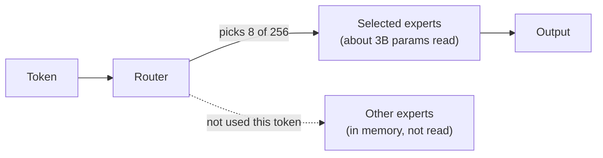

# Scaling up beyond 16 GB

Your 16 GB Air runs a 9B model well. At some point you will want more: a smarter model for code review, longer context for whole repositories, several agents at once. This lesson explains what extra memory actually buys, how mixture-of-experts models change the math, which hardware paths exist in late 2026, how to rent GPUs without leaking client data, and how to reason about cost without relying on prices that go stale in a month.

> [!GOALS]
> - Explain what more memory buys: bigger dense models, MoE models, longer context, concurrency
> - Explain mixture-of-experts: total versus active parameters, and why it changes memory and speed differently
> - Estimate memory and decode speed for any model on any machine from first principles
> - Compare hardware paths: bigger Macs, NVIDIA GPUs by VRAM class, AMD Strix Halo-class machines, DGX Spark
> - Rent GPUs with an engagement-grade security posture and reason about cost

## Two numbers decide everything

From [Memory math](#/foundations/memory-math) and [Performance tuning](#/lmstudio/performance), two hardware numbers dominate local inference:

1. **Memory capacity** decides what **fits**: weights + KV cache + buffers + the OS.
2. **Memory bandwidth** decides how **fast** it generates. During decode, every generated token requires reading all the weights that are used for that token from memory. So a rough ceiling is:

```text
max decode tokens/s  ≈  memory bandwidth (GB/s)  ÷  bytes of weights read per token (GB)
```

Check it on your own machine. Your Q4_K_M file is 5.63 GB, and a recent Air has roughly 100 to 120 GB/s:

```text
120 GB/s ÷ 5.63 GB ≈ 21 tokens/s   (ceiling; real speed is lower)
```

Real numbers land below the ceiling (compute, KV reads, overheads, thermal throttling on a fanless Air), but the ratio predicts relative speeds across models and machines well. Compute power matters a lot for **prefill** (processing a long prompt) and much less for decode.

A useful conversion from your own file: 5.63 GB for about 9 billion parameters is roughly **0.63 bytes per parameter** at Q4_K_M. Use it to estimate any 4-bit model.

## What more memory buys

### 1. Bigger dense models

> [!CONCEPT] Dense model
> A model where every parameter is used for every token. Qwen3.5-9B and Qwen3.5-27B are dense. Memory and per-token compute both scale with the full parameter count.

Qwen3.5 comes in larger sizes than yours. Unsloth's Qwen3.5 guide lists total memory needs (RAM plus VRAM, or unified memory) at 4-bit of about **17 GB for Qwen3.5-27B** and about **22 GB for Qwen3.5-35B-A3B**, against 6.5 GB for the 9B. The 27B is the obvious upgrade for quality: three times the parameters of your model, same family, same chat template.

Its cost is speed. Using the rule above with roughly 16 GB of weights read per token:

| Machine bandwidth | 9B Q4 ceiling | 27B Q4 ceiling |
|---|---|---|
| 120 GB/s (your Air) | about 21 tok/s | about 7.5 tok/s (and it does not fit) |
| 614 GB/s (an M5 Max class Mac) | about 109 tok/s | about 38 tok/s |

A 27B model on a fast machine feels roughly like your 9B does today, and on a slow machine it feels like typing.

### 2. Mixture-of-experts models

> [!CONCEPT] Mixture of experts (MoE)
> A model whose MLP blocks are split into many smaller "experts", plus a small router that picks a few experts for each token. **Total parameters** is everything stored; **active parameters** is what one token actually uses. In "35B-A3B", 35B is the total and A3B means about 3B active.

Qwen3.5-35B-A3B's model card describes 256 experts, of which 8 routed experts plus 1 shared expert are active per token. The consequence is the most important idea in this lesson:

- **Memory scales with total parameters.** All 35B must be loaded, because any token might route to any expert. That is why it needs about 22 GB at 4-bit, more than the dense 27B.
- **Speed scales with active parameters.** Each token reads only about 3B parameters' worth of weights: 3B × 0.63 bytes ≈ 1.9 GB. On a 614 GB/s machine the naive ceiling is over 300 tok/s; real numbers are well below that (attention, routing, imperfect memory locality), but MoE decode is dramatically faster than a dense model of similar memory size.



Unsloth's own guidance summarizes the trade-off: choose the 27B if you want slightly more accurate results, choose the 35B-A3B if you want much faster inference. In plain terms: **MoE trades memory for speed**. It is a great fit for machines with lots of memory but modest bandwidth (Strix Halo, DGX Spark), and a poor fit for small GPUs where memory is the binding constraint. Larger Qwen3.5 MoE models exist too (122B-A10B at about 70 GB and 397B-A17B at about 214 GB at 4-bit, per the same guide).

### 3. Longer context

For your model the KV cache costs 32 KiB per token, so 128K context is 4 GiB and the full 262K is 8 GiB. On 16 GB you cannot afford the long end; on 32 GB or more you can run your current 9B at its full native context with room to spare, which matters for whole-repository code review and long log investigations. Remember that bigger models generally have bigger KV caches per token; read their `config.json` and apply the formula from [Memory math](#/foundations/memory-math) before assuming.

### 4. Concurrent agents

Several agents working in parallel (a recon triager, a JS reviewer, a report drafter) need either several models or one model serving several requests at once. LM Studio 0.4.0 added parallel requests through llama.cpp's continuous batching, with a **Max Concurrent Predictions** load setting (default 4) and a unified KV cache. The memory rule that follows: **the KV cache must hold the sum of all concurrent conversations**. Four agents with 32K of context each need about the same KV memory as one 128K conversation, 4 GiB for your model. Throughput per request drops as you add concurrency, but total throughput usually rises, which is what batch agent work wants.

Use the calculator to try these scenarios: switch the parameter count to 27 or 35, change context, and see where each configuration stops fitting.

<div data-widget="memory"></div>

## Hardware paths

Spec facts below are as published by vendors at the time of writing (November 2026). Model names and configurations change every year; check the vendor's spec page before you buy.

### Bigger Macs

Apple's unified memory makes large models simple: one pool, no splitting between CPU and GPU, the same LM Studio and MLX workflow you already know.

| Class | Memory up to | Bandwidth | What it unlocks |
|---|---|---|---|
| MacBook Air (yours) | 16 to 32 GB | about 100 to 150 GB/s | 9B class, short to medium context |
| Mac mini / MacBook Pro with a Pro chip | 64 GB | about 300 GB/s class | 27B dense or 35B-A3B MoE at 4-bit with long context |
| MacBook Pro / Mac Studio with M5 Max | 128 GB | up to 614 GB/s | 122B-A10B MoE at 4-bit; several mid-size models at once |
| Mac Studio with M5 Ultra | 512 GB | 1.2 TB/s | Frontier-scale open MoE models (397B-A17B class) |

Remember the macOS GPU wiring limit (roughly two-thirds to three-quarters of RAM by default; raise it with `iogpu.wired_limit_mb` at your own risk). A Mac Pro-class laptop also has fans, which matters more than it sounds for long agent runs.

### NVIDIA GPUs by VRAM class

On a discrete GPU, what fits is decided by **VRAM**, and bandwidth is very high. Anything that does not fit spills to system RAM over PCIe and gets dramatically slower.

| VRAM class | Examples | Practical fit at 4-bit |
|---|---|---|
| 16 GB | RTX 5060 Ti 16 GB, RTX 5080 | 9B with long context; 27B does not fit |
| 24 GB | RTX 3090, RTX 4090 | 27B dense with modest context; 35B-A3B only with partial CPU offload |
| 32 GB | RTX 5090 (about 1.8 TB/s) | 27B with long context; 35B-A3B fits |
| 96 GB | RTX PRO 6000 Blackwell | 122B-A10B class MoE; several models at once |
| 128 GB unified | NVIDIA DGX Spark (GB10, 273 GB/s) | Very large models fit; decode is bandwidth-limited, prefill is strong |

The trade-off versus a Mac: much more speed per dollar at the same model size, at the cost of noise, power, a Linux or Windows box to administer, and a hard VRAM wall. MoE models with expert offloading to CPU RAM soften that wall somewhat on llama.cpp.

### AMD Strix Halo-class machines

AMD's Ryzen AI Max+ 395 ("Strix Halo") puts a large integrated GPU next to up to **128 GB of LPDDR5X-8000** on a 256-bit bus, which works out to about **256 GB/s**:

```text
8000 MT/s × 256 bits ÷ 8 bits per byte = 256,000 MB/s ≈ 256 GB/s
```

AMD documents up to 96 GB assignable to the GPU through Variable Graphics Memory on Windows; Linux setups commonly allocate more through kernel parameters. That combination, lots of memory with moderate bandwidth, is exactly the MoE profile: a 35B-A3B or 122B-A10B model fits comfortably and decodes at usable speed because few parameters are active, while a large dense model would be slow. LM Studio supports these machines through its Vulkan and ROCm llama.cpp runtimes. Newer generations with more memory have been announced; check current specs.

### Choosing

| If your priority is | Lean towards |
|---|---|
| Same workflow, silence, portability, MLX fine-tuning | A bigger Mac |
| Maximum speed for models up to about 30B, CUDA tooling, training | An NVIDIA GPU with 24 to 32 GB |
| Big MoE models on a budget, Linux box | Strix Halo class or DGX Spark |
| Occasional big jobs | Renting, below |

## Renting GPUs privately

For occasional heavy work (a 27B review of a large codebase, a fine-tuning run from [Fine-tune in the cloud with Unsloth](#/finetune/unsloth-cloud)), renting a GPU by the hour beats buying. Common providers include RunPod, Vast.ai and Lambda, and the large clouds. The security question is not "is the provider good" but **"who can see the memory and disk of the machine running my client's data?"**

Know the tiers:

- **RunPod** offers **Secure Cloud** (its docs describe T3/T4 datacenters for production workloads) and **Community Cloud** (a vetted peer-to-peer network of individual compute providers).
- **Vast.ai** is a marketplace of hosts; its **Secure Cloud** filter limits you to datacenter providers that Vast.ai says hold at least ISO 27001 certification, while other listings are run by independent hosts.

A machine run by an individual host means that host has physical and root access to the box your data is on. That is fine for public datasets and your own experiments; it is not acceptable for client data.

> [!DANGER]
> Renting a GPU is processing data on a third party's infrastructure. Apply the classification table from [Why local AI](#/security/why-local): restricted data never goes there, and client-confidential data only if the contract allows third-party processing and the provider tier meets the client's requirements. When unsure, rent for sanitized or synthetic work only.

A rental hygiene checklist:

- [ ] Use datacenter or "secure" tiers for anything beyond public data; check the provider's current compliance documentation, not a review site
- [ ] Choose a region that satisfies the client's data-residency terms
- [ ] SSH keys only, a fresh key pair per provider; no password logins
- [ ] Do not expose Jupyter, the inference API or a web UI on a public port; use SSH port forwarding (`ssh -L 1234:127.0.0.1:1234 ...`) instead
- [ ] Pull models from the Hub with `HF_TOKEN` scoped read-only, and verify hashes as in [Hardening and air-gapping](#/infra/hardening)
- [ ] Upload only what the job needs; encrypt archives in transit and at rest
- [ ] Download results, then destroy the instance **and** its persistent volumes; confirm in the dashboard that nothing is still billed or stored
- [ ] Rotate any token that touched the machine

## Reasoning about cost without stale prices

GPU prices and hardware prices change monthly, so this lesson deliberately quotes none. What does not go stale is the method. Collect three current numbers yourself (purchase price, hourly rental rate for the equivalent GPU, your electricity price) and work through:

```text
1. Your workload in hours:   H = hours of heavy inference or training per month
2. Rental cost per month:    R = H × hourly rate (+ storage and egress)
3. Ownership cost per month: O = (purchase price − expected resale value) ÷ months you will keep it
                                 + power (watts × hours × electricity price)
4. Break-even:               buy when O < R, i.e. when H > O_fixed ÷ hourly rate
```

Then adjust for things that are not on an invoice:

| Factor | Pushes towards |
|---|---|
| Client data that may not leave your hardware | Owning (renting may simply be off the table) |
| Bursty, rare heavy jobs | Renting |
| Daily agent work, iteration speed | Owning |
| Fast-moving hardware generations | Renting, or buying with a short horizon and high resale |
| Admin time for a Linux GPU box | Mac or renting |

A second useful metric for comparing setups is **cost per million tokens**: `(cost per hour) ÷ (tokens per second × 3600) × 1,000,000`. Measure tokens per second on your actual workload, at your actual context length; vendor benchmark numbers are usually measured at short context and high batch.

> [!LAB] Plan your next machine with numbers
> 1. In the memory calculator above, find the smallest memory size that fits Qwen3.5-27B at 4-bit with 64K context, and the same for the 35B-A3B. (Use the 32 KiB per token KV figure for your 9B as a sanity check of the widget, and remember larger models usually need more per token.)
> 2. For each, compute the decode ceiling on three machines: your Air (use your measured bandwidth), a 614 GB/s machine and a 256 GB/s machine. For the MoE, use active parameters (about 3B × 0.63 bytes).
> 3. Measure your real tokens per second on the 9B in LM Studio and compute the ratio real ÷ ceiling. Apply that ratio to your other estimates.
> 4. Estimate your monthly heavy-inference hours from the last two weeks of work. Look up one current rental rate and one current hardware price, and run the break-even formula.
> 5. Write a one-paragraph recommendation for yourself that names the data classes you handle and which option they rule out.

## Recap
- Capacity decides what fits; bandwidth decides decode speed. Ceiling ≈ bandwidth ÷ bytes read per token. About 0.63 bytes per parameter at Q4_K_M.
- More memory buys bigger dense models (Qwen3.5-27B, about 17 GB at 4-bit), MoE models (35B-A3B, about 22 GB), longer context and concurrent agents (KV must hold all conversations at once).
- MoE: memory scales with total parameters, speed with active parameters. It trades memory for speed and suits high-memory, moderate-bandwidth machines.
- Hardware paths: bigger Macs (up to 128 GB at 614 GB/s or 512 GB at 1.2 TB/s), NVIDIA by VRAM class (fast, hard memory wall), Strix Halo class (128 GB at about 256 GB/s), DGX Spark (128 GB at 273 GB/s).
- Renting is third-party processing: use secure datacenter tiers, SSH tunnels, hash-verified models, and destroy instances and volumes after use; restricted data stays local.
- Reason about cost with formulas and fresh numbers, not remembered prices.

## Check yourself
1. Why does Qwen3.5-35B-A3B need more memory than the dense 27B, yet generate faster?
   <details><summary>Answer</summary>

   All 35B parameters must be in memory because any token can route to any expert, so memory follows the total count. But each token only uses about 3B parameters, so far fewer bytes are read per token, and decode speed follows active parameters.

   </details>
2. Estimate the decode ceiling for a 27B dense model at 4-bit on a 256 GB/s machine.
   <details><summary>Answer</summary>

   27B × about 0.63 bytes is roughly 17 GB of weights read per token. 256 ÷ 17 ≈ 15 tokens per second as a ceiling, with real speed noticeably lower.

   </details>
3. You want four agents, each with a 32K context, served concurrently by your 9B model. How much KV cache does that need?
   <details><summary>Answer</summary>

   4 × 32,768 tokens × 32 KiB = 4 GiB, the same as one 128K conversation. Add that to 5.24 GiB of weights and buffers to check the fit.

   </details>
4. Which hardware profile is MoE best suited to, and why?
   <details><summary>Answer</summary>

   Lots of memory with moderate bandwidth, such as Strix Halo class machines, DGX Spark or high-memory Macs. MoE needs capacity for all experts but reads only a small active subset per token, so moderate bandwidth still gives usable speed.

   </details>
5. A colleague wants to rent a cheap marketplace GPU from an individual host to run a 27B review of a client's source code. What do you tell them?
   <details><summary>Answer</summary>

   Client source code is at least client-confidential: it may only go to a third party if the contract allows it, and an individual host has root and physical access to the machine. Use a certified datacenter tier with an appropriate region if the contract allows, or keep it local (bigger local hardware, or the 9B with chunking), or use sanitized excerpts.

   </details>

## Go deeper
- [Unsloth: Qwen3.5 guide](https://unsloth.ai/docs/models/qwen3.5) — memory requirements for every Qwen3.5 size and the 27B versus 35B-A3B advice
- [Qwen3.5-35B-A3B base model card](https://huggingface.co/Qwen/Qwen3.5-35B-A3B-Base) — the expert configuration behind "A3B"
- [Apple: Mac Studio with M5 Max and M5 Ultra](https://www.apple.com/newsroom/2026/08/apple-introduces-new-mac-studio-with-m5-max-and-m5-ultra/) — official memory and bandwidth figures
- [AMD: Variable Graphics Memory FAQ](https://www.amd.com/en/blogs/2025/faqs-amd-variable-graphics-memory-vram-ai-model-sizes-quantization-mcp-more.html) — how Strix Halo assigns memory to the GPU
- [Vast.ai security and compliance](https://vast.ai/compliance) — what the Secure Cloud tier requires of providers
