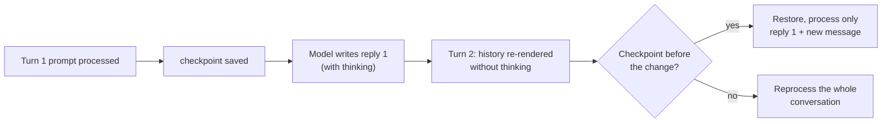

# Load settings, every knob explained

Load settings decide how your model is laid out in memory: how much context it can hold, where each piece lives, and which kernels run it. They are fixed at load time, so getting them right is the difference between a snappy 9B assistant and a Mac that swaps itself to death. This lesson takes every load parameter LM Studio exposes for your setup, explains it from zero, and gives a concrete value for a 16 GB MacBook Air running Qwen3.5-9B Q4_K_M.

> [!GOALS]
> - Tell load-time settings apart from inference-time settings, and know where to change each
> - Explain what each load setting does mechanically, and what it costs in memory and speed
> - Compute the memory budget for your model at any context length and KV-cache precision
> - Choose values for this Mac and this model, and verify them by measurement

## Load time vs inference time

LM Studio splits configuration into two families:

| | Load settings (this lesson) | Inference settings ([next lesson](#/lmstudio/sampling-settings)) |
|---|---|---|
| Decide | Memory layout, context size, engine features | How each next token is picked, how long to answer |
| When applied | When the model is loaded | On every request |
| Changing them | Requires a **reload** ("Reload to apply changes") | Instant |
| Examples | Context Length, GPU Offload, Flash Attention, KV cache type | Temperature, Top P, Stop Strings |

> [!CONCEPT] Loading a model
> Loading means: open the GGUF file, map its weights into memory, allocate the **KV cache** (the model's working memory for the current conversation) and other buffers, and compile or select the GPU kernels. Everything a load setting touches is allocated up front, which is why the memory cost is paid even if your chat is short.

### Where to change load settings

1. **The model loader** (<kbd>Cmd</kbd>+<kbd>L</kbd>): toggle **Manually choose model load parameters**, select the model, then **Show advanced settings**. The loader shows **Estimated Memory Usage** (GPU and Total) live as you change values.
2. **A loaded model**: the right sidebar has a load section (and since 0.4.0 a gear on the loaded model). Edits there show "Reload to apply changes".
3. **Per-model defaults**: My Models, gear icon. Saved values apply everywhere the model is loaded: chat, server, `lms load`, SDKs.
4. **CLI and API**: `lms load` takes a subset as flags (`--context-length`, `--gpu`, `--parallel`, `--ttl`); the REST endpoint `POST /api/v1/models/load` takes `context_length`, `eval_batch_size`, `flash_attention`, `offload_kv_cache_to_gpu`. Everything else comes from the per-model defaults.

> [!TIP]
> Settle on values in the loader, then save them as the per-model default (the loader offers to save your changes as the model's defaults). From then on every tool that loads the model gets the same configuration.

## Your memory budget, from first principles

Everything in this lesson trades against one number: how much of your 16 GB the GPU can use. A one-paragraph reminder from [Memory math](#/foundations/memory-math):

```text
Total for this model ≈ weights + KV cache + recurrent state + compute buffers (+ draft model, if any)

weights (Q4_K_M file)       5,627,044,224 bytes ≈ 5.24 GiB      fixed
KV cache, F16               32 KiB per token of context          grows with Context Length
recurrent (DeltaNet) state  ~50 MiB per parallel slot            fixed per slot
compute buffers             a few hundred MiB                    grows with batch size
```

Where does 32 KiB per token come from? Only the 8 full-attention layers keep a KV cache (the other 24 are Gated DeltaNet layers with a fixed-size state):

```text
2 (K and V) × 8 layers × 4 KV heads × 256 dims × 2 bytes (F16) = 32,768 bytes = 32 KiB per token

  8K context  →  0.25 GiB        64K  →  2 GiB
 32K context  →  1 GiB          128K  →  4 GiB
                                262K  →  8 GiB  (model maximum)
```

And the DeltaNet state, from the model's config (24 linear-attention layers, 32 value heads, 128 × 128 state per head, stored as 32-bit floats in llama.cpp):

```text
24 × 32 × 128 × 128 × 4 bytes = 48 MiB, plus ~2 MiB of convolution state ≈ 50 MiB per sequence
```

The ceiling is macOS's GPU wired-memory limit, by default roughly two-thirds of RAM on a 16 GB machine: about 10.7 GiB. You also need room for macOS and your other apps.

<div data-widget="memory"></div>

> [!MAC]
> On Apple Silicon, "GPU memory" and "RAM" are the same physical chips. What differs is accounting: memory the GPU uses is **wired** (pinned) and counts against the Metal limit. That's why a configuration can fail to load with plenty of "free RAM" showing, and why [Performance tuning](#/lmstudio/performance) covers raising the limit with `sysctl`.

## Context and placement

### Context Length

**What it is.** The maximum number of tokens the model can see at once: system prompt + every message in the chat + attachments + the reply being written + hidden thinking tokens. It's the size of the model's working memory for this conversation. See [Tokens](#/foundations/tokens) if "token" is still fuzzy (roughly 3/4 of an English word; code and logs tokenize less efficiently).

**Mechanism.** Every token processed writes a key and a value vector into the KV cache of each full-attention layer, so later tokens can attend to it ([How text gets generated](#/foundations/generation) explains the KV cache). LM Studio allocates the cache for the full Context Length when the model loads.

**Cost.** Memory: 32 KiB per token at F16, as computed above. Speed: decoding gets slightly slower as the cache fills, because each new token's attention reads every cached key and value. For this hybrid model only 8 layers do that, so the slowdown is much milder than for a classic transformer. The bigger time cost is prefill: a 100K-token document takes minutes to read in.

**What happens when you exceed it.** The Context Overflow policy (an inference setting) decides: truncate the middle, roll the window, or stop. See [Sampling settings](#/lmstudio/sampling-settings).

**The Qwen guidance and the 16 GB reality.** The Qwen3.5 model card advises keeping at least 128K context "to preserve thinking capabilities", because long reasoning chains plus multi-turn history can be long. At F16 that's 4 GiB of KV cache: 5.24 + 4 + ~0.7 ≈ 10 GiB, right at your GPU limit, with nothing left for comfort. Two ways out: 128K with Q8_0 KV cache (≈2.1 GiB), or a smaller context such as 32K-64K, accepting that very long thinking sessions will hit the wall.

**Recommended.** **32,768** for daily use (≈1 GiB KV). **65,536** for long reasoning or code (≈2 GiB). **131,072 with Q8_0 K and V cache** for long documents (≈2.1 GiB). LM Studio's default for new loads has been 8K since 0.4.16, which is too small for thinking mode; set your per-model default explicitly.

### GPU Offload

**What it is.** How many of the model's layers run on the GPU (via Apple's Metal API) rather than the CPU. Shown as a slider from OFF to MAX, labeled in layers (your model has 32 transformer layers; the count shown may include the output layer).

**Mechanism.** On a PC with a discrete GPU, layers that don't fit in VRAM run on the CPU from system RAM, and each token flows from GPU to CPU and back. The CPU layers are the bottleneck.

**Why "MAX" on Apple Silicon.** Unified memory removes the usual reason to offload partially: there is no separate, smaller VRAM to overflow, and no PCIe copy. The GPU reads the same RAM as the CPU but has far more parallel compute and is far better at saturating memory bandwidth. Any layer you leave on the CPU runs several times slower and stalls the pipeline. The only reason to lower it on a Mac is if you're at the Metal wired limit and want some layers in CPU-side memory that doesn't count against it, a trade of a lot of speed for a little headroom.

**Recommended.** **MAX** (all layers). CLI: `lms load <key> --gpu max`.

### CPU Thread Pool Size

**What it is.** How many CPU threads llama.cpp uses for work it does on the CPU.

**Mechanism.** Your Air's CPU has two kinds of cores: **performance cores** (fast, power-hungry) and **efficiency cores** (slow, frugal). An M1, M2 or M3 Air has 4 P + 4 E; an M4 Air has 4 P + 6 E. llama.cpp splits CPU matrix work evenly across threads, so the slowest thread sets the pace: putting threads on E-cores can make CPU inference slower, not faster. Check yours:

```bash
sysctl -n machdep.cpu.brand_string
sysctl hw.perflevel0.physicalcpu hw.perflevel1.physicalcpu   # P-cores, then E-cores
```

**Why it barely matters for you.** With GPU Offload at MAX, the transformer math runs on the GPU. The CPU only handles tokenization, sampling, scheduling and feeding the GPU. More threads change almost nothing; you'd only see a difference with partial or zero offload.

**Recommended.** Leave the default (LM Studio picks it per machine; often 4). If you ever run CPU-only, set it to your P-core count. There is a separate inference-time **CPU Threads** setting in the sidebar with the same logic.

### Max Concurrent Predictions and Unified KV Cache

**What they are.** Since 0.4.0, LM Studio's llama.cpp engine supports **continuous batching**: several requests (from the server, or two chats in Split View) are processed together instead of queued. **Max Concurrent Predictions** caps how many run at once (default 4); extra requests wait.

**Unified KV Cache** (default on) means the parallel requests share one context pool sized by Context Length. A single request can use all of it; four simultaneous ones share it. Turning it off gives each slot its own full-size cache, multiplying KV memory by the number of slots.

**Cost for your model.** Each slot needs its own DeltaNet state (~50 MiB), so 4 slots cost roughly 150 MiB more than 1, plus some scheduling overhead. Per-request speed drops when several run at once, but total throughput rises.

**Recommended.** Leave Unified KV Cache **on**. Max Concurrent Predictions: default **4** is fine for normal use; set **1** when squeezing in a very long context, or **2-4** if an agent fires parallel requests. CLI: `lms load <key> --parallel 2`. (The MLX engine has its own concurrency support; check the loader.)

## Attention and the KV cache

### Flash Attention

**What it is.** A faster way to compute attention that produces the same result.

**Mechanism.** Naive attention computes a score for every pair of positions (a big matrix of size tokens × tokens), applies softmax, then multiplies by the values. **Flash Attention** processes the matrix in tiles that fit in fast on-chip memory, keeping a running softmax, so the full score matrix never exists in RAM. Less memory traffic, less scratch memory, usually faster at long context ([FlashAttention paper](https://arxiv.org/abs/2205.14135)).

**Cost.** None in quality (it's exact, up to floating-point rounding). In llama.cpp it's also a **prerequisite for quantizing the V cache**. For your model the speed benefit is smaller than on classic transformers, because only 8 of 32 layers do softmax attention at all.

**Recommended.** **On.** llama.cpp's own default is "auto", and LM Studio's toggle default has varied between versions (older builds labeled it experimental), so set it explicitly in your per-model defaults. Verify a loaded model's real setting with `curl -s http://localhost:1234/api/v1/models` and look for `"flash_attention": true` under `loaded_instances`.

### K Cache Quantization Type and V Cache Quantization Type

**What they are.** The numeric precision used to store the KV cache. Options: F32, F16 (the default, shown as OFF), Q8_0, Q5_1, Q5_0, Q4_1, IQ4_NL, Q4_0. LM Studio marks both as experimental.

> [!CONCEPT] KV cache quantization
> The same idea as weight quantization ([Quantization](#/foundations/quantization)), applied to the conversation's working memory. Q8_0 stores blocks of 32 numbers as 8-bit integers plus one 16-bit scale: 34 bytes per 32 values, about 53% of F16. Q4_0 is 18 bytes per 32, about 28%.

**Mechanism and risk.** Keys are multiplied with the current query and pushed through a softmax, which exaggerates small errors; values are just averaged. So keys are generally more sensitive to aggressive quantization than values. Q8_0 for both is the widely used safe choice; Q4_0 saves more but can measurably hurt long-context recall.

**Your numbers:**

| Context | F16 K+V | Q8_0 K+V | Q4_0 K+V |
|---|---|---|---|
| 32K | 1.0 GiB | 0.53 GiB | 0.28 GiB |
| 64K | 2.0 GiB | 1.06 GiB | 0.56 GiB |
| 128K | 4.0 GiB | 2.13 GiB | 1.13 GiB |
| 262K | 8.0 GiB | 4.25 GiB | 2.25 GiB |

Because your KV cache is already small (thanks to the hybrid architecture), quantizing it buys less than it would on Qwen3-8B, where 32K costs 4.5 GiB at F16.

**Rules.** V cache quantization requires Flash Attention on (the UI blocks it otherwise). The app warns: "If you encounter problems, reset to the default F16." Speed can move slightly either way on Metal; measure.

**Recommended.** **F16 (off)** up to 64K. **Q8_0 for both K and V** for 128K-class contexts. Avoid Q4 types unless you've tested recall on your own documents.

### Offload KV Cache to GPU Memory

**What it is.** Whether the KV cache lives in GPU buffers (on, default) or in CPU memory (off).

**Mechanism.** If the cache is CPU-side, attention over it is computed by the CPU, which is much slower, even on unified memory. The only upside of turning it off on a Mac is that CPU-side memory doesn't count against the Metal wired limit.

**Recommended.** **On.** Treat "off" as a last-resort way to squeeze a huge context in, at a large speed cost.

### Context Checkpoints

**What it is.** The maximum number of saved snapshots of the model's state per slot (default 32). The app's own description: "Lower values reduce RAM usage for SWA/recurrent models. 0 disables checkpoints."

**Why your model needs it.** For a classic transformer, "rewinding" a conversation is trivial: throw away the KV entries after the point where the prompt changed, and recompute only the rest. Your model's 24 DeltaNet layers don't keep per-token entries; they keep a **running summary** that gets overwritten with every token. You can't subtract tokens back out of it. So whenever the prompt changes partway through (you edit a message, regenerate, branch, or the chat template rewrites history), the engine needs a saved copy of that summary from before the change. Without one, it has to reprocess the **entire** conversation from token zero.

This happens more often than you'd think. Qwen3.5's chat template removes the `<think>` content of earlier assistant turns when it renders history. So on every new turn, the text of the previous answer differs from what the model actually generated, and the engine must restart from just before it. Checkpoints make that a cheap restore instead of a full re-read.



**Cost.** Each checkpoint stores a copy of the recurrent state, about 50 MiB for this model by the arithmetic above, so 32 checkpoints could reach ~1.6 GB in a long chat. That's an estimate; the runtime log (`lms log stream -s runtime`) prints the actual checkpoint sizes when they're created.

**Recommended.** **8** on a 16 GB Mac (≈400 MiB worst case), which covers normal edit and regenerate patterns. Use 16-32 if you branch deep into old turns often and have memory to spare. Don't use 0 with this model unless you want slow multi-turn chats.

## Positional encoding: RoPE Frequency Base and Scale

**What they are.** Overrides for how the model encodes token positions. Both show **Auto** by default.

> [!CONCEPT] RoPE (rotary position embedding)
> Attention by itself doesn't know word order. RoPE fixes that by **rotating** each query and key vector by an angle that depends on the token's position, using a set of rotation speeds (frequencies) derived from a base number, theta. Two tokens' relative distance then shows up as a relative rotation, which the dot product can detect ([RoFormer paper](https://arxiv.org/abs/2104.09864)).

**Your model's values.** Qwen3.5-9B uses theta = 10,000,000 and rotates only a quarter of each head's dimensions (partial rotary factor 0.25), and only in the 8 full-attention layers. It was trained for 262,144 positions. The GGUF records all of this, and "Auto" reads it.

**What the overrides do.**

- **RoPE Frequency Base** replaces theta. Raising it slows the rotations so far-apart positions look less extreme, one historical trick for context extension.
- **RoPE Frequency Scale** compresses positions (linear "position interpolation"): with a scale factor, position 200,000 is presented to the model as if it were a smaller number, letting a model address more tokens than it was trained on, at some quality cost.
- **YaRN** is a smarter scaling method that treats different frequencies differently ([YaRN paper](https://arxiv.org/abs/2309.00071)). Qwen documents YaRN for going past 262K toward ~1M tokens, and warns that static YaRN can hurt performance on shorter texts.

**Recommended.** **Auto, both.** You will never need extension on 16 GB: the native 262K already costs 8 GiB of F16 KV cache. Wrong RoPE values don't crash; they quietly produce degraded or nonsense output, which is the worst kind of failure.

## Memory behavior and reproducibility

### Keep Model in Memory

**What it is.** Asks the OS to lock the model's memory (technically `mlock`), so macOS can't page it out or compress it while the model sits idle.

**Cost.** That memory is unavailable to other apps even when you're not chatting. Benefit: no multi-second stall on the first token after the model has been idle and the OS reclaimed pages.

**Recommended.** **On** (the default). If you keep the model loaded all day while running a browser, IDE and Docker on 16 GB, consider unloading the model instead of turning this off.

### Try mmap()

**What it is.** Load the file by memory-mapping it: the file's bytes appear in the process's address space and the OS reads pages from disk on demand.

**Mechanism and cost.** Loads start fast and the OS can share the file's pages. With mmap off, llama.cpp reads the whole file into memory it allocates (slower start). The app notes disabling it "may improve performance when the model is larger than the available system RAM". That's not your situation.

**Related.** Recent builds (llama.cpp engine 2.28.1+) reworked the advanced mmap, mlock and direct I/O options, and there's a **Direct I/O** option that bypasses the OS page cache, aimed at hardware such as NVIDIA's DGX Spark. Labels may differ slightly in your build.

**Recommended.** **On**; Direct I/O **off**.

### Seed

**What it is.** The starting value for the random number generator used in sampling. Unchecked or -1 means a random seed each time.

**Mechanism.** Sampling picks tokens at random according to probabilities ([Sampling settings](#/lmstudio/sampling-settings)). A fixed seed makes those "random" picks repeat: same seed + same prompt + same settings + same engine version = the same output, in practice. Seed appears both as a load setting and as an inference setting; the inference-time one is what you'll usually use.

**Recommended.** Random for normal use. Fixed (for example 42) when running experiments, like the lab below, so differences come from the knob you changed, not luck.

## Other options you may see

| Setting | What it does | For you |
|---|---|---|
| **Physical Batch Size** | The chunk actually computed at once inside an evaluation batch (llama.cpp `n_ubatch`, default 512) | Leave default |
| **Automatic Optimize Based on Hardware** (and `lms load --auto`) | Lets llama.cpp choose context and placement from available memory | Off: you want to choose |
| **Chat Template** (load-time) | The Jinja template the engine uses for chat, tools and reasoning; changing it requires a reload | See [Prompts and templates](#/lmstudio/prompts-templates) |
| **Reasoning Budget Message** | Text injected before the end-of-thinking tag when a reasoning budget runs out | Leave empty |
| **llama.cpp argument overrides** (0.4.24+, experimental) | Disable or append raw llama.cpp server arguments | An escape hatch; avoid unless you know the exact flag |
| **Speculative decoding** (Draft MTP, draft model, Max Draft Tokens) | Uses a draft to speed decoding | Covered in [Sampling settings](#/lmstudio/sampling-settings) and [Performance](#/lmstudio/performance) |
| **Number of Experts**, MoE CPU-layer options | Mixture-of-Experts models only | Not applicable: your model is dense |
| **On-Demand Tensor Loading** | Lazy reading of certain embedding tables (some Gemma variants) | Not applicable |
| **Limit Model Offload to Dedicated GPU Memory** | Discrete-GPU PCs | Not applicable |

### Evaluation Batch Size

This one deserves its own paragraph because it does affect you on long prompts.

**What it is.** How many prompt tokens are scheduled together during prefill (llama.cpp's logical batch, `n_batch`). Defaults have varied by version (512 in older builds, 2048 in current ones).

**Mechanism.** Reading a prompt is a big batched matrix multiply: the more tokens per batch, the better the GPU's compute units are used. Generation is always one token at a time, so this setting does **nothing** for tokens/sec after the first token. It affects **time to first token** on long prompts.

**Cost.** Bigger batches need bigger scratch (compute) buffers: tens to hundreds of MiB more.

**Recommended.** Leave the default. If you feed long documents, compare 512 vs 2048 on a 10K-token prompt (lab below) and keep the faster one if memory allows.

## The MLX engine's load options

If you run an MLX build of a model (covered in [Performance](#/lmstudio/performance)), the loader shows a different, shorter list, because MLX always runs on the GPU and manages memory differently:

| MLX setting | Meaning |
|---|---|
| **Context Length** | As above |
| **Automatic Context Sizing** | Let the engine choose a safe context length from available memory |
| **Prompt Disk Cache** | Reuse prompt states across requests by caching them on disk (LM Studio's MLX engine writes a temporary scratch file, cleared on unload) |
| **KV Cache Quantization** | Bits (8, 6, 4, 3, 2), group size (Accuracy = 32, Balanced = 64, Speedy = 128), and a threshold to start quantizing once context passes N tokens (default 5,000). The UI warns that Context Length is ignored when this is on. |
| **Max Concurrent Predictions** | Parallel requests |

No GPU Offload, Flash Attention, mmap or RoPE knobs: MLX handles those internally.

## Recommended load configuration for your Mac

| Setting | Daily (32K) | Long document (128K) | Why |
|---|---|---|---|
| Context Length | 32,768 | 131,072 | 1 GiB vs 2.1 GiB KV |
| GPU Offload | MAX | MAX | Unified memory; GPU is far faster |
| CPU Thread Pool Size | default | default | GPU does the work |
| Evaluation Batch Size | default | default (try 2048) | Only affects prefill |
| Max Concurrent Predictions | 4 (default) | 1 | Saves ~150 MiB of state |
| Unified KV Cache | on | on | Shared pool, no multiplication |
| Flash Attention | on | on | Exact, faster, needed for V quant |
| K / V Cache Quantization | F16 / F16 | Q8_0 / Q8_0 | Halves KV at long context |
| Offload KV Cache to GPU Memory | on | on | CPU attention is slow |
| Context Checkpoints | 8 | 4-8 | Fast multi-turn without 1.6 GB of snapshots |
| RoPE Base / Scale | Auto / Auto | Auto / Auto | Native context is plenty |
| Keep Model in Memory | on | on | No stalls |
| Try mmap() | on | on | Fast load |
| Seed | random | random | Fix it only for experiments |

Approximate totals: daily ≈ 5.24 + 1.0 + 0.2 + compute ≈ 7 GiB; long document ≈ 5.24 + 2.13 + 0.05 + compute ≈ 8 GiB. Both leave macOS room to breathe. Full ready-to-copy presets are in [Recommended configs](#/lmstudio/presets-for-you).

## Lab: one knob at a time

> [!LAB] Measure what each setting costs
> You'll change one setting per run and record memory and speed. Changing one variable at a time is the same discipline as isolating a variable in a pentest: if you change two, you learn nothing.
>
> **Setup**
> 1. `mkdir -p ~/ai-lab/lmstudio && cd ~/ai-lab/lmstudio`
> 2. Close heavy apps. Plug in power. Open Activity Monitor, Memory tab (watch "Memory Used" and the Memory Pressure graph).
> 3. Create a long test prompt on your clipboard (log-like text; digits tokenize one per token, so 250 lines is roughly 10,000 tokens; check the chat's token counter after pasting and adjust the line count):
>
> ```bash
> seq 1 250 | awk '{print "2026-11-03T10:"$1%60":00Z GET /api/v1/items/"$1" 200 user=svc-"$1%7}' | pbcopy
> ```
>
> 4. In a new chat, set inference settings for repeatability: Seed fixed at 42, Temperature 0, Limit Response Length 256.
> 5. Short test: ask "List five HTTP security headers and what each prevents." Long test: paste the clipboard followed by "How many distinct users appear? Answer in one sentence."
>
> **Baseline:** Context 8,192, GPU MAX, Flash Attention on, KV F16. Load, then record: loader estimate (GPU / Total), Activity Monitor Memory Used, and for each test the stats line (tok/sec, time to first token).
>
> **Runs (reload between each, change only the listed knob):**
>
> | Run | Change from baseline | Estimate (GPU/Total) | Memory Used | Short: tok/s | Long: TTFT | Notes |
> |---|---|---|---|---|---|---|
> | 0 | baseline (8K) | | | | | |
> | 1 | Context 32,768 | | | | | |
> | 2 | Context 65,536 | | | | | |
> | 3 | Context 131,072 | | | | | |
> | 4 | Context 131,072 + K/V Q8_0 | | | | | |
> | 5 | Flash Attention off (8K) | | | | | |
> | 6 | GPU Offload 16 layers (8K) | | | | | |
> | 7 | Evaluation Batch Size 512 vs 2048 | | | | | |
>
> 6. You can also preview estimates without loading:
>
> ```bash
> lms load qwen3.5-9b-uncensored-hauhaucs-aggressive --estimate-only --context-length 131072 --gpu max
> ```
>
> (Replace the key with yours from `lms ls`.)
>
> **Questions to answer in `~/ai-lab/lmstudio/load-lab.md`:**
> - Does the memory growth from run 0 to run 3 match 32 KiB per token? (Expect about +3.75 GiB from 8K to 128K.)
> - How much did Q8_0 save at 128K, and did the long-test answer change?
> - How much slower was run 6? Why is partial offload a bad deal on unified memory?
> - Did Evaluation Batch Size change TTFT on the long test? Did it change tok/sec on the short test? (It shouldn't.)

> [!WARNING]
> If a load fails or macOS turns memory pressure red, don't push further with "Load anyway". Eject the model, step back one setting, and note where the edge is. Pushing past the Metal limit can freeze the machine.

## Recap
- Load settings are fixed at load time and need a reload; set them once as per-model defaults (My Models, gear).
- Budget = weights (5.24 GiB) + KV cache (32 KiB/token at F16) + DeltaNet state (~50 MiB per slot) + compute buffers, under a ~10.7 GiB default GPU limit.
- On Apple Silicon: GPU Offload MAX, Flash Attention on, KV cache on GPU. CPU threads barely matter with full offload.
- Context Length is your main memory knob: 32K daily, 64K for long reasoning, 128K with Q8_0 KV for long documents.
- Context Checkpoints matter specially for hybrid models like Qwen3.5: they let edits, regenerations and template-rewritten history resume from a snapshot instead of reprocessing everything. 8 is a sensible value on 16 GB.
- Leave RoPE on Auto; native 262K context is far beyond what 16 GB can hold anyway.

## Check yourself
1. Your colleague's Qwen3-8B at 32K context uses 4.5 GiB of KV cache; yours uses 1 GiB at the same context. Why?
   <details><summary>Answer</summary>

   Qwen3.5-9B is hybrid: only 8 of its 32 layers use full attention and keep a per-token KV cache, with 4 KV heads of 256 dims (32 KiB per token). Qwen3-8B keeps a KV cache in all 36 layers with 8 KV heads of 128 dims (144 KiB per token). The other 24 layers of your model keep a fixed-size state instead.

   </details>
2. You set V Cache Quantization to Q8_0 and the option is greyed out. What's missing?
   <details><summary>Answer</summary>

   Flash Attention. In llama.cpp, V-cache quantization requires Flash Attention to be enabled.

   </details>
3. Why does Evaluation Batch Size change time to first token but not tokens per second?
   <details><summary>Answer</summary>

   It controls how many prompt tokens are processed together during prefill, which is a batched, compute-heavy operation. Decoding produces one token at a time, so batch size doesn't apply there.

   </details>
4. You set Context Checkpoints to 0 to save memory, and now every new message in a long thinking-mode chat takes ages before the first token. Explain.
   <details><summary>Answer</summary>

   The DeltaNet layers' recurrent state can't be rewound. Qwen3.5's template strips thinking from earlier turns, so the rendered history differs from what was generated, and the engine must restart from before the change. Without a saved checkpoint it has to reprocess the whole conversation from the beginning on every turn.

   </details>
5. Why is "GPU Offload: MAX" the right answer on your Mac even though CPU and GPU share the same memory?
   <details><summary>Answer</summary>

   Sharing memory removes the capacity reason for partial offload, but the GPU is still much faster at the math and at saturating memory bandwidth. Layers left on the CPU become the bottleneck for every token.

   </details>

## Go deeper
- [LM Studio: Per-model defaults](https://lmstudio.ai/docs/app/advanced/per-model) — how defaults are saved and where they apply
- [LM Studio: Parallel requests](https://lmstudio.ai/docs/app/advanced/parallel-requests) — Max Concurrent Predictions and continuous batching
- [llama.cpp server README](https://github.com/ggml-org/llama.cpp/blob/master/tools/server/README.md) — the engine underneath; flags like `--ctx-checkpoints`, `--cache-type-k`, `-fa`
- [FlashAttention (Dao et al., 2022)](https://arxiv.org/abs/2205.14135) — why tiled attention is exact and faster
- [YaRN (Peng et al., 2023)](https://arxiv.org/abs/2309.00071) — how RoPE-based context extension works
