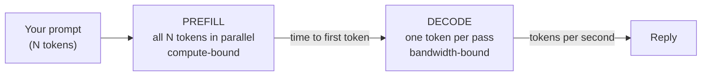

# Performance tuning on Apple Silicon

How fast can a 9B model run on a fanless MacBook Air, and what actually moves the number? This lesson gives you the physics first (why generation speed is set by memory bandwidth, not compute), then a calculated speed ceiling for your exact chip, then every practical lever: engine choice, the GPU memory limit, thermals, speculative decoding, context, and background apps. It ends with a benchmark script you'll reuse for the rest of the course.

> [!GOALS]
> - Explain time to first token and tokens per second in terms of prefill and decode
> - Calculate the theoretical decode ceiling for your chip and explain why real numbers land at 50-75% of it
> - Compare llama.cpp (GGUF) and MLX for this model, and know what MLX builds exist
> - Detect thermal throttling and avoid the common slowdowns
> - Build a streaming benchmark that measures TTFT and decode speed over many runs

## Two phases, two bottlenecks

Every reply has two phases ([How text gets generated](#/foundations/generation) introduced them):



**Prefill** reads the whole prompt. All prompt tokens go through the network together as one big batched matrix multiplication, so the GPU's arithmetic units are the limit. It determines **time to first token (TTFT)**. Your prefill rate is simply:

```text
prefill rate (tokens/s) = prompt tokens ÷ TTFT
```

**Decode** generates the answer one token at a time. Each new token needs a full pass through the network, which means reading essentially **all the weights** from memory, to do a small amount of math with them. The GPU spends most of its time waiting for bytes. That makes decode **memory-bandwidth-bound**, and it determines **tokens per second (tok/s)**.

> [!CONCEPT] Memory bandwidth
> How many bytes per second the memory system can deliver to the processor. Analogy: compute is how fast you can read; bandwidth is how fast pages are handed to you. During decode, the model "reads" 5+ GB of weights per token, so page delivery is the limit, however fast you read.

## Your theoretical decode ceiling

If each token requires reading the weights once, then:

```text
max tokens/s ≈ memory bandwidth (GB/s) ÷ bytes read per token (GB)
```

**Bytes per token for your model.** The Q4_K_M file is 5,627,044,224 bytes (≈5.6 GB, or 5.24 GiB). Not all of it is read per token: the input embedding table (≈1 billion parameters, because the vocabulary is 248,320 tokens × 4,096 dimensions) is a lookup, so only one row is read. Subtract that and you're at roughly 5.0-5.3 GB per token, plus a little for the KV cache and DeltaNet state. We'll use **5.3 GB** as a round, slightly conservative figure.

**Your chip's bandwidth.** Find your chip:

```bash
system_profiler SPHardwareDataType | grep -E "Chip|Memory"
```

Then compute:

| MacBook Air chip | Memory bandwidth | Ceiling (÷ 5.3 GB) | Realistic (50-75%) |
|---|---|---|---|
| M1 | 68.25 GB/s | ≈12.9 tok/s | ≈6-10 tok/s |
| M2 | 100 GB/s | ≈18.9 tok/s | ≈9-14 tok/s |
| M3 | 100 GB/s | ≈18.9 tok/s | ≈9-14 tok/s |
| M4 | 120 GB/s | ≈22.6 tok/s | ≈11-17 tok/s |
| M5 | ≈153 GB/s | ≈28.9 tok/s | ≈14-22 tok/s |

The realistic column is an estimate, not a measurement. Your lab benchmark will give you the real number.

### Why reality is 50-75% of the ceiling

- **Achievable bandwidth is below the spec sheet.** The rated figure is a peak; real streaming reads typically get a large fraction of it, not all.
- **Dequantization costs compute.** Q4_K weights must be unpacked into numbers the GPU can multiply. On a small GPU this isn't free.
- **More than weights.** Each token also reads the KV cache of the 8 attention layers and the ~50 MiB DeltaNet state, and writes new entries. The longer the context, the more extra reading.
- **Per-token overheads.** Launching dozens of GPU kernels per token, synchronizing with the CPU, running the sampler over 248,320 logits, detokenizing, streaming to the UI. These are small individually and add up at 10-20 tokens per second.
- **Shared memory system.** The CPU, display, browser and everything else draw on the same bandwidth.
- **Heat.** A fanless Air slows its clocks under sustained load (below).

> [!TIP]
> This formula is the most useful sanity check in local AI. Q8_0 (8.9 GB file) roughly halves your ceiling; a 4B model at Q4 roughly doubles it. If a benchmark claims 60 tok/s for a 9B Q4 on an Air, something is off.

## Engine choice: llama.cpp (GGUF) vs MLX

LM Studio runs two engines on Apple Silicon ([Quantization and file formats](#/foundations/quantization) covers the formats):

| | llama.cpp engine | MLX engine |
|---|---|---|
| Model format | GGUF (your model) | MLX (safetensors-based) |
| Who builds it | ggml/llama.cpp project, packaged by LM Studio | LM Studio's `mlx-engine`, on Apple's MLX + mlx-lm |
| Quant types | K-quants (Q4_K_M, Q6_K...), I-quants | MLX affine 4/8-bit, MXFP4/MXFP8 |
| Load knobs | Many (Flash Attention, KV types, checkpoints, mmap...) | Few (context, KV quantization, prompt disk cache, concurrency) |
| Speculative decoding | Draft model and MTP | Draft model |
| Structured output | llama.cpp grammars | Outlines |

**Which is faster?** For many models, community comparisons on Apple Silicon have shown MLX ahead on decode, but it depends on the model architecture, the quantization, and how mature each engine's kernels are for it. Qwen3.5's Gated DeltaNet layers are new in both. Don't trust a general rule: measure both with the benchmark below. LM Studio's [MLX engine post](https://lmstudio.ai/blog/mlx-engine-agentic-workloads) (June 2026) describes disk-backed prompt caching and continuous batching specifically improved for hybrid models like Qwen3.5.

**Is there an MLX build of your model?** HauhauCS publishes **GGUF only** for Qwen3.5-9B Uncensored. On Hugging Face there are community conversions, for example `TheCluster/Qwen3.5-9B-Uncensored-HauhauCS-Aggressive-MLX-mxfp4` (≈5.7 GB), `-MLX-8bit`, `-MLX-mxfp8` and `-MLX-bf16`, plus a safetensors export by another user. These are third-party uploads: unverified provenance, unknown conversion quality. For a security person the rule is simple: weights from an unknown uploader are untrusted input. Safetensors and MLX files can't carry pickle-style code execution, but a modified model can still behave differently from what you tested.

Your options for an MLX comparison:

1. **Benchmark the engine, not the uncensoring:** download the official `lmstudio-community/Qwen3.5-9B-MLX-4bit` (≈5.95 GB including the vision tower) and compare it against the official GGUF at a similar size. Same architecture, trusted source, apples-to-apples speed test.
2. **Use a community MLX conversion** of the uncensored model, accepting the provenance risk.
3. **Convert it yourself** from a safetensors export with `mlx-lm` (covered in [Fine-tune on your Mac with MLX](#/finetune/mlx-mac)).

Which engine runs which format is set on the Runtime page ("Selections: select an engine to use for each model format").

> [!NOTE]
> LM Studio 0.4.25+ also offers **Splash**, a Mac engine optimized for a couple of specific large Qwen models, requiring an M3 or newer, macOS 26.4+ and at least 36 GB of memory. Not for a 16 GB Air.

## The GPU memory limit (wired memory)

macOS lets the GPU wire (pin) only part of unified memory, by default roughly two-thirds on a 16 GB machine, about 10.7 GiB. Model weights, KV cache and compute buffers must fit under it. You can raise it temporarily:

```bash
sysctl iogpu.wired_limit_mb                  # 0 means "macOS default"
sudo sysctl iogpu.wired_limit_mb=12288       # allow the GPU 12 GiB
sudo sysctl iogpu.wired_limit_mb=0           # back to default
```

> [!WARNING] Advanced and optional
> - The change resets at reboot (good: mistakes are temporary).
> - Leave macOS at least ~4 GB. On 16 GB (16,384 MB), 12,288 is a sensible maximum; higher values risk severe swapping or a frozen machine.
> - You only need this for configurations that don't otherwise fit, like 262K context, or Q8_0 weights plus a long context. None of the presets in [Recommended configs](#/lmstudio/presets-for-you) need it.
> - `sudo` on a system tunable: you're changing kernel behavior. Do it deliberately, write down that you did, and revert when done.

## Thermal throttling on a fanless Air

The Air has no fan. Under sustained GPU load, the chip heats up and macOS lowers clock speeds to stay within thermal limits. Short chats never notice; long prefills, benchmarks, batch jobs and agent loops do.

**How to detect it:**

1. **Run a long benchmark** (the lab below with `--runs 30`) and compare the first runs to the last. A steady decline in tok/s over minutes, recovering after a rest, is throttling.
2. **Ask macOS directly:**

```bash
pmset -g therm                                          # thermal warnings, if any
sudo powermetrics --samplers thermal,gpu_power -i 2000  # pressure level, GPU frequency and power every 2 s
```

`powermetrics` prints a thermal pressure level (Nominal, Moderate, Heavy...) and the GPU's active frequency. Watch the frequency drop as pressure rises. It needs `sudo` because it reads hardware counters; stop it with <kbd>Ctrl</kbd>+<kbd>C</kbd>.

**What helps:** hard, cool surface (not a bed or lap); lid open; room temperature matters; pause between big jobs; for batch work, accept a lower steady-state number and plan with it. Some people use a laptop stand or a cooling pad; the effect on a fanless chassis is real but modest.

### Low Power Mode

System Settings, Battery, **Low Power Mode** reduces clocks and power to save battery, which slows both prefill and decode. Check it:

```bash
pmset -g | grep -i lowpowermode     # 1 = on
```

Benchmark with it off and on power. Note that some Macs offer the option "Only on Battery", so plugging in can change your numbers.

## The other levers

### Speculative decoding

Covered in [Sampling settings](#/lmstudio/sampling-settings). For you: no MTP head in the HauhauCS GGUF, so the option is a draft model such as Qwen3.5-0.8B (same 248,320-token vocabulary). The gain is limited on an Air because the draft also consumes the scarce resource, memory bandwidth, and the GPU is small. Expect anywhere from a modest gain on code to a loss on creative text. Benchmark with and without; the stats line shows the accepted-draft percentage. Over ~60% acceptance is where it tends to pay off.

### Flash Attention

On, always ([Load settings](#/lmstudio/load-settings)). It's exact, saves memory and helps at long context. Your hybrid model benefits less than classic transformers because only 8 layers use softmax attention, but there's no downside.

### Keep context sane

- Decode slows as context fills, since every token also reads the attention layers' KV cache. Mild for your model, but real at 100K.
- Prefill time grows with every token you paste. A 30K-token log takes far longer to "read" than to answer.
- Big contexts cost memory you might need elsewhere.
- Thinking mode multiplies output tokens; at 12 tok/s, 2,000 thinking tokens is nearly three minutes.

Paste the relevant section, not the whole file; start fresh chats with a summary; use [RAG](#/using/rag) for repeated queries over big corpora.

### Close heavy apps and watch memory pressure

Everything shares the same 16 GB and the same bandwidth. The usual culprits:

- **Browsers** with many tabs (several GB).
- **Docker Desktop**: its Linux VM reserves memory up front (check its Resources setting).
- **IDEs, Xcode, Slack/Teams/Electron apps.**

Check before blaming the model:

```bash
memory_pressure | tail -1          # "System-wide memory free percentage: ..."
sysctl vm.swapusage                 # any swap in use during inference = slowdown
```

Activity Monitor's Memory tab shows the same as a graph: green is fine, yellow means compression, red means swapping. If the model's memory gets swapped or compressed, decode speed collapses. That's what "Keep Model in Memory" protects against.

### Quantization choice

The biggest lever of all, though not a setting: Q4_K_M (5.6 GB) vs Q6_K (7.4 GB) vs Q8_0 (9.5 GB). Since decode speed is bandwidth ÷ bytes, Q8_0 runs at roughly 60% of Q4_K_M's speed, for a quality gain that's often hard to notice in chat. Q4_K_M is the right choice on 16 GB ([Quantization](#/foundations/quantization)).

## Lab: a reusable benchmark

> [!LAB] Measure TTFT and decode speed
> This script streams responses from LM Studio's OpenAI-compatible server, timestamps the first and last token, and computes time to first token, prefill rate and decode tok/s over N runs. It prints a per-run table and a summary, and compares your result with the theoretical ceiling if you pass your chip's bandwidth.
>
> 1. Set up:
>
> ```bash
> mkdir -p ~/ai-lab/lmstudio && cd ~/ai-lab/lmstudio
> python3 -m venv .venv && source .venv/bin/activate
> pip install openai
> ```
>
> 2. Load your model in LM Studio and start the server (Developer tab, or `lms server start`).
> 3. Save the script below as `bench.py`.
> 4. Run the baseline: `python3 bench.py --runs 5 --bandwidth 100` (use your chip's bandwidth from the table).
> 5. Run a long-prompt test: `python3 bench.py --prompt long --runs 3`
> 6. Run a thermal test: `python3 bench.py --runs 30 --max-tokens 512` and compare the first and last five runs.
> 7. Repeat any run after changing exactly one thing: engine (GGUF vs MLX build), Low Power Mode, a draft model, Flash Attention, context length. Keep a table in `~/ai-lab/lmstudio/perf-log.md`.

```python title="bench.py"
#!/usr/bin/env python3
"""Benchmark time-to-first-token and decode speed against LM Studio.

Uses the OpenAI-compatible streaming API. Thinking tokens (if the model
thinks) count as output, which is what we want for a speed measurement.
"""
import argparse
import math
import statistics
import time

from openai import OpenAI

BASE_URL = "http://localhost:1234/v1"
MODEL = "qwen3.5-9b-uncensored-hauhaucs-aggressive"  # check yours: `lms ls` or curl .../v1/models
BYTES_PER_TOKEN_GB = 5.3  # approximate weight bytes read per decoded token (Q4_K_M)

SHORT_PROMPT = (
    "Explain, in about 400 words, how TLS 1.3 establishes a session key. "
    "Use plain paragraphs, no lists."
)


def long_prompt(lines: int) -> str:
    """Synthetic access-log text to exercise prefill (roughly 40 tokens per line)."""
    log = "\n".join(
        f"2026-11-03T10:{i % 60:02d}:00Z GET /api/v1/items/{i} 200 user=svc-{i % 7}"
        for i in range(1, lines + 1)
    )
    return log + "\n\nHow many distinct users appear above? Then summarize the traffic in 200 words."


def run_once(client: OpenAI, model: str, prompt: str, max_tokens: int) -> dict:
    """Stream one completion and return timing stats."""
    start = time.perf_counter()
    first = last = None
    chunks = 0
    usage = None

    stream = client.chat.completions.create(
        model=model,
        messages=[{"role": "user", "content": prompt}],
        max_tokens=max_tokens,
        temperature=0.7,
        stream=True,
        stream_options={"include_usage": True},  # final chunk carries token counts
    )
    for chunk in stream:
        if chunk.usage is not None:
            usage = chunk.usage
        if not chunk.choices:
            continue
        delta = chunk.choices[0].delta
        # Reasoning may arrive in a separate, non-standard field.
        extra = getattr(delta, "model_extra", None) or {}
        piece = (delta.content or "") + (extra.get("reasoning_content") or extra.get("reasoning") or "")
        if piece:
            now = time.perf_counter()
            if first is None:
                first = now
            last = now
            chunks += 1

    if first is None:
        raise RuntimeError("No tokens received. Is a model loaded and the name correct?")

    out_tokens = usage.completion_tokens if usage else chunks  # chunks ≈ tokens if usage is missing
    prompt_tokens = usage.prompt_tokens if usage else None
    ttft = first - start
    decode_time = last - first
    # The first token arrives at `first`; the remaining (n - 1) tokens take decode_time.
    decode_tps = (out_tokens - 1) / decode_time if out_tokens > 1 and decode_time > 0 else math.nan
    prefill_tps = prompt_tokens / ttft if prompt_tokens and ttft > 0 else math.nan
    return {
        "ttft": ttft,
        "decode_tps": decode_tps,
        "prefill_tps": prefill_tps,
        "out_tokens": out_tokens,
        "prompt_tokens": prompt_tokens or 0,
        "total_s": last - start,
    }


def summarize(name: str, values: list[float]) -> str:
    vals = [v for v in values if not math.isnan(v)]
    if not vals:
        return f"{name:>14}: n/a"
    sd = statistics.stdev(vals) if len(vals) > 1 else 0.0
    return (f"{name:>14}: mean {statistics.mean(vals):8.2f}  median {statistics.median(vals):8.2f}  "
            f"min {min(vals):8.2f}  max {max(vals):8.2f}  sd {sd:6.2f}")


def main() -> None:
    parser = argparse.ArgumentParser(description=__doc__)
    parser.add_argument("--model", default=MODEL)
    parser.add_argument("--runs", type=int, default=5)
    parser.add_argument("--max-tokens", type=int, default=400)
    parser.add_argument("--prompt", choices=["short", "long"], default="short")
    parser.add_argument("--long-lines", type=int, default=250, help="log lines for --prompt long")
    parser.add_argument("--cooldown", type=float, default=0.0, help="seconds to sleep between runs")
    parser.add_argument("--bandwidth", type=float, default=0.0, help="your chip's GB/s, for the ceiling")
    args = parser.parse_args()

    client = OpenAI(base_url=BASE_URL, api_key="lm-studio")
    prompt = SHORT_PROMPT if args.prompt == "short" else long_prompt(args.long_lines)

    print("Warm-up run (not counted)...")
    run_once(client, args.model, "Say OK.", 8)

    results = []
    print(f"\n{'run':>4} {'prompt_tok':>10} {'TTFT_s':>8} {'prefill_t/s':>11} {'out_tok':>8} {'decode_t/s':>10} {'total_s':>8}")
    for i in range(1, args.runs + 1):
        r = run_once(client, args.model, prompt, args.max_tokens)
        results.append(r)
        print(f"{i:>4} {r['prompt_tokens']:>10} {r['ttft']:>8.2f} {r['prefill_tps']:>11.1f} "
              f"{r['out_tokens']:>8} {r['decode_tps']:>10.2f} {r['total_s']:>8.1f}")
        if args.cooldown:
            time.sleep(args.cooldown)

    print("\nSummary")
    print(summarize("TTFT (s)", [r["ttft"] for r in results]))
    print(summarize("prefill tok/s", [r["prefill_tps"] for r in results]))
    print(summarize("decode tok/s", [r["decode_tps"] for r in results]))

    decode = [r["decode_tps"] for r in results if not math.isnan(r["decode_tps"])]
    if len(decode) >= 10:
        k = max(1, len(decode) // 5)
        head, tail = statistics.mean(decode[:k]), statistics.mean(decode[-k:])
        print(f"\nFirst {k} runs vs last {k}: {head:.2f} -> {tail:.2f} tok/s "
              f"({(tail - head) / head * 100:+.1f}%)  <- a steady drop suggests thermal throttling")

    if args.bandwidth and decode:
        ceiling = args.bandwidth / BYTES_PER_TOKEN_GB
        eff = statistics.median(decode) / ceiling * 100
        print(f"Theoretical ceiling at {args.bandwidth:.0f} GB/s: {ceiling:.1f} tok/s; "
              f"you reach {eff:.0f}% of it (50-75% is typical)")


if __name__ == "__main__":
    main()
```

Example of the shape of the output (numbers are illustrative, not a measurement):

```text
 run prompt_tok   TTFT_s prefill_t/s  out_tok decode_t/s  total_s
   1         32     0.31       103.2      400      12.84     31.4
   ...
Summary
      TTFT (s): mean     0.30  median     0.30  min     0.28  max     0.33  sd   0.02
 decode tok/s: mean    12.71  median    12.80  min    12.40  max    12.90  sd   0.20
Theoretical ceiling at 100 GB/s: 18.9 tok/s; you reach 68% of it (50-75% is typical)
```

> [!NOTE]
> Short prompts give tiny, noisy prefill rates (most of TTFT is fixed overhead). Use `--prompt long` to measure prefill properly. If `usage` comes back empty in your LM Studio version, the script falls back to counting streamed chunks, which is close to the token count but not exact; LM Studio's own stats line and `lms log stream --source model --filter output --stats` are good cross-checks.

## Recap
- TTFT is prefill (compute-bound, all prompt tokens in parallel); tok/s is decode (bandwidth-bound, one token per pass over the weights).
- Decode ceiling ≈ bandwidth ÷ ~5.3 GB: ≈19 tok/s on M2/M3, ≈23 on M4, ≈29 on M5; reality is 50-75% of that because of achievable bandwidth, dequantization, KV/state reads, per-token overheads and heat.
- HauhauCS ships GGUF only; MLX builds of the uncensored model are third-party. Compare engines with the official Qwen3.5-9B GGUF vs MLX if you want a clean test.
- `iogpu.wired_limit_mb` can raise the GPU memory cap until reboot; leave macOS ~4 GB; you rarely need it.
- A fanless Air throttles under sustained load; detect it with a long benchmark or `powermetrics`; avoid Low Power Mode when benchmarking.
- Biggest practical levers: quantization size, context discipline, thinking on/off, background apps. Speculative decoding is an experiment, not a guaranteed win, on an Air.

## Check yourself
1. Why does a Q8_0 version of your model generate tokens roughly 40% slower than Q4_K_M, even though the GPU does about the same number of multiplications?
   <details><summary>Answer</summary>

   Decode is memory-bandwidth-bound: each token requires reading all the weights. Q8_0 is about 9.5 GB vs about 5.6 GB for Q4_K_M, so each token needs about 1.7× more bytes from memory, which caps tok/s about 40% lower.

   </details>
2. Your M3 Air benchmark shows 11 tok/s. Is that good?
   <details><summary>Answer</summary>

   The ceiling is about 100 / 5.3 ≈ 18.9 tok/s, so 11 tok/s is about 58% of it, within the typical 50-75% range. Fine; if it drops much lower, check memory pressure, Low Power Mode and throttling.

   </details>
3. TTFT is 40 seconds for a 10,000-token prompt. What is your prefill rate, and which phase would speculative decoding help?
   <details><summary>Answer</summary>

   10,000 / 40 = 250 tokens/s. Speculative decoding only helps decode (generating new tokens); it does nothing for prefill.

   </details>
4. Over a 30-run benchmark, decode speed falls from 13 to 10 tok/s and recovers after a 10-minute break. What's happening and how do you confirm it?
   <details><summary>Answer</summary>

   Thermal throttling on the fanless Air. Confirm with `sudo powermetrics --samplers thermal,gpu_power` during the run (rising thermal pressure, falling GPU frequency), and by the recovery after cooling.

   </details>

## Go deeper
- [LM Studio: Improving the MLX engine for agentic workflows](https://lmstudio.ai/blog/mlx-engine-agentic-workloads) — prompt caching and batching for hybrid models like Qwen3.5
- [lmstudio-ai/mlx-engine](https://github.com/lmstudio-ai/mlx-engine) — LM Studio's open-source MLX engine
- [llama.cpp](https://github.com/ggml-org/llama.cpp) — the GGUF engine; its discussions contain many Apple Silicon benchmarks
- [Apple MLX](https://github.com/ml-explore/mlx) — the array framework behind the MLX engine
