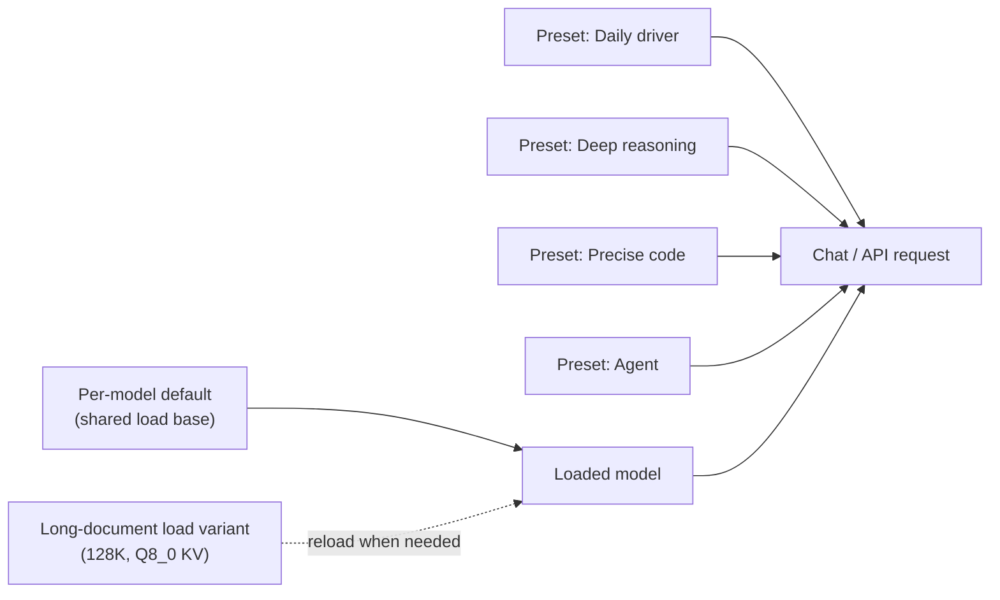

# Recommended configs for your Mac

The last three lessons explained every knob. This one turns them into six concrete configurations for a 16 GB MacBook Air running Qwen3.5-9B Q4_K_M, each with every value and a one-line reason. Copy them, save them as per-model defaults and presets, then tune from there with measurements, not vibes.

> [!GOALS]
> - Apply a shared load configuration as your model's per-model default
> - Set up six presets: Daily driver, Deep reasoning, Precise code, Long document, Agent / tool use, Brainstorm
> - Understand the trade-offs between them (latency, memory, quality, determinism)
> - Save, export and reuse them, in the UI and from Python

> [!NOTE]
> Sources for the values: the official Qwen3.5-9B model card (sampling profiles), the HauhauCS model card, LM Studio's settings, and the memory math from [Load settings](#/lmstudio/load-settings). Where a value is my recommendation rather than an official one, the reason says so. Your hardware generation (M1 to M5) changes speed, not these settings. The Qwen card has four sampling profiles: thinking/general (1.0, 0.95, 20, presence 1.5), thinking/precise coding (0.6, 0.95, 20, presence 0), non-thinking/general (0.7, 0.8, 20, presence 1.5) and non-thinking/reasoning (its quickstart says 1.0, 0.95, 20, presence 1.5; its Best Practices section says top_p 1.0, top_k 40, presence 2.0). The presets below use the first three; the fourth is a good starting point if you want reasoning-quality answers without the thinking latency.

## How the pieces fit

Remember the split from the previous lessons: **load settings** are per-model and need a reload; **inference settings** (including the system prompt) are per-chat and live in presets.



You'll keep **one** load configuration as the default (the shared base, 64K context), switch to the long-document load only when you need it, and swap presets freely without reloading.

## The shared load base

Set these once in My Models, gear ("Edit model default config"). They apply to every preset except where a preset lists a load override.

| Load setting | Value | Why |
|---|---|---|
| Context Length | 65,536 | 2 GiB of F16 KV cache: room for thinking and pasted code; fits comfortably |
| GPU Offload | MAX | Unified memory; any CPU layer is the bottleneck |
| CPU Thread Pool Size | default | The GPU does the math with full offload |
| Evaluation Batch Size | default | Only affects prompt reading; change only after measuring |
| Max Concurrent Predictions | 4 (default) | Lets Split View and API calls run together; costs ~150 MiB of extra DeltaNet state |
| Unified KV Cache | on | Slots share one context pool instead of multiplying it |
| Flash Attention | on | Exact, usually faster, required for V-cache quantization |
| K Cache Quantization Type | F16 (off) | At 64K the cache is only 2 GiB; no need to trade quality |
| V Cache Quantization Type | F16 (off) | Same |
| Offload KV Cache to GPU Memory | on | CPU-side attention is slow |
| Context Checkpoints | 8 | Fast regenerate/edit on this hybrid model without ~1.6 GB of snapshots (my recommendation) |
| RoPE Frequency Base / Scale | Auto / Auto | Native 262K context; overrides only cause harm |
| Keep Model in Memory | on | No stalls after idle |
| Try mmap() | on | Fast loads |
| Seed (load) | random | Fix per experiment, not by default |
| Speculative decoding | off | Your GGUF has no MTP head; a draft model is an optional experiment ([Performance](#/lmstudio/performance)) |

**Estimated memory:** 5.24 GiB weights + 2.0 GiB KV + ~0.2 GiB recurrent state + a few hundred MiB of buffers ≈ **7.5-8 GiB**. That leaves macOS and a browser enough room on 16 GB.

> [!TIP]
> If you rarely need more than a few thousand tokens of context, drop the base to 32,768 (1 GiB KV, ≈6.5-7 GiB total). On an M1 or M2 Air with lots of browser tabs open, that's the friendlier default.

## Preset 1: Daily driver (non-thinking)

Fast, direct answers for everyday questions: commands, explanations, quick drafts.

| Setting | Value | Why |
|---|---|---|
| Thinking | off | No reasoning preamble: answers start in about a second |
| Temperature | 0.7 | Qwen's non-thinking general profile |
| Top K Sampling | 20 | Qwen's value; hard cap on junk candidates |
| Top P Sampling | 0.8 | Qwen's non-thinking value; keeps answers on the likeliest phrasing |
| Min P Sampling | off (0) | Redundant with top-k + top-p |
| Presence Penalty | 1.5 | Qwen's general value; prevents loops in lists and prose |
| Frequency Penalty | off | Not recommended by Qwen |
| Repeat Penalty | off (1.0) | Qwen: 1.0; the blunt penalty hurts formatting |
| Limit Response Length | off | Let answers finish; non-thinking replies are short anyway |
| Context Overflow | Truncate Middle | Keeps your first message and system prompt in long chats |
| Stop Strings | none | Template handles end-of-turn |
| Structured Output | off | Prose answers |
| System prompt | "Precise technical assistant" ([library](#/lmstudio/prompts-templates)) | Short, factual, flags uncertainty |
| Load overrides | none (base) | |

## Preset 2: Deep reasoning (thinking)

Multi-step problems: threat modeling, debugging a weird auth flow, "why does this exploit chain work".

| Setting | Value | Why |
|---|---|---|
| Thinking | on | Reasoning before answering measurably helps multi-step problems |
| Temperature | 1.0 | Qwen's thinking-general profile (HauhauCS suggests 0.6: try it if reasoning wanders) |
| Top K Sampling | 20 | Qwen's value |
| Top P Sampling | 0.95 | Qwen's thinking value; room to explore alternatives inside `<think>` |
| Min P Sampling | off (0) | Redundant |
| Presence Penalty | 1.5 | Long reasoning chains are where small models loop |
| Frequency Penalty | off | |
| Repeat Penalty | off (1.0) | |
| Reasoning Budget | off, or 4,096 | Unlimited by default; cap it if the model over-thinks easy questions (my recommendation) |
| Limit Response Length | off | Thinking tokens count against it; a cap can leave an empty answer |
| Context Overflow | Truncate Middle | Keeps the original problem statement |
| Stop Strings | none | A stop string could fire inside the reasoning |
| Structured Output | off | Constrained output and free reasoning don't mix well |
| System prompt | "Teacher" or "Precise technical assistant" | |
| Load overrides | none at 64K; for the full Qwen guidance use 131,072 with K and V at Q8_0 | Qwen advises ≥128K for long thinking; Q8_0 makes that ≈2.1 GiB instead of 4 GiB |

> [!WARNING] Latency is the real cost
> At an illustrative 12 tok/s, 2,000 tokens of thinking is almost three minutes before the answer starts. Use this preset when the problem deserves it, not for "what's the nmap flag for UDP".

## Preset 3: Precise code

Writing and fixing code, regexes, parsers, Nuclei templates, shell one-liners.

| Setting | Value | Why |
|---|---|---|
| Thinking | on (off for small snippets) | Planning helps for non-trivial functions; skip it for one-liners |
| Temperature | 0.6 | Qwen's thinking-for-precise-coding profile |
| Top K Sampling | 20 | Qwen's value |
| Top P Sampling | 0.95 | Qwen's value for this profile |
| Min P Sampling | off (0) | |
| Presence Penalty | 0 | Code legitimately repeats identifiers and syntax (Qwen: 0 for precise coding) |
| Frequency Penalty | off | Same reason |
| Repeat Penalty | off (1.0) | Same reason; 1.1 visibly damages code |
| Limit Response Length | off | Long files plus thinking |
| Context Overflow | Stop at Limit | Silent truncation of pasted code produces confident wrong fixes (my recommendation) |
| Stop Strings | none | |
| Structured Output | off | |
| Seed | fixed (e.g. 42) when comparing variants, else random | Reproducible A/B tests of prompts |
| System prompt | "Precise technical assistant" | |
| Load overrides | none (64K base) | Room for a few files plus thinking |

## Preset 4: Long document

Reading big inputs: a 300-page PDF, a long Burp export, a full nmap XML. Requires a **reload** with the load variant below.

| Setting | Value | Why |
|---|---|---|
| **Load: Context Length** | 131,072 | Fits ~100K tokens of input plus an answer |
| **Load: K Cache Quantization** | Q8_0 | Halves KV memory: ≈2.1 GiB instead of 4 GiB |
| **Load: V Cache Quantization** | Q8_0 | Same; needs Flash Attention on |
| **Load: Flash Attention** | on | Required for V quantization |
| **Load: Max Concurrent Predictions** | 1 | One big job; saves state memory |
| **Load: Context Checkpoints** | 4 | Fewer snapshots; you won't be branching much (my recommendation) |
| **Load: Evaluation Batch Size** | default; test 2048 | Larger batches can speed up prompt reading if memory allows |
| Thinking | off | Long inputs already take minutes to read; extract first, reason later |
| Temperature | 0.7 | Qwen's non-thinking general profile |
| Top K Sampling | 20 | |
| Top P Sampling | 0.8 | Stick to what the document says |
| Min P Sampling | off (0) | |
| Presence Penalty | 1.5 | Qwen's general value; set 0 if extracting lists of repeated identifiers (IPs, hostnames) |
| Repeat Penalty | off (1.0) | |
| Limit Response Length | off | |
| Context Overflow | Stop at Limit | You must know if the document didn't fit |
| Structured Output | optional JSON schema | For extraction tasks (hosts, findings) |
| System prompt | "Answer only from the provided document. Quote the passage you rely on. If the answer is not in the document, say so." | Grounds a small model in its input (my recommendation) |

**Estimated memory:** 5.24 + 2.13 + 0.05 + buffers ≈ **8-8.5 GiB**. The full native 262,144 at Q8_0 would be ≈4.25 GiB of KV and ≈10.2 GiB total, at the edge of the default GPU limit; don't, unless you've raised it ([Performance](#/lmstudio/performance)).

> [!TIP]
> Prompt reading ("prefill") at 100K tokens takes minutes on an Air, and a fanless Air will throttle during it. Measure your prefill rate once with the benchmark in [Performance](#/lmstudio/performance), so you can predict it. For anything you query repeatedly, [RAG](#/using/rag) is usually the better tool.

## Preset 5: Agent / tool use

Driving tools through the API or MCP: the agent you'll build in [Building AI Agents](#/agents/what-is-an-agent).

| Setting | Value | Why |
|---|---|---|
| Thinking | off by default; on for a planning step | Every tool round-trip with thinking costs extra latency; small models are more reliable with short, direct steps |
| Temperature | 0.7 | Qwen's non-thinking general value |
| Top K Sampling | 20 | |
| Top P Sampling | 0.8 | Predictable tool choices |
| Min P Sampling | off (0) | |
| Presence Penalty | 0 | Tool-call arguments and JSON repeat syntax tokens (my recommendation; deviates from Qwen's general 1.5) |
| Repeat Penalty | off (1.0) | Same reason |
| Limit Response Length | 2,048 (non-thinking) | Stops a looping agent from burning minutes; raise if thinking is on |
| Context Overflow | Stop at Limit | Silently dropping a tool result corrupts the agent's state; handle overflow in code |
| Stop Strings | none | Tool calls are parsed from the template's format |
| Structured Output | JSON schema for final outputs, when you parse them | Guarantees parseable output ([Structured output and tool calling](#/using/structured-output-tools)) |
| Seed | fixed during development | Reproducible agent runs while debugging |
| System prompt | task-specific, short, with explicit tool-use rules | |
| Load overrides | none (64K base); Max Concurrent Predictions 4 | Tool outputs eat context fast; parallel calls need slots |
| API extras | `ttl` on JIT loads | Auto-unload when idle ([Server and API](#/lmstudio/server-api)) |

## Preset 6: Brainstorm

Generating many options: report titles, phishing-awareness training scenarios, test-case ideas, codenames.

| Setting | Value | Why |
|---|---|---|
| Thinking | off | Variety comes from sampling, not deliberation |
| Temperature | 1.1 | Bolder picks; safe because llama.cpp applies temperature after the filters (my recommendation) |
| Top K Sampling | 40 | Wider candidate pool than the precise presets |
| Top P Sampling | 0.95 | Keep the nucleus wide |
| Min P Sampling | 0.05 | A confidence-relative floor that stops nonsense at high temperature |
| Presence Penalty | 1.5 | Pushes toward new words and ideas |
| XTC | off; try probability 0.5, threshold 0.1 for creative writing | Excludes the most obvious choices; strong effect, use sparingly |
| Repeat Penalty | off (1.0) | |
| Limit Response Length | off | |
| Context Overflow | Rolling Window | Brainstorm chats are disposable; recency matters most |
| Structured Output | off | |
| System prompt | "Generate many distinct options. Number them. No two options may share their main idea." | |
| Load overrides | none | |

## Trade-offs at a glance

| Preset | Thinking | Temp / Top P | Presence | Context (KV) | Latency | Determinism |
|---|---|---|---|---|---|---|
| Daily driver | off | 0.7 / 0.8 | 1.5 | 64K F16 | Low | Medium |
| Deep reasoning | on | 1.0 / 0.95 | 1.5 | 64K F16 (or 128K Q8_0) | High | Low |
| Precise code | on | 0.6 / 0.95 | 0 | 64K F16 | Medium-high | Medium-high |
| Long document | off | 0.7 / 0.8 | 1.5 | 128K Q8_0 | High (prefill) | Medium |
| Agent / tool use | off | 0.7 / 0.8 | 0 | 64K F16 | Low per step | High with seed |
| Brainstorm | off | 1.1 / 0.95 + min-p | 1.5 | 64K F16 | Low | Low |

The main axes:

- **Thinking vs latency.** Thinking improves hard answers and costs minutes on an Air. Default to off; turn it on for problems that need it.
- **Context vs memory.** Every 32K tokens of F16 context is 1 GiB. Q8_0 halves it at a small quality risk, worth it only at 128K-class contexts.
- **Temperature vs reliability.** Low temperature for anything you'll execute or parse; higher for ideas. The filters (top-k, top-p, min-p) are the guard rails that make higher temperature safe.
- **Penalties vs structure.** Presence penalty prevents loops in prose and damages code and JSON. That single setting is the biggest difference between the "prose" and "structured" presets.

## Saving them

### In the UI

1. My Models, gear: enter the shared load base; save. Load the model.
2. New chat. Set the Daily driver values and system prompt in the sidebar. Preset dropdown, **Save As New...**, name `daily`.
3. Change the values for the next preset, **Save As New...** again. Repeat for all six. (Turning thinking off depends on your build; see [Prompts and templates](#/lmstudio/prompts-templates). Two virtual models, "thinking" and "no-think", make this clean.)
4. For Long document, either reload with the 128K / Q8_0 values each time you need it, or create a **virtual model** (My Models, Create Virtual Model) that bakes in those load settings so it appears as a separate model in the list.
5. Optional: Settings, "Enable model load configuration support in presets" (experimental) lets the Long document preset carry its load settings, applied on reload.

### The preset file

Presets are JSON files in `~/.lmstudio/config-presets/`. Each setting is a field with a `key` (the same keys LM Studio's SDK and `model.yaml` use) and a `value`; settings with an on/off checkbox store `{"checked": ..., "value": ...}`. An exported Daily driver looks like this:

```json title="daily.preset.json"
{
  "identifier": "@local:daily",
  "name": "daily",
  "changed": false,
  "operation": {
    "fields": [
      { "key": "llm.prediction.systemPrompt", "value": "You are a precise technical assistant for an experienced engineer. ..." },
      { "key": "llm.prediction.temperature", "value": 0.7 },
      { "key": "llm.prediction.topKSampling", "value": 20 },
      { "key": "llm.prediction.topPSampling", "value": { "checked": true, "value": 0.8 } },
      { "key": "llm.prediction.minPSampling", "value": { "checked": false, "value": 0.05 } },
      { "key": "llm.prediction.repeatPenalty", "value": { "checked": false, "value": 1.1 } },
      { "key": "llm.prediction.llama.presencePenalty", "value": { "checked": true, "value": 1.5 } },
      { "key": "llm.prediction.contextOverflowPolicy", "value": "truncateMiddle" }
    ]
  },
  "load": { "fields": [] }
}
```

The field keys and value shapes come from LM Studio's config schema (other useful keys: `llm.prediction.maxPredictedTokens`, `llm.prediction.stopStrings`, `llm.prediction.reasoning.enableThinking`, `llm.prediction.reasoning.budgetTokens`; load keys look like `llm.load.contextLength` and `llm.load.llama.flashAttention`). The outer wrapper (`identifier`, `name`, `operation`, `load`) is shown as it appears in exports I've seen, but LM Studio doesn't document the file format formally: **export one of your own presets first** (`•••`, Export File) and match its structure before hand-editing.

A fast way to build the set: create `daily` in the UI, export it, copy the file five times, edit names and values, and import them all at once (preset dropdown, **Import**, which accepts multiple `preset.json` or `.tar.gz` files).

### The same presets in Python

For scripts against the local server, keep the sampling side as a dictionary. `top_k` and `repeat_penalty` aren't standard OpenAI parameters, so they go in `extra_body`:

```python title="presets.py"
"""Sampling presets for Qwen3.5-9B via LM Studio's OpenAI-compatible API."""

PRESETS: dict[str, dict] = {
    "daily":     dict(temperature=0.7, top_p=0.8,  presence_penalty=1.5,
                      extra_body={"top_k": 20, "repeat_penalty": 1.0}),
    "reasoning": dict(temperature=1.0, top_p=0.95, presence_penalty=1.5,
                      extra_body={"top_k": 20, "repeat_penalty": 1.0}),
    "code":      dict(temperature=0.6, top_p=0.95, presence_penalty=0.0,
                      extra_body={"top_k": 20, "repeat_penalty": 1.0}),
    "agent":     dict(temperature=0.7, top_p=0.8,  presence_penalty=0.0, max_tokens=2048,
                      extra_body={"top_k": 20, "repeat_penalty": 1.0}),
    "brainstorm": dict(temperature=1.1, top_p=0.95, presence_penalty=1.5,
                       extra_body={"top_k": 40, "repeat_penalty": 1.0}),
}

if __name__ == "__main__":
    from openai import OpenAI

    client = OpenAI(base_url="http://localhost:1234/v1", api_key="lm-studio")
    MODEL = "qwen3.5-9b-uncensored-hauhaucs-aggressive"  # check yours: lms ls
    reply = client.chat.completions.create(
        model=MODEL,
        messages=[{"role": "user", "content": "One-line definition of IDOR."}],
        **PRESETS["daily"],
    )
    print(reply.choices[0].message.content)
```

Min P isn't in LM Studio's documented list of OpenAI-compatible parameters; if you need it from code, use the native `/api/v1/chat` endpoint (which accepts `min_p`) or rely on the value saved in the UI. Thinking on/off from code is covered in [Server and API](#/lmstudio/server-api).

## Lab: install and validate your presets

> [!LAB] Six presets, measured
> 1. Apply the shared load base as the per-model default; reload; note the loader's memory estimate.
> 2. Create the six presets (UI, or export-copy-import).
> 3. Run the same three prompts under Daily, Deep reasoning and Precise code:
>    - "Explain the difference between a reflected and a stored XSS in two sentences."
>    - "A JWT is signed with HS256 and the server also accepts RS256 public keys. Walk through the attack and the fix."
>    - "Write a Python function that extracts all IPv4 addresses from a log file, with tests."
> 4. For each run, record tok/sec, time to first token, total tokens and your 1-5 quality score in `~/ai-lab/lmstudio/presets-lab.md`.
> 5. Reload with the Long document load settings; paste a long text (a public RFC works well: RFC 9110 is a good size) and ask three questions whose answers are at the beginning, middle and end. Did all three succeed?
> 6. Decide which preset you'll actually use most, and make it the default you start chats with.

## Recap
- One shared load base (64K, F16 KV, GPU MAX, Flash Attention, 8 checkpoints) as the per-model default covers five of six presets at ≈7.5-8 GiB.
- Long document is a load variant: 128K with Q8_0 K and V, concurrency 1, Stop at Limit, ≈8-8.5 GiB.
- Sampling follows Qwen's card: non-thinking 0.7 / 0.8 / 20; thinking 1.0 / 0.95 / 20 for general and 0.6 for precise code; presence 1.5 for prose and 0 for code, JSON and agents; repeat penalty off.
- Thinking is the biggest latency lever on an Air; default to off, turn on when the problem needs it.
- Presets are JSON with `key`/`value` fields; export one of yours before hand-editing the format.

## Check yourself
1. Why does the Agent preset use presence penalty 0 when Qwen's general recommendation is 1.5?
   <details><summary>Answer</summary>

   Tool-call arguments and JSON reuse the same syntax tokens (quotes, braces, colons, keys) constantly. A presence penalty pushes the model away from tokens it has already used, which distorts structured output. Qwen itself recommends 0 for precise coding for the same reason.

   </details>
2. Long document uses Q8_0 KV cache but the other presets don't. What's the reasoning?
   <details><summary>Answer</summary>

   At 64K the F16 cache is only 2 GiB, so quantizing saves little and risks some quality. At 128K it would be 4 GiB, pushing the total to the GPU limit; Q8_0 brings it to ≈2.1 GiB with small quality impact.

   </details>
3. Brainstorm runs at temperature 1.1. Why doesn't that produce garbage?
   <details><summary>Answer</summary>

   llama.cpp applies top-k, top-p and min-p before temperature, using the model's original probabilities, so only reasonable candidates survive. Temperature then only spreads the probability among those survivors.

   </details>
4. You want the Long document load settings without reloading by hand each time. What are two options?
   <details><summary>Answer</summary>

   Create a virtual model that bakes in the 128K / Q8_0 load settings, or enable the experimental "model load configuration support in presets" setting so the preset carries its load configuration (applied on reload).

   </details>

## Go deeper
- [Qwen3.5-9B model card, Best Practices](https://huggingface.co/Qwen/Qwen3.5-9B) — the source of the sampling profiles
- [HauhauCS Qwen3.5-9B Uncensored card](https://huggingface.co/HauhauCS/Qwen3.5-9B-Uncensored-HauhauCS-Aggressive) — the uncensored variant's own recommendations and quirks
- [LM Studio: Importing and sharing presets](https://lmstudio.ai/docs/app/presets/import) — import from file or URL, where Hub presets are stored
- [LM Studio: model.yaml](https://lmstudio.ai/docs/app/modelyaml) — baking load and inference defaults into a virtual model
