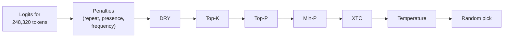
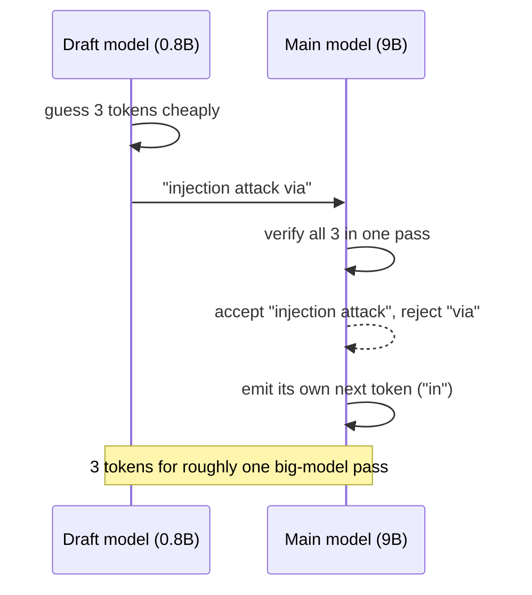

# Sampling and inference settings

Every time your model produces a token, it actually produces a probability for **all 248,320 tokens** in its vocabulary, and something has to pick one. The inference settings in LM Studio's sidebar are that "something": a chain of filters and dials that shape the probabilities, then roll the dice. This lesson explains each one, the order llama.cpp applies them in, how they interact, and which values Qwen recommends for your model and why.

> [!GOALS]
> - Explain temperature, top-k, top-p, min-p and the penalties in plain words and in math
> - Know the order llama.cpp applies samplers in, and why "temperature last" matters
> - Configure response length, context overflow, stop strings and structured output
> - Understand speculative decoding (draft models and MTP) and whether it helps your setup
> - Run controlled experiments that change one setting at a time

## From logits to one token

A one-paragraph refresher from [How text gets generated](#/foundations/generation): the model's last layer outputs a raw score (**logit**) for every token in the vocabulary. **Softmax** turns scores into probabilities that sum to 1. Then a **sampler** picks one token, it's appended to the text, and the whole thing repeats.

If the sampler always picked the single most likely token ("greedy decoding"), output would be deterministic but often dull and prone to loops. If it picked from the raw distribution, the long tail of thousands of weird, individually unlikely tokens would occasionally win and derail the answer. Sampling settings are the middle ground: cut the tail, then sample from what's left.

> [!CONCEPT] Sampling
> Choosing the next token at random, weighted by the model's probabilities, after filtering out unlikely candidates. Security analogy: the model proposes a ranked list of candidate payloads with confidence scores; your sampling settings are the filter rules deciding which candidates are even eligible before you pick one.

## Where these settings live

In Developer mode, the right sidebar of a chat shows the inference settings (sections such as General, Sampling, Structured Output, Speculative Decoding). They take effect on the **next message**, no reload. The same values can be stored in:

- **Presets** (a named bundle of system prompt + inference settings; [Prompts and templates](#/lmstudio/prompts-templates))
- **Per-model defaults** (My Models, gear)
- **API requests** (`temperature`, `top_p` etc. in the JSON body; [Server and API](#/lmstudio/server-api))

> [!WARNING] Know your starting values
> LM Studio's generic defaults (from its config schema) are Temperature 0.8, Top K 40, Top P 0.95, Min P 0.05 and Repeat Penalty 1.1. Models from LM Studio's own catalog can ship different defaults: the catalog entry for official Qwen3.5-9B uses Temperature 1, Top K 20, Top P 0.95, Presence Penalty 1.5, with Min P and Repeat Penalty off. A community GGUF like yours may just get the generic defaults. Open the sidebar and check before trusting anything.

## The sampler chain and its order

llama.cpp (the engine running your GGUF) applies samplers as a **chain**, in a fixed default order. From llama.cpp's source (`common/common.h`):



(The full default list is penalties, DRY, top-n-sigma, top-k, typical-p, top-p, min-p, XTC, temperature; samplers that are disabled just pass everything through.)

**The key consequence: temperature comes last.** Top-K, Top-P and Min-P decide which tokens survive using the model's **original** probabilities. Temperature then only reshapes the odds **among the survivors**. So with sensible filters, a high temperature can't resurrect garbage from the tail; and a low temperature makes the top survivor dominate.

Many tutorials (and some other engines) describe temperature as applied first, which changes how top-p behaves. LM Studio doesn't expose a sampler-order control for llama.cpp, so assume the order above for your GGUF. The MLX engine has its own sampler implementation.

## The four core samplers

We'll use one running example. Suppose that after "The scanner flagged a possible SQL" the model's top candidates are:

| Token | A " injection" | B " error" | C " issue" | D " flaw" | E " bug" | F " vuln" | G " risk" | H " problem" | thousands more |
|---|---|---|---|---|---|---|---|---|---|
| Probability | 0.50 | 0.20 | 0.10 | 0.06 | 0.04 | 0.03 | 0.015 | 0.010 | 0.045 total |

### Temperature

**What it is.** A dial for how adventurous the pick is. Technically, logits are divided by T before softmax, which is the same as raising each probability to the power 1/T and renormalizing.

- **T < 1** sharpens: the favorite gets more likely.
- **T = 1** leaves the distribution unchanged.
- **T > 1** flattens: underdogs gain.
- **T = 0** is treated as greedy: always the top token.

Applied to our survivors A-H (after the filters below, renormalized), here's what T does:

| Token | T = 1.0 | T = 0.6 |
|---|---|---|
| A " injection" | 0.524 | **0.745** |
| B " error" | 0.209 | 0.162 |
| C " issue" | 0.105 | 0.051 |
| D " flaw" | 0.063 | 0.022 |
| E-H combined | 0.099 | 0.020 |

(The T = 0.6 column is each survivor's probability raised to 1/0.6 ≈ 1.67, then renormalized. Do it once by hand; it makes the dial concrete.)

**Typical values.** 0.6-0.7 for precise work, about 1.0 for open-ended reasoning and writing with Qwen3.5, 0 for repeatable tests. Small models degrade faster at high temperature than big ones: they have less "margin" before a slightly odd token derails the next ten.

### Top K Sampling

**What it is.** Keep only the K most likely tokens; discard the rest.

**Example.** With K = 20, everything outside the top 20 is removed, whatever its probability. With K = 3, only A, B, C survive.

**Strengths and weaknesses.** It's a blunt cap that ignores the shape of the distribution: when the model is very sure (A = 0.99), K = 20 still keeps 19 pointless candidates; when it's genuinely unsure among 50 good options, K = 20 cuts good ones. Qwen recommends **20** (40 in one profile). In LM Studio, Top K is a plain number (no on/off checkbox).

### Top P Sampling

**What it is.** "Nucleus sampling" ([Holtzman et al.](https://arxiv.org/abs/1904.09751)): sort tokens by probability and keep the smallest set whose probabilities add up to at least P.

**Example with P = 0.95.** Running total: A 0.50, +B 0.70, +C 0.80, +D 0.86, +E 0.90, +F 0.93, +G 0.945, +H 0.955. We've crossed 0.95 at H, so A through H survive (8 tokens). With P = 0.8, only A, B, C survive.

**Why it's better than Top K alone.** It adapts: when the model is confident, the nucleus is tiny; when it's unsure, the nucleus grows. Qwen recommends **0.95** for thinking and **0.8** for non-thinking mode.

### Min P Sampling

**What it is.** Keep only tokens whose probability is at least P_min **times the top token's probability** ([min-p paper](https://arxiv.org/abs/2407.01082)).

**Example with Min P = 0.05.** The top token is A at 0.50, so the threshold is 0.05 × 0.50 = 0.025. A-F survive (F = 0.03), G and H are cut.

**Why it exists.** It scales with confidence even more directly than Top P: if the top token is 0.99, the threshold is 0.0495, so almost everything else dies. It's popular for creative writing at high temperature. Qwen recommends **0** (off) for your model, because Top K 20 + Top P already do the job.

### How they interact

Each filter only removes tokens; the survivors are the **intersection** of what every enabled filter keeps. With Qwen's thinking profile (Top K 20, Top P 0.95, Min P 0):

```text
start:       all 248,320 tokens
top-k 20:    the 20 most likely (A..H plus 12 tail tokens)
top-p 0.95:  A..H (8 tokens) - top-p was the tighter filter here
min-p 0:     disabled, keeps all 8
temperature: reshapes odds among A..H
pick:        random draw, " injection" about 52% of the time at T=1, about 75% at T=0.6
```

In practice: Top K 20 is a safety cap on pathological flat distributions, Top P does the adaptive work, temperature sets how bold the final draw is.

<div data-widget="sampler"></div>

> [!TIP]
> In the widget, set top-k 20 and top-p 0.95, then move temperature from 0.6 to 1.0. Then try min-p 0.05 with top-p at 1.0. Get a feel for which filter is "binding" in different situations.

## Repetition controls

Small models love to loop: repeating a phrase, a list item, or an entire paragraph. (The MIT weight-editing study in [Part 8](#/weights/mit-study) found a 0.8B Qwen3.5 model looping to the token limit on most practice problems.) Three knobs push back, all applied at the very start of the chain.

### Repeat Penalty

**What it is.** llama.cpp's classic penalty: for each token that appeared in the recent window, its logit is divided by the penalty if positive (multiplied if negative), making it less likely. 1.0 = off; LM Studio's generic default is 1.1 (on).

**The window.** llama.cpp applies penalties over the last N tokens (its default `penalty_last_n` is 64). LM Studio doesn't appear to expose N in the UI.

**Why Qwen says 1.0 (off).** It's indiscriminate: it penalizes "the", indentation, quotes, braces and every other token that **should** repeat. Code and JSON suffer most. Qwen's model card recommends `repetition_penalty=1.0` in every profile.

### Presence Penalty and Frequency Penalty

**What they are.** OpenAI-style penalties, subtracted from logits:

```text
logit[t] -= presence_penalty  × (1 if t appeared, else 0)
logit[t] -= frequency_penalty × (number of times t appeared)
```

Presence is a flat "you've said this already" tax; frequency grows with repetition count. LM Studio's llama.cpp engine exposes **Presence Penalty** and **Frequency Penalty** in the sidebar (both off by default), and the OpenAI-compatible API accepts `presence_penalty` and `frequency_penalty`.

**Qwen's recommendation.** Presence penalty **1.5** for general thinking and non-thinking use, **0** for precise coding. The card notes values from 0 to 2 reduce endless repetition, but higher values "may occasionally result in language mixing and a slight decrease in model performance". It doesn't recommend a frequency penalty.

> [!WARNING]
> Penalties and structured text don't mix well. JSON, code and tool-call arguments repeat the same syntax tokens constantly; penalizing them distorts output. Use presence penalty 0 for code, JSON schema output and agents.

### XTC and the rest

- **XTC Sampling Probability / Threshold** ("Exclude Top Choices"): with some probability per token, removes all high-probability candidates above the threshold except the least likely of them, forcing less clichéd choices. A creative-writing tool; off by default; leave it off for technical work.
- **Tail-Free Sampling, Locally Typical Sampling, Mirostat, logit bias**: older or niche samplers still present in llama.cpp. Leave them off unless you have a specific reason.

## Length, overflow and stopping

### Limit Response Length

**What it is.** A cap on how many tokens one reply may contain (off by default; when switched on it starts at 1,000). When hit, the stop reason is "Max Predicted Tokens Reached".

**The thinking trap.** In thinking mode, the hidden `<think>` tokens count against this limit. A 1,000-token cap can be eaten entirely by reasoning, leaving an empty or truncated answer. Qwen recommends allowing up to 32,768 output tokens for most queries.

**Recommended.** Off in chat. In scripts and agents, set `max_tokens` explicitly as a safety net against runaway loops: generous in thinking mode (8,000-16,000), smaller (1,000-2,000) in non-thinking mode.

### Context Overflow

**What it is.** What LM Studio does when the conversation no longer fits in the Context Length you loaded:

| Policy (UI label) | Behavior | Good for |
|---|---|---|
| **Truncate Middle** (default) | Keeps the system prompt and the first user message, removes messages from the middle | Long chats where the original task statement matters |
| **Rolling Window** | Keeps the most recent messages; the beginning is forgotten | Endless casual chat |
| **Stop at Limit** | Stops generating when context is full (stop reason "Context Length Limit Reached") | Scripts, agents, long-document work where silent truncation would be a bug |

Security analogy: Truncate Middle and Rolling Window are log rotation. Fine for chatter, dangerous for evidence. If you're analyzing a long scan output and the middle silently disappears, the model will confidently answer about data it no longer has. For analysis work, prefer **Stop at Limit** and fix the context explicitly.

### Stop Strings

**What it is.** A list of exact strings; when the model produces one, generation stops (stop reason "Stop String Found").

**Uses.** Ending at a delimiter you asked for (`END_OF_REPORT`), stopping after the first paragraph (`\n\n`), or cutting off a model that keeps going past the answer.

**Caveats.** Matching is on decoded text, so pick strings that won't appear naturally, including inside the thinking block. The model's own end-of-turn token is handled by the chat template, so you don't need to add `<|im_end|>` yourself.

## Structured Output

**What it is.** You supply a JSON Schema; the engine forces the reply to be valid JSON matching it.

**Mechanism.** The schema is compiled into a grammar. At every step, before sampling, tokens that would make the output invalid are masked out (probability 0). For GGUF models this uses llama.cpp's grammar-based sampling; for MLX models LM Studio uses the Outlines library. So the output is guaranteed to **parse**; it is not guaranteed to be **true**, and the model can still put nonsense in valid fields.

In the UI, paste a schema into the **Structured Output** section of the sidebar. Over the API, pass `response_format` with `type: "json_schema"`. Full treatment, including tool calling, is in [Structured output and tool calling](#/using/structured-output-tools); API examples are in [Server and API](#/lmstudio/server-api).

## Speculative decoding

**The idea.** Generating a token with your 9B model costs one full pass over ~5.3 GB of weights, and that pass is limited by memory bandwidth, not compute ([Performance](#/lmstudio/performance)). But checking several tokens in one pass costs about the same as generating one. So: let a tiny, fast **draft model** guess the next few tokens, then have the big **main model** verify all the guesses in a single pass. Correct guesses are accepted for free; at the first wrong one, the main model's own token is used instead ([Leviathan et al.](https://arxiv.org/abs/2211.17192)).



**Quality.** Unchanged. The main model only accepts tokens it would have produced itself, so the output follows the main model. Only speed changes.

**Requirements.**

- **Same vocabulary.** Draft and main must use the same tokenizer. Qwen3.5-0.8B and Qwen3.5-9B both have the same 248,320-token vocabulary (checked in both models' `config.json`), so the pair is compatible in principle. LM Studio only lists drafts it considers compatible.
- **Much smaller draft.** LM Studio's guidance: for a 7B main model, a draft of at most about 1B. 0.8B for 9B fits.
- **Engine support for hybrid models.** Rejecting draft tokens means rolling back state, which is hard for recurrent layers. Community reports indicate llama.cpp only fixed draft-model speculation for Qwen3.5's hybrid layers in spring 2026, so use a current runtime.

**An uncensored main with a censored draft.** The draft only proposes; your uncensored 9B decides. Output is unaffected, but on topics where the stock 0.8B would refuse or steer away, its guesses get rejected more often, so the speed-up shrinks exactly where you might want it.

**MTP: the built-in draft.** Qwen3.5-9B was trained with a **multi-token prediction (MTP)** head: one extra layer that predicts a token further ahead, usable as a free built-in draft. LM Studio supports MTP speculative decoding (stable since 0.4.14; load-time option **Draft MTP**; `lms load --speculative-draft-mtp`). The catch: the GGUF must contain the MTP layer. Your HauhauCS GGUF almost certainly doesn't: it predates llama.cpp's MTP support (merged May 2026), and its BF16 file is about 0.49 GB smaller than Unsloth's MTP-bundled Qwen3.5-9B BF16, which is about the size of one extra layer. If Draft MTP is unavailable or errors for your model, that's why.

**Where the settings are.** This moved in 2026:

- In current builds using the llama.cpp "Engine Protocol" (default since 0.4.19), speculative decoding is configured at **load time**: **Draft MTP**, or a separate draft model ("Draft Simple"), with **Max Draft Tokens** (default 3), **Min Draft Tokens** and **Drafting Probability Cutoff**. CLI: `lms load <key> --speculative-draft-simple --speculative-draft-model <draft-key>`.
- Older builds and the MLX engine show a **Speculative Decoding** section in the chat sidebar with a **Draft Model** dropdown and **Max Draft Size**, **Min Draft Size**, **Drafting Probability Cutoff** (MLX: **Draft Tokens to Generate**).

If you don't see one, look for the other. Results appear in the stats line as "Accepted X/Y draft tokens (Z%)", and a "Visualize accepted draft tokens" option colors them in the chat.

**Does it help on a 16 GB Air?** Possibly a little, sometimes not at all. The draft costs memory (0.8B at Q8_0 is under 1 GB plus its own cache) and bandwidth, and LM Studio's docs warn that a draft that's not fast or accurate enough can make generation **slower**. It works best on predictable text (code, boilerplate, structured answers) and worst on creative text. Treat it as an experiment you measure ([Performance](#/lmstudio/performance)).

## The remaining sidebar settings

| Setting | What it is | Recommendation |
|---|---|---|
| **CPU Threads** (inference) | Threads for CPU-side work during generation | Default; irrelevant with full GPU offload |
| **Seed** (inference) | Fixes sampling randomness | Fixed only for experiments |
| **Enable Thinking**, **Reasoning Budget**, **Reasoning Section Parsing** | Thinking controls | [Prompts and templates](#/lmstudio/prompts-templates) |
| **Tool Use** | JSON list of tools the model may call | [Structured output and tool calling](#/using/structured-output-tools) |
| **Prompt Template** | How messages are formatted for the model | [Prompts and templates](#/lmstudio/prompts-templates) |

## Qwen's recommended values, and why

The official Qwen3.5-9B model card gives four profiles:

| Profile | Temp | Top P | Top K | Min P | Presence | Repeat |
|---|---|---|---|---|---|---|
| Thinking, general tasks | 1.0 | 0.95 | 20 | 0 | 1.5 | 1.0 |
| Thinking, precise coding | 0.6 | 0.95 | 20 | 0 | 0 | 1.0 |
| Non-thinking (instruct), general | 0.7 | 0.8 | 20 | 0 | 1.5 | 1.0 |
| Non-thinking, reasoning tasks | 1.0 | 0.95 or 1.0 | 20 or 40 | 0 | 1.5 or 2.0 | 1.0 |

The card is inconsistent on the last row: its quickstart section says 1.0 / 0.95 / 20 / presence 1.5, while its Best Practices section says top_p 1.0, top_k 40, presence 2.0. Either is defensible; start with the quickstart values.

The HauhauCS model card lists slightly different values: thinking 0.6 / 0.95 / 20 / 0 and non-thinking 0.7 / 0.8 / 20 / 0, without presence penalty. Where they differ, treat Qwen's card as the source (the uncensoring edit didn't retrain sampling behavior) and HauhauCS's 0.6 as a reasonable "more focused" variant to try if thinking output wanders.

Why these shapes make sense:

- **Top K 20 everywhere**: a hard cap that prevents rare, flat distributions from producing junk, which matters more for a 9B than a 400B model.
- **Top P 0.95 when thinking, 0.8 when not**: reasoning benefits from exploring alternatives inside `<think>`; a direct answer benefits from sticking to the likeliest phrasing.
- **Temperature 1.0 for general thinking**: the model was trained to reason at its natural distribution; lowering it too far makes long thinking chains more prone to loops, which presence penalty then fights.
- **Presence 1.5, repeat 1.0**: a targeted anti-loop tax instead of the blunt repeat penalty; turned off for code, where repetition is legitimate.
- **Min P 0**: redundant with the other two filters.

Ready-to-copy versions of these as presets are in [Recommended configs](#/lmstudio/presets-for-you).

## Lab: controlled sampling experiments

> [!LAB] Change one thing, observe one thing
> Work in `~/ai-lab/lmstudio`. For the UI experiments, duplicate a chat (`•••`, Duplicate) so each variant starts from identical history, and change only the named setting.
>
> **Part A: diversity vs temperature (scripted).**
>
> 1. Start the server (Developer tab, or `lms server start`) with your model loaded.
> 2. Set up Python:
>
> ```bash
> cd ~/ai-lab/lmstudio
> python3 -m venv .venv && source .venv/bin/activate
> pip install openai
> ```
>
> 3. Save and run this script:
>
> ```python title="sampling_lab.py"
> """Sample one prompt N times per configuration and count distinct answers."""
> from openai import OpenAI
>
> BASE_URL = "http://localhost:1234/v1"
> MODEL = "qwen3.5-9b-uncensored-hauhaucs-aggressive"  # check yours: lms ls
> PROMPT = ("Invent a codename for an internal red-team exercise. "
>           "Reply with the codename only, two words max.")
> N = 8
>
> # top_k and repeat_penalty are LM Studio extensions, so they go in extra_body.
> CONFIGS = {
>     "greedy T=0":             dict(temperature=0.0),
>     "T=0.6 p=0.95 k=20":      dict(temperature=0.6, top_p=0.95, extra_body={"top_k": 20}),
>     "T=1.0 p=0.95 k=20":      dict(temperature=1.0, top_p=0.95, extra_body={"top_k": 20}),
>     "T=1.0 p=0.8  k=20":      dict(temperature=1.0, top_p=0.8, extra_body={"top_k": 20}),
>     "T=1.5 p=1.0  k=100":     dict(temperature=1.5, top_p=1.0, extra_body={"top_k": 100}),
> }
>
> client = OpenAI(base_url=BASE_URL, api_key="lm-studio")
>
>
> def final_answer(message) -> str:
>     """Return the visible answer, dropping an inline <think> block if present."""
>     text = message.content or ""
>     if "</think>" in text:
>         text = text.split("</think>", 1)[1]
>     return text.strip()
>
>
> def main() -> None:
>     for name, cfg in CONFIGS.items():
>         cfg = dict(cfg)
>         extra = cfg.pop("extra_body", {})
>         answers = []
>         for _ in range(N):
>             resp = client.chat.completions.create(
>                 model=MODEL,
>                 messages=[{"role": "user", "content": PROMPT}],
>                 max_tokens=2048,  # room for thinking, if it's on
>                 extra_body=extra,
>                 **cfg,
>             )
>             answers.append(final_answer(resp.choices[0].message))
>         distinct = len({a.lower() for a in answers})
>         print(f"{name:22s} distinct {distinct}/{N}: {answers[:4]}")
>
>
> if __name__ == "__main__":
>     main()
> ```
>
> ```bash
> python3 sampling_lab.py
> ```
>
> Expect greedy to give 1/8 distinct, and diversity to rise with temperature and top-p. Note whether the T=1.5 answers stay sensible (the filters are holding) or start to break.
>
> **Part B: repetition (UI).** Thinking off if you can (see [Prompts and templates](#/lmstudio/prompts-templates)), Temperature 0.7, Top P 0.8, Top K 20. Prompt: "List 60 distinct Linux privilege-escalation checks, one per line, no numbering." Run with Presence Penalty off, then 1.5, then Repeat Penalty 1.3 with presence off. Count duplicates and look at the formatting of the 1.3 run.
>
> **Part C: penalties vs code.** Prompt: "Write a Python function that parses an nginx access log line into a dict, with type hints." Compare Presence 0 vs 1.5. Does the 1.5 version get odd variable names or broken syntax?
>
> **Part D: length and overflow.** With thinking on, set Limit Response Length to 300 and ask a multi-step question. Read the stop reason. Then load a small context (4,096), paste a long log, and compare Truncate Middle vs Stop at Limit: which one tells you something went wrong?
>
> **Part E (optional): speculative decoding.** If you download Qwen3.5-0.8B (GGUF), enable it as a draft. Ask for the same code task with and without it, three runs each; record tok/sec and the accepted-draft percentage.
>
> Record everything in `~/ai-lab/lmstudio/sampling-lab.md`.

## Recap
- The model outputs probabilities for every token; sampling filters the candidates and picks one at random.
- llama.cpp's default chain applies penalties first, then top-k, top-p, min-p, and **temperature last**, so filters decide eligibility from the model's original probabilities and temperature reshapes only the survivors.
- Top K is a blunt cap, Top P an adaptive nucleus, Min P a confidence-relative threshold. Survivors are the intersection.
- Prefer Qwen's presence penalty (1.5, or 0 for code) over the blunt repeat penalty (keep 1.0).
- Thinking tokens count against response length; for analysis work, "Stop at Limit" beats silent truncation.
- Structured output guarantees valid JSON, not correct content. Speculative decoding changes speed, never output; MTP needs a GGUF that includes the MTP layer, which yours very likely doesn't.

## Check yourself
1. With Top K 20, Top P 0.8 and Temperature 1.5, can a token ranked 30th ever be chosen? Why or why not?
   <details><summary>Answer</summary>

   No. In llama.cpp's default order, top-k and top-p run before temperature, so the 30th token is removed by top-k (and probably top-p) before temperature is applied. Temperature only reshapes the probabilities of the surviving tokens.

   </details>
2. Top token probability is 0.40. Which tokens does Min P 0.1 keep?
   <details><summary>Answer</summary>

   Tokens with probability at least 0.1 × 0.40 = 0.04.

   </details>
3. Why does Qwen recommend presence penalty 1.5 for general use but 0 for precise coding?
   <details><summary>Answer</summary>

   Presence penalty discourages any token that has already appeared. That helps prevent loops in prose and reasoning, but code legitimately repeats identifiers, keywords and syntax, so penalizing them degrades correctness.

   </details>
4. A teammate says "speculative decoding made the model dumber". Is that plausible?
   <details><summary>Answer</summary>

   Not if it's implemented correctly: the main model verifies every draft token and only accepts what it would have produced, so output follows the main model. Speed can go up or down; quality shouldn't change. If outputs differ, suspect other changed settings or randomness (no fixed seed).

   </details>
5. You're feeding a 60K-token scan output into a 32K context and the answer cites hosts that look plausible. Which overflow setting would have warned you, and what would you see?
   <details><summary>Answer</summary>

   Stop at Limit. Instead of silently dropping the middle of the input (Truncate Middle), it stops generation with the stop reason "Context Length Limit Reached", telling you the input didn't fit.

   </details>

## Go deeper
- [Qwen3.5-9B model card](https://huggingface.co/Qwen/Qwen3.5-9B) — the official sampling profiles and best practices
- [The Curious Case of Neural Text Degeneration (Holtzman et al.)](https://arxiv.org/abs/1904.09751) — why greedy decoding loops and where top-p came from
- [Min-p sampling (Nguyen et al.)](https://arxiv.org/abs/2407.01082) — the confidence-relative filter
- [Fast Inference from Transformers via Speculative Decoding (Leviathan et al.)](https://arxiv.org/abs/2211.17192) — the original speculative decoding paper
- [LM Studio: Speculative Decoding](https://lmstudio.ai/docs/app/advanced/speculative-decoding) — draft model guidance and trade-offs
