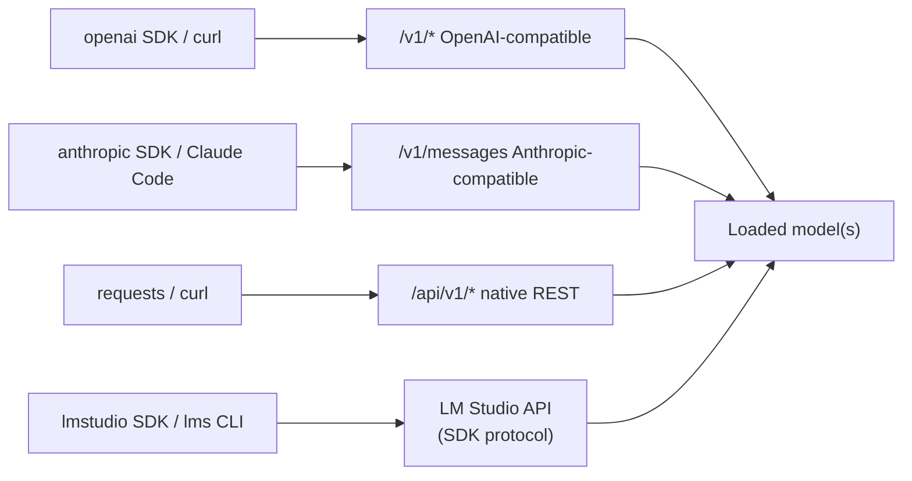

# Local server, API and the lms CLI

The chat window is for you; the server is for your code. Once LM Studio is serving on `localhost:1234`, every script, agent, IDE plugin and tool you build in this course can use your model through the same API shape as OpenAI's. This lesson covers starting the server, the endpoints (OpenAI-compatible, Anthropic-compatible and LM Studio's native REST API), Python clients, the `lms` CLI, just-in-time loading, and how to expose the server safely.

> [!GOALS]
> - Start, stop and check the server from the UI and from `lms`
> - Call the OpenAI-compatible endpoints with curl and the `openai` Python client, including streaming and JSON schema output
> - Use LM Studio's native REST API and the `lmstudio` Python SDK (including `.act()` for tools)
> - Drive models from the terminal with `lms` (ls, ps, load, unload, get, import, log stream, server)
> - Understand JIT loading, idle TTL, authentication, network binding and CORS, and their security implications

## Start the server

**From the UI:** Developer tab, toggle the server on. The default port is **1234**. Server Settings sits next to it.

**From the terminal:**

```bash
lms server start                 # uses the last port (1234 by default), binds to 127.0.0.1
lms server start --port 3000     # custom port
lms server status                # "The server is running on port 1234."
lms server status --json --quiet # {"running": true, "port": 1234}
lms server stop
```

Quick health check:

```bash
curl -s http://localhost:1234/v1/models | python3 -m json.tool
```

> [!TIP]
> To keep the server available without the window open, enable **Settings, "Enable Local LLM Service"** (headless; closing the app leaves it in the menu bar), and the Developer tab's "Auto-start server". For servers without a GUI, LM Studio ships a standalone daemon, **llmster** (`lms daemon up`), introduced in 0.4.0. You don't need it on your Mac.

## The endpoint map



| Endpoint | Method | What it does |
|---|---|---|
| `/v1/models` | GET | List models (all downloaded ones when JIT loading is on, else only loaded) |
| `/v1/chat/completions` | POST | Chat: messages in, assistant reply out. Template applied automatically |
| `/v1/responses` | POST | OpenAI Responses API: stateful via `previous_response_id`, streaming, reasoning, tools, remote MCP (0.3.29+) |
| `/v1/completions` | POST | Legacy raw text completion. **No chat template**: meant for base models |
| `/v1/embeddings` | POST | Text embeddings (needs an embedding model loaded; see [RAG](#/using/rag)) |
| `/v1/decisions` | POST | OpenAI-style "decisions" with a dedicated decision model (0.4.26+); not for your chat model |
| `/v1/messages` | POST | Anthropic Messages API (0.4.1+) |
| `/api/v1/chat` | POST | Native chat: stateful, MCP integrations, reasoning control, rich stats (0.4.0+) |
| `/api/v1/models` | GET | Native model list with capabilities and loaded-instance config |
| `/api/v1/models/load`, `/api/v1/models/unload` | POST | Load (with options) and unload |
| `/api/v1/models/download`, `/api/v1/models/download/status/{job_id}` | POST, GET | Download models via API |

The older native API at `/api/v0/*` still appears in docs as "REST API v0"; LM Studio recommends v1 for new work.

## OpenAI-compatible API with curl

The model name is the identifier from `lms ls`, `lms ps` or `/v1/models`. Any API key string works unless you enable authentication.

```bash
curl -s http://localhost:1234/v1/chat/completions \
  -H "Content-Type: application/json" \
  -d '{
    "model": "qwen3.5-9b-uncensored-hauhaucs-aggressive",
    "messages": [
      {"role": "system", "content": "You are a terse security assistant."},
      {"role": "user", "content": "One sentence: what is CSRF?"}
    ],
    "temperature": 0.7,
    "top_p": 0.8,
    "top_k": 20,
    "presence_penalty": 1.5,
    "max_tokens": 2048
  }' | python3 -m json.tool
```

Documented payload parameters for chat completions: `model`, `messages`, `temperature`, `top_p`, `top_k`, `max_tokens`, `stream`, `stop`, `presence_penalty`, `frequency_penalty`, `logit_bias`, `repeat_penalty`, `seed`; plus `response_format`, `tools`, `tool_choice` and `stream_options`. LM Studio also accepts `ttl` (idle unload) and `draft_model` (speculative decoding). Parameters you omit come from the model's saved settings.

Streaming uses server-sent events; `-N` stops curl from buffering:

```bash
curl -N http://localhost:1234/v1/chat/completions \
  -H "Content-Type: application/json" \
  -d '{"model": "qwen3.5-9b-uncensored-hauhaucs-aggressive",
       "messages": [{"role": "user", "content": "Count from 1 to 5."}],
       "stream": true}'
```

> [!TIP]
> Keep `lms log stream --source model --filter input,output` running in another terminal while you develop. You'll see the exact prompt LM Studio built from your API request, which settles most "why did it answer that" questions.

## Python with the `openai` client

```bash
cd ~/ai-lab/lmstudio && source .venv/bin/activate   # from earlier lessons
pip install openai
```

### Basic and streaming

```python title="openai_basic.py"
from openai import OpenAI

BASE_URL = "http://localhost:1234/v1"
MODEL = "qwen3.5-9b-uncensored-hauhaucs-aggressive"  # check yours: lms ls

client = OpenAI(base_url=BASE_URL, api_key="lm-studio")


def split_thinking(text: str) -> tuple[str, str]:
    """Qwen3.5 opens <think> in the prompt, so output may be 'reasoning</think>answer'."""
    if "</think>" in text:
        reasoning, answer = text.split("</think>", 1)
        return reasoning.replace("<think>", "").strip(), answer.strip()
    return "", text.strip()


def main() -> None:
    # Non-streaming
    resp = client.chat.completions.create(
        model=MODEL,
        messages=[{"role": "user", "content": "Name three OWASP Top 10 categories."}],
        temperature=0.7,
        top_p=0.8,
        presence_penalty=1.5,
        extra_body={"top_k": 20},  # LM Studio extension, not a standard OpenAI field
    )
    msg = resp.choices[0].message
    # If "separate reasoning_content" is enabled in Settings, reasoning arrives separately.
    reasoning = (msg.model_extra or {}).get("reasoning_content")
    _, answer = split_thinking(msg.content or "")
    print("finish_reason:", resp.choices[0].finish_reason)
    print("reasoning present:", bool(reasoning) or "</think>" in (msg.content or ""))
    print(answer)

    # Streaming
    stream = client.chat.completions.create(
        model=MODEL,
        messages=[{"role": "user", "content": "Explain SSRF in two sentences."}],
        stream=True,
    )
    for chunk in stream:
        if chunk.choices and chunk.choices[0].delta.content:
            print(chunk.choices[0].delta.content, end="", flush=True)
    print()


if __name__ == "__main__":
    main()
```

### Structured output with a JSON schema

The schema is compiled into a grammar, so the reply is guaranteed to parse ([Sampling settings](#/lmstudio/sampling-settings)); [Structured output and tool calling](#/using/structured-output-tools) goes much deeper.

```python title="openai_json.py"
import json

from openai import OpenAI

BASE_URL = "http://localhost:1234/v1"
MODEL = "qwen3.5-9b-uncensored-hauhaucs-aggressive"

SCHEMA = {
    "type": "json_schema",
    "json_schema": {
        "name": "header_findings",
        "strict": True,
        "schema": {
            "type": "object",
            "properties": {
                "findings": {
                    "type": "array",
                    "items": {
                        "type": "object",
                        "properties": {
                            "header": {"type": "string"},
                            "issue": {"type": "string"},
                            "severity": {"type": "string", "enum": ["info", "low", "medium", "high"]},
                        },
                        "required": ["header", "issue", "severity"],
                    },
                }
            },
            "required": ["findings"],
        },
    },
}

RESPONSE_HEADERS = """HTTP/1.1 200 OK
Server: nginx/1.18.0
Access-Control-Allow-Origin: *
Set-Cookie: session=abc123; Path=/
X-Powered-By: PHP/7.4.3"""


def main() -> None:
    client = OpenAI(base_url=BASE_URL, api_key="lm-studio")
    resp = client.chat.completions.create(
        model=MODEL,
        messages=[
            {"role": "system", "content": "You review HTTP response headers for security issues."},
            {"role": "user", "content": f"Review these headers:\n{RESPONSE_HEADERS}"},
        ],
        response_format=SCHEMA,
        temperature=0.6,
        presence_penalty=0.0,  # penalties distort JSON
    )
    data = json.loads(resp.choices[0].message.content)
    for f in data["findings"]:
        print(f"[{f['severity']:>6}] {f['header']}: {f['issue']}")


if __name__ == "__main__":
    main()
```

> [!WARNING]
> Valid JSON is not a verified finding. A 9B model will happily fill a perfect schema with a wrong claim. Treat output as leads to confirm ([Trust but verify](#/security/hallucination-verification)).

## LM Studio's native REST API (v1)

The native API exposes things the OpenAI shape can't: model loading with options, reasoning control, load-time stats, and stateful chats.

```bash
# List models with capabilities and loaded-instance config
curl -s http://localhost:1234/api/v1/models | python3 -m json.tool

# Load with options; echo the final config
curl -s http://localhost:1234/api/v1/models/load \
  -H "Content-Type: application/json" \
  -d '{"model": "qwen3.5-9b-uncensored-hauhaucs-aggressive",
       "context_length": 32768, "flash_attention": true, "echo_load_config": true}'

# Chat: stateless here (store=false), thinking off if LM Studio supports it for this model
curl -s http://localhost:1234/api/v1/chat \
  -H "Content-Type: application/json" \
  -d '{"model": "qwen3.5-9b-uncensored-hauhaucs-aggressive",
       "system_prompt": "You are a terse security assistant.",
       "input": "What is clickjacking?",
       "temperature": 0.7, "top_p": 0.8, "top_k": 20,
       "reasoning": "off", "store": false}'

# Unload by instance id (from the load response or /api/v1/models)
curl -s http://localhost:1234/api/v1/models/unload \
  -H "Content-Type: application/json" \
  -d '{"instance_id": "qwen3.5-9b-uncensored-hauhaucs-aggressive"}'
```

Notes:

- `/api/v1/chat` returns an `output` array of typed items (`message`, `reasoning`, `tool_call`) and a `stats` object: `input_tokens`, `total_output_tokens`, `reasoning_output_tokens`, `tokens_per_second`, `time_to_first_token_seconds`, and `model_load_time_seconds` if it had to load.
- `reasoning` accepts `"off"`, `"on"`, `"low"`, `"medium"`, `"high"` and **errors** if LM Studio doesn't think the model supports that setting. `/api/v1/models` shows what it thinks under `capabilities.reasoning.allowed_options`. For a community GGUF without detected reasoning support, use a template override or a virtual model instead ([Prompts and templates](#/lmstudio/prompts-templates)).
- It's **stateful** by default (`store: true`): responses get a `response_id` you can pass as `previous_response_id` to continue without resending history. Set `store: false` for one-shot calls.
- It supports `context_length` per request and MCP `integrations`; it does not accept custom tool definitions or prior assistant messages (use `/v1/chat/completions` or `/v1/responses` for those).

## The `lmstudio` Python SDK

LM Studio's own SDK talks to the app over its SDK protocol (it scans a few local ports for the LM Studio API; since SDK 1.5.0 it doesn't need the HTTP server toggled on). It's the most convenient way to load models, read stats, and run tool-using agents.

```bash
pip install lmstudio
```

PyPI's current stable release is 1.5.0 (a 1.6.0 beta exists), and the Python SDK has moved more slowly than the app, so the newest server features (for example the thinking toggle) may not be exposed in it yet. Check `pip show lmstudio` and the [SDK docs](https://lmstudio.ai/docs/python).

```python title="sdk_demo.py"
import lmstudio as lms

MODEL = "qwen3.5-9b-uncensored-hauhaucs-aggressive"  # check yours: lms ls


def tcp_port_hint(port: int) -> str:
    """Return a short note about a well-known TCP port (a toy tool for the agent)."""
    known = {22: "SSH", 80: "HTTP", 443: "HTTPS", 445: "SMB", 3389: "RDP", 6379: "Redis"}
    return known.get(port, "unknown; verify with service detection")


def main() -> None:
    # Gets the model if loaded, otherwise loads it (config only applies on a fresh load).
    model = lms.llm(MODEL, config={"contextLength": 32768, "gpu": {"ratio": 1.0}})

    # 1. One-shot response with stats
    result = model.respond(
        "Give one sentence on why Redis should not be exposed to the internet.",
        config={"temperature": 0.7, "topPSampling": 0.8, "topKSampling": 20, "maxTokens": 2048},
    )
    print(result.content)
    s = result.stats
    print(f"{s.tokens_per_second:.1f} tok/s, TTFT {s.time_to_first_token_sec:.2f}s, "
          f"{s.predicted_tokens_count} tokens, stop={s.stop_reason}")

    # 2. Streaming with a chat history
    chat = lms.Chat("You are a terse security assistant.")
    chat.add_user_message("What does HSTS protect against?")
    stream = model.respond_stream(chat)
    for fragment in stream:
        print(fragment.content, end="", flush=True)
    print()

    # 3. Tool use: .act() runs the model, executes requested tools, feeds results back, repeats
    model.act(
        "A scan found ports 22, 6379 and 8443 open. Use the tool to describe each port.",
        [tcp_port_hint],
        on_message=print,
    )


if __name__ == "__main__":
    main()
```

Other handy calls: `lms.list_downloaded_models()`, `lms.list_loaded_models()`, `model.unload()`, and `lms.Client("host:port")` for a non-default host. `.act()` is an agent loop in one line; [Build an agent from scratch](#/agents/agent-from-scratch) builds the same loop by hand so you understand it. Note that `.act()` executes your Python functions with model-chosen arguments: give it only tools that are safe to call with arbitrary input.

## The `lms` CLI reference

All flags below are from the `lms` source as of October 2026. `lms <command> --help` is authoritative for your version.

| Task | Command |
|---|---|
| List downloaded models | `lms ls` (`--llm`, `--embedding`, `--json`, `--variants`) |
| List loaded models | `lms ps` (`--json` includes status and queued requests) |
| Load with options | `lms load <key> --context-length 32768 --gpu max --parallel 2 --ttl 3600 --identifier mymodel -y` |
| Estimate memory without loading | `lms load <key> --estimate-only --context-length 131072` |
| Load with a draft model | `lms load <key> --speculative-draft-simple --speculative-draft-model <draft-key>` |
| Unload | `lms unload <identifier>` or `lms unload --all` |
| Download | `lms get <catalog-name>[@quant]`, `lms get <huggingface-url>`, `--mlx` / `--gguf`, `-y`, `--select` |
| Import a local file | `lms import <file.gguf>` (`--copy`, `--symbolic-link`, `--hard-link`, `--user-repo user/repo`, `--dry-run`, `-y`; default **moves** the file) |
| Chat in the terminal | `lms chat <key>` (`-p "prompt"` one-shot, `-s "system prompt"`, `--stats`, `--ttl`, `--reasoning auto\|on\|off`) |
| Server | `lms server start` (`--port`, `--bind`, `--cors`), `lms server stop`, `lms server status --json` |
| Logs | `lms log stream` (`-s model\|server\|runtime`, `--filter input,output`, `--stats`, `--json`) |
| Runtimes | `lms runtime ls`, `lms runtime update llama.cpp`, `lms runtime update --all`, `lms runtime select`, `lms runtime survey` |
| Overall status | `lms status` |

Some useful combinations:

```bash
# Pipe text into a one-shot prompt
cat nginx.conf | lms chat qwen3.5-9b-uncensored-hauhaucs-aggressive -p "List security issues in this config." --stats

# Watch per-request speed stats from server traffic
lms log stream --source model --filter output --stats

# See llama.cpp engine logs (context checkpoints, load details)
lms log stream --source runtime
```

> [!NOTE]
> `lms load` only exposes some load settings as flags (context, GPU, parallel, TTL, speculative decoding). Everything else (Flash Attention, KV cache types, checkpoints) comes from the model's per-model defaults in My Models, which `lms load` respects.

## JIT loading, idle TTL and auto-evict

**Just-in-Time Model Loading** (Server Settings, on by default): a request naming a model that isn't loaded loads it automatically, and `/v1/models` lists all downloaded models, not just loaded ones. Convenient; it also means any client that can reach the server can make your Mac load any model you have.

**Idle TTL**: JIT-loaded models unload after being idle for a time (default 60 minutes, configurable as "Max idle TTL"). Per request, add `"ttl": 300` to the JSON body. Models loaded with `lms load` have no TTL unless you pass `--ttl`.

**Auto-evict** ("Only Keep Last JIT Loaded Model", on by default): loading a new model via JIT first unloads the previous JIT-loaded one, so at most one JIT model is in memory. Leave it on with 16 GB: two 9B models at once will swap.

## Serving beyond localhost, safely

By default the server binds to **127.0.0.1** and requires **no authentication**. That's acceptable only because nothing else can reach it. Every step outward needs a control.

### Authentication (LM Studio 0.4.0+)

Server Settings, **Require Authentication**, then **Manage Tokens** to create API tokens (each with a name and permissions; the token is shown once). Clients send:

```bash
export LM_API_TOKEN="paste-token-here"   # don't hardcode it in scripts
curl -s http://localhost:1234/v1/models -H "Authorization: Bearer $LM_API_TOKEN"
```

With the `openai` client, pass the token as `api_key` (it's sent as a Bearer header); the `lmstudio` SDK reads `LM_API_TOKEN` automatically or takes `api_token=`; the Anthropic-compatible endpoint also accepts `x-api-key`. Verify enforcement yourself: a request **without** the header should now fail with an authentication error.

### Binding to the network

UI: **Serve on Local Network**. CLI: `lms server start --bind 0.0.0.0` (or set `LMS_SERVER_HOST`). LM Studio's own warning: any bind other than 127.0.0.1 exposes the server beyond localhost, and it recommends enabling authentication.

Before you flip it, think like the person scanning that network:

- **Without auth, it's an open, unauthenticated inference API** on your LAN, coffee-shop Wi-Fi or hotel network. Anyone can use your GPU, read your model list, and with JIT on, load models.
- **MCP makes it worse.** "Allow calling servers from mcp.json" lets API clients use the MCP servers you configured (filesystem, browser, shell...). LM Studio requires authentication for that option, for good reason: it turns an API endpoint into a tool-execution surface.
- **macOS firewall**: System Settings, Network, Firewall. With it on, macOS asks whether LM Studio may accept incoming connections; only allow on trusted networks.
- **Prefer an SSH tunnel** over binding to the LAN when you just need remote access from another machine you control:

```bash
# On the other machine: forward its local 1234 to the Mac's localhost:1234
ssh -N -L 1234:127.0.0.1:1234 you@your-mac.local
```

The server stays on 127.0.0.1; access rides on SSH's authentication and encryption. Full treatment in [Hardening and air-gapping](#/infra/hardening) and [Threat-model your own AI setup](#/security/ai-threat-model).

### CORS

**Enable CORS** (UI) or `lms server start --cors` lets JavaScript on **web pages** call your server from your browser. That's needed for local web UIs or some editor extensions. It also means any website you visit could send requests to `localhost:1234` from your browser, the same class of problem as CSRF against internal services. LM Studio's CLI warns: "CORS is enabled. This means any website you visit can use the LM Studio server." Enable it only while you need it, and with authentication on.

> [!DANGER]
> Never expose an unauthenticated LM Studio server to a network you don't control, and never port-forward it to the internet. An uncensored model with tool access behind an open port is someone else's free, unlogged attack platform, and the traffic comes from your IP.

## Lab: list, load, stream, measure

> [!LAB] An end-to-end client
> This script lists models via the native API, (re)loads your model with `lms` at a chosen context length under a fixed identifier, streams a request through the OpenAI-compatible API, prints tokens per second, and unloads.
>
> 1. `cd ~/ai-lab/lmstudio && source .venv/bin/activate && pip install openai requests`
> 2. Start the server: `lms server start`
> 3. Save the script, set `MODEL_KEY` from `lms ls`, run `python3 server_lab.py`.
> 4. Extensions: add `"ttl": 120` via `extra_body` and watch the model unload two minutes after the run (`lms ps`); enable Require Authentication and make the script read `LM_API_TOKEN`; confirm a request without the token fails.

```python title="server_lab.py"
#!/usr/bin/env python3
"""List models, load one with lms, stream a request, report tokens/sec."""
import os
import subprocess
import time

import requests
from openai import OpenAI

HOST = "http://localhost:1234"
MODEL_KEY = "qwen3.5-9b-uncensored-hauhaucs-aggressive"  # from `lms ls`
IDENTIFIER = "lab-model"  # name we give the loaded instance for API calls
TOKEN = os.environ.get("LM_API_TOKEN", "lm-studio")  # real token only if auth is enabled
HEADERS = {"Authorization": f"Bearer {TOKEN}"}


def list_models() -> None:
    r = requests.get(f"{HOST}/api/v1/models", headers=HEADERS, timeout=10)
    r.raise_for_status()
    for m in r.json()["models"]:
        loaded = [inst["id"] for inst in m.get("loaded_instances", [])]
        print(f"  {m['type']:<10} {m['key']:<55} {m.get('format') or '-':<5} loaded={loaded or 'no'}")


def lms(*args: str) -> subprocess.CompletedProcess:
    return subprocess.run(["lms", *args], capture_output=True, text=True)


def load_model(context_length: int) -> None:
    lms("unload", IDENTIFIER)  # ignore failure if it wasn't loaded
    t0 = time.perf_counter()
    res = lms("load", MODEL_KEY, "--context-length", str(context_length),
              "--gpu", "max", "--identifier", IDENTIFIER, "-y")
    if res.returncode != 0:
        raise SystemExit(f"lms load failed:\n{res.stdout}\n{res.stderr}")
    print(f"Loaded {MODEL_KEY} as '{IDENTIFIER}' in {time.perf_counter() - t0:.1f}s")


def stream_and_measure(prompt: str) -> None:
    client = OpenAI(base_url=f"{HOST}/v1", api_key=TOKEN)
    start = time.perf_counter()
    first = last = None
    n_chunks = 0
    usage = None
    stream = client.chat.completions.create(
        model=IDENTIFIER,
        messages=[{"role": "user", "content": prompt}],
        temperature=0.7,
        max_tokens=600,
        stream=True,
        stream_options={"include_usage": True},
    )
    for chunk in stream:
        if chunk.usage is not None:
            usage = chunk.usage
        if not chunk.choices:
            continue
        delta = chunk.choices[0].delta
        extra = getattr(delta, "model_extra", None) or {}
        text = (delta.content or "") + (extra.get("reasoning_content") or "")
        if text:
            now = time.perf_counter()
            first = first or now
            last = now
            n_chunks += 1
            print(text, end="", flush=True)
    print()
    if first is None:
        raise SystemExit("No tokens received.")
    out_tokens = usage.completion_tokens if usage else n_chunks
    decode = (out_tokens - 1) / (last - first) if last > first else float("nan")
    print(f"\nTTFT {first - start:.2f}s | {out_tokens} tokens | {decode:.1f} tok/s decode")


def main() -> None:
    print("Models known to the server:")
    list_models()
    load_model(context_length=32768)
    try:
        stream_and_measure("In about 200 words, explain how a reverse proxy can enable request smuggling.")
    finally:
        lms("unload", IDENTIFIER)
        print(f"Unloaded '{IDENTIFIER}'.")


if __name__ == "__main__":
    main()
```

## Recap
- The server runs on `localhost:1234` (UI toggle or `lms server start`); `lms server status` and `/v1/models` confirm it.
- OpenAI-compatible endpoints: `/v1/models`, `/v1/chat/completions`, `/v1/responses`, `/v1/completions` (no template), `/v1/embeddings`; plus Anthropic-compatible `/v1/messages` and the native `/api/v1/*` (chat with reasoning control and stats, load, unload, download).
- In Python, the `openai` client with `base_url` covers most needs (`top_k`, `repeat_penalty` go in `extra_body`); the `lmstudio` SDK adds loading, stats and `.act()` tool loops.
- `lms` covers the whole lifecycle: `ls`, `ps`, `load` (context, GPU, parallel, TTL, identifier, estimate), `unload`, `get`, `import`, `chat`, `log stream`, `server`, `runtime`.
- JIT loading plus idle TTL plus auto-evict keep memory under control when apps request models on demand.
- Default is no authentication on 127.0.0.1. Before binding to the network or enabling CORS: tokens on, firewall on, prefer an SSH tunnel, and be very careful with MCP access over the API.

## Check yourself
1. Your script sends `min_p` to `/v1/chat/completions` and nothing seems to change. Why, and what are your options?
   <details><summary>Answer</summary>

   `min_p` isn't in LM Studio's documented parameter list for the OpenAI-compatible chat endpoint, so it may be ignored. Use the native `/api/v1/chat` (which accepts `min_p`) or set Min P in the model's saved settings.

   </details>
2. You call `/v1/completions` with a chat-style question and get rambling output with strange tokens. What went wrong?
   <details><summary>Answer</summary>

   `/v1/completions` doesn't apply the chat template; it's raw text completion meant for base models. Use `/v1/chat/completions` (or format the template yourself).

   </details>
3. `/api/v1/chat` with `"reasoning": "off"` returns an error for your model. Why, and how can you still disable thinking for API clients?
   <details><summary>Answer</summary>

   LM Studio hasn't detected reasoning support for this community GGUF (check `capabilities.reasoning` in `/api/v1/models`), so the setting is rejected. Override the chat template in the per-model defaults to always emit an empty think block, or create a virtual model with an `enable_thinking` custom field, and call that.

   </details>
4. A colleague wants to use your Mac's model from their laptop on the office Wi-Fi. What setup do you suggest?
   <details><summary>Answer</summary>

   Keep the server bound to 127.0.0.1 and have them use an SSH tunnel (`ssh -N -L 1234:127.0.0.1:1234 you@mac`). If you must bind to the network: enable Require Authentication with a dedicated token, keep the macOS firewall on, keep CORS and MCP-over-API off, and turn it off when done.

   </details>
5. Why does LM Studio require authentication before allowing API clients to call MCP servers from your `mcp.json`?
   <details><summary>Answer</summary>

   Those MCP servers can have access to your filesystem, browser or shell. Letting unauthenticated API clients invoke them would turn the inference endpoint into a remote tool-execution surface.

   </details>

## Go deeper
- [LM Studio developer docs](https://lmstudio.ai/docs/developer) — server, REST v1, OpenAI and Anthropic compatibility, authentication
- [LM Studio: OpenAI compatibility endpoints](https://lmstudio.ai/docs/developer/openai-compat) — supported endpoints and parameters
- [LM Studio: Authentication](https://lmstudio.ai/docs/developer/core/authentication) — API tokens and permissions
- [lmstudio-python](https://github.com/lmstudio-ai/lmstudio-python) — the Python SDK source and examples
- [lms CLI docs](https://lmstudio.ai/docs/cli) — every command with flags
