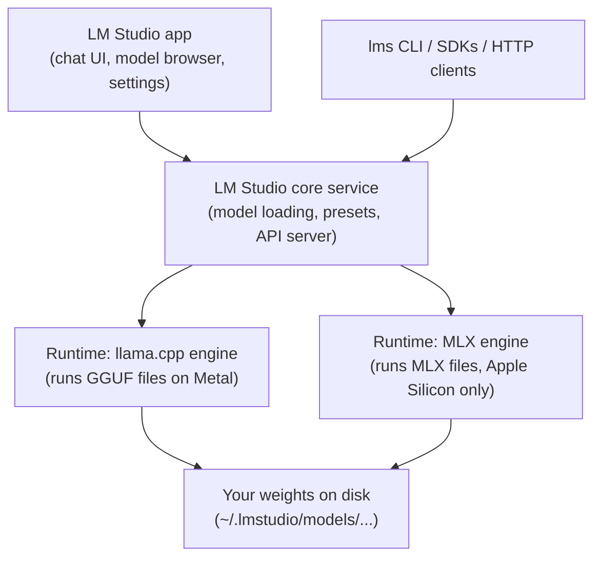

# A guided tour of LM Studio

LM Studio is the cockpit for everything you do with your local model: it downloads weights, runs the inference engines, gives you a chat UI, and exposes an API server. This lesson walks every room of the building once, so that the deep-dive lessons that follow (load settings, sampling, templates, performance, the API) have a map to hang on.

> [!GOALS]
> - Install and update LM Studio **and** its inference runtimes (llama.cpp and MLX), and know why those are separate updates
> - Find your way around Chat, Discover, My Models, Developer, Runtime and Settings
> - Read the stats line under every reply (tokens/sec, time to first token, stop reason) and know what each number means
> - Install and verify the `lms` command-line tool
> - Complete a hands-on tour checklist on your own Mac

## The big picture: three layers

Before clicking anything, get the architecture straight. LM Studio is not "the model". It is three cooperating layers:



| Layer | What it is | How it updates |
|---|---|---|
| The **app** | The Electron desktop UI plus the core service that manages models and the server | In-app updater (Settings, "Check for updates") |
| The **runtimes** (LM Studio calls them "LM Runtimes" or "Runtime Extension Packs") | The actual inference engines: a build of llama.cpp for GGUF files and LM Studio's MLX engine for MLX files | Separately, from the Runtime page, without reinstalling the app |
| The **weights** | The model file you downloaded (for you: a ~5.6 GB GGUF) | Never, unless you download a new file |

> [!CONCEPT] Runtime (inference engine)
> The program that actually does the math: it reads the weight file, runs the transformer layer by layer on your GPU, and produces next-token probabilities. LM Studio is the manager; the runtime is the worker. Security analogy: the app is your orchestration layer, the runtime is the binary that executes the payload. A new model architecture (like Qwen3.5's hybrid attention) needs support **in the runtime**, which is why "update your runtimes" is the fix for many "model won't load" errors.

> [!NOTE]
> As of November 2026 the current LM Studio release is in the **0.4.x** series (0.4.28 shipped on 2026-10-31). LM Studio also launched a separate app called **Bionic** (July 2026), an agent harness that can use local or cloud models. This course uses the classic LM Studio app, which remains the place for low-level model configuration. If you install both, they can share models and runtimes.

## Install and update

### Install the app

1. Download the macOS installer from [lmstudio.ai](https://lmstudio.ai/download) and drag LM Studio into Applications.
2. Requirements per the official docs: Apple Silicon, macOS 14.0 or newer, 16 GB RAM recommended. You meet all three.
3. Launch it once. The first launch creates the hidden folder `~/.lmstudio/`, where nearly everything lives:

```text
~/.lmstudio/
├── models/            # downloaded weights (publisher/repo/file.gguf)
├── conversations/     # your chats, as JSON
├── config-presets/    # your saved presets, as JSON
├── hub/               # presets/artifacts pulled from the LM Studio Hub
└── bin/               # the lms CLI binary
```

### Update the app

Open **Settings** (the gear at the bottom of the window, or <kbd>Cmd</kbd>+<kbd>,</kbd>) and use **Check for updates**. The **Updates Channel** setting chooses Stable, Beta or Alpha. Stay on Stable unless you need a fix that only exists in beta (beta builds are listed at [lmstudio.ai/beta-releases](https://lmstudio.ai/beta-releases)).

### Update the runtimes (separately)

This is the step most people miss. Open the runtime manager with <kbd>Cmd</kbd>+<kbd>Shift</kbd>+<kbd>R</kbd> (or the **Runtime** entry in the left navigation; older builds put it under Developer, "LM Runtimes"). You will see:

- **llama.cpp** (the Metal build for Apple Silicon): runs GGUF files, which is what your model is.
- **MLX**: runs MLX-format models (Apple's own array framework). Mac only.
- Possibly newer, experimental Mac engines (LM Studio 0.4.25+ added an engine called Splash, and Bionic 1.1.10 an "oMLX" engine). Splash targets specific large models and needs 36 GB+ RAM, so ignore it on a 16 GB Air.

Each engine has an **Update Available** badge when a newer extension pack exists. There is also a **Runtime download channel** setting (Stable, Beta, Dev) and an option to **Auto-update selected Runtime Extension Packs**.

From the terminal (after you install `lms`, below):

```bash
lms runtime ls                 # what's installed and which version is selected
lms runtime update llama.cpp   # update the llama.cpp engine
lms runtime update --all       # update every installed runtime
lms runtime select             # interactively pick which version is active
lms runtime survey             # print what LM Studio detects about your GPU
```

> [!WARNING] Qwen3.5 needs a recent llama.cpp
> Qwen3.5's hybrid Gated DeltaNet architecture only works in recent llama.cpp builds, and speed and features (MTP drafting, context checkpoints) keep improving. If your model fails to load with an "unknown architecture" style error, or misbehaves after an app update, update the llama.cpp runtime first. LM Studio 0.4.26 shipped llama.cpp runtime 2.50.0; newer packs exist. After updating a runtime, **eject and reload** the model, because a loaded model keeps using the engine it was loaded with.

## Navigation and UI modes

The left navigation bar has: **Chat**, **Discover** (model search), **My Models**, **Developer**, **Runtime**, plus **Downloads** and **Settings** at the bottom. You can move the bar to the top in Settings ("Navigation Bar position").

### User vs Developer mode

LM Studio hides advanced knobs from casual users.

| Mode | What you see |
|---|---|
| **User** | Chat only; everything auto-configured |
| **Developer** | Every load and inference parameter, the prompt template editor, advanced chat features (insert, edit and continue messages of either role), and developer features |

Older versions (0.3.x) had three levels: User, Power User, Developer. Since 0.4.0, the docs describe **Developer Mode** as combining the old Power User and Developer modes; you turn it on in **Settings, Developer**. Some docs pages still say "Power User mode or higher": read that as "Developer mode". **Turn Developer mode on now**; the rest of this module assumes it.

### Keyboard shortcuts worth memorizing

| Shortcut | Action |
|---|---|
| <kbd>Cmd</kbd>+<kbd>L</kbd> | Open the model loader |
| <kbd>Cmd</kbd>+<kbd>N</kbd> | New chat |
| <kbd>Cmd</kbd>+<kbd>Shift</kbd>+<kbd>N</kbd> | New chat folder |
| <kbd>Cmd</kbd>+<kbd>Shift</kbd>+<kbd>M</kbd> | Model search (0.4.x) |
| <kbd>Cmd</kbd>+<kbd>Shift</kbd>+<kbd>R</kbd> | Runtime manager |
| <kbd>Cmd</kbd>+<kbd>,</kbd> | App settings |

Older docs also list <kbd>Cmd</kbd>+<kbd>2</kbd> (Discover) and <kbd>Cmd</kbd>+<kbd>3</kbd> (My Models). If a shortcut doesn't work in your build, hover the navigation icons: tooltips show the current bindings.

## Discover: finding models on Hugging Face

Discover (the search button, <kbd>Cmd</kbd>+<kbd>Shift</kbd>+<kbd>M</kbd>) searches LM Studio's curated catalog **and** Hugging Face. You can type a keyword (`qwen3.5`), a `user/repo` string (`HauhauCS/Qwen3.5-9B-Uncensored-HauhauCS-Aggressive`), or paste a full Hugging Face URL.

What to look at on a result:

- **Format filter: GGUF vs MLX.** GGUF files run on llama.cpp; MLX files run on the MLX engine. Both work on your Mac. The difference is covered in [Quantization and file formats](#/foundations/quantization) and benchmarked in [Performance tuning](#/lmstudio/performance). The filter persists between restarts, so if a model "doesn't exist", check you haven't left it on the wrong format.
- **Download options.** One repo usually offers several quantizations (Q4_K_M, Q6_K, Q8_0, ...). Each is a different file of the same model at a different precision.
- **Fit indicators.** LM Studio estimates each file against your hardware and labels it:

| Label | Meaning on your 16 GB Air |
|---|---|
| **Full GPU Offload Possible** | The whole model should fit in GPU-usable memory. This is what you want. |
| **Partial GPU Offload Possible** | Only part fits on the GPU; the rest runs on CPU, much slower. |
| **Likely Fit** | Fits in RAM but without GPU acceleration. |
| **Likely too large** | Don't download it. |
| **Recommended** | LM Studio's pick for your hardware. |

The estimates are heuristics (the UI itself warns that architecture and current free memory matter), and they assume a default context length. A model that "fits" at 8K context may not fit at 128K. The real check is the memory estimate in the model loader, covered in [Load settings](#/lmstudio/load-settings).

> [!MAC]
> On Apple Silicon there is no separate VRAM. "GPU memory" means the share of your 16 GB of unified memory that macOS lets the GPU wire down, by default roughly two-thirds (about 10-11 GB). That is why a 5.6 GB Q4_K_M gets "Full GPU Offload Possible" while the 17 GB BF16 file is "Likely too large". See [Memory math](#/foundations/memory-math).

## My Models: where weights live

My Models lists every model LM Studio has indexed, with columns for architecture, parameter count, publisher, quantization, size, and (since 0.4.0) Capabilities and Format; right-click a column header to show or hide columns.

### The models folder

The default is `~/.lmstudio/models/`, organized as `publisher/repo/file`:

```text
~/.lmstudio/models/
└── HauhauCS/
    └── Qwen3.5-9B-Uncensored-HauhauCS-Aggressive/
        ├── Qwen3.5-9B-Uncensored-HauhauCS-Aggressive-Q4_K_M.gguf
        └── mmproj-Qwen3.5-9B-Uncensored-HauhauCS-Aggressive-BF16.gguf   # only if you downloaded vision
```

The **Models Directory** control at the top of My Models has **Change...**, **Reset to Default Path**, and **Reveal in Finder**. Moving the folder to an external SSD is fine for storage, but load times then depend on that drive's speed.

To use a GGUF you downloaded elsewhere (curl, `huggingface-cli`, a colleague's file), either place it in that `publisher/repo/` structure or let the CLI do it:

```bash
lms import ~/Downloads/some-model-Q4_K_M.gguf --copy --dry-run   # preview where it would go
lms import ~/Downloads/some-model-Q4_K_M.gguf --copy             # copy it in (default is to MOVE)
```

### Per-model defaults (the gear icon)

Each model row has a gear, "Edit model default config". Settings saved there (context length, GPU offload, Flash Attention, KV cache type, prompt template, and more) become that model's defaults **everywhere**: the chat loader, the server, `lms load`, and the SDKs. This is the right place to put the load configuration you settle on in the next lesson. A model with saved overrides shows "(* has overrides)" on the gear tooltip.

Other useful right-click items: **Show Raw Metadata** (the GGUF header, including the embedded chat template), **Copy Default Identifier** (the string you pass as `model` in API calls), **Open on Hugging Face**, and **Create Virtual Model** (a model.yaml wrapper that bundles a model with settings without duplicating the weights; [Prompts and templates](#/lmstudio/prompts-templates) uses this for a thinking toggle).

## Chat: more than a text box

### Loading a model

Press <kbd>Cmd</kbd>+<kbd>L</kbd>, pick the model. Toggle **Manually choose model load parameters** (or hold <kbd>Option</kbd> while clicking) to see every load setting and the **Estimated Memory Usage** (GPU and Total) before you commit. If the estimate exceeds your guardrail, LM Studio refuses; holding <kbd>Option</kbd> offers "Load anyway" (don't, until you've read [Load settings](#/lmstudio/load-settings)).

> [!TIP]
> A setting in **Settings** ("When selecting a model to load, first unload any currently loaded ones") prevents you from accidentally running two 9B models at once and swapping your Mac to a crawl. Keep it on.

### Chats, folders, split view, export

- **New chat**: <kbd>Cmd</kbd>+<kbd>N</kbd>. Organize with folders (drag and drop).
- **Split View**: drag a chat tab to either half of the window, or use the split icon at the top right, to run two chats side by side (useful for A/B comparing two settings).
- **Duplicate** a chat from its `•••` menu, then change one setting in the copy: the cleanest A/B experiment.
- **Export** to PDF, Markdown or plain text from the `•••` menu.
- **Conversation Notes**: private notes attached to a chat; never sent to the model.
- Chats are stored as JSON in `~/.lmstudio/conversations/` (right-click a chat, Reveal in Finder). The docs warn not to rely on that JSON structure.

### System prompt

Each chat has a **System Prompt** field (in the right-hand sidebar; there is also an editor view for long prompts). It holds standing instructions for the model. Mechanically it is just text inserted into a special slot of the prompt, which [Prompts and templates](#/lmstudio/prompts-templates) dissects.

### Attachments and chat with documents

The paperclip attaches `.pdf`, `.docx` and `.txt` files (images too, if the model has vision loaded). What happens next depends on size:

- If the document fits in the context window, LM Studio **pastes it in full**.
- If it doesn't, LM Studio switches to **RAG** (retrieval-augmented generation): it splits the document into chunks, embeds them, and inserts only the chunks most similar to your question.

Everything is processed locally. The practical tip from the docs: mention the specific terms you expect in the relevant passage, because retrieval is driven by similarity to your query. How RAG works, and how to build a better one yourself, is the subject of [RAG](#/using/rag).

> [!WARNING]
> Attached documents consume context. A 40-page PDF can be 20,000+ tokens. If the context indicator jumps to 90% after an attachment, the model will soon start dropping earlier conversation (see Context Overflow in [Sampling settings](#/lmstudio/sampling-settings)).

### Regenerate, edit, continue, branch

Hover a message to see its actions:

| Action | What it does | Typical use |
|---|---|---|
| **Regenerate** | Re-samples the assistant reply from the same context | See how variable the model is at your temperature |
| **Edit** (either role) | Changes the text in history | Fix a typo in your prompt; or edit the assistant's reply to steer later turns |
| **Continue assistant message** | Resumes generation from the end of an assistant message | Recover from a reply cut off by a length limit |
| **Branch chat after this message** | Forks a new chat containing history up to that point | Explore an alternative path without losing the original |
| **Add** (instead of Send) | Inserts a message into context **without** generating | Build few-shot examples by hand |

Editing an assistant message is a powerful (and slightly sneaky) technique: the model treats it as something it said, and stays consistent with it. Security analogy: you're forging the session transcript, and the model trusts it completely.

### The stats line

Under every reply you get a line like this (wording from the app's own strings):

```text
12.41 tok/sec • 512 tokens • 0.84s to first token • Stop reason: EOS Token Found
```

| Field | Meaning | What moves it |
|---|---|---|
| **tok/sec** | Decode speed: how fast new tokens appear once generation started | Memory bandwidth, quantization size, thermal state ([Performance](#/lmstudio/performance)) |
| **tokens** | How many tokens the reply contained (including hidden thinking tokens) | Your prompt, thinking mode, length limit |
| **s to first token** (TTFT) | Time spent reading ("prefilling") your prompt before the first output token | Prompt length, attachments, cache hits |
| **Stop reason** | Why generation ended | See below |

Stop reasons you'll see:

- **EOS Token Found**: the model emitted its end-of-turn token. Normal.
- **Stop String Found**: one of your Stop Strings appeared.
- **Max Predicted Tokens Reached**: you hit "Limit Response Length". The answer is probably truncated.
- **Context Length Limit Reached**: the context window filled up (with the "Stop at Limit" overflow policy).
- **User Stopped**, **Tool Calls**, **Generation Failed**, **Model Unloaded**: self-explanatory.

> [!TIP]
> The **context indicator** near the input shows "Tokens: used/total" and "Context is N% full". Watch it. When it nears 100%, the overflow policy kicks in and the model silently loses part of the conversation.

## Developer tab: the server and logs

The Developer tab (Local Server) is where LM Studio becomes an API:

- A **Start server** toggle (default port **1234**), plus **Server Settings**: port, Require Authentication with API tokens, Serve on Local Network, Enable CORS, Just-in-Time model loading, auto-unload of idle JIT models, MCP permissions.
- The **loaded models** list with an API identifier for each.
- A live **server log**, and buttons to clear logs or open the logs folder.
- **Developer Docs** with copy-paste snippets for chat, structured output, embeddings and tool use.

All of this is covered properly in [Local server, API and the lms CLI](#/lmstudio/server-api). For now, know where it is.

## App settings worth knowing

| Setting | Where it matters |
|---|---|
| **Default Context Length** ("Model Maximum" or a custom value) | Since 0.4.16 the default for new loads is 8K tokens. Per-model defaults override it. |
| **Model loading guardrails** (Off, Relaxed, Balanced, Strict, Custom) | How cautious LM Studio is about loading something that might freeze your Mac. Keep Balanced or Strict on 16 GB. |
| **Enable Local LLM Service (headless)** | Keeps the server running without the window open (system tray). |
| **When applicable, separate `reasoning_content` and `content` in API responses** | Splits thinking from the answer in API output. Relevant to [the API lesson](#/lmstudio/server-api). |
| **Tool Call Confirmation** | Asks before running tools from MCP plugins. Leave confirmations on. |
| **Enable model load configuration support in presets** | Experimental: lets presets carry load settings too ([Presets](#/lmstudio/prompts-templates)). |
| **Updates Channel** / **Runtime download channel** | Stable vs beta for the app and engines. |

## Install the `lms` CLI

`lms` ships inside LM Studio; you only need it on your `PATH`. Run LM Studio at least once, open a **new** terminal window, and try:

```bash
lms --help
```

If zsh says `command not found`, bootstrap it. Either of these is documented by the `lms` project:

```bash
~/.lmstudio/bin/lms bootstrap      # adds lms to your PATH
# or
npx lmstudio install-cli           # needs Node.js
```

Then open a new terminal and verify:

```bash
lms status
lms ls
```

```text
You have 1 models, taking up 5.63 GB of disk space.

LLMs (Large Language Models)                                PARAMS    ARCHITECTURE    SIZE
qwen3.5-9b-uncensored-hauhaucs-aggressive                      9B        qwen35     5.63 GB
```

Your exact output will differ (the CLI's columns change between versions). The important part is the **model key** in the first column, which you will use in `lms load`, in code, and in API calls. If `lms` starts LM Studio in the background when it isn't running, that is expected behavior.

> [!NOTE]
> `lms` is open source (MIT) at [github.com/lmstudio-ai/lms](https://github.com/lmstudio-ai/lms). Every subcommand has `--help`; when this course and your installed version disagree, `--help` wins.

## Lab: the guided tour

> [!LAB] Walk every room
> Work through this list on your Mac. Tick each item and write the answers to the questions in a file, `~/ai-lab/lmstudio/tour-notes.md`.
>
> - [ ] Create the workspace: `mkdir -p ~/ai-lab/lmstudio`
> - [ ] Settings: note your LM Studio version and update channel. Turn on Developer mode.
> - [ ] Runtime page (<kbd>Cmd</kbd>+<kbd>Shift</kbd>+<kbd>R</kbd>): record the selected llama.cpp and MLX versions. Update llama.cpp if a newer pack is offered.
> - [ ] Discover: search `Qwen3.5-9B`. Switch the format filter between GGUF and MLX and compare what's offered. Note the fit label shown for Q4_K_M, Q8_0 and BF16 of your model's repo.
> - [ ] My Models: click Reveal in Finder and confirm the `publisher/repo/file` layout. Right-click your model, Show Raw Metadata, and find the architecture name and the context length the file declares.
> - [ ] Open the gear (Edit model default config) and look, without changing anything yet.
> - [ ] Chat: load the model with <kbd>Cmd</kbd>+<kbd>L</kbd> using "Manually choose model load parameters". Write down the Estimated Memory Usage (GPU and Total) and the default context length.
> - [ ] Ask: "Explain what a reverse proxy is in three sentences." Record tok/sec, tokens, time to first token and stop reason.
> - [ ] Regenerate the same reply twice. Did the stats or wording change? Why might the wording change while tok/sec stays similar?
> - [ ] Did the reply include a collapsible reasoning ("thinking") block? Note yes or no; you'll need this in [Prompts and templates](#/lmstudio/prompts-templates).
> - [ ] Branch the chat after your first message and ask a different follow-up in the branch.
> - [ ] Attach a small `.txt` file (for example a copy of an nginx config) and ask a question about it. Watch the context indicator before and after.
> - [ ] Developer tab: start the server, then stop it. Note the port.
> - [ ] Terminal: get `lms` working, then run `lms ls`, `lms ps` and `lms runtime ls`. Copy your model key into your notes.
> - [ ] Export the chat to Markdown and save it in `~/ai-lab/lmstudio/`.

## Recap
- LM Studio has three layers: the app, the runtimes (llama.cpp, MLX), and the weights. App and runtime updates are separate; Qwen3.5 needs a recent llama.cpp runtime.
- Developer mode (Settings, Developer) exposes every knob; it replaced the old Power User and Developer levels.
- Discover searches the catalog and Hugging Face; filter GGUF vs MLX; fit labels are estimates at default context.
- My Models shows where weights live (`~/.lmstudio/models/publisher/repo/`); the gear sets per-model defaults used everywhere, including `lms load` and the API.
- The stats line gives decode speed (tok/sec), prompt processing latency (time to first token), token count and stop reason. Learn to read it at a glance.
- `lms` is on your PATH after a bootstrap; `lms ls` gives you the model key you'll use in code.

## Check yourself
1. Your model suddenly fails to load after you updated LM Studio. What is the first thing to check, and why is it separate from the app version?
   <details><summary>Answer</summary>

   Check the llama.cpp runtime version on the Runtime page (<kbd>Cmd</kbd>+<kbd>Shift</kbd>+<kbd>R</kbd>) and update or reselect it. Runtimes are packaged and updated independently of the app, and architecture support (like Qwen3.5's hybrid layers) lives in the runtime. After changing the runtime, eject and reload the model.

   </details>
2. A reply ends mid-sentence and the stats line says "Stop reason: Max Predicted Tokens Reached". What happened and what are two ways to recover?
   <details><summary>Answer</summary>

   The response hit the "Limit Response Length" cap. Either use "Continue assistant message" to resume generation, or raise or disable the limit in the sidebar and regenerate.

   </details>
3. Discover says "Full GPU Offload Possible" for a file. Why can that model still fail to load or run badly?
   <details><summary>Answer</summary>

   The estimate assumes a default context length and current conditions. A large context length adds KV-cache memory, other apps may be using RAM, and architecture details matter. The loader's Estimated Memory Usage at your chosen settings is the real check.

   </details>
4. Where would you set Flash Attention so it applies both in the chat UI and when a script loads the model with `lms load`?
   <details><summary>Answer</summary>

   In My Models, on the model's gear ("Edit model default config"). Per-model defaults are used wherever the model is loaded, including `lms load` and the API.

   </details>
5. What is the difference between "tok/sec" and "s to first token", in terms of what the model is doing?
   <details><summary>Answer</summary>

   Time to first token covers reading (prefilling) the whole prompt before the first output token. Tokens per second measures the decode phase, producing new tokens one at a time. Long prompts and attachments hurt the first; memory bandwidth limits the second.

   </details>

## Go deeper
- [LM Studio docs: Getting started](https://lmstudio.ai/docs/app) — the official app documentation, including chats, downloads, RAG and per-model defaults
- [Introducing LM Studio 0.4.0](https://lmstudio.ai/blog/0.4.0) — the release that introduced Developer Mode, parallel requests, llmster and the v1 REST API
- [LM Studio changelog](https://lmstudio.ai/changelog) — check what changed in your exact version
- [lms on GitHub](https://github.com/lmstudio-ai/lms) — the CLI source and README, the ground truth for flags
- [lmstudio-ai/docs](https://github.com/lmstudio-ai/docs) — the docs as Markdown, easy to grep offline
