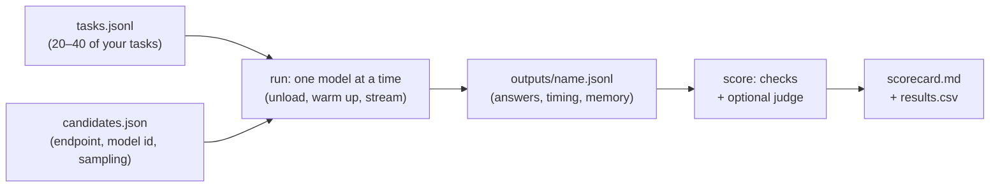

# Benchmarks, leaderboards and your own evals

Every model card opens with a table of impressive numbers, and every week a leaderboard crowns a new winner. This lesson teaches you to read those numbers like a sceptical reviewer reads a vendor's security whitepaper: what each benchmark actually measures, the ways scores mislead, which leaderboards are still maintained in 2026, and then how to replace all of it with the only eval that decides anything for you: your own tasks, on your own Mac, at your own quant.

> [!GOALS]
> - Explain what the common benchmarks measure: MMLU-Pro, GPQA, AIME/HMMT, LiveCodeBench, SWE-bench, IFEval, BFCL, RULER, and the cybersecurity ones
> - Spot the ways benchmark scores mislead: contamination, cherry-picking, thinking budgets, harness differences, quantization, small-sample variance
> - Use the leaderboards that are current in 2026 for shortlisting, not deciding
> - Build `model_shootout.py`: the same security tasks across several models, with automatic checks, JSON-schema validation, an optional LLM judge, speed and memory, and a Markdown scorecard
> - Decide on a daily driver per job, and know when to re-evaluate

## Why your eval beats everyone else's

A benchmark score answers "how did this model, at full precision, with the lab's prompt and maximum thinking budget, do on someone else's questions?" Your question is "how does the Q4 file on my Mac do on *my* nmap output, *my* JS bundles and *my* report template, at a speed I can live with?" Those can differ wildly. Public numbers are good for one thing: building a shortlist of three or four candidates worth your time. [The right model for each job](#/models/use-cases) did that; this lesson shows you how to decide.

You have built evaluation tools twice already in this course: the prompt test harness in [Prompt engineering for small local models](#/using/prompt-engineering) (same model, different prompts) and `eval.py` in [Evaluate your fine-tune](#/finetune/evaluate) (base versus fine-tune). The shootout here is the third variant of the same idea: **same prompts, different models**.

## What common benchmarks actually measure

> [!CONCEPT] Benchmark
> A fixed set of tasks with a scoring rule, used to compare models. Its value depends on three things: whether the tasks resemble real work, whether the scoring rule rewards the right answers (and only those), and whether the models have seen the tasks during training.

### Knowledge and reasoning

| Benchmark | What it is | What a high score means | What it does not mean |
|---|---|---|---|
| **MMLU-Pro** | About 12,000 multiple-choice questions across 14 academic subjects, 10 options each (a harder successor to MMLU) | Broad textbook knowledge and some reasoning | That the model knows *your* domain or can apply knowledge in a workflow |
| **GPQA Diamond** | 198 graduate-level biology, physics and chemistry questions designed to be "Google-proof" | Expert-level scientific reasoning | Anything about security; also only 198 items, so a few questions swing it |
| **AIME, HMMT** | Competition maths problems with numeric answers (AIME has 30 problems per year) | Multi-step mathematical reasoning, usually with long thinking | Each AIME problem is worth 3.3 points: tiny sample, big variance |
| **Humanity's Last Exam (HLE)** | Very hard expert questions across many fields | Frontier reasoning; small models score low | Day-to-day usefulness |

### Code

| Benchmark | What it is | Caveat |
|---|---|---|
| **HumanEval** | 164 hand-written Python function problems from 2021, scored by unit tests | Saturated and widely contaminated; ignore it for 2026 models |
| **LiveCodeBench** | Competitive-programming problems collected continuously from contests, each tagged with its release date | Lets you score only on problems newer than a model's training cutoff, which limits contamination. Versions (v5, v6) are not comparable |
| **SWE-bench Verified** | 500 human-validated real GitHub issues; an agent must produce a patch that passes the repository's tests | OpenAI stopped reporting it in February 2026, citing contamination and flawed tests (in an audit of 138 hard problems, at least 59.4% had tests that reject correct fixes). Labs still quote it; read it as a rough signal |
| **SWE-bench Pro, Terminal-Bench** | Harder repository and terminal-environment agent tasks | Measure the whole agent scaffold as much as the model; grading problems have been reported for these too |

### Instruction following, tools and long context

| Benchmark | What it is | Why you care |
|---|---|---|
| **IFEval** | About 500 prompts with automatically verifiable instructions ("answer in under 100 words", "no commas", "use exactly 3 bullet points") | Closest public proxy for "does it follow my output format?". IFBench is a newer, harder set with unfamiliar constraints |
| **BFCL** (Berkeley Function Calling Leaderboard) | Does the model emit correct function calls: right function, right arguments, knowing when *not* to call. V4 adds agentic parts such as web search and memory | Tool calling is the skill small models lose first. But Epoch AI's review (10 September 2026) rated BFCL v4 **"Flawed"**: 24 of 50 sampled tasks had defects such as outdated answer keys and correct calls scored as wrong |
| **RULER** | Synthetic long-context tasks from NVIDIA (variants of needle-in-a-haystack, multi-hop tracing, aggregation) at configurable lengths | Measures **effective** context: models often degrade far below their advertised window |

### Cybersecurity benchmarks

[Evaluate your fine-tune](#/finetune/evaluate) has the detailed table (licences, sizes, notes). In brief:

| Benchmark | Measures | Fits a 16 GB Mac? |
|---|---|---|
| **CyberMetric** | Multiple-choice security knowledge (sets of 80 to 10,000 questions) | Yes; the 80 and 500 sets run quickly |
| **CTIBench** | Threat-intel tasks: MCQ, CVE-to-CWE mapping (RCM), CVSS prediction (VSP), ATT&CK extraction, attribution | Yes; RCM and VSP are close to real triage |
| **Cybench** | 40 professional CTF tasks solved by an agent in Docker | Heavy; tests your agent stack |
| **CyberGym** (ICLR 2026) | 1,507 instances from 188 open-source projects: generate a proof-of-concept that reproduces a known vulnerability | Heavy; the paper's best agent-model combinations reached only about 20% |
| **CyberSecEval** (Meta PurpleLlama) | Security *risks* of models: insecure code, helpfulness to attacks, prompt injection | A safety benchmark; different question from "is it good at my job?" |

> [!NOTE]
> Security benchmarks are dominated by multiple-choice knowledge tests because those are cheap to score. Knowing that CWE-89 is SQL injection is not the same as noticing the injectable parameter in 4,000 lines of Burp history. Use them for a second opinion, and your own tasks for the decision.

## Why scores mislead

Seven traps, each with a real example from 2026 model cards.

**1. Contamination.** If benchmark questions (or close paraphrases) were in the training data, the score measures memory, not skill. SWE-bench's tasks come from public repositories that everyone trains on, which is half of why OpenAI dropped it. Defences: date-tagged benchmarks like LiveCodeBench, and private evals that have never been on the internet, like yours.

**2. Cherry-picking.** Each lab chooses which benchmarks to show. Qwen's 3.5 card reports HMMT where Google's Gemma 4 card reports AIME 2026; IBM's Granite 4.2 card reports IFBench, not IFEval; Cisco's Foundation-Sec card compares against Llama 3.1 8B and GPT-5-Nano rather than against 2026 open models of the same size. None of this is dishonest, but the absence of a benchmark is information.

**3. Thinking budget.** Reasoning models score much higher with long thinking. DeepSeek's V4.1-Flash card reports results at maximum reasoning effort; Qwen3.8's default effort is `xhigh`. On your Air, a 10,000-token thinking trace at 15 tok/s is 11 minutes per question. Ask: at what effort was this measured, and can I afford that effort?

**4. Harness and prompt differences.** The same benchmark run with a different prompt template, few-shot count, answer-extraction regex or tool-call parser gives different numbers. Qwen reports BFCL-V4 66.1 for Qwen3.5-9B; IBM reports 52.39 for Granite 4.2 8B. You cannot conclude Qwen is 14 points better, because they did not run the same harness.

**5. Quantization is not reflected.** Cards report BF16 results. You run Q4_K_M. For most models the loss is small on knowledge tests, but it can be larger on exactly the fragile skills you care about: long-context retrieval, strict formats, code ([Quantization](#/foundations/quantization) covers measuring it with KL divergence).

**6. Small samples and variance.** A score is a sample, and samples have noise.

> [!CONCEPT] Standard error of a pass rate
> If a model passes a fraction *p* of *n* independent tasks, the uncertainty in *p* is roughly √(p(1−p)/n). For 30 tasks at 70%: √(0.7 × 0.3 / 30) ≈ 0.084, so a 95% interval is about ±16 points (two standard errors). A model scoring 70% and one scoring 60% on 30 tasks are **not distinguishable**. AIME's 30 problems have the same problem; so will your eval.

This is why your shootout runs each task several times (`--repeats 3`) and reports the spread, and why you should only trust differences of 15+ points on a 30-task set, or grow the set.

**7. Flawed benchmarks.** Answer keys go stale, tests reject correct fixes, tasks are mis-specified. Epoch AI's reviews (BFCL v4 "Flawed") and OpenAI's SWE-bench audit show that even famous benchmarks have double-digit error rates. A model that "fails" might be right.

> [!TIP]
> When you read a model card, ask five questions: Which benchmarks are missing? Compared against whom, and how recent? At what thinking effort? Measured by whom (vendor or independent)? At what precision? Write the answers next to the number.

## Leaderboards and arenas in 2026

Leaderboards aggregate results so you don't have to read 40 model cards. Here is what is current and maintained as of November 2026, and how each can mislead:

| Leaderboard | What it ranks | Good for | Watch out for |
|---|---|---|---|
| **Arena** (arena.ai; formerly LMArena at lmarena.ai, originally Chatbot Arena) | Models by human preference votes in blind pairwise chats | General "which answer do people prefer" signal | Rewards style, length and formatting; mostly large models via APIs |
| **Artificial Analysis** | An Intelligence Index built from many benchmarks it runs itself, plus speed and price | Independent, consistent runs across open and closed models; open-weights filter | Index composition changes between versions; full-precision API endpoints, not your Q4 |
| **Epoch AI Benchmarking Hub** | Independent benchmark runs and **reviews of benchmarks themselves** | Knowing which benchmarks to trust | Coverage of small local models is limited |
| **BFCL leaderboard** (Berkeley) | Function calling | Shortlisting tool callers | See the "Flawed" review above |
| **SWE-bench leaderboards** | Coding agents on SWE-bench variants | Coding-agent trends | Scaffold matters as much as model; contamination |
| **MTEB** (Hugging Face Space) | Embedding models across retrieval, clustering, classification | Choosing an embedder | Many submissions trained on MTEB-like data; check your language and domain |

The **Hugging Face Open LLM Leaderboard**, the default reference for years, has been retired; guides that still point to it are out of date.

A pattern you will notice: leaderboards rank large models served at full precision. For 1–14B models at Q4 on a laptop, they are at best a coarse filter. That is exactly the gap your own eval fills.

## Build your own eval: `model_shootout.py`

### Design



Principles carried over from your earlier harnesses:

- **Same conditions for every candidate**: same tasks, same system prompts, each model at its own recommended sampling, thinking mode recorded.
- **One model loaded at a time** on 16 GB. Outputs are cached per candidate, so you can generate today and score tomorrow.
- **Automatic checks first** (cheap, unbiased), **LLM judge second** (for prose), **your blind review last** (the gold standard, see [Evaluate your fine-tune](#/finetune/evaluate)).
- **Measure what you will feel**: time to first token, tokens per second, total time per task, and memory.

### Task format

Each line of `tasks.jsonl` is one task. Build 20–40 of them from **your own past work** (redacted): real scan outputs, real log excerpts, real JS snippets, real report notes. Spread them across the jobs you care about, and include a few edge cases where the right answer is "nothing found".

| Field | Meaning |
|---|---|
| `id`, `job` | Unique id; job label for per-job scoring (`triage`, `js`, `report`, `ctf`, `cti`, ...) |
| `system`, `prompt` | The messages; reuse your best prompts from the prompt harness |
| `checks.must_include` / `must_not_include` | Case-insensitive substrings |
| `checks.regex` | Patterns that must match |
| `checks.json_schema` | The answer must contain JSON valid against this schema |
| `checks.max_words` | Length limit |
| `reference` | Your gold answer (used by the judge, and to whitelist CVE IDs) |
| `judge` | `true` to have the LLM judge grade this task |

Two checks run on every task unless you turn them off: **no invented CVE IDs** (any CVE in the answer that is not in the prompt or reference fails; set `"allow_new_cves": true` to disable) and **no refusal** (set `"expect_refusal": true` for tasks where refusing is correct).

Here is a starter set. It uses documentation IP ranges (RFC 5737) and `example.com`-style names, which is good hygiene for anything you might share.

```json title="tasks.jsonl"
{"id": "triage-nmap-01", "job": "triage", "system": "You are a penetration tester. Use only facts present in the input. Output JSON only.", "prompt": "Authorized lab scan. Return JSON with keys host (string), open_ports (array of objects with port (integer), service (string), version (string)), and priority (one of: low, medium, high). Priority is high if any database or cache service is exposed.\n\n<scan>\nNmap scan report for 192.0.2.10\nPORT     STATE SERVICE VERSION\n22/tcp   open  ssh     OpenSSH 8.2p1 Ubuntu\n80/tcp   open  http    nginx 1.18.0\n6379/tcp open  redis   Redis key-value store 6.0.16\n</scan>", "checks": {"json_schema": {"type": "object", "required": ["host", "open_ports", "priority"], "properties": {"host": {"const": "192.0.2.10"}, "open_ports": {"type": "array", "minItems": 3, "maxItems": 3, "items": {"type": "object", "required": ["port", "service", "version"], "properties": {"port": {"type": "integer"}}}}, "priority": {"const": "high"}}}}}
{"id": "triage-log-01", "job": "triage", "system": "You are a SOC analyst. Use only the log lines given. Output JSON only.", "prompt": "Classify this auth.log excerpt. Return JSON with keys verdict (benign, suspicious or malicious), source_ip (string) and evidence (array of short strings).\n\n<log>\nNov  9 03:12:01 web1 sshd[811]: Failed password for root from 203.0.113.45 port 51122 ssh2\nNov  9 03:12:03 web1 sshd[811]: Failed password for root from 203.0.113.45 port 51122 ssh2\nNov  9 03:12:06 web1 sshd[813]: Failed password for admin from 203.0.113.45 port 51130 ssh2\nNov  9 03:12:09 web1 sshd[815]: Failed password for deploy from 203.0.113.45 port 51141 ssh2\nNov  9 03:12:12 web1 sshd[817]: Accepted password for deploy from 203.0.113.45 port 51150 ssh2\n</log>", "checks": {"json_schema": {"type": "object", "required": ["verdict", "source_ip", "evidence"], "properties": {"verdict": {"enum": ["suspicious", "malicious"]}, "source_ip": {"const": "203.0.113.45"}, "evidence": {"type": "array", "minItems": 1}}}, "must_include": ["deploy"]}}
{"id": "js-review-01", "job": "js", "system": "You are an application security reviewer.", "prompt": "Review this JavaScript from an in-scope target. List every DOM XSS source-to-sink flow, any hard-coded secret, and every API endpoint, with the line number for each.\n\n1  const API_KEY = \"test_key_9f2c\";\n2  function render() {\n3    const msg = decodeURIComponent(location.hash.slice(1));\n4    document.getElementById(\"out\").innerHTML = msg;\n5  }\n6  fetch(\"/api/v2/admin/users\", {headers: {\"X-Key\": API_KEY}});\n7  window.addEventListener(\"hashchange\", render);", "checks": {"must_include": ["innerHTML", "location.hash", "/api/v2/admin/users", "API_KEY"], "regex": ["line\\s*4|L4|4\\s*[:)]"]}}
{"id": "cvss-01", "job": "cti", "system": "You are a vulnerability analyst. Be precise.", "prompt": "A reflected XSS in a search parameter of a public website. The victim must click a crafted link. Script runs in the site's origin and can read and modify page content, but the site holds no sensitive data beyond the page. Give the CVSS 3.1 base vector string only.", "checks": {"regex": ["AV:N/AC:L/PR:N/UI:R/S:C/C:L/I:L/A:N"], "max_words": 30}, "reference": "CVSS:3.1/AV:N/AC:L/PR:N/UI:R/S:C/C:L/I:L/A:N (6.1)"}
{"id": "cwe-01", "job": "cti", "system": "You map vulnerabilities to CWE IDs.", "prompt": "Give the single most specific CWE ID for each, one per line: (a) user-supplied id parameter concatenated into a SQL query; (b) untrusted data passed to Java ObjectInputStream.readObject; (c) server fetches an attacker-supplied URL from a webhook field.", "checks": {"regex": ["CWE-89\\b", "CWE-502\\b", "CWE-918\\b"]}}
{"id": "ctf-01", "job": "ctf", "system": "You are helping with a CTF in a practice lab.", "prompt": "Decode this and give the flag only: ZmxhZ3tsb2NhbF9tb2RlbHNfcm9ja30=", "checks": {"must_include": ["flag{local_models_rock}"]}}
{"id": "ctf-02", "job": "ctf", "system": "You are helping with a CTF in a practice lab.", "prompt": "Identify the most likely hash algorithm and explain in one sentence why: 5f4dcc3b5aa765d61d8327deb882cf99", "checks": {"regex": ["\\bMD5\\b"], "max_words": 80}}
{"id": "ioc-01", "job": "triage", "system": "Extract indicators of compromise. Output JSON only.", "prompt": "Return JSON with arrays ips, domains and sha256 (refang any defanged values).\n\nThe loader beacons to 198.51.100[.]23 and update-check[.]example[.]net every 300 s, then downloads a second stage with SHA-256 fe90bd1b2d1e96877e5d3ffbd2b927e4ee4e2c67928486614e3b694908512559.", "checks": {"json_schema": {"type": "object", "required": ["ips", "domains", "sha256"], "properties": {"ips": {"const": ["198.51.100.23"]}, "domains": {"const": ["update-check.example.net"]}, "sha256": {"type": "array", "minItems": 1, "maxItems": 1}}}}}
{"id": "report-01", "job": "report", "system": "You write concise, factual bug bounty reports.", "prompt": "Write the Impact section (under 150 words) for this finding, using only these notes: IDOR on GET /api/invoices/{id}. Changing id returns other customers' invoices. Invoices contain name, billing address, last 4 card digits, purchase history. IDs are sequential integers. Tested only with two accounts I own; viewed one other record to confirm, then stopped.", "checks": {"max_words": 150, "must_include": ["invoice"], "must_not_include": ["full card number"]}, "reference": "Any authenticated user can read every customer's invoices by iterating sequential IDs, exposing names, billing addresses, last four card digits and purchase history. This is a confidentiality breach of personal data at scale and may carry regulatory implications.", "judge": true}
```

The SHA-256 in `ioc-01` is simply the hash of the text `shootout-test-sample`, used as harmless test data. Replace these examples with your own material as soon as you can; the value of the shootout comes from tasks that look like your real week.

### Candidates

`candidates.json` lists each model once. `params` holds standard OpenAI parameters; anything non-standard (`top_k`, `min_p`, `repeat_penalty`) goes in `extra_body`. Use each model's recommended sampling from its card, and write the thinking mode in `notes` (set it in LM Studio's model defaults or the Ollama Modelfile so it is consistent).

```json title="candidates.json"
[
  {
    "name": "qwen35-9b-unc",
    "runtime": "lmstudio",
    "base_url": "http://localhost:1234/v1",
    "model": "qwen3.5-9b-uncensored-hauhaucs-aggressive",
    "params": {"temperature": 0.7, "top_p": 0.8},
    "extra_body": {"top_k": 20, "min_p": 0},
    "notes": "Q4_K_M, thinking off"
  },
  {
    "name": "gemma4-12b-qat",
    "runtime": "ollama",
    "base_url": "http://localhost:11434/v1",
    "model": "gemma4:12b-it-qat",
    "params": {"temperature": 1.0, "top_p": 0.95},
    "notes": "QAT Q4_0, thinking off; check the card for current recommended sampling"
  },
  {
    "name": "granite42-8b",
    "runtime": "ollama",
    "base_url": "http://localhost:11434/v1",
    "model": "granite4.2:8b",
    "params": {"temperature": 0.2},
    "notes": "Q4_K_M default tag, thinking default; check the card for recommended sampling"
  }
]
```

> [!WARNING]
> Sampling values above are placeholders except Qwen's (from its card). Read each candidate's model card and use its recommended values: comparing a model at the wrong temperature is comparing your configuration mistake, not the model.

### The script

```python title="model_shootout.py"
#!/usr/bin/env python3
"""Model shootout: run the same tasks across several local models and write a scorecard.

Subcommands
  run    generate outputs for candidates, one model loaded at a time (cached per candidate)
  score  apply automatic checks (+ optional LLM judge) to cached outputs, write scorecard.md

Examples
  python model_shootout.py run --repeats 3
  python model_shootout.py run --only gemma4-12b-qat --regen
  python model_shootout.py score
  python model_shootout.py score --judge-url http://localhost:1234/v1 --judge-model <judge-id>
"""
from __future__ import annotations

import argparse
import csv
import json
import re
import shutil
import statistics
import subprocess
import threading
import time
from collections import defaultdict
from datetime import datetime
from pathlib import Path

import psutil
import requests
from jsonschema import Draft202012Validator
from openai import BadRequestError, OpenAI

ROOT = Path(__file__).resolve().parent
OUT_DIR = ROOT / "outputs"
GB = 1024 ** 3
THINK_RE = re.compile(r"<think>.*?</think>", re.S)
CVE_RE = re.compile(r"CVE-\d{4}-\d{4,7}", re.I)
REFUSAL_RE = re.compile(
    r"I can(?:not|'t) (?:help|assist|provide)|I'm sorry, but|I am unable to|I won't be able to", re.I
)


# ---------- helpers ----------

def load_jsonl(path: Path) -> list[dict]:
    with path.open(encoding="utf-8") as f:
        return [json.loads(line) for line in f if line.strip()]


def strip_thinking(text: str) -> str:
    text = THINK_RE.sub("", text)
    if "</think>" in text:  # some templates open <think> in the prompt, so only the close appears
        text = text.split("</think>", 1)[1]
    return text.strip()


def mem_in_use_gb() -> float:
    vm = psutil.virtual_memory()
    return (vm.total - vm.available) / GB


class PeakSampler:
    """Samples system memory in use in a background thread and keeps the maximum."""

    def __init__(self, interval: float = 0.5):
        self.interval = interval
        self.peak = mem_in_use_gb()
        self._stop = threading.Event()
        self._thread = threading.Thread(target=self._loop, daemon=True)

    def _loop(self) -> None:
        while not self._stop.is_set():
            self.peak = max(self.peak, mem_in_use_gb())
            time.sleep(self.interval)

    def __enter__(self) -> "PeakSampler":
        self._thread.start()
        return self

    def __exit__(self, *exc) -> None:
        self._stop.set()
        self._thread.join()


def ollama_root(base_url: str) -> str:
    return base_url.rstrip("/").removesuffix("/v1")


def unload_all(cand: dict) -> None:
    """Unload models in the candidate's runtime so the memory baseline is clean."""
    if cand.get("runtime") == "ollama":
        root = ollama_root(cand["base_url"])
        try:
            for m in requests.get(f"{root}/api/ps", timeout=10).json().get("models", []):
                # An empty request with keep_alive 0 unloads the model immediately.
                requests.post(f"{root}/api/generate", json={"model": m["name"], "keep_alive": 0}, timeout=60)
        except requests.RequestException as exc:
            print(f"  warning: could not unload Ollama models: {exc}")
    elif cand.get("runtime") == "lmstudio" and shutil.which("lms"):
        subprocess.run(["lms", "unload", "--all"], capture_output=True, text=True)
    time.sleep(3)  # give macOS a moment to reclaim the memory


def ollama_size_gb(cand: dict) -> float | None:
    """Ollama reports the loaded size of each model; LM Studio has no equivalent API."""
    if cand.get("runtime") != "ollama":
        return None
    try:
        for m in requests.get(f"{ollama_root(cand['base_url'])}/api/ps", timeout=10).json().get("models", []):
            if cand["model"] in (m.get("name"), m.get("model")):
                return round(m.get("size", 0) / GB, 2)
    except requests.RequestException:
        pass
    return None


# ---------- generation ----------

def generate(client: OpenAI, cand: dict, task: dict) -> dict:
    messages = [{"role": "system", "content": task["system"]}] if task.get("system") else []
    messages.append({"role": "user", "content": task["prompt"]})
    kwargs = dict(
        model=cand["model"],
        messages=messages,
        stream=True,
        max_tokens=task.get("max_tokens", cand.get("max_tokens", 2048)),
        **cand.get("params", {}),
    )
    if cand.get("extra_body"):
        kwargs["extra_body"] = cand["extra_body"]

    t0 = time.perf_counter()
    try:  # ask for token usage in the final stream chunk
        stream = client.chat.completions.create(stream_options={"include_usage": True}, **kwargs)
    except BadRequestError:
        stream = client.chat.completions.create(**kwargs)

    first, content, reasoning, usage = None, [], [], None
    for chunk in stream:
        if getattr(chunk, "usage", None):
            usage = chunk.usage
        if not chunk.choices:
            continue
        delta = chunk.choices[0].delta
        piece = delta.content or ""
        # Runtimes that separate reasoning put it in a non-standard field.
        think = getattr(delta, "reasoning_content", None) or getattr(delta, "reasoning", None) or ""
        if (piece or think) and first is None:
            first = time.perf_counter()
        content.append(piece)
        reasoning.append(think)
    t_end = time.perf_counter()

    raw, reasoning_text = "".join(content), "".join(reasoning)
    answer = strip_thinking(raw)
    if usage and usage.completion_tokens:
        tokens, estimated = usage.completion_tokens, False
    else:  # rough fallback: about 4 characters per token
        tokens, estimated = max(1, len(raw + reasoning_text) // 4), True
    first = first or t_end
    return {
        "answer": answer,
        "thinking_chars": len(reasoning_text) + len(raw) - len(answer),
        "ttft_s": round(first - t0, 3),
        "total_s": round(t_end - t0, 3),
        "completion_tokens": tokens,
        "tokens_estimated": estimated,
        "tok_per_s": round(tokens / max(t_end - first, 1e-6), 2),
    }


def cmd_run(args: argparse.Namespace) -> None:
    cands = json.loads((ROOT / args.candidates).read_text(encoding="utf-8"))
    if args.only:
        cands = [c for c in cands if c["name"] in args.only]
    tasks = load_jsonl(ROOT / args.tasks)
    OUT_DIR.mkdir(exist_ok=True)

    for cand in cands:
        out_path = OUT_DIR / f"{cand['name']}.jsonl"
        if out_path.exists() and not args.regen:
            print(f"[{cand['name']}] cached, skipping (use --regen to redo)")
            continue
        print(f"[{cand['name']}] unloading models and measuring baseline memory")
        unload_all(cand)
        baseline = mem_in_use_gb()
        client = OpenAI(base_url=cand["base_url"], api_key=cand.get("api_key", "local"), timeout=900)

        t = time.perf_counter()
        generate(client, cand, {"prompt": "Reply with OK.", "max_tokens": 16})  # loads the model
        load_s = time.perf_counter() - t

        rows = []
        with PeakSampler() as sampler:
            for rep in range(args.repeats):
                for task in tasks:
                    res = generate(client, cand, task)
                    rows.append({"candidate": cand["name"], "id": task["id"], "repeat": rep, **res})
                    print(f"  {task['id']} r{rep}: {res['total_s']:.1f}s, {res['tok_per_s']} tok/s")

        meta = {
            "_meta": True, "candidate": cand["name"], "notes": cand.get("notes", ""),
            "baseline_gb": round(baseline, 2), "peak_gb": round(sampler.peak, 2),
            "delta_gb": round(sampler.peak - baseline, 2), "ollama_size_gb": ollama_size_gb(cand),
            "load_s": round(load_s, 1), "repeats": args.repeats,
            "date": datetime.now().isoformat(timespec="minutes"),
        }
        with out_path.open("w", encoding="utf-8") as f:
            f.write(json.dumps(meta) + "\n")
            for r in rows:
                f.write(json.dumps(r, ensure_ascii=False) + "\n")
        print(f"[{cand['name']}] done: +{meta['delta_gb']} GB over baseline (peak {meta['peak_gb']} GB in use)")


# ---------- scoring ----------

def extract_json(text: str):
    fenced = re.search(r"```(?:json)?\s*(.*?)```", text, re.S)
    body = fenced.group(1) if fenced else text
    for open_ch, close_ch in (("{", "}"), ("[", "]")):
        start, end = body.find(open_ch), body.rfind(close_ch)
        if start != -1 and end > start:
            return json.loads(body[start:end + 1])
    raise ValueError("no JSON found")


def run_checks(task: dict, answer: str) -> dict[str, bool]:
    c = task.get("checks", {})
    res: dict[str, bool] = {}
    low = answer.lower()
    for s in c.get("must_include", []):
        res[f"include:{s}"] = s.lower() in low
    for s in c.get("must_not_include", []):
        res[f"exclude:{s}"] = s.lower() not in low
    for pattern in c.get("regex", []):
        res[f"regex:{pattern}"] = re.search(pattern, answer, re.I | re.M) is not None
    if "max_words" in c:
        res["max_words"] = len(answer.split()) <= c["max_words"]
    if "json_schema" in c:
        try:
            obj = extract_json(answer)
            res["json_valid"] = True
            res["json_schema"] = not list(Draft202012Validator(c["json_schema"]).iter_errors(obj))
        except ValueError:  # json.JSONDecodeError is a ValueError
            res["json_valid"] = res["json_schema"] = False
    if not c.get("allow_new_cves"):
        known = {x.upper() for x in CVE_RE.findall(task["prompt"] + task.get("reference", ""))}
        res["no_invented_cve"] = not ({x.upper() for x in CVE_RE.findall(answer)} - known)
    if not task.get("expect_refusal"):
        res["no_refusal"] = REFUSAL_RE.search(answer) is None
    return res


JUDGE_PROMPT = """You grade answers to security tasks. Compare the answer with the task and the reference.
5 = correct, complete, precise, follows the requested format
4 = correct with minor omissions
3 = partly correct or vague
2 = significant errors or unsupported claims
1 = wrong, fabricated, or ignores the task
Do not reward length. Penalise any claim not supported by the task input.
Return JSON only: {"score": <1-5>, "reason": "<one sentence>"}"""


def judge(client: OpenAI, model: str, task: dict, answer: str) -> tuple[int | None, str]:
    user = (f"TASK:\n{task['prompt']}\n\nREFERENCE (may be partial):\n{task.get('reference', '(none)')}"
            f"\n\nANSWER TO GRADE:\n{answer}")
    resp = client.chat.completions.create(
        model=model, temperature=0, max_tokens=1024,
        messages=[{"role": "system", "content": JUDGE_PROMPT}, {"role": "user", "content": user}],
    )
    text = strip_thinking(resp.choices[0].message.content or "")
    m = re.search(r'"score"\s*:\s*([1-5])', text) or re.search(r"\b([1-5])\b", text)
    return (int(m.group(1)) if m else None), text[:300]


def median(values: list[float]) -> float:
    return round(statistics.median(values), 2) if values else 0.0


def cmd_score(args: argparse.Namespace) -> None:
    tasks = {t["id"]: t for t in load_jsonl(ROOT / args.tasks)}
    judge_client = OpenAI(base_url=args.judge_url, api_key="local", timeout=900) if args.judge_model else None
    jpath = OUT_DIR / "judgements.jsonl"
    cache = {j["key"]: j for j in load_jsonl(jpath)} if jpath.exists() else {}

    summary, per_job, failures, csv_rows = [], defaultdict(dict), defaultdict(list), []
    for path in sorted(OUT_DIR.glob("*.jsonl")):
        if path.name == "judgements.jsonl":
            continue
        rows = load_jsonl(path)
        meta = next((r for r in rows if r.get("_meta")), {})
        rows = [r for r in rows if not r.get("_meta") and r["id"] in tasks]
        if not rows:
            continue
        name = rows[0]["candidate"]
        by_repeat, by_job = defaultdict(list), defaultdict(list)
        judge_scores, json_ok, refusals, invented = [], [], 0, 0

        for r in rows:
            task = tasks[r["id"]]
            checks = run_checks(task, r["answer"])
            passed = all(checks.values())
            by_repeat[r["repeat"]].append(passed)
            by_job[task.get("job", "other")].append(passed)
            if "json_valid" in checks:
                json_ok.append(checks["json_valid"])
            refusals += not checks.get("no_refusal", True)
            invented += not checks.get("no_invented_cve", True)
            for k, ok in checks.items():
                if not ok and len(failures[name]) < 15:
                    failures[name].append(f"`{r['id']}` r{r['repeat']}: {k}")

            score = None
            if judge_client and task.get("judge"):
                key = f"{args.judge_model}|{name}|{r['id']}|{r['repeat']}"
                if key not in cache:
                    s, reason = judge(judge_client, args.judge_model, task, r["answer"])
                    cache[key] = {"key": key, "score": s, "reason": reason}
                    with jpath.open("a", encoding="utf-8") as jf:
                        jf.write(json.dumps(cache[key], ensure_ascii=False) + "\n")
                score = cache[key]["score"]
                if score is not None:
                    judge_scores.append(score)
            csv_rows.append({"candidate": name, "id": r["id"], "repeat": r["repeat"], "passed": passed,
                             "failed_checks": ";".join(k for k, ok in checks.items() if not ok),
                             "judge": score, "ttft_s": r["ttft_s"], "total_s": r["total_s"],
                             "tok_per_s": r["tok_per_s"], "thinking_chars": r["thinking_chars"]})

        rates = [100 * sum(v) / len(v) for v in by_repeat.values()]
        summary.append({
            "name": name, "notes": meta.get("notes", ""),
            "pass": statistics.mean(rates), "lo": min(rates), "hi": max(rates),
            "judge": round(statistics.mean(judge_scores), 2) if judge_scores else None,
            "json": round(100 * sum(json_ok) / len(json_ok)) if json_ok else None,
            "refusals": refusals, "invented": invented,
            "ttft": median([r["ttft_s"] for r in rows]), "tps": median([r["tok_per_s"] for r in rows]),
            "task_s": median([r["total_s"] for r in rows]),
            "mem": meta.get("ollama_size_gb") or meta.get("delta_gb"),
        })
        for job, v in by_job.items():
            per_job[job][name] = round(100 * sum(v) / len(v))

    if not summary:
        raise SystemExit("No outputs found. Run: python model_shootout.py run")
    summary.sort(key=lambda s: s["pass"], reverse=True)
    write_reports(summary, per_job, failures, csv_rows, len(tasks), args.judge_model)


def write_reports(summary, per_job, failures, csv_rows, n_tasks, judge_model) -> None:
    fmt = lambda v, suffix="": "n/a" if v is None else f"{v}{suffix}"
    lines = [
        f"# Model shootout scorecard ({datetime.now():%Y-%m-%d %H:%M})", "",
        f"{n_tasks} tasks. Judge: {judge_model or 'none'}. Pass = all checks of a task passed; "
        "range = min-max across repeats. Memory = Ollama loaded size, else system memory increase (approx.).", "",
        "| Model | Pass % (range) | Judge 1-5 | JSON valid % | Refusals | Invented CVEs | "
        "TTFT s | tok/s | s/task | Mem GB | Notes |",
        "|---|---|---|---|---|---|---|---|---|---|---|",
    ]
    for s in summary:
        lines.append(
            f"| {s['name']} | {s['pass']:.0f} ({s['lo']:.0f}-{s['hi']:.0f}) | {fmt(s['judge'])} | "
            f"{fmt(s['json'])} | {s['refusals']} | {s['invented']} | {s['ttft']} | {s['tps']} | "
            f"{s['task_s']} | {fmt(s['mem'])} | {s['notes']} |"
        )
    names = [s["name"] for s in summary]
    lines += ["", "## Pass % by job", "", "| Job | " + " | ".join(names) + " |",
              "|---|" + "---|" * len(names)]
    for job in sorted(per_job):
        lines.append(f"| {job} | " + " | ".join(fmt(per_job[job].get(n), "%") for n in names) + " |")
    lines += ["", "## First failures per model", ""]
    for n in names:
        lines.append(f"**{n}**: " + ("; ".join(failures[n]) or "none"))
        lines.append("")
    (ROOT / "scorecard.md").write_text("\n".join(lines), encoding="utf-8")
    with (ROOT / "results.csv").open("w", newline="", encoding="utf-8") as f:
        writer = csv.DictWriter(f, fieldnames=list(csv_rows[0].keys()))
        writer.writeheader()
        writer.writerows(csv_rows)
    print("Wrote scorecard.md and results.csv")


def main() -> None:
    ap = argparse.ArgumentParser(description=__doc__, formatter_class=argparse.RawDescriptionHelpFormatter)
    sub = ap.add_subparsers(dest="cmd", required=True)
    run = sub.add_parser("run", help="generate outputs")
    run.add_argument("--candidates", default="candidates.json")
    run.add_argument("--tasks", default="tasks.jsonl")
    run.add_argument("--only", nargs="*", help="candidate names to run")
    run.add_argument("--repeats", type=int, default=1, help="runs per task (3 recommended)")
    run.add_argument("--regen", action="store_true", help="ignore cached outputs")
    score = sub.add_parser("score", help="score cached outputs")
    score.add_argument("--tasks", default="tasks.jsonl")
    score.add_argument("--judge-url", default="http://localhost:1234/v1")
    score.add_argument("--judge-model", help="model id of the judge (omit to skip judging)")
    args = ap.parse_args()
    cmd_run(args) if args.cmd == "run" else cmd_score(args)


if __name__ == "__main__":
    main()
```

What the non-obvious parts do:

- **Streaming** lets the script record time to first token separately from generation speed. `stream_options={"include_usage": True}` asks the server for exact token counts in the last chunk; if a server rejects it, the script retries without and estimates tokens from characters (marked in the CSV via `tokens_estimated` in the outputs).
- **Thinking** is stripped before checks, whether it arrives inline as `<think>…</think>` or in a separate reasoning field, and its size is recorded as `thinking_chars`, so you can see which model "spends" more to get its score.
- **Memory**: for Ollama the script asks `/api/ps` for the loaded size. LM Studio exposes no such number, so the script records how much system memory in use rose from an unloaded baseline to the peak during the run. It is approximate (other apps move it too); quit heavy apps first and cross-check with Activity Monitor as in [Memory math](#/foundations/memory-math).
- **Judge results are cached** in `outputs/judgements.jsonl`, keyed by judge, model, task and repeat, so re-scoring is free.

> [!NOTE] About the judge
> LLM judges have position, verbosity and self-preference biases ([Evaluate your fine-tune](#/finetune/evaluate) explains them and their mitigations). Here each answer is graded alone against your reference, which avoids position bias but not the others. On 16 GB your judge will often be one of the candidates; don't let it judge its own answers for the final decision. Treat judge scores as a tiebreaker after the automatic checks, and do a blind read of the report tasks yourself.

## Lab: shortlist, run, decide

> [!LAB] Pick a daily driver per job
> 1. **Shortlist** 3–4 models from [The right model for each job](#/models/use-cases) that fit 16 GB, for example your Qwen3.5-9B uncensored build, the original Qwen3.5-9B, Gemma 4 12B QAT and Granite 4.2 8B. Download them (`lms get`, `ollama pull`).
> 2. **Set up**:
>
> ```bash
> mkdir -p ~/ai-lab/models/shootout && cd ~/ai-lab/models/shootout
> python3 -m venv .venv && source .venv/bin/activate
> pip install openai requests psutil jsonschema
> ```
>
> 3. Save `tasks.jsonl`, `candidates.json` and `model_shootout.py`. Replace or extend the tasks with 20–40 of your own, redacted, across at least four jobs.
> 4. Start the servers you need: LM Studio's server with **JIT loading on** (Developer tab, or `lms server start`), and Ollama (`ollama serve`, or the menu-bar app). Check the model ids with `curl http://localhost:1234/v1/models` and `ollama list`.
> 5. Close heavy apps, plug in the charger, and run: `python model_shootout.py run --repeats 3`. Expect a few minutes per model per repeat on a 30-task set; a fanless Air will slow down over a long run, so if one model runs much later than another, note it or rerun it cool.
> 6. Score: `python model_shootout.py score`. Then, with a judge model loaded that is not the model under test where possible: `python model_shootout.py score --judge-model <judge-id>`.
> 7. Open `scorecard.md`. Read the failures section before the totals: a model failing `json_schema` on every triage task has a formatting problem you might fix with structured output; a model failing `no_invented_cve` has a trust problem you cannot prompt away.
> 8. Fill in the decision table below, one row per job.

A finished scorecard has this shape (illustrative layout, not real results):

```text
| Model         | Pass % (range) | Judge 1-5 | JSON valid % | Refusals | Invented CVEs | TTFT s | tok/s | s/task | Mem GB | Notes                 |
|---------------|----------------|-----------|--------------|----------|---------------|--------|-------|--------|--------|-----------------------|
| model-a       | ..             | ..        | ..           | ..       | ..            | ..     | ..    | ..     | ..     | Q4_K_M, thinking off  |
```

## How to decide

The scorecard gives you numbers; you still have to make a call. Use this order:

1. **Hard failures eliminate.** Invented CVEs, refusals on legitimate tasks, or JSON that your pipeline cannot parse disqualify a model *for that job*, whatever its average.
2. **Then pass rate by job, with the noise in mind.** On 30 tasks, differences under about 15 points are within noise (see the standard-error box). If two models are within noise, they are tied on quality.
3. **Ties go to the cheaper model**: faster, smaller, cooler, more context left. This is "smallest model that passes" in practice.
4. **Then the judge and your blind read** for prose jobs like reports.
5. **Then practicalities**: licence for client work, runtime support, whether it can stay resident next to your router.

| Job | Daily driver | Runner-up | Why (one line) | Re-test trigger |
|---|---|---|---|---|
| Triage (scan, logs) | | | | |
| JS / code review | | | | |
| Report writing | | | | |
| CTF / reasoning | | | | |
| CTI mapping | | | | |

It is normal, and good, for different jobs to get different winners. Your router from [The right model for each job](#/models/use-cases) can then send each job to its winner.

## How often to re-evaluate

Your eval set is an asset; re-running it is cheap. Re-run when:

- **A new family or generation lands that fits 16 GB** (your monthly `radar.py` run from [The open-model landscape](#/models/landscape) tells you). Add it as a candidate, run only it with `--only`, and re-score.
- **You update LM Studio, its llama.cpp runtime, or Ollama.** Chat templates, tool parsers and kernels change; a model's score can move without its weights changing.
- **You change quant, context or sampling** for a daily driver.
- **Your work changes**: a new kind of engagement (cloud audits instead of web apps) deserves new tasks.
- **Quarterly anyway**, as a regression check.

Grow the task set over time: every time a model gets something wrong in real work, redact it and add it as a task. After six months you will have the most relevant benchmark in existence for your job, and it will never have leaked into anyone's training data.

> [!TIP]
> Keep `tasks.jsonl` and `candidates.json` in git, and commit each `scorecard.md` with the date in the message. Six months from now, "why did we switch to this model?" has an answer.

## Recap

- Benchmarks are task sets with scoring rules; their value depends on realism, correct scoring and freedom from contamination.
- MMLU-Pro and GPQA test knowledge and reasoning, AIME/HMMT maths, LiveCodeBench and SWE-bench code, IFEval instruction following, BFCL tool calling, RULER effective long context; security benchmarks are mostly multiple-choice knowledge, with Cybench and CyberGym as heavy agentic exceptions.
- Scores mislead through contamination, cherry-picked benchmark sets, maximum thinking budgets, harness differences, full-precision results, small samples, and flawed benchmarks (SWE-bench Verified dropped by OpenAI; BFCL v4 rated "Flawed" by Epoch AI).
- In 2026 use Arena (formerly LMArena), Artificial Analysis, Epoch AI, BFCL, SWE-bench and MTEB for shortlisting; the Hugging Face Open LLM Leaderboard is retired.
- `model_shootout.py` runs your own tasks across candidates one at a time, checks substrings, regexes, JSON schema, invented CVEs and refusals, optionally asks a judge, and records TTFT, tok/s and memory in a scorecard.
- Decide by eliminating hard failures, comparing pass rates with noise in mind, giving ties to the cheaper model, and re-run whenever models, runtimes or your work change.

## Check yourself

1. Model A scores 73% and model B 67% on your 30-task shootout. Which do you pick?
   <details><summary>Answer</summary>

   Neither on quality alone: the standard error at about 70% on 30 tasks is about 8 points, so a 6-point gap is within noise. Treat them as tied, check the per-job breakdown and hard failures, then prefer the faster or smaller model, or add tasks and repeats to tighten the estimate.

   </details>
2. Qwen's card shows Qwen3.5-9B at BFCL-V4 66.1 and IBM's card shows Granite 4.2 8B at 52.39. What can you conclude?
   <details><summary>Answer</summary>

   Very little. The numbers come from different vendors with different harnesses, prompts and possibly modes, and BFCL v4 itself was rated "Flawed" by Epoch AI. They justify putting both on your shortlist for tool calling; your own tool-calling tasks in your runtime decide.

   </details>
3. Why does the shootout fail any answer containing a CVE ID that is not in the prompt or reference?
   <details><summary>Answer</summary>

   Invented CVE IDs are the most common and most damaging hallucination in security work: they look authoritative and send you or a client chasing a vulnerability that does not apply. The check is a cheap tripwire. Tasks where the model is expected to recall real CVEs can turn it off with `allow_new_cves`.

   </details>
4. A model card reports AIME 2026 at 89% "with maximum reasoning effort". What two things do you check before expecting that on your Air?
   <details><summary>Answer</summary>

   First, how many thinking tokens that effort needs, and whether you can afford the time and context on a fanless 16 GB machine (at 15 tok/s, 10,000 tokens is 11 minutes). Second, that the result was measured at full precision; your Q4 file may score lower. Also remember AIME has only 30 problems per year, so the score itself is noisy.

   </details>
5. You updated LM Studio's llama.cpp runtime and nothing else. Should you re-run the shootout?
   <details><summary>Answer</summary>

   Yes, at least for your daily drivers. Runtime updates can change chat-template handling, tool-call parsing, thinking toggles and kernels, which can move format compliance and speed without any change to the weights. Re-run with `--regen` for the affected candidates and compare the scorecards.

   </details>

## Go deeper

- [Why we no longer evaluate SWE-bench Verified (OpenAI)](https://openai.com/index/why-we-no-longer-evaluate-swe-bench-verified/) — a first-hand account of contamination and flawed tests in a famous benchmark
- [Epoch AI benchmark review: BFCL](https://epoch.ai/benchmarks/berkeley-function-calling-leaderboard/review) — what a benchmark audit looks like, task by task
- [Artificial Analysis](https://artificialanalysis.ai/) — independent runs across open and closed models, with speed figures
- [Arena (formerly LMArena)](https://arena.ai/) — human-preference rankings, and a good place to see style bias at work
- [RULER (arXiv 2404.06654)](https://arxiv.org/abs/2404.06654) — why advertised context length and effective context length differ
- [CyberGym (arXiv 2506.02548)](https://arxiv.org/abs/2506.02548) — a large, realistic security benchmark built from real vulnerabilities
