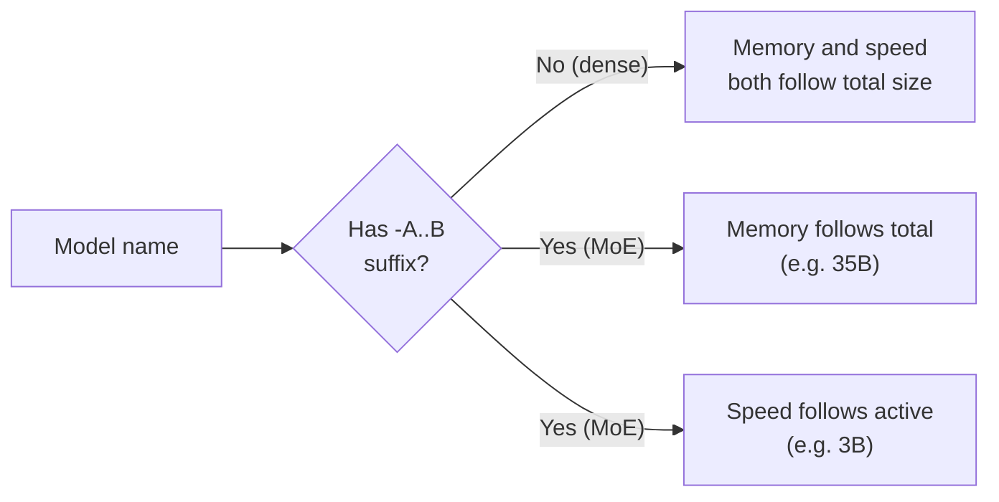

# The open-model landscape

You know one model very well by now: your Qwen3.5-9B. This lesson zooms out to the whole field: who publishes open-weight models, how the families differ in ways that matter to you (licence, context, modalities, thinking, tool calling), what each size tier can realistically do, what fits on a 16 GB Mac, and how to find a trustworthy file on Hugging Face. The specific model names will age within months; the way of reading the landscape will not.

> [!GOALS]
> - Name the main open-weight labs and families as of November 2026, and re-check the lineup yourself in minutes
> - Read a licence the way a client contract would: Apache-2.0 and MIT versus custom licences with use restrictions
> - Explain what each size tier (0.5B to 1T+) can realistically do, and how dense and mixture-of-experts sizes differ
> - Decide whether a model fits your 16 GB Mac at a given quant and context, with the arithmetic
> - Navigate base, instruct, reasoning and uncensored variants, Hugging Face model trees and trusted quantizers

> [!WARNING] This lesson has a shelf life
> Everything in the tables below was checked against official model cards, Hugging Face and the Ollama library **as of November 2026**. The open-model world ships something important almost every month. Treat names, sizes and scores as a snapshot, and use the radar lab at the end of this lesson to refresh it.

## Who makes open-weight models

Start with a distinction people blur constantly.

> [!CONCEPT] Open weights versus open source
> An **open-weight** model publishes its trained parameters (the files you download) under some licence. That is not the same as **open source** in the software sense: most labs do not publish the training data or the full training code, so you cannot rebuild the model from scratch. A few projects (AI2's Olmo family is the best-known) release weights, data and code together. For your purposes, open weights is what matters: you can run, quantize, fine-tune and inspect the model locally. The licence decides what you are *allowed* to do with it.

The labs that matter for local use fall into three groups.

**Groups that ship many small and mid sizes** (most relevant to a 16 GB machine):

- **Alibaba Qwen** (China). Your model's family. Very frequent releases, nearly every size from 0.8B to 397B, mostly Apache-2.0, strong at coding, agents and multilingual work. Qwen3.5 (February 2026) was followed by Qwen3.6 (April) and Qwen3.8 (August), but the newer generations so far only shipped 27B and larger open models.
- **Google Gemma**. Gemma 4 (April 2026, with a 12B added in May) covers E2B, E4B, 12B, 26B-A4B and 31B, and **switched to Apache-2.0**. Earlier Gemma releases used Google's custom Gemma Terms of Use.
- **Mistral AI** (France). Ministral 3 (3B, 8B, 14B), Devstral Small 2 (24B, coding agents), Mistral Small 4 (119B MoE), all Apache-2.0.
- **IBM Granite**. Granite 4.2 (August 2026: 3B, 8B, 30B, dense, Apache-2.0), aimed at enterprise tool use and RAG.
- **NVIDIA Nemotron**. Nemotron 3 Nano 4B, Nemotron 3.5 Lightning (30B MoE) and larger, under NVIDIA's own open model licence.
- **Microsoft Phi**. Phi-4 (14B), Phi-4-mini (3.8B) and reasoning variants, MIT. No new general-purpose Phi chat model has appeared since Phi-4-reasoning-vision-15B in January 2026.
- **Liquid AI LFM** (LFM3, 1.7B and up) and **Xiaomi MiMo** (MiMo-V2.6 9B, fine-tuned from Qwen3.5-9B) are smaller players with interesting small models.

**Frontier-scale open labs** (models far too big for your laptop, but they set the bar and often get distilled into small models later): **DeepSeek** (V4-Pro, V4.1-Flash, MIT), **Z.ai GLM** (GLM-5.3, MIT), **Moonshot Kimi** (Kimi K3, custom licence), **MiniMax** (M3, custom licence), and **OpenAI**'s gpt-oss (20b and 120b, Apache-2.0, August 2025).

**Meta** deserves its own line. The Llama 4 models (April 2025) were large MoE models under the Llama 4 community licence, and nothing newer has appeared on the `meta-llama` Hugging Face organisation since (as of this check). Meta's newer open model, **Muse Glimmer** (30B, Apache-2.0 per its Ollama listing), is easiest to find through the Ollama library and the LM Studio catalog. That is a pattern worth noticing: where a lab publishes can change, so search by model name, not only by organisation.

## How families differ

Benchmark scores get the headlines, but in practice six properties decide whether a family is usable for your work.

### Licence

This is the property security professionals underrate most, because it is boring until it isn't. Licences fall into three buckets:

| Bucket | Examples (as of November 2026) | What it means |
|---|---|---|
| **Permissive** | Apache-2.0: Qwen3.5/3.6, Qwen3.8-27B, Gemma 4, Mistral (Ministral 3, Devstral Small 2, Small 4), Granite 4.2, gpt-oss, Muse Glimmer. MIT: Phi-4, DeepSeek V4, GLM-5.x, MiMo-V2.6 | Use commercially, modify, redistribute, keep the notice. Apache-2.0 also includes an explicit patent grant |
| **Custom "community" or "open model" licences** | Llama 3.x/4 community licences, Gemma Terms of Use (Gemma 3 and earlier, EmbeddingGemma-300m), NVIDIA Nemotron Open Model License, Qwen Community License 1.0 (Qwen3.8-Flash-Next), LFM Open License v1.0, Kimi K3 License, MiniMax community licence | Free to use, but with conditions: user or revenue thresholds, acceptable-use policies, attribution, or separate licences for certain business models |
| **Non-commercial** | Many community fine-tunes and some datasets (CC BY-NC, CC BY-NC-SA) | Not for paid client work at all |

Three real conditions from that middle bucket, to show why "free" is not the end of the question:

- The **LFM Open License v1.0** lets companies use Liquid's models commercially for free only while annual revenue is under US$10 million; above that, commercial rights end unless you buy a licence.
- The **Qwen Community License 1.0** (used by Qwen3.8-Flash-Next, unlike the Apache-2.0 Qwen3.5 and 3.6) requires a separate licence before commercial use if you run a "Model as a Service" or "AI Work Assistant" business, and requires very large products to display the model name.
- The **Llama community licences** carry an acceptable-use policy, attribution requirements and a clause for services above 700 million monthly active users.

> [!DANGER] Licences in client work
> If you use a model inside a paid engagement (triage of a client's logs, drafting a report, a tool you hand over), the licence of the model, **and of the base model it was derived from**, applies to your firm. A fine-tune inherits its base's obligations: Cisco's Foundation-Sec-8B models, for example, ship with a NOTICE that applies both the Llama 3.1 Community License (from the base) and Apache-2.0 (for Cisco's changes). Revenue thresholds apply to your company, not to you personally. Acceptable-use policies list prohibited activities; read whether your kind of security testing is in tension with them. When in doubt, prefer Apache-2.0 or MIT models for client work and get your firm's legal review for anything else. This is practical guidance, not legal advice.

### Context length

How many tokens the model can attend to at once (see [Tokens](#/foundations/tokens)). Advertised context is mostly 128K to 256K for small and mid models in 2026 (Qwen3.5 262,144; Gemma 4 E2B/E4B 128K and larger sizes 256K; Ministral 3 256K; Granite 4.2 128K, extendable to 512K), and up to 1M for frontier models. Two caveats: advertised is not the same as *usable* (quality often degrades well before the limit, which is what benchmarks like RULER measure; see [Benchmarks, leaderboards and your own evals](#/models/evaluate)), and on 16 GB the **KV cache** is what stops you, not the advertised number.

### Multilingual

Families differ in how many languages they were trained and tested on. IBM, for example, states Granite 4.2 was tested in 12 languages. Qwen has historically been the broadest. If you read Chinese-language threat intel or write reports in German, test on your actual language; a small model's weakest skill is usually its least-trained language.

### Multimodal

Can it take images, audio or video as input? Qwen3.5 is natively multimodal (text, image, video, through the separate `mmproj` file you already met). Gemma 4 accepts images on every size and audio on E2B, E4B and 12B. Ministral 3 and Mistral Small 4 take images. Granite 4.2 and gpt-oss are text-only. For screenshots of Burp, architecture diagrams or scanned PDFs, this is a hard requirement, not a nice-to-have.

### Thinking and non-thinking

Most 2026 families are **hybrid**: one model that can reason step by step in a hidden block before answering, or answer directly. The switches differ per family, which matters when you swap models:

| Family | How you switch thinking |
|---|---|
| Qwen3.5 / 3.6 / 3.8 | Chat-template variable `enable_thinking`; Qwen3.8 adds `reasoning_effort` (`low`, `medium`, `xhigh`) |
| Gemma 4 | A `<\|think\|>` token at the start of the system prompt, or `enable_thinking=True` in the template |
| Granite 4.2 | Thinking on by default; off, or low/high effort, per request |
| gpt-oss | Reasoning effort low, medium or high |
| Mistral | Separate `-Instruct` and `-Reasoning` checkpoints for Ministral 3; `reasoning_effort` for Mistral Small 4 |
| Nemotron 3 Nano | Controlled via the system prompt |

Some models are explicitly non-thinking (Qwen3-Coder-Next produces no `<think>` blocks at all). See [Base, instruct, thinking and chat templates](#/foundations/model-types) for what the template does.

### Tool calling quality

Whether a model can reliably emit a well-formed function call, choose the right tool and recover when a tool fails. This varies far more than chat quality, and it drops sharply with size. On Qwen's own model card, Qwen3.5-9B scores 66.1 on the BFCL-V4 tool-calling benchmark while Qwen3.5-4B scores 50.3, a much bigger gap than on knowledge tests (MMLU-Pro 82.5 versus 79.1). Tool calling also depends on the **runtime's** chat template and parser, so the same weights can work in one app and fail in another. More in [The right model for each job](#/models/use-cases).

## Size tiers: what each can realistically do

Parameter count is the crudest predictor of quality, but it is the one that decides what fits. Here is what each tier is good for in practice, with examples that exist as of November 2026. "Q4 size" is the approximate weight file at 4-bit; your own file gives a handy rule: 5.63 GB for about 9B parameters is roughly **0.63 bytes per parameter** at Q4_K_M ([Scaling up beyond 16 GB](#/infra/scaling)).

| Tier | Q4 size | Examples | Realistic jobs | Where it breaks |
|---|---|---|---|---|
| **≈0.3–2B** | 0.3–1.5 GB | Qwen3.5-0.8B, Qwen3.5-2B, LFM3 1.7B, Gemma 4 E2B, embedding models | Classification, routing, extraction into fixed fields, draft model for speculative decoding, autocomplete | Facts, multi-step reasoning, long instructions; hallucinates freely |
| **3–4B** | 2–3.5 GB | Qwen3.5-4B, Gemma 4 E4B, Granite 4.2 3B, Ministral 3 3B, Nemotron 3 Nano 4B, Phi-4-mini | Summaries, simple tool calls, structured output, on-the-go assistant | Subtle code review, long agent loops, niche knowledge |
| **7–9B** | 5–6.6 GB | Qwen3.5-9B (yours), Granite 4.2 8B, Ministral 3 8B, MiMo-V2.6 9B | Solid daily driver: triage, explanation, scripting help, decent tool calling, RAG | Deep multi-file reasoning, reliable long agent runs, rare facts |
| **12–15B** | 7.5–9.5 GB | Gemma 4 12B, Ministral 3 14B, Phi-4 14B | Noticeably better reasoning and writing than 8B | Fits 16 GB only with short context |
| **24–35B** | 15–22 GB | Devstral Small 2 24B, Qwen3.6-27B, Qwen3.8-27B, Gemma 4 31B, Muse Glimmer 30B | Strong coding agents, near-frontier for many tasks | Needs 24–32 GB+ |
| **MoE 20–35B total, 3–4B active** | 14–22 GB | gpt-oss-20b (21B total, about 3.6B active), Gemma 4 26B-A4B, Qwen3.5/3.6-35B-A3B, Nemotron 3.5 Lightning 30B-A3B | Big-model quality at small-model speed | Memory scales with **total** parameters |
| **70B+ dense, 100B+ MoE** | 40 GB to hundreds of GB | Mistral Small 4 (119B-A6.5B), Qwen3.5-122B-A10B, gpt-oss-120b, GLM-5.3, DeepSeek V4, Kimi K3 (2.8T total) | Frontier-class work | Workstations, big Macs or servers only |

> [!CONCEPT] Effective parameters (Gemma's "E" sizes)
> Gemma 4 E2B and E4B are named by **effective** parameters: about 2.3B and 4.5B do the per-token compute, but with their embedding tables included they are about 5.1B and 8B. Large embedding tables are lookups, not matrix multiplications, so they cost memory and disk more than speed. That is why `gemma4:e4b` is a 6.6 GB download in Ollama despite the "4B" in its name. Always check the real file size, not the name.

### Dense versus MoE, briefly

You met this in [Scaling up beyond 16 GB](#/infra/scaling): a **dense** model uses every parameter for every token; a **mixture-of-experts (MoE)** model stores many expert blocks and routes each token through a few of them. The one-line rule: **memory scales with total parameters, speed scales with active parameters.** So a name like `35B-A3B` means "needs memory for 35B, runs about as fast as a 3B". On a 16 GB machine memory is the binding constraint, so MoE mostly helps you *later*, on a bigger machine. gpt-oss-20b is the one MoE that sits near the edge of 16 GB, which is why it comes up so often in "16 GB" discussions.



## What fits on your 16 GB Mac

Recall the budget from [Memory math](#/foundations/memory-math): by default Metal lets the GPU wire roughly two-thirds of 16 GB, about **10.7 GB**, and macOS plus your apps need the rest. Everything the model needs must fit in that GPU budget for full speed:

```text
needed ≈ weight file + KV cache (grows with context) + compute buffers (~0.5–1 GB) + vision encoder (if loaded)
```

### Worked example 1: your current model

```text
Qwen3.5-9B Q4_K_M weights      5.3 GiB
KV cache at 32K context        32 KiB/token × 32,768 = 1 GiB
Linear-attention state         tens of MB
Buffers                        ~0.5–1 GiB
Total                          ~7–7.5 GiB     -> comfortable inside ~10.7 GB
```

### Worked example 2: Gemma 4 12B

Ollama's `gemma4:12b-it-q4_K_M` is an 8.0 GB download (Google's QAT build is 7.2 GB).

```text
Weights                        8.0 GB
Buffers                        ~0.5–1 GB
Left for KV cache              10.7 − 8.0 − 0.75 ≈ 2 GB
```

Whether 2 GB buys you 8K or 64K of context depends on the model's architecture: how many layers keep a full KV cache, how many KV heads, the head size, and whether some layers use a sliding window. Do not guess. Read its `config.json` and apply the formula from [Memory math](#/foundations/memory-math), or ask LM Studio with `lms load <key> --estimate-only --context-length 32768`. Verdict: fits, with a modest context and few other apps open.

### Worked example 3: gpt-oss-20b

Ollama lists `gpt-oss:20b` at 14 GB (its MoE weights are stored in a 4-bit format called MXFP4; OpenAI says it runs on systems with as little as 16 GB). Against your ~10.7 GB GPU budget it does **not** fit by default. You could raise the limit with `sudo sysctl iogpu.wired_limit_mb=...` (see [Memory math](#/foundations/memory-math)) and close everything else, but you would be running with almost no headroom for macOS. On 16 GB it is an experiment, not a daily driver.

### The fit table

Sizes are download sizes from the Ollama library (default 4-bit tags; some include vision encoders) or estimates from 0.63 bytes per parameter where marked. Check the exact file you pick.

| Model | Approx. Q4 size | Verdict on 16 GB (default GPU limit) |
|---|---|---|
| Qwen3.5-0.8B / 2B / 4B | 1.2 / 1.9 / 3.3 GB | Easy; can sit beside your main model |
| Granite 4.2 3B / 8B | 2.2 / 5.3 GB | Easy / comfortable |
| Ministral 3 3B / 8B | 3.0 / 6.0 GB | Easy / comfortable |
| Gemma 4 E2B / E4B | 4.6 / 6.6 GB | Comfortable |
| Qwen3.5-9B (yours) | 5.3 GB text (6.6 GB with vision in Ollama) | Comfortable, generous context thanks to the hybrid layout |
| MiMo-V2.6 9B | 6.6 GB | Comfortable |
| Gemma 4 12B | 7.2–8.0 GB | Tight; short to medium context |
| Ministral 3 14B | 9.1 GB | Very tight; short context, nothing else loaded |
| Phi-4 14B | ≈9.3 GB (estimate) | Very tight |
| gpt-oss-20b | 14 GB | No, unless you raise the GPU limit and accept the risk |
| Devstral Small 2 24B | 15 GB | No |
| Qwen3.5-27B, Qwen3.6-27B, Qwen3.8-27B | ≈17 GB | No (needs 24 GB+) |
| Gemma 4 26B-A4B / 31B, Muse Glimmer 30B, Qwen3.6-35B-A3B | 16–22 GB | No (needs 24–32 GB+) |

Try the edge cases in the calculator: set 12B and 14B at Q4, raise context from 8K to 64K, and watch where each stops fitting. Then set 20B to see why gpt-oss-20b is a stretch.

<div data-widget="memory"></div>

> [!MAC]
> Two Mac-specific notes. First, Ollama now publishes MLX-engine tags for Apple Silicon for some models (for example `gemma4:12b-mlx`, 7.7 GB); MLX and GGUF builds of the same model can differ in speed and memory, so benchmark both ([Performance tuning](#/lmstudio/performance)). Second, your Air is fanless: a model that fits but runs at 100% GPU for twenty minutes will throttle. A smaller model that finishes the job before the chassis heats up can beat a bigger one on wall-clock time.

## Variants: base, instruct, reasoning, uncensored

One family release produces many repositories. [Base, instruct, thinking and chat templates](#/foundations/model-types) explains the training stages; here is how they show up in names, using real 2026 repositories:

| Name pattern | Example | What it is | Use it for |
|---|---|---|---|
| `-Base` | `Qwen/Qwen3.5-9B-Base`, `mistralai/Ministral-3-8B-Base-2512` | Pretrained only; continues text, does not follow instructions | Fine-tuning, research |
| no suffix, `-Instruct`, `-it` | `Qwen/Qwen3.5-9B`, `Ministral-3-8B-Instruct-2512`, `google/gemma-4-12B-it` | Instruction-tuned chat model (often hybrid thinking) | Daily use |
| `-Reasoning`, `-Thinking` | `Ministral-3-8B-Reasoning-2512`, `Phi-4-reasoning` | Trained to think before answering | Math, planning, hard analysis |
| `-A3B`, `-A4B` | `Qwen3.6-35B-A3B`, `gemma-4-26B-A4B-it` | MoE; active parameters per token | See dense versus MoE |
| date suffix | `-2512`, `-2603` | Mistral's year-month build stamp (2512 = December 2025) | Pick the newest build |
| `-FP8`, `-GPTQ-Int4`, `-NVFP4`, `-mxfp4` | `Qwen3.5-27B-FP8` | Quantized for GPU servers (vLLM, SGLang), mostly not for LM Studio | Ignore on a Mac |
| `-GGUF`, `-MLX`, `-qat-q4_0-gguf` | `google/gemma-4-12B-it-qat-q4_0-gguf` | Files for llama.cpp, LM Studio, Ollama, or MLX | What you download |
| `Distill` | MiMo-V2.6 (distilled into Qwen3.5-9B) | A smaller model trained on a bigger model's outputs | Often punches above its size |
| `abliterated`, `Uncensored`, `heretic` | Your HauhauCS model | Refusals removed by direction ablation or fine-tuning | Unfiltered work, with costs |

> [!CONCEPT] Quantization-aware training (QAT)
> Normally a model is trained in high precision and quantized afterwards, which loses a little quality ([Quantization](#/foundations/quantization)). **QAT** simulates the low precision during the final stage of training so the weights adapt to it. Google publishes QAT Q4_0 GGUFs for Gemma 4; they are usually closer to full-precision quality than a post-hoc Q4 of the same size. Smaller, and better per gigabyte, which is exactly what 16 GB wants.

On uncensored variants: [Where uncensored and abliterated variants come from](#/using/ecosystem) covers the methods, and [Alignment, refusals and "uncensored"](#/foundations/alignment-uncensored) covers the why. For model choice the key point is that an uncensored variant is a *derivative*: it inherits the base's licence and most of its strengths and weaknesses, plus whatever quality the uncensoring cost. Compare it to its own base on your tasks before you assume it is a free upgrade.

## Navigating Hugging Face

### The model tree

Every model page has a **model tree** in the sidebar: the base it derives from, and counts of **Adapters**, **Finetunes**, **Merges** and **Quantizations** derived from it. Click "Quantizations" on `Qwen/Qwen3.5-9B` and you get every GGUF, MLX and GPTQ build of it; click "Finetunes" and you find the uncensored and specialised variants, including the base of your own model. The same view works as a URL filter, which is handy for scripts:

```text
https://huggingface.co/models?other=base_model:quantized:Qwen/Qwen3.5-9B
https://huggingface.co/models?other=base_model:finetune:Qwen/Qwen3.5-9B
```

Walk the tree **upwards** too. MiMo-V2.6 9B's card says it is fine-tuned from Qwen3.5-9B; Foundation-Sec-8B is built on Llama 3.1 8B. The base tells you the chat template, the architecture (and so the runtime support you need), and the licence chain.

### Trusted quantizers

Most people never run the lab's original safetensors; they run someone's GGUF or MLX conversion. Who made the conversion matters (wrong chat template, broken tokenizer, or in the worst case a tampered file). As of November 2026 these are the long-standing sources, all active:

| Source | What they publish | Notes |
|---|---|---|
| **The original lab** | Many labs now publish their own GGUFs: `Qwen/...-GGUF`, `google/gemma-4-*-qat-q4_0-gguf`, `mistralai/Ministral-3-*-GGUF`, `ibm-granite/granite-4.2-*-GGUF`, `nvidia/...-GGUF`, `fdtn-ai/...-GGUF` | First choice when it exists |
| **ggml-org** | GGUFs from the llama.cpp maintainers themselves | Reference builds for new architectures |
| **unsloth** | GGUFs including "Unsloth Dynamic" (`UD-`) quants, plus model-specific run guides | Their guides are worth reading for sampling settings and known issues |
| **bartowski** | imatrix GGUFs for a huge range of models, usually within days | Consistent naming, many quant levels |
| **lmstudio-community** | Curated GGUF and MLX builds behind LM Studio's catalog | What `lms get` often resolves to |
| **mlx-community** | MLX conversions for Apple Silicon | For the MLX engine |

Everything in [How to evaluate an uploader and a model](#/using/ecosystem) applies: lineage, licence, file formats (GGUF or safetensors, never pickles), community reports and SHA-256 checks.

### Reading a model card in two minutes

- [ ] Licence tag, and the base model's licence
- [ ] Total and active parameters, architecture (dense, MoE, hybrid)
- [ ] Native context length and whether longer context needs YaRN or other scaling
- [ ] Modalities and whether vision needs an extra file (`mmproj`)
- [ ] Thinking default and how to switch it
- [ ] Recommended sampling parameters (they differ a lot between families; Qwen3.8-27B recommends temperature 1.0 in thinking mode, Qwen3.5 recommends 0.6)
- [ ] Benchmark table: which benchmarks, which mode, compared against whom
- [ ] Known issues, minimum runtime versions (new architectures need recent llama.cpp)

## The big comparison table

As of November 2026, checked against official model cards, Hugging Face and the Ollama library. "16 GB picks" are the sizes that fit your Mac.

| Family (lab) | Latest open release | 16 GB picks | Bigger sizes | Licence | Context | Input | Thinking | Notes |
|---|---|---|---|---|---|---|---|---|
| **Qwen3.5** (Alibaba) | Feb–Mar 2026 | 0.8B, 2B, 4B, 9B | 27B, 35B-A3B, 122B-A10B, 397B-A17B | Apache-2.0 | 262K | Text, image, video | Hybrid (`enable_thinking`) | Your base; hybrid linear attention keeps KV small |
| **Qwen3.6 / 3.8** (Alibaba) | Apr / Aug 2026 | none | 3.6: 27B, 35B-A3B; 3.8: 27B; 3.8-Flash-Next 125B-A6B | Apache-2.0 (27B, 35B-A3B); Qwen Community 1.0 (Flash-Next) | 262K | Text, image, video | Hybrid, effort levels | Strong agentic coding; no small sizes yet |
| **Gemma 4** (Google) | Apr–May 2026 | E2B, E4B, 12B | 26B-A4B, 31B | Apache-2.0 (Gemma 3 used Gemma Terms) | 128K (E2B/E4B), 256K | Text, image; audio on E2B/E4B/12B | Hybrid (`<\|think\|>`) | QAT GGUFs from Google |
| **Ministral 3** (Mistral) | Dec 2025 | 3B, 8B, 14B | — | Apache-2.0 | 256K | Text, image | Separate Instruct / Reasoning | Native function calling |
| **Devstral Small 2 / Mistral Small 4** (Mistral) | Dec 2025 / Mar 2026 | none | 24B; 119B-A6.5B | Apache-2.0 | 384K (Devstral, per Ollama); 256K | Text, image | Small 4: `reasoning_effort` | Devstral is built for coding agents |
| **Granite 4.2** (IBM) | Aug 2026 | 3B, 8B | 30B | Apache-2.0 | 128K (to 512K) | Text | Hybrid, effort levels | Enterprise tool use, RAG, FIM code completion |
| **Phi-4** (Microsoft) | Dec 2024 to Jan 2026 | Phi-4-mini 3.8B, Phi-4 14B (tight) | Phi-4-reasoning-vision-15B | MIT | varies | Text (vision variant) | Separate reasoning models | Ageing; strong at math for size |
| **gpt-oss** (OpenAI) | Aug 2025 | 20b (borderline) | 120b | Apache-2.0 | 128K | Text | Effort low/med/high | MoE with MXFP4 weights |
| **Nemotron** (NVIDIA) | Mar–Oct 2026 | Nemotron 3 Nano 4B | 3.5 Lightning 30B-A3B, 3.5 Super VL 120B-A12B | NVIDIA Nemotron Open Model License | 262K (Nano 4B) | Text (VL variants: image) | System-prompt toggle | Nano 4B is a hybrid Mamba-2 design |
| **Muse Glimmer / Llama 4** (Meta) | 2026 / Apr 2025 | none | Glimmer 30B; Llama 4 Scout, Maverick | Apache-2.0 (Glimmer, per Ollama); Llama 4 community licence | 128K (Glimmer) | Text, image | Glimmer: effort levels | Glimmer targets local agents |
| **LFM3** (Liquid AI) | 2026 | 1.7B | — | LFM Open License v1.0 (US$10M revenue cap) | 256K | Text | Supported | Tiny agent and tool-calling model |
| **MiMo-V2.6** (Xiaomi) | 2026 | 9B | Pro and Flash (cloud-scale) | MIT (9B) | 256K | Text, image | Supported | Distilled into Qwen3.5-9B |
| **DeepSeek V4** | Apr–Oct 2026 | none | V4-Pro 1.6T-A49B, V4.1-Flash | MIT | 1M | Text, image | Effort 1–100 | Frontier; datacentre only |
| **GLM-5.3** (Z.ai) | Aug 2026 | none | 5.3-Flash 320B-A18B, 5.3 | MIT | not stated on card (evaluated up to 1M) | Text, image | Effort low/high/max | Frontier coding and agents |
| **Kimi K3** (Moonshot) | Jun–Nov 2026 | none | K3 2.8T-A104B, K3.1-Pro | Kimi K3 License (custom) | 1M | Text, image | Yes | Frontier agentic |
| **MiniMax M3** | Jun–Oct 2026 | none | M3 ~428B-A23B, M3.1-Flash | MiniMax community licence | 1M | Text, image, video | Yes | Frontier agentic |
| **Foundation-Sec** (Cisco) | 2025–Jan 2026 | 8B (Instruct 1.1, Reasoning) | — | Llama 3.1 Community + Apache-2.0 | 64K (1.1 Instruct) | Text | Reasoning variant | Security-specialised; see [use cases](#/models/use-cases) |

> [!NOTE]
> Benchmark numbers are left out of this table on purpose. Every lab reports a different set, in a different mode, with a different harness. [Benchmarks, leaderboards and your own evals](#/models/evaluate) shows how to read them and how to replace them with your own.

## Lab: build a landscape radar

> [!LAB] A script that tells you what changed this month
> You will write `~/ai-lab/models/radar.py`. It asks the Hugging Face API for the newest repositories from the labs you care about, shows their creation date, licence tag and downloads, and skips the noise (server-only quant formats, adapters). Run it monthly; it is how you keep this lesson current.
>
> 1. Set up the folder:
>
> ```bash
> mkdir -p ~/ai-lab/models && cd ~/ai-lab/models
> python3 -m venv .venv && source .venv/bin/activate
> pip install requests
> ```
>
> 2. Save the script below as `radar.py` and run `python radar.py --days 60`.
> 3. For each new family you see, open its model card and fill in one row of the two-minute checklist above. Add anything that fits 16 GB to your shortlist for the shootout in [Benchmarks, leaderboards and your own evals](#/models/evaluate).
> 4. Check the Ollama library sorted by newest (ollama.com/library?sort=newest) and the LM Studio catalog (lmstudio.ai/models) as well: some releases appear there first, under names you would not find by organisation.

```python title="radar.py"
#!/usr/bin/env python3
"""List recent open-weight model repos from chosen Hugging Face organisations.

Uses the public Hugging Face API (no token needed for public repos).
Example: python radar.py --days 60 --authors Qwen google mistralai
"""
from __future__ import annotations

import argparse
from datetime import datetime, timedelta, timezone

import requests

API = "https://huggingface.co/api/models"
DEFAULT_AUTHORS = [
    "Qwen", "google", "mistralai", "ibm-granite", "nvidia", "microsoft",
    "openai", "meta-llama", "deepseek-ai", "zai-org", "moonshotai",
    "MiniMaxAI", "LiquidAI", "fdtn-ai",
]
# Repos whose names contain these are usually server formats or tooling, not new models.
NOISE = ("-FP8", "-NVFP4", "-GPTQ", "-AWQ", "-ONNX", "-mxfp4", "-nvfp4", "-fp8", "eagle", "SAE-")


def recent_models(author: str, since: datetime, limit: int = 50) -> list[dict]:
    params = {"author": author, "sort": "createdAt", "direction": -1, "limit": limit, "full": "true"}
    resp = requests.get(API, params=params, timeout=30)
    resp.raise_for_status()
    rows = []
    for m in resp.json():
        created = datetime.fromisoformat(m["createdAt"].replace("Z", "+00:00"))
        if created < since:
            break  # results are sorted newest first
        if any(n in m["id"] for n in NOISE):
            continue
        licence = next((t.split(":", 1)[1] for t in m.get("tags", []) if t.startswith("license:")), "?")
        rows.append({
            "id": m["id"],
            "created": created.date().isoformat(),
            "licence": licence,
            "task": m.get("pipeline_tag") or "?",
            "downloads": m.get("downloads", 0),
        })
    return rows


def main() -> None:
    ap = argparse.ArgumentParser()
    ap.add_argument("--days", type=int, default=45, help="look back this many days")
    ap.add_argument("--authors", nargs="*", default=DEFAULT_AUTHORS)
    args = ap.parse_args()
    since = datetime.now(timezone.utc) - timedelta(days=args.days)

    print(f"| Repo | Created | Licence | Task | Downloads |\n|---|---|---|---|---|")
    for author in args.authors:
        try:
            for r in recent_models(author, since):
                print(f"| {r['id']} | {r['created']} | {r['licence']} | {r['task']} | {r['downloads']:,} |")
        except requests.RequestException as exc:
            print(f"| {author} | error: {exc} | | | |")


if __name__ == "__main__":
    main()
```

The output is a Markdown table you can paste into your notes. A licence of `other` means "read the LICENSE or NOTICE file"; that is exactly what Foundation-Sec and several community licences show.

## Recap

- Open weights means downloadable parameters under a licence; it rarely means open training data. The licence, and the base model's licence, decide what you may do in client work.
- Licences come in three buckets: permissive (Apache-2.0, MIT), custom community licences with conditions (revenue or user caps, acceptable-use policies, separate licences for some businesses), and non-commercial.
- Families differ in licence, context, languages, modalities, thinking controls and tool-calling quality, and each family switches thinking differently.
- Size tiers: 1–2B for routing and extraction, 3–4B for simple structured work, 7–9B as a daily driver, 12–15B for better reasoning at tight memory, 24B+ and MoE models for near-frontier work on bigger machines.
- MoE: memory follows total parameters, speed follows active parameters. On 16 GB, memory is the wall.
- On your Mac, models up to about 9B at Q4 are comfortable, 12–14B are tight, and 20B+ (including gpt-oss-20b at 14 GB) do not fit the default GPU budget.
- Read names (Base, Instruct, Reasoning, A3B, QAT, GGUF, abliterated), walk the model tree in both directions, and prefer the lab's own GGUFs or long-standing quantizers.

## Check yourself

1. A colleague wants to use an LFM model inside a paid product at a firm with US$40M annual revenue. What do you tell them?
   <details><summary>Answer</summary>

   The LFM Open License v1.0 allows free commercial use only for companies with annual revenue under US$10 million. Above that, commercial use rights end unless they buy a commercial licence from Liquid AI. Either get that licence or choose an Apache-2.0 or MIT model of similar size.

   </details>
2. Why does `gemma4:e4b` download as 6.6 GB when it is called a "4B" model?
   <details><summary>Answer</summary>

   "E4B" counts effective parameters, about 4.5B, that do per-token compute. Including embedding tables the model is about 8B parameters, and the Ollama package also bundles its vision and audio encoders. Memory is decided by what is in the file, not by the name.

   </details>
3. Qwen3.6-35B-A3B generates fast on a 64 GB Mac. Why won't it run on yours even though only about 3B parameters are active per token?
   <details><summary>Answer</summary>

   In an MoE model any token can be routed to any expert, so all 35B parameters must be in memory: about 22 GB at Q4, double your GPU budget. Active parameters set speed, total parameters set memory.

   </details>
4. You find a promising "Cyber-8B-Uncensored" GGUF from a new account. What three things do you check before downloading?
   <details><summary>Answer</summary>

   Any three of: its lineage in the model tree (which base, and is it named exactly), the licence chain (the base's licence still applies), the file formats (GGUF or safetensors only, no pickles or `trust_remote_code`), community reports and the uploader's track record, and whether the card explains how it was made. Then verify the SHA-256 after download and compare it against its base on your own tasks.

   </details>
5. Estimate the Q4_K_M weight size of a 14B dense model and say whether it fits comfortably on your Mac with 32K context.
   <details><summary>Answer</summary>

   14 × 0.63 ≈ 8.8 GB of weights. With ~0.75 GB of buffers that leaves under 1.2 GB of a ~10.7 GB GPU budget for the KV cache. Whether that holds 32K depends on the model's KV cost per token (read its `config.json`), but for a classic transformer it usually will not; plan on short context or a smaller model.

   </details>

## Go deeper

- [Hugging Face model cards documentation](https://huggingface.co/docs/hub/model-cards) — what the metadata, licence tags and base-model fields on a card mean
- [Hugging Face Hub API](https://huggingface.co/docs/huggingface_hub/index) — the Python client behind scripts like `radar.py`
- [Ollama model library, newest first](https://ollama.com/library?sort=newest) — a fast way to see what is new and how big each tag is
- [LM Studio model catalog](https://lmstudio.ai/models) — curated models that run in LM Studio, with sizes
- [Choose a License: Apache-2.0](https://choosealicense.com/licenses/apache-2.0/) — a plain-language summary of what the most common permissive model licence allows
- [Liquid AI LFM licence FAQ](https://www.liquid.ai/lfm-license) — a concrete example of a revenue-capped model licence
