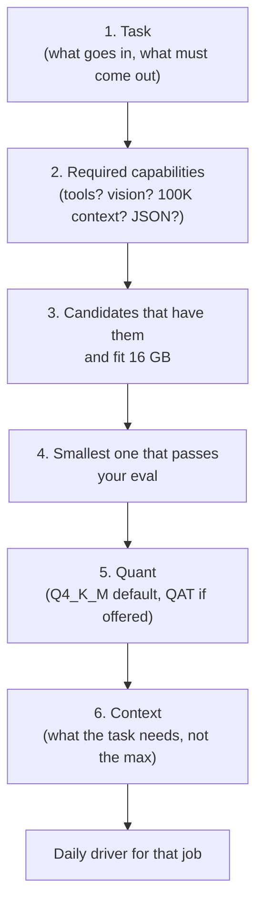

# The right model for each job

"What's the best model?" has no answer. "What's the smallest model that reliably does *this* job on *my* machine?" does. This lesson gives you a decision framework, then walks through the jobs you actually do (chat, coding, reasoning, security analysis, agents, long documents, vision, embeddings, drafting, routing) with two or three candidates that fit 16 GB and what you would pick with more memory. It ends with multi-model setups and a starter kit for your disk.

> [!GOALS]
> - Apply a repeatable framework: task, required capability, smallest model that passes your eval, quant, context
> - Pick 16 GB candidates for each job, and know the upgrade path with more memory
> - Judge security-specialised models honestly against general models
> - Decide when an uncensored variant is worth its costs
> - Run several models on one 16 GB Mac (router plus specialist, JIT loading, keep-alive) without swapping
> - Download a starter kit with `lms get` and `ollama pull`

> [!WARNING] Recommendations age fast
> Candidates below are **as of November 2026**, chosen from what was verified on official model cards and the Ollama and LM Studio catalogs at that time. Benchmark numbers quoted are the **vendors' own**, measured with their harnesses and settings; they are useful for shortlisting, never for deciding. Deciding is what [Benchmarks, leaderboards and your own evals](#/models/evaluate) is for. Use the radar script from [The open-model landscape](#/models/landscape) to see what is new.

## The decision framework

Most people choose a model the way they choose a laptop: read reviews, buy the biggest they can afford. On 16 GB that leads to a 14B model with 4K of context that throttles your Air. Work backwards from the job instead.



**1. Task.** Write it as input and output: "nmap XML in, JSON triage object out", "300 lines of minified JS in, list of sinks with line numbers out", "my notes and redacted HTTP in, HackerOne-style report out".

**2. Required capabilities.** Some are hard filters, not preferences:

| If the task needs... | Filter |
|---|---|
| Images (screenshots, diagrams) | Multimodal model plus its vision encoder file |
| Calling tools reliably | A family with native tool calling, tested in *your* runtime |
| 64K+ tokens of input | An architecture whose KV cache you can afford (hybrid or sliding-window attention helps a lot) |
| Strict JSON | Any decent instruct model *plus* structured-output constraints ([Structured output and tool calling](#/using/structured-output-tools)) |
| Content a safety-tuned model refuses | Try a professional system prompt first; then an uncensored variant |
| Use in paid client work | Apache-2.0 or MIT, or a licence your firm has reviewed ([landscape](#/models/landscape)) |

**3. Candidates that fit.** From [What fits on your 16 GB Mac](#/models/landscape): up to about 9B at Q4 comfortably, 12–14B tightly.

> [!CONCEPT] Smallest model that passes
> The principle that you pick the **least** capable model that clears your quality bar, not the most capable one that fits. Smaller means faster, cooler (your Air is fanless), more context for the same memory, and room for a second model. "Passes" is defined by your own eval set, not by a leaderboard. It is the same instinct as least privilege: grant only the capability the job requires.

**4. Smallest one that passes.** Run your shootout ([Benchmarks, leaderboards and your own evals](#/models/evaluate)). Often a 4B passes extraction tasks that you assumed needed a 9B, and sometimes a 9B fails a review task that only a 27B can do, which tells you to rent a GPU for that job rather than suffer ([Scaling up beyond 16 GB](#/infra/scaling)).

**5. Quant.** Q4_K_M is the sensible default; Q6_K or Q8_0 if a model is small enough that you can afford it and quality matters (code, precise extraction); a lab's QAT build when one exists. See [Quantization](#/foundations/quantization).

**6. Context.** Set what the task needs plus margin, not the model's maximum. Every token of context you reserve is KV-cache memory you cannot use for anything else.

## Getting models: `lms get` and `ollama pull`

You will download many candidates, so get fluent with both tools.

**LM Studio** downloads by search term, with an optional quant after `@`; if several models match, it shows a picker. It also accepts a Hugging Face URL ([Local server, API and the lms CLI](#/lmstudio/server-api)):

```bash
lms get gemma-4-12b@q4_k_m
lms get https://huggingface.co/fdtn-ai/Foundation-Sec-8B-Reasoning-Q4_K_M-GGUF
lms ls
```

Use `lms get --mlx` or `--gguf` to restrict the format, and run `lms get --help` because the search behaviour has changed between versions.

**Ollama** pulls by `name:tag` from its own library, or any GGUF from Hugging Face with `hf.co/<user>/<repo>:<quant>`:

```bash
ollama pull gemma4:12b-it-qat
ollama pull hf.co/fdtn-ai/Foundation-Sec-8B-Reasoning-Q4_K_M-GGUF
ollama list
```

Library tags verified as of November 2026, with the default download sizes Ollama lists:

| Model | Ollama tag | Size |
|---|---|---|
| Qwen3.5 0.8B / 2B / 4B / 9B | `qwen3.5:0.8b`, `qwen3.5:2b`, `qwen3.5:4b`, `qwen3.5:9b` | 1.2 / 2.7 (1.9 as `qwen3.5:2b-q4_K_M`) / 3.3 / 6.6 GB (vision included) |
| Gemma 4 E2B / E4B / 12B | `gemma4:e2b`, `gemma4:e4b`, `gemma4:12b-it-qat` | 4.6 / 6.6 / 7.2 GB |
| Granite 4.2 3B / 8B | `granite4.2:3b`, `granite4.2:8b` | 2.2 / 5.3 GB |
| Ministral 3 3B / 8B / 14B | `ministral-3:3b`, `ministral-3:8b`, `ministral-3:14b` | 3.0 / 6.0 / 9.1 GB |
| MiMo-V2.6 9B | `mimo-v2.6:9b` | 6.6 GB |
| LFM3 1.7B | `lfm3:1.7b` | 1.1 GB |
| Nemotron 3 Nano 4B | `nemotron-3-nano:4b` | check `ollama show` |
| gpt-oss 20B | `gpt-oss:20b` | 14 GB |
| Qwen3 Embedding | `qwen3-embedding:0.6b`, `:4b`, `:8b` | small (0.6B) to large |
| EmbeddingGemma 2 | `embeddinggemma-2:270m` (text), `:740m` (text and image) | 0.3 / 1.3 GB |

> [!NOTE]
> The same model can behave differently in the two runtimes: Ollama packages its own chat templates and defaults, LM Studio uses the template inside the GGUF. When you compare models, compare them in the same runtime. [Server tuning and a fair benchmark vs LM Studio](#/ollama/tuning) covers running both fairly.

## Job by job

Each job lists 16 GB candidates (in rough order of what to try first), what to watch for, and the upgrade path.

### General chat and assistant

The bar: follows instructions, explains clearly, admits uncertainty, fast enough to feel interactive.

| Candidate | Why | Watch for |
|---|---|---|
| **Qwen3.5-9B** (your uncensored build, or the original) | Strong all-rounder; Qwen reports IFEval 91.5 and MMLU-Pro 82.5 for the 9B | Thinking on by default in some builds; turn it off for chat speed |
| **Gemma 4 12B** (QAT) | Larger, good writing, Apache-2.0, images and audio | Only ~2 GB left for context; pick a short context |
| **Gemma 4 E4B** or **Qwen3.5-4B** | "Fast mode" when the Air is hot or you need a second model loaded | Thinner knowledge; more confident errors |

**With more memory**: Qwen3.6-27B or Qwen3.8-27B, Gemma 4 31B, or the 26B-A4B/35B-A3B MoE models if you value speed.

### Coding and code review

Writing scripts, reviewing a diff, explaining a decompiled function, fixing a broken PoC for an in-scope target.

| Candidate | Vendor-reported signal | Watch for |
|---|---|---|
| **Qwen3.5-9B** | LiveCodeBench v6 65.6 (Qwen card) | Use non-thinking for quick edits, thinking for tricky bugs |
| **Gemma 4 12B** | LiveCodeBench v6 72.0 (Google card) | Tight memory; short files only |
| **MiMo-V2.6 9B** (Xiaomi, MIT) | Distilled into Qwen3.5-9B; Xiaomi reports SWE-bench Pro 32.0 → 44.6 over the base | Same size as yours: a direct A/B candidate |
| **Granite 4.2 8B** | LiveCodeBench v6 73.24, SWE-bench Verified 47.67 (IBM card); fill-in-the-middle completion | Text-only |

Two practical points. First, for code, quality per bit matters: if a candidate is small enough, try Q6_K or Q8_0 against Q4_K_M in your eval. Second, code review benefits from **context more than size**: a 9B that sees the whole file plus the caller beats a 14B that sees 40 lines. That favours your hybrid-attention Qwen3.5-9B on 16 GB.

**With more memory**: this is where 24–32 GB pays off most. Devstral Small 2 24B (Apache-2.0, built for coding agents, Mistral reports SWE-bench Verified 65.8), Qwen3.6-35B-A3B (Qwen reports SWE-bench Verified 73.4, and it is fast because only ~3B parameters are active), Qwen3.6/3.8-27B. On a big machine, Qwen3-Coder-Next (80B total, 3B active, non-thinking, Apache-2.0).

### Reasoning and math

CVSS reasoning, "is this chain of three low-severity issues actually a high?", protocol logic, crypto CTF maths.

| Candidate | Signal | Watch for |
|---|---|---|
| **Qwen3.5-9B, thinking on** | HMMT Feb 25: 83.2, GPQA Diamond 81.7 (Qwen card) | Long thinking traces eat context and time; set a max-tokens budget |
| **Gemma 4 12B, thinking on** | AIME 2026 (no tools) 77.5, GPQA Diamond 78.8 (Google card) | Same memory caveats as above |
| **Ministral 3 8B/14B Reasoning** | Dedicated reasoning checkpoints | 14B is very tight on 16 GB |

Reasoning models trade **time** for accuracy. On a fanless Air a 4,000-token thinking trace at 15 tok/s is over four minutes. Use thinking for decisions that deserve it and non-thinking for everything else; [Prompt engineering](#/using/prompt-engineering) covers when to ask for reasoning.

**With more memory**: Qwen3.8-27B (thinking with effort levels), Gemma 4 31B, gpt-oss-120b on a large machine.

### Security analysis

Break "security" into the actual jobs, because they need different capabilities:

| Job | What matters most | 16 GB pick (recommendation) |
|---|---|---|
| **Log triage** (auth logs, WAF logs, cloud audit trails) | Long context, structured JSON output, low hallucination | Qwen3.5-9B: cheap KV cache means you can feed big log slices; structured output on |
| **JavaScript review** (sinks, secrets, endpoints in bundles) | Code understanding, context for big bundles | Qwen3.5-9B; second opinion from Gemma 4 12B on the interesting chunks |
| **Report writing** | Clear prose, follows a template, no invented facts | Gemma 4 12B or Qwen3.5-9B; always draft from your own notes ([Reporting](#/bugbounty/reporting)) |
| **CTF help** (crypto maths, encodings, reversing hints) | Reasoning, code execution via tools | Qwen3.5-9B with thinking, plus a Python tool so it computes instead of guessing |
| **CTI mapping** (CVE to CWE, ATT&CK technique tagging) | Domain knowledge | Worth testing a security-specialised model here |

#### Security-specialised open models

They exist; here is what was verifiable as of November 2026:

- **Cisco Foundation AI Foundation-Sec-8B** (`fdtn-ai` on Hugging Face): a base model built on Llama 3.1 8B with continued pretraining on a security corpus, plus **Foundation-Sec-1.1-8B-Instruct** (64K context) and **Foundation-Sec-8B-Reasoning** (32K training context). Official Q4_K_M and Q8_0 GGUFs are published. Licence: the NOTICE applies the Llama 3.1 Community License plus Apache-2.0 for Cisco's changes. Training data cutoff: 10 April 2025.
- **Trend Micro Llama-Primus** (`trendmicro-ailab`, early 2025): Base, Merged and Reasoning variants built on Llama.

What their cards actually claim: on Cisco's 0-shot tables, Foundation-Sec-8B-Reasoning scores CTI-MCQA 0.691 and CTI-RCM 0.753 against Llama 3.1 8B's 0.607 and 0.531, and roughly on par with GPT-5-Nano. Those are real gains **over its own base**, on CTIBench tasks (multiple-choice threat-intel knowledge and CVE-to-CWE mapping).

Now the candid part, which is my assessment rather than a measured result:

- The comparison is against **Llama 3.1 8B, a 2024 model**. The card does not compare against 2026 general models such as Qwen3.5-9B or Gemma 4 12B, which are much stronger general reasoners with 4–8 times the context and native tool calling.
- Multiple-choice CTI knowledge is not the same as triaging *your* logs or reviewing *your* JS bundle.
- The Instruct card scores 94.74% on HarmBench (a safety benchmark) and lists generating malware and attack plans against specific organisations as out of scope. Expect it to be more conservative than your uncensored model on offensive tasks.
- A knowledge cutoff of April 2025 means it has never seen newer CVEs. You need retrieval for current vulnerability data with *any* model ([RAG](#/using/rag)).

**The practical rule**: in 2026 a strong recent general model, a good security system prompt ([Security personas](#/security/system-prompts)) and RAG over your own notes and references usually beats an older domain-specialised 8B on pentest work. Specialised models earn a place **in your shootout**, especially for CTI mapping, not a default slot. If one wins on your eval for a specific job, use it for that job.

> [!DANGER]
> Whatever model you choose, the output feeds authorized work only: in-scope assets, program rules, written client authorization. A model's confidence is not evidence; every finding gets reproduced by you before it goes in a report ([Trust but verify](#/security/hallucination-verification)).

### Agents and tool calling

The job: choose the right tool, emit valid arguments, read the result, recover from errors, and stop. This is the capability that degrades fastest as models shrink.

| Candidate | Signal | Notes |
|---|---|---|
| **Qwen3.5-9B** | BFCL-V4 66.1 vs 50.3 for the 4B (Qwen card) | Your best tool caller on 16 GB; the 4B is noticeably weaker |
| **Granite 4.2 8B** | BFCL v4 52.39, τ³-bench 58.06 (IBM card) | Reasons about which tool to call before calling; Apache-2.0 |
| **Ministral 3 8B** | Native function calling and JSON output (Mistral) | Image input too, for screenshot-driven agents |
| **LFM3 1.7B** | Built for tool calling on-device | A tiny tool-router, not a planner; LFM licence has a revenue cap |

Do not compare BFCL numbers across vendors' cards: each ran a different harness, and an independent review rated BFCL v4 "Flawed" (see [evaluate](#/models/evaluate)). What matters is whether the model calls **your** tools correctly in **your** runtime, where the chat template and tool parser can make or break it. [Making a 9B agent reliable](#/agents/reliability) covers the scaffolding (schemas, validation, retries) that matters as much as the model.

**With more memory**: Qwen3.6-35B-A3B (tool calling is a stated strength), Muse Glimmer 30B (Meta reports MCP Atlas 75.5 against 62.5 for Qwen3.6-27B), Nemotron 3.5 Lightning 30B-A3B.

### Long-context and document work

Feeding a 200-page pentest report, a full HAR file, or a week of logs. On 16 GB the question is not "how long is the advertised context?" but "how much KV cache can I afford?"

| Candidate | Why |
|---|---|
| **Qwen3.5-9B** | Only 8 of 32 layers keep a KV cache: 32 KiB per token, so 128K is about 4 GiB. Few dense models of similar size come close |
| **Nemotron 3 Nano 4B** | Hybrid design, mostly Mamba-2 layers plus four attention layers, 262K context; NVIDIA licence |
| **Granite 4.2 8B** | 128K native; IBM reports RULER 128K of 71.41. It is a classic dense transformer, so compute its KV cost from `config.json` before you set a long context |

> [!TIP]
> For most document work, retrieval beats stuffing. Chunk, embed, retrieve the 10 relevant passages and give the model 8K of focused context ([RAG](#/using/rag)). Long context is for when the *relationships* across the whole document matter, such as tracing a session through a full HAR file.

**With more memory**: run Qwen3.5-9B at its full 262K (8 GiB of KV cache), or the 27B and MoE models at 128K+.

### Vision: screenshots and diagrams

Burp screenshots, architecture diagrams from a client, a photo of a whiteboard, a scanned PDF.

| Candidate | Notes |
|---|---|
| **Qwen3.5-9B + `mmproj`** | You already have it; the 880 MB vision file must be loaded alongside |
| **Gemma 4 E4B / 12B** | Images on every size; audio too on E4B and 12B |
| **Ministral 3 8B** | Image input with tool calling |

For pure OCR of scanned documents, dedicated OCR models exist (GLM-OCR and DeepSeek-OCR appear in the Ollama library); test them against a general vision model on your own scans. **With more memory**: Qwen3.6-27B, Gemma 4 31B, Mistral Small 4.

### Embeddings and rerankers for RAG

RAG needs two extra small models next to your chat model ([RAG](#/using/rag) explains the pipeline).

> [!CONCEPT] Reranker
> An **embedding model** turns each chunk and the query into vectors independently, which is fast but coarse. A **reranker** (a cross-encoder) reads the query and one candidate chunk *together* and outputs a relevance score, which is slower but much more accurate. The usual pattern: embeddings fetch the top 50, the reranker picks the best 5.

> [!CONCEPT] Matryoshka embeddings
> Embeddings trained so that the first 512, 256 or 128 numbers of a 768-number vector are still a usable embedding on their own. You can truncate to save index space and search time, trading a little accuracy.

| Role | Candidates (16 GB friendly) | Licence | Notes |
|---|---|---|---|
| Embedding | **Qwen3-Embedding-0.6B** (also 4B, 8B) | Apache-2.0 | Multilingual, strong for size; 0.6B is plenty for a personal corpus |
| Embedding | **EmbeddingGemma 2** (270M, 440M, 570M, 740M; September 2026) | Apache-2.0 | 768 dimensions with Matryoshka truncation to 512/256/128; 440M and 740M also embed images. Ollama's page reports MTEB English v2 68.46 at 768d |
| Embedding (multimodal) | **Qwen3-VL-Embedding-2B** | check card | For screenshot and diagram search |
| Reranker | **Qwen3-Reranker-0.6B** (also 4B, 8B), Qwen3-VL-Reranker-2B | check card | Run with llama.cpp's server and `--reranking`, or with sentence-transformers |

The older EmbeddingGemma-300m used the Gemma licence; the 2026 EmbeddingGemma 2 is Apache-2.0. Another reminder to check the licence of each version, not each family.

To serve a GGUF reranker locally with llama.cpp ([Lab: run your GGUF on llama.cpp](#/using/ecosystem)), the server needs the reranking flag, and then answers on `/v1/rerank`:

```bash
llama-server -m ~/models/Qwen3-Reranker-0.6B-Q8_0.gguf --reranking --port 8090
```

Replace the path with the GGUF you downloaded. Embedding models are tiny, so run them at Q8_0 or full precision; quantization hurts small embedding models more than big chat models.

### Small draft models for speculative decoding

Recall from [Performance tuning](#/lmstudio/performance): a small **draft** model guesses several tokens ahead, the big model verifies them in one pass, and accepted guesses are free speed. LM Studio's documentation states the hard rule: the draft must share the main model's **vocabulary**, so in practice it must come from the same family, and it should be much smaller (their guidance: up to 1B for a 7B model, up to 3B for a 14B model).

- For your Qwen3.5-9B, the natural draft is **Qwen3.5-0.8B** (compare `vocab_size` in both `config.json` files to be sure).
- For Gemma 4 12B, try Gemma 4 E2B.

A subtle point that matters for you: the draft only *proposes* tokens and the main model accepts only what it would have produced itself, so a safety-tuned draft cannot make your uncensored main model refuse. It just gets more of its guesses rejected on content it would have refused, which lowers the speed-up there. Speculative decoding helps most on predictable output (code, JSON, templated reports) and least on creative prose. On 16 GB, measure: the draft costs memory and compute, and if acceptance is low it slows you down.

```bash
lms load qwen3.5-9b-uncensored-hauhaucs-aggressive --speculative-draft-simple --speculative-draft-model <draft-key>
```

Use the keys from `lms ls`; the flags are documented in [Local server, API and the lms CLI](#/lmstudio/server-api).

### Tiny routers, classifiers and guards

Not every call needs your 9B. Classifying a request, deciding "is this in-scope host data or noise?", or tagging a log line as auth/network/app are jobs for a model under 2B.

| Candidate | Use |
|---|---|
| **Qwen3.5-0.8B / 2B** | Routing, labelling, short extraction; same tokenizer as your main model |
| **LFM3 1.7B** | Tool routing, structured output |
| **Granite 4.2 3B** | When the 1–2B models are too unreliable; IBM reports BFCL v4 52.41, near its 8B |
| **Guard models** (Llama Guard 4 12B, Granite Guardian 4.1 8B, gpt-oss-safeguard 20B and 120B) | Classify inputs or outputs against a policy; useful as an output filter in front of an uncensored agent |

Ollama's library also gained a crop of "decision models" in 2026 (small models specialised for classification, routing and scoring). Treat them like any other candidate: check the card and licence, then run your eval.

## Uncensored variants: when they are worth it

You run an uncensored model already, so be deliberate about it. [Alignment, refusals and "uncensored"](#/foundations/alignment-uncensored) explains what was removed.

**Worth it when**: a safety-tuned model refuses legitimate, authorized work even with a clear professional system prompt, such as explaining an exploit chain for an in-scope finding, writing a PoC for a vulnerability you are authorized to test, analysing a malware sample's behaviour from a report, or drafting phishing-simulation copy for a contracted red-team exercise.

**The costs**:

| Cost | Why it matters |
|---|---|
| No safety net | It will also comply with instructions planted in data it reads. In an agent, a prompt injection in a scanned page meets no resistance ([Threat-model your own AI setup](#/security/ai-threat-model)) |
| Possible quality loss | Abliteration and fine-tuning can damage capabilities; authors' "no capability loss" claims are self-measured |
| Confident nonsense | Refusals often coincided with "I don't know"; removing them can increase confident fabrication |
| Provenance | Uploaded by individuals, not labs; your supply-chain checks matter more |
| Client perception | Some clients' AI policies will not accept an "uncensored" model in their engagement; the licence chain still applies |

**A sensible pattern**: use a standard instruct model (with a good security persona) as the default for anything touching untrusted input, and an uncensored one for specific offensive-writing tasks on trusted input, with output filtering and human review. Then measure: run both on the same eval set and see whether the uncensored build actually loses quality on your tasks.

## Multi-model setups on one 16 GB Mac

Specialists only help if you can switch between them without swapping. Two patterns work.

### Pattern 1: router plus specialist, both resident

A tiny model stays loaded and decides which specialist handles each request; one mid-size specialist stays loaded too.

```text
Router      Qwen3.5-0.8B Q8_0          ~1 GB
Embedder    Qwen3-Embedding-0.6B Q8_0  ~0.7 GB (estimate)
Specialist  Qwen3.5-9B Q4_K_M          5.3 GB + 1 GiB KV (32K) + buffers ≈ 7 GB
Total                                  ≈ 8.7 GB   -> fits inside ~10.7 GB
```

Adding Gemma 4 12B (8 GB) on top would not fit; it has to **swap in** when needed.

### Pattern 2: swap in and out on demand

**In LM Studio**, the server's JIT loading loads a model when a request names it; the idle TTL unloads it after inactivity; and **Auto-Evict** (on by default) unloads the previous JIT-loaded model before loading a new one ([JIT loading, idle TTL and auto-evict](#/lmstudio/server-api)). Models you load explicitly with `lms load` are not JIT models, so the trick is: load the always-on models explicitly, and let specialists come and go through JIT.

```bash
lms load qwen3.5-0.8b --identifier router --context-length 4096
lms load qwen3.5-9b-uncensored-hauhaucs-aggressive --identifier main --context-length 32768
lms ps
```

Use your own model keys from `lms ls`. A request that names a third model (for example Gemma 4 12B) now JIT-loads it, which takes several seconds, and may push memory over the limit while the 9B is resident; unload `main` first for big swaps, or route only small specialists through JIT.

**In Ollama**, models stay loaded for 5 minutes after their last request by default. You change that per request with `keep_alive` (`"10m"`, `-1` to keep forever, `0` to unload immediately) or globally with the `OLLAMA_KEEP_ALIVE` environment variable. `OLLAMA_MAX_LOADED_MODELS` caps how many models can be resident at once (default 3 per GPU), and `ollama ps` and `ollama stop <model>` show and free them. On 16 GB, set the cap to 2 so a third request swaps rather than overcommits. [Server tuning](#/ollama/tuning) shows how to set server environment variables on macOS.

> [!WARNING]
> Do not run models in LM Studio and Ollama at the same time. They are separate processes with separate memory, and neither knows about the other's usage; two 9B models across two runtimes will push your Mac into swap, and generation speed falls off a cliff.

> [!LAB] Build a router in front of two models
> You will write `~/ai-lab/models/router.py`: a 0.8B model labels each request, and the request goes to the model you configured for that label.
>
> 1. Download the router: `lms get qwen3.5-0.8b` (pick a Q8_0 build), then load router and main model as shown above.
> 2. `cd ~/ai-lab/models && source .venv/bin/activate && pip install openai`
> 3. Save the script below, edit `ROUTES` with your model ids from `lms ps`, and run `python router.py "Summarize this nmap output: 22/tcp open ssh"`.
> 4. Try 20 requests of different kinds and count how often the router picks the label you would have picked. Below about 90%, try Qwen3.5-2B as the router, or add two examples per label to the router prompt.

```python title="router.py"
#!/usr/bin/env python3
"""Route each request to a specialist model using a tiny classifier model.

Works with any OpenAI-compatible server (LM Studio on :1234, Ollama on :11434/v1).
"""
from __future__ import annotations

import sys
import time

from openai import OpenAI

BASE_URL = "http://localhost:1234/v1"  # Ollama: "http://localhost:11434/v1"
ROUTER_MODEL = "router"                # identifier given with lms load --identifier
LABELS = ["triage", "code", "report", "chat"]
ROUTES = {                              # label -> model id that should handle it
    "triage": "main",
    "code": "main",
    "report": "main",                   # e.g. swap in a Gemma 4 12B id here via JIT
    "chat": "router",                   # small talk does not need the 9B
}

ROUTER_PROMPT = """Classify the user's request into exactly one label.
triage: summarising or prioritising scan output, logs or findings
code: writing, fixing or reviewing code or scripts
report: drafting or editing a vulnerability report or write-up
chat: anything else
Answer with the label only, in lowercase."""

client = OpenAI(base_url=BASE_URL, api_key="lm-studio")


def classify(request: str) -> str:
    resp = client.chat.completions.create(
        model=ROUTER_MODEL,
        messages=[{"role": "system", "content": ROUTER_PROMPT},
                  {"role": "user", "content": request[:4000]}],  # the router only needs the gist
        temperature=0,
        max_tokens=5,
    )
    text = (resp.choices[0].message.content or "").strip().lower()
    # Small models sometimes add punctuation or a sentence: take the first known label we see.
    return next((label for label in LABELS if label in text), "chat")


def answer(request: str) -> None:
    t0 = time.perf_counter()
    label = classify(request)
    model = ROUTES[label]
    t1 = time.perf_counter()
    resp = client.chat.completions.create(
        model=model,
        messages=[{"role": "user", "content": request}],
        temperature=0.7,
    )
    t2 = time.perf_counter()
    print(f"[route: {label} -> {model} | routing {t1 - t0:.2f}s, answer {t2 - t1:.1f}s]\n")
    print(resp.choices[0].message.content)


if __name__ == "__main__":
    if len(sys.argv) < 2:
        sys.exit('usage: python router.py "your request"')
    answer(sys.argv[1])
```

If your router model has thinking enabled by default, disable it for this role (the routing call should take well under a second); see [System prompts, templates, thinking and presets](#/lmstudio/prompts-templates).

## The starter kit

Six models that cover nearly every job on a 16 GB Mac, as of November 2026. This is a recommendation to start your shootout from, not a final answer.

| Role | Model | Approx. disk | Resident memory (typical) | Get it |
|---|---|---|---|---|
| Daily driver: security, triage, code, long context | Qwen3.5-9B (your HauhauCS Q4_K_M, plus the original as a control) | 5.3 GB (+0.9 GB `mmproj`) | ~7 GB at 32K | You have it; original: `ollama pull qwen3.5:9b` |
| Second opinion: writing, reasoning, vision | Gemma 4 12B QAT | 7.2 GB | ~8–9 GB at short context | `ollama pull gemma4:12b-it-qat` or `lms get gemma-4-12b` |
| Agent and tool-calling alternative | Granite 4.2 8B (or Ministral 3 8B if you need images) | 5.3 GB (6.0 GB) | ~6.5 GB | `ollama pull granite4.2:8b` |
| Router and draft model | Qwen3.5-0.8B | 1.0–1.3 GB | ~1 GB | `ollama pull qwen3.5:0.8b` or `lms get qwen3.5-0.8b` |
| Embeddings | Qwen3-Embedding-0.6B or EmbeddingGemma 2 270M | ~0.3–0.7 GB | <1 GB | `ollama pull qwen3-embedding:0.6b` or `ollama pull embeddinggemma-2:270m` |
| Security-specialist experiment | Foundation-Sec-8B-Reasoning Q4_K_M | ≈4.9 GB (estimate) | ~6 GB | `ollama pull hf.co/fdtn-ai/Foundation-Sec-8B-Reasoning-Q4_K_M-GGUF` |

Total disk: roughly **25 GB**. Resident at once: the daily driver plus router plus embedder (about 9 GB); everything else swaps in.

> [!MAC]
> Downloaded models live in `~/.lmstudio/models` for LM Studio and `~/.ollama/models` for Ollama. If you use both runtimes, you will store some models twice; pick one runtime as the home for each model, and delete the losers of your shootout (`lms ls` and `ollama rm <model>`). An Air's SSD fills faster than you expect at 5–8 GB per candidate.

## Recap

- Choose backwards from the job: task, hard capability filters, candidates that fit, the **smallest** that passes your eval, then quant and context.
- On 16 GB, Qwen3.5-9B remains an excellent default for security, code and long context, mainly because its hybrid attention makes context cheap. Gemma 4 12B is the strongest "second opinion" that fits; Granite 4.2 8B and Ministral 3 8B are solid tool-calling alternatives.
- Security-specialised open models (Foundation-Sec, Llama-Primus) show gains over their 2024 Llama base on CTI benchmarks; test them in your shootout, but don't assume they beat 2026 general models on your jobs.
- Tool calling degrades fastest with size and depends on the runtime's template; test it with your own tools.
- RAG needs an embedder (Qwen3-Embedding-0.6B, EmbeddingGemma 2) and ideally a reranker (Qwen3-Reranker-0.6B).
- A draft model must share the main model's vocabulary; Qwen3.5-0.8B drafts for your 9B.
- Uncensored variants remove a safety net that also protects you in agents; use them deliberately, on trusted input, and measure their quality.
- Keep a router, an embedder and one specialist resident; swap the rest with JIT and TTL in LM Studio or `keep_alive` in Ollama, and never run both runtimes loaded at once.

## Check yourself

1. You need to tag 50,000 log lines as auth, network or application. Which model tier do you start with, and why?
   <details><summary>Answer</summary>

   Start with a 1–2B model (Qwen3.5-0.8B or 2B, or LFM3 1.7B) with a fixed label set and temperature 0. The task is short classification with a closed answer set, so a small model will likely pass, and at 50,000 calls speed and heat matter. Measure accuracy on 100 hand-labelled lines; move up a tier only if it fails your bar.

   </details>
2. Why might Qwen3.5-9B beat Gemma 4 12B at reviewing a 3,000-line JS bundle on your Mac, even though the 12B is larger?
   <details><summary>Answer</summary>

   Context is the bottleneck on 16 GB. Qwen3.5-9B's hybrid layout costs 32 KiB per token of KV cache, so it can see the whole bundle within budget, while Gemma 4 12B leaves only about 2 GB for KV cache after its 8 GB of weights. A model that sees the whole file and the callers usually reviews better than a larger model that sees a fragment.

   </details>
3. Your uncensored main model is paired with a safety-tuned Qwen3.5-0.8B as a speculative-decoding draft. Will the draft cause refusals?
   <details><summary>Answer</summary>

   No. The draft only proposes tokens; the main model verifies them and keeps only tokens it would have generated itself. The output follows the main model. The draft may just be rejected more often on content it would refuse, which reduces the speed-up for those responses.

   </details>
4. A colleague says "Foundation-Sec is trained for security, so it must be better than Qwen3.5-9B for our pentest reports." How do you respond?
   <details><summary>Answer</summary>

   Its card shows gains over Llama 3.1 8B, a 2024 model, mostly on CTI multiple-choice and mapping tasks, not report writing. It has a 2025 knowledge cutoff, a shorter context, and is more conservative on offensive content. It might win on CTI mapping; the way to know is to run both on the same report-writing eval with the same prompts and a blind review.

   </details>
5. In LM Studio you load a router and your 9B with `lms load`, then a script requests Gemma 4 12B. What happens to memory, and what would you change?
   <details><summary>Answer</summary>

   JIT loads Gemma 4 12B (about 8 GB) on top of the resident ~8 GB, which exceeds the ~10.7 GB GPU budget and pushes the Mac into swap or a failed load. Auto-evict does not help because the resident models were loaded explicitly, not via JIT. Either unload the 9B before the swap (`lms unload main`), route that job to a smaller specialist, or run the 12B job as a separate batch later.

   </details>

## Go deeper

- [LM Studio: speculative decoding](https://lmstudio.ai/docs/app/advanced/speculative-decoding) — draft-model requirements and when it helps or hurts
- [Ollama FAQ](https://docs.ollama.com/faq) — `keep_alive`, `OLLAMA_MAX_LOADED_MODELS`, preloading and unloading
- [Use Ollama with any GGUF on Hugging Face](https://huggingface.co/docs/hub/ollama) — the `hf.co/<user>/<repo>:<quant>` syntax
- [llama.cpp server README](https://github.com/ggml-org/llama.cpp/blob/master/tools/server/README.md) — embedding, reranking and draft-model flags
- [Foundation-Sec-1.1-8B-Instruct model card](https://huggingface.co/fdtn-ai/Foundation-Sec-1.1-8B-Instruct) — read a security model's claims, scope and limitations first-hand
- [Qwen3-Embedding-0.6B model card](https://huggingface.co/Qwen/Qwen3-Embedding-0.6B) — usage, instructions for queries, and the companion rerankers
