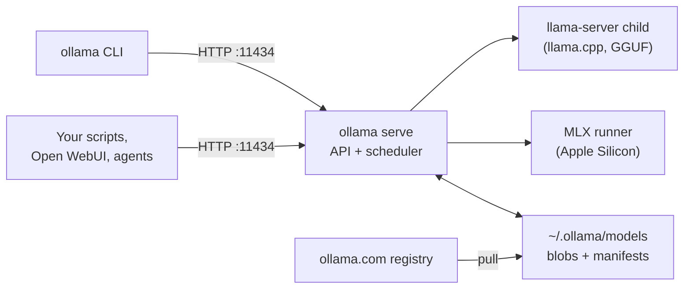

# Ollama from zero: install, run, inspect

Ollama is the other big way to run local models: a background server, a small CLI and a model registry, with no chat window in the way. You already know LM Studio; this lesson builds the same depth for Ollama, from the process layout down to reading every column of `ollama ps`, so that when you later compare the two you know exactly what you are measuring.

> [!GOALS]
> - Explain Ollama's moving parts (server, CLI, runners, registry, model store) and how a request flows through them
> - Install Ollama on macOS the right way for you, and know how the app and Homebrew installs differ for configuration
> - Use every everyday command: `pull`, `run`, `list`, `ps`, `show`, `stop`, `rm`, `cp`, `serve`
> - Read `ollama run --verbose` stats and `ollama ps` output and connect them to memory and speed
> - Decode Ollama library tags and quant names, and control thinking from the CLI

## What Ollama actually is

When you open LM Studio, you get one app that does everything: download, load, chat, serve. Ollama splits the same job into pieces that talk over HTTP, which is why security people tend to like it: every piece is visible and scriptable.

> [!CONCEPT] Ollama
> **Ollama** is an open-source (MIT) tool that runs language models locally. It has three parts: a **server** (`ollama serve`) that listens on `127.0.0.1:11434`, loads models and answers API requests; a **CLI** (`ollama`) that is just an HTTP client for that server; and a **registry** at ollama.com from which you `pull` packaged models, much like `docker pull` pulls images.

The Docker analogy is deliberate and mostly accurate. Models have names and tags (`qwen3.5:9b`), they are stored as content-addressed blobs plus manifests, you build your own from a recipe file (the **Modelfile**, next lesson), and you can push them to a registry. The analogy breaks in one place: a model is not a sandboxed process. It is data that a runner reads.

### The engines underneath (November 2026)

Like LM Studio, Ollama is mostly packaging around inference engines (see [The local AI ecosystem](#/using/ecosystem) for the map). What it uses changed a lot during 2026, so here is the current state, checked against Ollama's source and release notes for v0.40.x:

- **GGUF models run on llama.cpp.** The server starts the upstream `llama-server` program from llama.cpp as a child process for each loaded GGUF model. Ollama pins a specific llama.cpp build (the repo's `LLAMA_CPP_VERSION` file) and applies its own compatibility patches. The source comment is blunt: "All GGUF models are served via the upstream llama-server subprocess."
- **On Apple Silicon, MLX-format models run on Apple's MLX** through Ollama's own MLX runner. Since **v0.40.0** (September 2026), architectures the MLX runner supports run on MLX **by default** on Apple Silicon, and the release notes name `qwen3.5` among them.
- **Ollama's older in-house Go engine** (labelled `ggml` in manifests) has been phased out for GGUF: v0.40.2 upgrades older downloads in the background "for better performance and compatibility when running on llama.cpp".

So the folk wisdom "Ollama is just llama.cpp" is now half right: for a GGUF it literally runs llama.cpp's server, and for Ollama's own Qwen3.5 download on your Mac it probably runs MLX, which is a different engine with different speed and memory behavior. Keep that in mind; it matters a lot in [the benchmark lesson](#/ollama/tuning).

> [!NOTE]
> This is the fastest-moving part of the lesson. Check your own version with `ollama -v` and read the release notes at github.com/ollama/ollama/releases before trusting any engine claim, including this one.

### How a request flows



1. Something sends `POST /api/chat` (or `/v1/chat/completions`) to port 11434. The CLI does exactly this when you type into `ollama run`.
2. The **scheduler** checks whether the model is loaded. If not, it estimates memory, picks a runner, starts it, and waits for the weights to load.
3. The server renders your messages into the model's prompt format (its chat template, see [Base, instruct, thinking and chat templates](#/foundations/model-types)), forwards the request to the runner, and streams tokens back.
4. After the reply, a **keep-alive timer** starts. If nothing uses the model for 5 minutes (the default), the runner is stopped and its memory freed.

That last step is the first clue to your "Ollama uses less resources" observation: LM Studio keeps a model loaded until you eject it, while Ollama quietly unloads it after five idle minutes. Both are reasonable defaults; they just look very different in Activity Monitor.

## Installing on macOS

Ollama requires macOS Sonoma (14) or newer. There are two sensible installs, and the difference matters later when you configure the server.

| | Ollama app (recommended) | Homebrew formula |
|---|---|---|
| Get it | Download `Ollama.dmg` from ollama.com/download, drag to Applications (or `brew install --cask ollama-app`) | `brew install ollama` |
| What you get | Menu-bar app with a chat window and Settings, plus the `ollama` CLI linked into your PATH | CLI and server only, no GUI |
| Server starts | At login (registered as a login item) | `brew services start ollama`, or `ollama serve` by hand |
| Updates | Auto-downloads; menu bar "Restart to update" | `brew upgrade ollama` |
| Configure via | App Settings, plus `launchctl setenv` for other variables | Variables in the service definition, or your shell when running `ollama serve` |
| Logs | `~/.ollama/logs/server.log` (and `app.log`) | `$(brew --prefix)/var/log/ollama.log` |

> [!WARNING] Homebrew's service is not "default Ollama"
> The Homebrew formula's service definition sets `OLLAMA_FLASH_ATTENTION=1` and `OLLAMA_KV_CACHE_TYPE=q8_0`, which the app does not. That halves KV-cache memory compared with the app's `f16` default. Two people both "running Ollama" can therefore see different memory use for the same model. Note which install you have before comparing anything.

Pick one install and stick to it. Running the app and a Homebrew service at the same time means two servers fighting over port 11434.

> [!MAC]
> The app's Settings window exposes a few server options directly: **Expose Ollama to the network**, **Model location**, **Context length** (a slider from 4k to 256k) and cloud features. Under the hood the app passes these to the server as environment variables, and the app's values win over the same variables set with `launchctl`. If a setting "does nothing", check the app's Settings first. Everything else (flash attention, KV cache type, keep-alive) is set with `launchctl setenv`; the [tuning lesson](#/ollama/tuning) covers that properly.

Check the install:

```bash
ollama -v
curl -s http://localhost:11434/api/version
```

```text
ollama version is 0.40.16
{"version":"0.40.16"}
```

Your numbers will differ. If `curl` says "connection refused", the server isn't running: open the app, or start it with `ollama serve` in a separate terminal.

> [!NOTE]
> Ollama also offers **cloud models** (names ending in `-cloud`) that run on ollama.com after `ollama signin`. They look like local models in the CLI but your prompts leave the machine. For this course, keep everything local; the FAQ documents `OLLAMA_NO_CLOUD=1` (or `"disable_ollama_cloud": true` in `~/.ollama/server.json`) to switch cloud features off entirely.

## Where models live

On macOS everything is under `~/.ollama`:

```text
~/.ollama/
├── id_ed25519, id_ed25519.pub   # your Ollama key pair (used for ollama.com: push, private pulls, cloud)
├── logs/                        # server.log, app.log
└── models/
    ├── blobs/                   # content-addressed files: sha256-<64 hex chars>
    └── manifests/               # small JSON files: which blobs make up name:tag
```

> [!CONCEPT] Blobs and manifests
> A **blob** is a file named after the SHA-256 hash of its content: the weights, the vision projector, the parameters, the template, the license. A **manifest** is a small JSON document that lists which blobs make up a given `name:tag`. This is the same design as container images: two models built from the same weights share one weights blob on disk, and integrity is checked by hash.

Explore it:

```bash
du -sh ~/.ollama/models
ls -lhS ~/.ollama/models/blobs | head
find ~/.ollama/models/manifests -type f | head
```

You will see a few multi-gigabyte blobs (weights) and many tiny ones (params, template, license). The manifest path mirrors the name, under a registry host folder such as `registry.ollama.ai/library/qwen3.5/9b`.

Never edit or delete files in `blobs/` by hand. Use `ollama rm`, which removes the manifest and any blobs no other model uses. To move the store to an external SSD, set **Model location** in the app (or `OLLAMA_MODELS`); see [tuning](#/ollama/tuning).

> [!TIP]
> The key pair in `~/.ollama` identifies you to ollama.com. Treat `id_ed25519` like an SSH private key: don't sync it to a shared repo or back it up to somewhere public.

## Library tags and quant naming

The Ollama library (ollama.com/library) is Ollama's curated registry. Model names follow `namespace/model:tag`; official models have no namespace, and the tag defaults to `latest`. These are the 9B Qwen3.5 tags listed on ollama.com/library/qwen3.5/tags in November 2026:

| Tag | Format / runner | Listed size | Notes |
|---|---|---|---|
| `qwen3.5:9b` (also `latest`) | manifest list: MLX and llama.cpp | 6.6 GB to 7.6 GB | Ollama picks the variant for your machine |
| `qwen3.5:9b-q4_K_M` | GGUF | 6.6 GB | 5.6 GB Q4_K_M weights + 922 MB BF16 vision projector |
| `qwen3.5:9b-q8_0` | GGUF | 10 GB | 8-bit |
| `qwen3.5:9b-bf16` | GGUF | 19 GB | full precision; does not fit your Mac |
| `qwen3.5:9b-mtp-q4_K_M` | GGUF | 9.0 GB | includes the multi-token prediction (MTP) head for speculative decoding |
| `qwen3.5:9b-nvfp4` | MLX | 7.2 GB | 4-bit floating-point format |
| `qwen3.5:9b-mtp-nvfp4` | MLX | 7.6 GB | 4-bit with MTP |
| `qwen3.5:9b-mlx` | MLX | 8.9 GB | |
| `qwen3.5:9b-mxfp8` | MLX | 11 GB | 8-bit floating-point format |

> [!CONCEPT] Manifest list
> A **manifest list** is one tag that points at several builds of the same model, one per runner, like a multi-architecture Docker image. `qwen3.5:9b` contains an MLX build (7.6 GB, with MTP speculative decoding settings) and a llama.cpp build (6.6 GB, Q4_K_M plus vision projector). On Apple Silicon Ollama prefers the MLX build. You can force one with `ollama pull qwen3.5:9b --runner llamacpp` (the flag accepts `mlx`, `ggml` and `llamacpp`).

How to read the names:

- **`q4_K_M`, `q8_0`, `bf16`** are GGUF quantization types, exactly the ones you met in [Precision, quantization and file formats](#/foundations/quantization). `q4_K_M` here is the same kind of file as your LM Studio download.
- **`nvfp4`, `mxfp8`** are 4-bit and 8-bit *floating-point* block formats (originally from NVIDIA and the Open Compute Project). In this library they are MLX builds.
- **`mtp`** means the multi-token prediction head (part of Qwen3.5's architecture) is kept, so the runner can draft extra tokens cheaply and verify them. That is speculative decoding using the model itself, covered in [Sampling and inference settings](#/lmstudio/sampling-settings).
- **Listed size** is the whole download (weights plus projector and small files), in decimal GB. The 5.6 GB Q4_K_M weights match your LM Studio file (5.3 GiB is the same number in binary units).

> [!WARNING] Library qwen3.5 is not your HauhauCS model
> `qwen3.5:9b` is Alibaba's official instruct model, with its normal refusal behavior. Your LM Studio model is HauhauCS's uncensored fine-tune. They share architecture and size, which makes the library model a fine way to learn Ollama, but it is a different model. The [Modelfile lesson](#/ollama/modelfile) imports your actual HauhauCS GGUF from LM Studio's folder, and the [benchmark](#/ollama/tuning) uses that same file in both tools.

The library build also ships its own sampling defaults. The llama.cpp build of `qwen3.5:9b` carries `temperature 1`, `top_p 0.95`, `top_k 20` and `presence_penalty 1.5`, which is Qwen's thinking-mode general profile with Unsloth's anti-repetition advice. You will see them with `ollama show` in a moment.

## The core commands

All of these are thin wrappers around the HTTP API, which is why they work identically against a remote server (set `OLLAMA_HOST` in the client's environment to point the CLI elsewhere).

| Command | What it does |
|---|---|
| `ollama pull qwen3.5:9b` | Download (or update) a model; resumes if interrupted |
| `ollama run qwen3.5:9b` | Load if needed, then open an interactive chat |
| `ollama run qwen3.5:9b "prompt"` | One-shot: print the answer and exit (also reads stdin) |
| `ollama list` (or `ollama ls`) | Models on disk: name, ID, size, modified |
| `ollama ps` | Models loaded in memory right now |
| `ollama show qwen3.5:9b` | Architecture, context length, capabilities, parameters, license |
| `ollama stop qwen3.5:9b` | Unload now, without waiting for keep-alive |
| `ollama rm qwen3.5:9b` | Delete the model (unloads it first) |
| `ollama cp qwen3.5:9b my-qwen` | Copy under a new name (cheap: blobs are shared) |
| `ollama create name -f Modelfile` | Build a model from a recipe ([next lesson](#/ollama/modelfile)) |
| `ollama serve` | Run the server in the foreground (if the app or a service isn't already) |
| `ollama serve --help` | List every server environment variable with a one-line description |

Useful `ollama run` flags (from `ollama run --help` on v0.40):

| Flag | Effect |
|---|---|
| `--verbose` | Print timing statistics after every answer |
| `--think` | `true`/`false`, or a level such as `high`/`medium`/`low` for models that support levels |
| `--hidethinking` | Think, but don't print the reasoning |
| `--keepalive 30m` | How long to keep the model loaded after this session |
| `--format json` | JSON mode |
| `--runner llamacpp` | Choose a variant from a manifest list |
| `--nowordwrap` | Raw output, handy when piping |

`ollama show` has its own flags: `--modelfile`, `--parameters`, `--template`, `--system`, `--license` and `-v` (verbose, includes all metadata).

### One-shot use, Unix style

Because the CLI reads stdin, Ollama slots into pipelines the way `jq` does. Piped input is placed before the prompt argument, so phrase the instruction as coming after the data:

```bash
ollama run qwen3.5:9b --think=false "Summarize the notes above in 3 bullets." < ~/ai-lab/notes/recon-target-a.md
```

```bash
git diff | ollama run qwen3.5:9b --think=false "Review the diff above for security issues. Be terse."
```

## Reading `ollama run --verbose`

`--verbose` (or `/set verbose` inside a session) prints the server's own measurements after every answer:

```text
total duration:       14.21s
load duration:        3.02s
prompt eval count:    31 token(s)
prompt eval duration: 210ms
prompt eval rate:     147.62 tokens/s
eval count:           402 token(s)
eval duration:        10.95s
eval rate:            36.71 tokens/s
```

(Illustrative numbers. Yours depend on chip, runner and context.)

| Line | Meaning | Maps to |
|---|---|---|
| total duration | Wall time for the whole request on the server | |
| load duration | Time spent loading the model; near zero when already loaded | cold vs warm start |
| prompt eval count / duration / rate | Tokens of your rendered prompt processed, and how fast | **prefill** |
| prompt eval cached | Prompt tokens reused from the previous turn (shown only when non-zero) | prompt caching |
| eval count / duration / rate | Tokens generated, and how fast | **decode**, the tok/s you feel |

> [!CONCEPT] Prefill and decode, again
> **Prefill** reads your whole prompt in parallel; it is compute-bound and fast per token. **Decode** produces one token at a time and must read all the weights for each one; on a Mac it is limited by memory bandwidth. [How text gets generated](#/foundations/generation) explains why, and [Performance tuning](#/lmstudio/performance) computes your Air's decode ceiling (roughly bandwidth divided by bytes read per token).

Two traps when reading these numbers:

1. **Thinking tokens count as eval tokens.** A Qwen3.5 answer with 1,500 tokens of reasoning has a big eval count and a long eval duration, but the eval *rate* stays honest.
2. **The first request includes the load.** Always run a warm-up before you believe any speed number.

## Reading `ollama ps`

While a model is loaded (within the keep-alive window), `ollama ps` shows what is in memory:

```text
NAME          ID              SIZE      PROCESSOR    CONTEXT    RUNNER      UNTIL
qwen3.5:9b    fdf5fd4cd409    8.1 GB    100% GPU     4096       mlx         4 minutes from now
```

(Illustrative; your SIZE and RUNNER may differ.)

| Column | What it tells you |
|---|---|
| NAME, ID | Which model and which exact build (ID is a digest prefix) |
| SIZE | Ollama's estimate of the memory this loaded model occupies: weights, KV cache, projector and compute buffers. It is bigger than the file because of everything that isn't weights |
| PROCESSOR | `100% GPU` means everything is in Metal-accessible memory. A split like `48%/52% CPU/GPU` means some layers run on the CPU, which is much slower |
| CONTEXT | The context window (`num_ctx`) this model was loaded with, in tokens |
| RUNNER | Which engine runs it: `mlx`, `llamacpp` (or `ggml` for legacy builds) |
| UNTIL | When the keep-alive timer will unload it |

The CONTEXT column is the single most important number for your LM Studio comparison. Ollama's documented default context depends on detected GPU memory: **4k for under 24 GiB**, 32k for 24 to 48 GiB, 256k above that. Your 16 GB Air gets **4,096 tokens** unless you change it. LM Studio typically loads Qwen3.5 with a much larger context. At F16 the KV cache costs this model 32 KiB per token ([Memory math](#/foundations/memory-math)), so:

```text
4,096 tokens  × 32 KiB = 128 MiB of KV cache   (Ollama default on 16 GB)
32,768 tokens × 32 KiB = 1 GiB                 (a typical LM Studio setting)
```

That gap is about 0.9 GiB for this hybrid model. For a classic transformer like Qwen3-8B (144 KiB per token) the same comparison is 0.56 GiB versus 4.5 GiB, which is why "Ollama uses less RAM" became folklore. The flip side: 4k tokens is tight for a thinking model. Qwen3.5 can spend 2,000+ tokens reasoning, and once the window fills, Ollama has to shift or truncate older context, quietly losing parts of your conversation. Larger windows are a [tuning](#/ollama/tuning) decision, not a default to accept blindly.

> [!TIP]
> `ollama ps` is also your answer to "why is my Mac slow?" after you stopped using a model: if it's still listed, it's still in memory until UNTIL. `ollama stop <name>` frees it immediately.

## The interactive session

`ollama run <model>` drops you at a `>>>` prompt. Slash commands control the session (type `/?` for the list):

| Command | Effect |
|---|---|
| `/set parameter temperature 0.6` | Change a sampling parameter for this session (also `top_p`, `top_k`, `min_p`, `num_ctx`, `num_predict`, `repeat_penalty`, `repeat_last_n`, `seed`, `stop`, `num_gpu`) |
| `/set system "You are ..."` | Set the system prompt |
| `/set think`, `/set nothink` | Turn thinking on or off |
| `/set verbose`, `/set quiet` | Show or hide timing stats |
| `/set format json`, `/set noformat` | JSON mode on or off |
| `/show info`, `/show parameters`, `/show template`, `/show system`, `/show modelfile`, `/show license` | Inspect the loaded model |
| `/save my-session` | Save the conversation and settings as a new model you can `run` later |
| `/load <model>` | Switch model or load a saved session |
| `/clear` | Forget the conversation so far |
| `/bye` | Exit (or <kbd>Ctrl</kbd>+<kbd>D</kbd>) |

Wrap multi-line input in triple quotes:

```text
>>> """Here is a log excerpt:
... 10.0.0.5 - - [03/Nov/2026] "GET /admin HTTP/1.1" 403
... What stands out?"""
```

> [!WARNING]
> `/set parameter num_ctx 32768` reloads the model, because context size is a load-time setting (Ollama's source calls these "runner options which must be set when the model is loaded"). Sampling parameters like temperature apply instantly. This is the same split as LM Studio's load settings versus inference settings ([Load settings](#/lmstudio/load-settings)).

### Thinking control

Qwen3.5 can reason in a hidden scratchpad before answering ([Base, instruct, thinking and chat templates](#/foundations/model-types)). Ollama separates that reasoning from the answer: the API returns it in a `thinking` field rather than inline `<think>` tags, and the CLI prints it in a separate block.

Ways to control it:

```bash
ollama run qwen3.5:9b --think=false "What port does SMB use?"
ollama run qwen3.5:9b --think=true --hidethinking "Plan a recon checklist for a small web app."
```

Inside a session: `/set think` and `/set nothink`. Over the API: the `think` field, which accepts `true`, `false`, or a level string such as `"high"` for models that define levels ([API lesson](#/ollama/api-integration)).

To see what a model supports and its default, ask the server:

```bash
curl -s http://localhost:11434/api/show -d '{"model":"qwen3.5:9b"}' | python3 -c 'import sys,json; d=json.load(sys.stdin); print(d.get("capabilities")); print(d.get("thinking"))'
```

The documented `thinking` object has `values` (for example `[true, false]` or named levels) and `default`. If it is missing, the model has no thinking metadata and behaves as its template dictates. The course guide notes that sources disagree on whether Qwen3.5 9B thinks by default; this command settles it for your exact build.

## Inspecting a model with `ollama show`

```bash
ollama show qwen3.5:9b
```

The output has sections for the model (architecture `qwen35`, parameter count about 9B, context length 262,144, quantization), capabilities (for example completion, vision, tools, thinking), the stored parameters, and the license. Since v0.40.7 it also reports which **renderer and parser** the model uses and where its chat template comes from. That last detail becomes important when you import your own GGUF.

```bash
ollama show qwen3.5:9b --parameters
ollama show qwen3.5:9b --modelfile | head -30
```

`--modelfile` prints a Modelfile that would rebuild this model: a `FROM` line pointing at the weights blob, plus `TEMPLATE`, `PARAMETER` and `LICENSE` lines. It is the fastest way to learn how a model is packaged, and the starting point of the [next lesson](#/ollama/modelfile).

> [!LAB] Install, pull, run and watch
> Goal: get Ollama running, load Qwen3.5 9B, and connect what the CLI reports to what macOS sees.
>
> 1. **Make room.** Quit LM Studio entirely (menu bar icon, Quit) so the two don't compete for memory. Check you start clean:
>
> ```bash
> memory_pressure | tail -1
> ```
>
> 2. **Install** the app from ollama.com/download (or `brew install --cask ollama-app`), open it once, and confirm:
>
> ```bash
> ollama -v
> curl -s http://localhost:11434/api/version
> ```
>
> 3. **Pull** the model and look at what landed on disk:
>
> ```bash
> ollama pull qwen3.5:9b
> ollama list
> du -sh ~/.ollama/models
> ```
>
> 4. **Inspect** before you run: `ollama show qwen3.5:9b` and `ollama show qwen3.5:9b --parameters`. Write down the architecture, context length, capabilities and stored sampling parameters.
> 5. **Open Activity Monitor**, Memory tab, sort by Memory, and keep the Memory Pressure graph visible.
> 6. **Run with stats**, first with thinking off:
>
> ```bash
> ollama run qwen3.5:9b --verbose --think=false "Explain the difference between a reflected and a stored XSS in 150 words."
> ```
>
> Note load duration (first run), prompt eval rate and eval rate. Run the exact command again: load duration should drop to near zero.
> 7. **Read `ollama ps`** in a second terminal while the model is loaded. Record SIZE, PROCESSOR, CONTEXT, RUNNER and UNTIL. In Activity Monitor, find the `ollama` processes (the server and its runner child) and note their memory.
> 8. **Thinking on:** repeat step 6 with `--think=true`. Compare eval count and total duration. How many tokens did it spend thinking?
> 9. **Watch it unload:** wait 5 minutes without using the model (or run `ollama stop qwen3.5:9b`), then run `ollama ps` again and look at Activity Monitor. That memory drop is the keep-alive default at work.
> 10. **Optional, if disk allows (about 6.6 GB):** pull the llama.cpp variant with `ollama pull qwen3.5:9b --runner llamacpp`, run it with `ollama run qwen3.5:9b --runner llamacpp --verbose --think=false` and the same prompt, and compare eval rate and RUNNER. You are now comparing MLX against llama.cpp inside the same tool.
>
> Save your numbers in `~/ai-lab/ollama/NOTES.md`; the [tuning lab](#/ollama/tuning) builds on them.

> [!MAC]
> Activity Monitor's Memory column for the runner may look smaller than `ollama ps` SIZE. Weights that are memory-mapped from disk can be accounted as file cache rather than app memory, and GPU allocations show up as wired memory in the bottom panel. For honest comparisons, watch **Memory Used**, **Wired Memory** and **Memory Pressure** at the bottom of the Memory tab, not one process's number. The tuning lesson's benchmark measures system-wide memory for this reason.

## Recap

- Ollama is a server (`ollama serve` on `127.0.0.1:11434`), a CLI that is an HTTP client, and a registry of packaged models stored as hashed blobs plus manifests in `~/.ollama/models`.
- In v0.40.x, GGUF models run on llama.cpp's `llama-server` as a child process, and on Apple Silicon supported models (including `qwen3.5`) run on MLX by default. "Ollama vs LM Studio" can therefore mean MLX vs llama.cpp, not just two wrappers around one engine.
- The app and the Homebrew formula differ: the app is configured via its Settings and `launchctl setenv`; Homebrew's service enables flash attention and a Q8_0 KV cache by default.
- `qwen3.5:9b` is a manifest list (MLX and llama.cpp builds); `--runner` selects one. Library Qwen3.5 is the official model, not your HauhauCS fine-tune.
- `ollama run --verbose` gives prefill (prompt eval) and decode (eval) rates; `ollama ps` shows size, CPU/GPU split, context, runner and unload time.
- Defaults explain much of the "lighter" feel: a 4k context on 16 GB machines and a 5-minute keep-alive.

## Check yourself

1. You run `ollama ps` and see `PROCESSOR 35%/65% CPU/GPU`. What does that mean for speed, and what are two likely causes on a 16 GB Mac?
   <details><summary>Answer</summary>

   About a third of the model's layers run on the CPU instead of the GPU, so decode will be much slower than `100% GPU`. Likely causes: the requested context (KV cache) plus weights exceed what Metal is allowed to wire, often because another model is still loaded or `num_ctx` was raised a lot; or other apps (Docker, browsers) leave too little free memory. Fix by unloading other models (`ollama stop`), lowering the context, or quantizing the KV cache ([tuning](#/ollama/tuning)).

   </details>
2. A colleague says "Ollama and LM Studio both run llama.cpp, so speed differences must be configuration." Is that right for `ollama run qwen3.5:9b` on your Mac?
   <details><summary>Answer</summary>

   Not necessarily. On Apple Silicon, since v0.40.0, Ollama runs supported architectures including `qwen3.5` on MLX by default, and the MLX build of `qwen3.5:9b` uses the model's MTP head for speculative decoding. LM Studio's GGUF engine is llama.cpp. Check the RUNNER column in `ollama ps`. To compare like with like, use `--runner llamacpp` or import the same GGUF file into both tools.

   </details>
3. `ollama run` answers a first question in 14 s and the identical second question in 10 s. `--verbose` shows the same eval rate both times. Where did the 4 seconds go?
   <details><summary>Answer</summary>

   Model loading. The first request's `load duration` included reading weights into memory and starting the runner; the second found the model already loaded (within the keep-alive window). Always warm up before measuring.

   </details>
4. Why does `/set parameter num_ctx 16384` pause for a few seconds while `/set parameter temperature 0.6` is instant?
   <details><summary>Answer</summary>

   Context size is a load-time (runner) option: the KV cache is allocated when the model loads, so changing it means reloading the model. Temperature is applied per request during sampling, so nothing has to be reloaded.

   </details>
5. Where would you look to find out whether your installed Qwen3.5 build thinks by default, and how would you turn thinking off for one command?
   <details><summary>Answer</summary>

   `POST /api/show` returns a `thinking` object with the supported `values` and the `default` (and `ollama show` lists the thinking capability). For one command, use `ollama run qwen3.5:9b --think=false "..."`; inside a session, `/set nothink`.

   </details>

## Go deeper
- [Ollama documentation](https://docs.ollama.com) — official docs: quickstart, CLI, FAQ, API and capabilities; check here when a command changes.
- [Ollama FAQ](https://docs.ollama.com/faq) — configuration, storage paths, keep-alive, concurrency, flash attention and KV cache quantization in one page.
- [Context length](https://docs.ollama.com/context-length) — the VRAM-based default and how to change it.
- [Ollama releases](https://github.com/ollama/ollama/releases) — the only reliable record of engine changes such as the MLX default and the llama-server switch.
- [qwen3.5 in the Ollama library](https://ollama.com/library/qwen3.5) — every tag, its size, runner and stored parameters.
