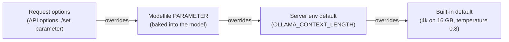
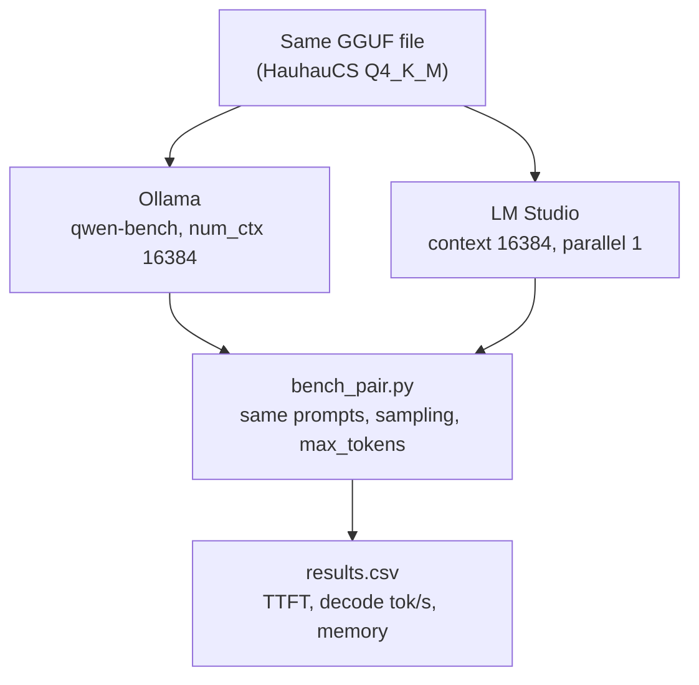

# Server tuning and a fair benchmark vs LM Studio

You've noticed that Ollama feels lighter than LM Studio on your Air. That might be true, and this lesson takes it seriously. But a lot of what makes Ollama *look* lighter is defaults: a small context window, models that unload themselves, no desktop UI, and sometimes a different engine altogether. Here you learn every server setting that affects memory and speed, set them correctly on macOS, and then run one benchmark script against both tools with the same file, context, quantization and sampling, so the numbers answer the question instead of the defaults.

> [!GOALS]
> - Know every Ollama server environment variable that matters on a Mac, with its current default and its memory or speed cost for your model
> - Set variables correctly for the menu-bar app, for `ollama serve`, and for the Homebrew service, and verify what the server actually picked up
> - Understand the precedence between request options, Modelfile parameters and environment defaults
> - Plan memory on 16 GB when Ollama shares the machine with agents, Docker and Burp
> - Run a fair Ollama vs LM Studio benchmark (TTFT, decode tok/s, memory, N runs) and interpret it honestly

## Why Ollama looks lighter: the usual suspects

Before measuring anything, list what differs by default. Each item is a real reason for lower memory or a snappier feel, and none of them is "a better engine":

| Difference | Ollama default | LM Studio default | Effect |
|---|---|---|---|
| Context window | 4,096 tokens on machines with under 24 GiB of GPU memory | 8K for new loads since 0.4.16; your saved per-model setting (the course recommends 32K) | 128 MiB vs 1 GiB of KV cache for your model at F16 |
| Idle behavior | Unload after 5 minutes (`OLLAMA_KEEP_ALIVE=5m`) | Stays loaded until ejected (JIT-loaded API models use an idle TTL) | Ollama often holds zero model memory when you check |
| Memory locking | Not locked by default | Keep Model in Memory (mlock) on | Locked pages show as wired and can't be compressed |
| Parallel slots | 1 (`OLLAMA_NUM_PARALLEL`) | Max Concurrent Predictions 4 | ~150 MiB more recurrent state in LM Studio for this model |
| UI | Optional small app; server is headless | Full desktop app with a renderer process | Hundreds of MB that aren't the model |
| Engine for `qwen3.5:9b` | MLX on Apple Silicon (since v0.40.0), with MTP speculative decoding | llama.cpp for GGUF; MLX only if you load an MLX build | A different engine, quant and decoding method |
| KV cache type (Homebrew service) | Homebrew's service sets `q8_0` and flash attention on | F16 unless you change it | Half the KV memory |

So "Ollama is lighter" can be true for at least five reasons that have nothing to do with code quality. The benchmark later in this lesson removes each one, so whatever difference remains is real. And it may well remain: Ollama ships a recent llama.cpp and an actively tuned MLX runner, and a newer engine build can genuinely be faster.

> [!NOTE]
> Remember from [the basics lesson](#/ollama/basics) what Ollama runs today: GGUF files on llama.cpp's `llama-server` (Ollama pins its own build), and supported models such as the library `qwen3.5` on MLX by default on Apple Silicon. LM Studio's GGUF engine is also llama.cpp, in its own build. Same family, different versions and defaults.

## Every server variable that matters

The authoritative list for your version is one command away:

```bash
ollama serve --help
```

The table below is from the v0.40 source and the official FAQ (November 2026). Costs use your model's numbers from [Memory math](#/foundations/memory-math): weights 5.24 GiB (Q4_K_M), KV cache 32 KiB per token at F16, about 50 MiB of Gated DeltaNet state per parallel slot.

| Variable | Default | What it controls | Cost or effect for you |
|---|---|---|---|
| `OLLAMA_CONTEXT_LENGTH` | 4k / 32k / 256k by GPU memory (<24 / 24 to 48 / >=48 GiB): **4,096** on your Air | Default `num_ctx` when neither the request nor the Modelfile sets one | +32 KiB per token at F16: 16K = 0.5 GiB, 32K = 1 GiB |
| `OLLAMA_FLASH_ATTENTION` | auto: on when the backend supports it | Force flash attention on (`1`) or off (`0`) | Exact, saves memory; required for KV quantization ([Load settings](#/lmstudio/load-settings)) |
| `OLLAMA_KV_CACHE_TYPE` | `f16` | KV cache precision: `f16`, `q8_0` (~1/2 memory), `q4_0` (~1/4). Global for all models; needs flash attention | 32K context: 1 GiB at f16, ~0.53 GiB at q8_0 |
| `OLLAMA_KEEP_ALIVE` | `5m` | Idle time before unloading; `-1` = never, `0` = right after each response | Trades idle memory for reload time (several seconds) |
| `OLLAMA_NUM_PARALLEL` | `1` | Concurrent requests per model | Memory scales with parallel × context: 2 slots at 16K = a 32K cache plus one more DeltaNet state |
| `OLLAMA_MAX_LOADED_MODELS` | 3 per GPU (3 for CPU) | How many different models may be loaded at once, if they fit | On 16 GB, two 9B models is already swap territory |
| `OLLAMA_MAX_QUEUE` | `512` | Requests waiting before the server returns 503 | Irrelevant for one user; matters for agents fanning out |
| `OLLAMA_HOST` | `127.0.0.1:11434` | Bind address and port | `0.0.0.0` exposes an unauthenticated API to your network ([security](#/ollama/api-integration)) |
| `OLLAMA_ORIGINS` | 127.0.0.1 and 0.0.0.0 origins allowed | Extra browser origins allowed (CORS), comma-separated | Don't set `*`: any web page could then call your model |
| `OLLAMA_MODELS` | `~/.ollama/models` | Model store location | Move to an external SSD to save internal disk |
| `OLLAMA_DEBUG` | off (INFO) | `1` = debug logs, `2` = trace | Shows load decisions and memory estimates in `server.log` |
| `OLLAMA_LOAD_TIMEOUT` | `5m` | How long a stalled load may take before giving up | Raise only for very slow external disks |
| `OLLAMA_GPU_OVERHEAD` | `0` | Bytes of GPU memory to leave unused per GPU | A blunt way to keep headroom for other GPU apps |
| `OLLAMA_LLM_LIBRARY` | auto | Force a specific backend library, bypassing autodetection | Leave unset on a Mac |
| `OLLAMA_NO_CLOUD` | off | `1` disables cloud models and web search | Recommended for a local-only setup |
| `OLLAMA_NOPRUNE` | off | Don't prune unused blobs at startup | Leave off |
| `OLLAMA_DEBUG_LOG_REQUESTS` | off | Write request bodies and replay commands to a temp directory | **Logs your prompts to disk.** Debug only, then delete the files |

> [!WARNING] Variables that no longer exist
> Older guides mention `OLLAMA_NEW_ENGINE` to opt into Ollama's own Go engine. It is not in v0.40's variable list: GGUF models now always run through `llama-server`, and MLX is chosen automatically on Apple Silicon. If a blog post's variable doesn't appear in `ollama serve --help`, it does nothing on your version.

> [!CONCEPT] Keep-alive
> **Keep-alive** is how long a loaded model stays in memory after its last request. Loading the HauhauCS Q4_K_M from an internal SSD takes a few seconds; keeping it loaded costs about 6 GiB of RAM the whole time. Ollama's 5-minute default is a compromise for laptops. LM Studio's equivalents are the idle TTL and auto-evict described in [Local server, API and the lms CLI](#/lmstudio/server-api).

### The memory picture for your model

Put the variables together for the HauhauCS Q4_K_M:

```text
Total ≈ weights + KV cache + DeltaNet state × slots + compute buffers (+ projector if vision)

weights (Q4_K_M)              5.24 GiB    fixed
KV cache                      32 KiB × num_ctx × num_parallel at f16  (× ~0.53 at q8_0, × ~0.28 at q4_0)
DeltaNet state                ~50 MiB per parallel slot
compute buffers               a few hundred MiB (grows with num_batch)
vision projector (optional)   ~0.9 GB BF16
```

| num_ctx (1 slot) | KV at f16 | KV at q8_0 | KV at q4_0 | Rough total at f16 |
|---|---|---|---|---|
| 4,096 (Ollama default) | 0.13 GiB | 0.07 GiB | 0.04 GiB | ~5.7 GiB |
| 16,384 | 0.5 GiB | 0.27 GiB | 0.14 GiB | ~6.1 GiB |
| 32,768 | 1 GiB | 0.53 GiB | 0.28 GiB | ~6.6 GiB |
| 65,536 | 2 GiB | 1.06 GiB | 0.56 GiB | ~7.6 GiB |
| 131,072 | 4 GiB | 2.1 GiB | 1.1 GiB | ~9.6 GiB |

(q8_0 stores 32 values in 34 bytes and q4_0 in 18 bytes, hence the 0.53 and 0.28 factors. "Rough total" adds ~0.3 GiB for buffers and state.)

The important lesson for the benchmark: because only 8 of this model's 32 layers keep a KV cache, the context difference between Ollama's 4K default and LM Studio's 32K is under 1 GiB. For a classic transformer like Qwen3-8B (144 KiB per token) the same gap is about 4 GiB, which is where the "Ollama is so much lighter" reputation was born.

Play with the numbers yourself (it's preset to your model and Mac):

<div data-widget="memory"></div>

> [!MAC]
> Every number above has to fit under macOS's GPU wired-memory limit, roughly two-thirds of 16 GB (~10.7 GiB), alongside everything else you run. Both of Ollama's engines (llama.cpp and MLX) use Metal, so the limit applies to both. Raising it with `sysctl iogpu.wired_limit_mb` is covered, with caveats, in [Performance tuning](#/lmstudio/performance).

## Setting variables on macOS

How you set a variable depends on how the server was started. Getting this wrong is the number one "my setting does nothing" cause.

### The menu-bar app

The app starts `ollama serve` itself, passing on the environment it got from `launchd`. Use `launchctl setenv`, then quit and reopen the app:

```bash
launchctl setenv OLLAMA_FLASH_ATTENTION 1
launchctl setenv OLLAMA_KV_CACHE_TYPE q8_0
launchctl setenv OLLAMA_KEEP_ALIVE 10m
launchctl setenv OLLAMA_NO_CLOUD 1
```

Then menu bar icon, **Quit Ollama**, and open it again from Applications. Check what you set with `launchctl getenv OLLAMA_KV_CACHE_TYPE`; remove a value with `launchctl unsetenv OLLAMA_KV_CACHE_TYPE`.

Two app-specific rules, confirmed in the app's source:

- **The app's Settings win.** If you set Context length, Model location or "Expose Ollama to the network" in the app, it passes `OLLAMA_CONTEXT_LENGTH`, `OLLAMA_MODELS` or `OLLAMA_HOST=0.0.0.0` to the server, overriding your `launchctl` values for those keys. Set context in the app's slider or in `launchctl`, not both.
- **`launchctl setenv` doesn't survive a reboot.** To make it permanent, have `launchd` run it at login with a small user agent:

```text title="~/Library/LaunchAgents/local.ollama-env.plist"
<?xml version="1.0" encoding="UTF-8"?>
<!DOCTYPE plist PUBLIC "-//Apple//DTD PLIST 1.0//EN" "http://www.apple.com/DTDs/PropertyList-1.0.dtd">
<plist version="1.0">
<dict>
  <key>Label</key><string>local.ollama-env</string>
  <key>ProgramArguments</key>
  <array>
    <string>/bin/sh</string><string>-c</string>
    <string>launchctl setenv OLLAMA_FLASH_ATTENTION 1; launchctl setenv OLLAMA_KV_CACHE_TYPE q8_0; launchctl setenv OLLAMA_KEEP_ALIVE 10m; launchctl setenv OLLAMA_NO_CLOUD 1</string>
  </array>
  <key>RunAtLoad</key><true/>
</dict>
</plist>
```

```bash
launchctl load ~/Library/LaunchAgents/local.ollama-env.plist
```

The Ollama app also starts at login, so on some boots it can start before this agent runs. If a setting is missing after a reboot, quit and reopen the app once.

### `ollama serve` in a terminal

Best for experiments and benchmarks, because the variables are right there on the command line and the logs scroll in front of you. Quit the app first (otherwise port 11434 is taken):

```bash
OLLAMA_CONTEXT_LENGTH=16384 OLLAMA_FLASH_ATTENTION=1 OLLAMA_KV_CACHE_TYPE=f16 ollama serve
```

<kbd>Ctrl</kbd>+<kbd>C</kbd> stops it. Nothing persists, which is exactly what you want while testing.

### The Homebrew service

`brew services start ollama` runs the formula's service definition, which sets `OLLAMA_FLASH_ATTENTION=1` and `OLLAMA_KV_CACHE_TYPE=q8_0` and logs to `$(brew --prefix)/var/log/ollama.log`. Variables defined there override anything else for those two keys. For other variables, `launchctl setenv` followed by `brew services restart ollama` works the same way as for the app. Don't hand-edit the generated plist in `~/Library/LaunchAgents/homebrew.mxcl.ollama.plist`: Homebrew rewrites it. If you need full control, stop the service and run `ollama serve` yourself.

### Always verify what the server actually loaded

At startup the server logs its whole configuration on one line. Read it instead of trusting your memory:

```bash
grep "server config" ~/.ollama/logs/server.log | tail -1 | tr ' ' '\n' | grep -E "OLLAMA_(CONTEXT_LENGTH|FLASH_ATTENTION|KV_CACHE_TYPE|KEEP_ALIVE|NUM_PARALLEL|MAX_LOADED_MODELS|HOST)"
```

(For the Homebrew service, grep `$(brew --prefix)/var/log/ollama.log` instead; for `ollama serve` in a terminal, it's printed on screen.) Then load a model and confirm the context with `ollama ps`. For the KV cache type and flash attention on the llama.cpp runner, set `OLLAMA_DEBUG=1` once and look for the `llama-server` launch arguments (`--cache-type-k`, `--flash-attn`) in the log. If you use the MLX runner, check the log too: don't assume every llama.cpp-oriented variable applies to MLX.

## Precedence: which value wins

Settings come from four places. For any option, the most specific one wins:



Examples:

- `OLLAMA_CONTEXT_LENGTH=32768`, but your `qwen-sec` Modelfile has `PARAMETER num_ctx 16384`: `qwen-sec` loads with 16,384. A raw library model without `num_ctx` loads with 32,768.
- A request with `"options": {"num_ctx": 8192}` beats both, and causes a reload if the model was loaded with a different context.
- `keep_alive` in a request beats `OLLAMA_KEEP_ALIVE`.
- Clients you don't control can override you: Open WebUI's per-model `num_ctx` setting is sent on every request when set, and its docs warn that the control pre-fills a small 2048. If a model seems to forget things through Open WebUI, check there first.

The OpenAI-compatible `/v1` endpoint cannot send `num_ctx`, `top_k` or `min_p`, so for `/v1` clients the Modelfile is the place for those ([API lesson](#/ollama/api-integration)).

## Recommended settings for a 16 GB Air

These are recommendations for your machine and this model, not official defaults:

| Setting | Daily driver | Long documents or long thinking | Why |
|---|---|---|---|
| Context | 16,384 baked into your models (or `OLLAMA_CONTEXT_LENGTH=16384`) | 65,536 | 4K is too short for thinking mode; 16K costs only 0.5 GiB here |
| `OLLAMA_FLASH_ATTENTION` | `1` | `1` | Exact and memory-saving; makes KV quantization possible |
| `OLLAMA_KV_CACHE_TYPE` | `f16` | `q8_0` | At 16K the saving is 0.25 GiB, not worth any quality risk; at 64K+ it saves 1 GiB or more |
| `OLLAMA_KEEP_ALIVE` | `10m` | `-1` during a session, then `ollama stop` | Fewer reloads without pinning 6 GiB all day |
| `OLLAMA_NUM_PARALLEL` | `1` | `1` | Each slot multiplies context memory |
| `OLLAMA_MAX_LOADED_MODELS` | `2` (chat model + small embedding model) | `1` | Prevents a second 9B model from pushing you into swap |
| `OLLAMA_HOST` | `127.0.0.1:11434` (default) | same | Never expose without a proxy and auth |
| `OLLAMA_NO_CLOUD` | `1` | `1` | Keeps everything local |

> [!WARNING] KV quantization is global
> `OLLAMA_KV_CACHE_TYPE` applies to every model the server loads. The FAQ notes that models with many query heads per KV head can lose more precision from cache quantization; Qwen3.5 uses 16 query heads over 4 KV heads. If you switch to `q8_0`, re-run a few of your eval prompts ([Benchmarks and your own evals](#/models/evaluate)) rather than assuming it's free.

### Sharing 16 GB with agents, Docker and Burp

A realistic hunting session on your Air: an agent loop calling the model, a couple of Docker containers (a target lab, maybe Open WebUI), Burp Suite, a browser. Budget it before it budgets you:

```text
macOS + browser + editor         ~4-5 GB
Docker Desktop VM                whatever its Resources limit is (it reserves memory up front)
Burp Suite (JVM)                 1-2+ GB depending on project size and its memory setting
Ollama: HauhauCS Q4_K_M @ 16K    ~6.1 GiB
-----------------------------------------------
Already ~12-14 GB before the target app does anything
```

Strategy that works on 16 GB:

1. **Cap Docker.** Set Docker Desktop's memory limit to what your containers actually need (often 3 to 4 GB for a small lab). Don't run Ollama inside Docker on a Mac: Docker Desktop has no GPU passthrough on macOS, so it would run on the CPU. Run Ollama natively and point containers at `http://host.docker.internal:11434`.
2. **Pin the model during the session, free it after.** Start the session with `keep_alive: -1` (or `ollama run qwen-sec --keepalive -1 ""` to preload), so the agent never pays reload stalls. When you stop hunting: `ollama stop qwen-sec`.
3. **One model at a time.** `OLLAMA_MAX_LOADED_MODELS=1` (or 2 with a tiny embedding model). Make your agent's variants share one GGUF and one `num_ctx` so switching doesn't reload ([Modelfiles](#/ollama/modelfile)).
4. **Watch pressure, not just "used".** `memory_pressure | tail -1` and `sysctl vm.swapusage`; any swap during inference collapses decode speed.
5. **If pressure goes yellow,** in order: lower context, switch KV to `q8_0`, close the browser, shrink Docker. Moving to a smaller quant is the last resort.

## The fair benchmark

Now the experiment. The goal is to answer one question at a time:

1. **Same file, same settings:** with the identical HauhauCS Q4_K_M GGUF, the same context, KV type, flash attention, parallel slots and sampling, which tool is faster and which uses less memory? This isolates the wrapper and the engine build.
2. **Best of each (optional):** Ollama's library `qwen3.5:9b` on MLX against LM Studio's best option for you. Legitimate, but it compares engines and quantizations, not wrappers. Label it as such.



### Controls: make the two sides identical

| Control | Ollama | LM Studio |
|---|---|---|
| Weights | `FROM` the GGUF in `~/.lmstudio/models/...` | The same file |
| Context | `PARAMETER num_ctx 16384` | Context Length 16384 |
| Parallel slots | `OLLAMA_NUM_PARALLEL=1` | Max Concurrent Predictions 1 (`--parallel 1`) |
| Flash attention | `OLLAMA_FLASH_ATTENTION=1` | On |
| KV cache | `OLLAMA_KV_CACHE_TYPE=f16` | F16 / F16 |
| GPU | 100% GPU (check `ollama ps`) | GPU Offload MAX |
| `top_k`, `min_p`, repeat penalty | Baked in: 20, 0, 1.0 | `top_k` and `repeat_penalty` sent by the script; set **Min P = 0** in the model's settings (LM Studio may ignore `min_p` on `/v1`) |
| temperature, top_p, presence penalty, seed, max_tokens | Sent by the script | Sent by the script |
| Prompt template | Embedded GGUF template (check `ollama show`) | Embedded GGUF template |
| Other app | LM Studio quit | Ollama quit (menu bar, Quit) |

Two subtle controls the script handles for you:

- **Prompt caching.** Both servers reuse work when a new prompt starts with the same tokens as the last one, which would make runs 2+ look impossibly fast. The script puts a random run ID at the very start of every prompt so every run pays full prefill.
- **Equal output length.** Thinking models can spend very different numbers of tokens. The script uses a prompt that wants about 600 words and caps `max_tokens`, so both sides should hit the cap and decode the same number of tokens. It records `completion_tokens` so you can confirm.

> [!CONCEPT] TTFT and decode rate
> **Time to first token (TTFT)** is the delay from sending the request to receiving the first generated token: mostly prefill, plus scheduling and any loading. **Decode rate** is generated tokens per second after the first one, the speed you watch text appear. The script computes decode rate as (completion tokens − 1) ÷ (time of last token − time of first token), and an approximate prefill rate as prompt tokens ÷ TTFT. Both ideas are explained in [Performance tuning](#/lmstudio/performance).

### Measuring memory honestly on a Mac

Process memory on macOS is slippery. Weights that are memory-mapped from the GGUF can be counted as file cache instead of process memory; GPU allocations are **wired** memory; Activity Monitor's per-process "Memory" column is a different metric (the physical footprint) from the RSS that tools like `ps` report. A tool can look lighter in one column while using the same RAM.

So the script records three things, sampled four times a second:

- **System used** (total − available, from `psutil`): what the whole machine is using. The most honest single number.
- **Wired** (from `psutil`, macOS only): memory pinned for the GPU and kernel. Model weights and KV cache on Metal show up here.
- **Process RSS** of the server processes it can find by name: useful, but treat it as a lower bound.

It takes an idle baseline before the model loads, so "peak minus baseline" is the cost of loading and running the model. For the app's own overhead, compare the baseline with a reading taken when neither app is running (`bench_pair.py idle`). Cross-check one run with Activity Monitor's Memory tab (Memory Used, Wired Memory, Memory Pressure).

> [!LAB] Run the fair benchmark and record it
> 1. **Set up** the workspace:
>
> ```bash
> mkdir -p ~/ai-lab/ollama/bench && cd ~/ai-lab/ollama/bench
> python3 -m venv .venv && source .venv/bin/activate
> pip install openai psutil
> ```
>
> 2. **Create the Ollama benchmark model** from the same GGUF (sampling values are the non-thinking general profile):
>
> ```bash
> GGUF="$HOME/.lmstudio/models/HauhauCS/Qwen3.5-9B-Uncensored-HauhauCS-Aggressive/Qwen3.5-9B-Uncensored-HauhauCS-Aggressive-Q4_K_M.gguf"
> printf 'FROM %s\nPARAMETER num_ctx 16384\nPARAMETER top_k 20\nPARAMETER min_p 0\nPARAMETER repeat_penalty 1.0\n' "$GGUF" > Modelfile.bench
> ollama create qwen-bench -f Modelfile.bench
> ```
>
> 3. **Configure LM Studio** for the same file: in the model's settings (My Models, gear) set Flash Attention on, K and V cache F16, Min P 0. Find its key with `lms ls`.
> 4. **Prepare the machine:** plugged in, Low Power Mode off (`pmset -g | grep -i lowpowermode`), lid open on a hard surface, browser and Docker closed. Record `python3 bench_pair.py idle` with **both apps quit**.
> 5. **Ollama run A.** Quit LM Studio completely. Quit the Ollama app and start a controlled server in another terminal:
>
> ```bash
> OLLAMA_FLASH_ATTENTION=1 OLLAMA_KV_CACHE_TYPE=f16 OLLAMA_NUM_PARALLEL=1 OLLAMA_KEEP_ALIVE=10m ollama serve
> ```
>
> Then, in the bench terminal (model not yet loaded, so the baseline is clean):
>
> ```bash
> python3 bench_pair.py run --target ollama --model qwen-bench --label ollama-gguf-16k --runs 5
> ollama ps   # confirm CONTEXT 16384, 100% GPU, RUNNER llamacpp
> ```
>
> 6. Stop that server (<kbd>Ctrl</kbd>+<kbd>C</kbd>) and **cool down 5 minutes**.
> 7. **LM Studio run B.** Open LM Studio, make sure no model is loaded, start the server (`lms server start`), and let the script load the model after taking the baseline:
>
> ```bash
> python3 bench_pair.py run --target lmstudio --model qwen-bench --label lms-gguf-16k --runs 5 \
>   --load-cmd "lms load <model key> --context-length 16384 --gpu max --parallel 1 --identifier qwen-bench -y"
> ```
>
> 8. Cool down, then repeat **B then A** (so the order is A B B A, which cancels slow thermal drift). Eject the LM Studio model (`lms unload --all`) and quit LM Studio before the second Ollama run.
> 9. **Long-prompt variant:** repeat one A and one B with `--prompt long` (about 8K prompt tokens) to compare prefill.
> 10. **Summarize:** `python3 bench_pair.py summary` prints a Markdown table. Paste it into `~/ai-lab/ollama/NOTES.md` with your chip, macOS version, Ollama version (`ollama -v`) and LM Studio runtime version.
> 11. **Optional "best of each":** `ollama pull qwen3.5:9b` (MLX on your Mac), run with `--model qwen3.5:9b --label ollama-mlx-default`, and compare with LM Studio running an MLX build if you have one. Label it clearly as an engine comparison.

```python title="bench_pair.py"
#!/usr/bin/env python3
"""Fair speed and memory benchmark: Ollama vs LM Studio over their OpenAI-compatible APIs.

Same prompt, same sampling, same max_tokens. Run ONE server at a time (quit the other
app) and alternate the order (A B B A) to cancel thermal drift.

  python3 bench_pair.py idle
  python3 bench_pair.py run --target ollama --model qwen-bench --label ollama-gguf-16k
  python3 bench_pair.py summary
"""
from __future__ import annotations

import argparse
import csv
import shlex
import statistics
import subprocess
import threading
import time
import uuid
from datetime import datetime
from pathlib import Path

import psutil
from openai import OpenAI

TARGETS = {
    "ollama": {"base_url": "http://localhost:11434/v1", "api_key": "ollama",
               "procs": ["ollama", "llama-server"]},
    "lmstudio": {"base_url": "http://localhost:1234/v1", "api_key": "lm-studio",
                 "procs": ["lm studio", "lmstudio"]},  # check names: ps -axo rss,comm | grep -i studio
}
# Sent to both. top_k, min_p and num_ctx cannot go through Ollama's /v1, so they are
# baked into the Ollama model and set in LM Studio's per-model settings instead.
SAMPLING = {"temperature": 0.7, "top_p": 0.8, "presence_penalty": 1.5, "seed": 42}
EXTRA_BODY = {"lmstudio": {"top_k": 20, "repeat_penalty": 1.0}, "ollama": None}
RESULTS = Path(__file__).with_name("results.csv")
FIELDS = ["time", "label", "target", "model", "prompt", "run", "prompt_tokens", "completion_tokens",
          "ttft_s", "prefill_tps", "decode_tps", "base_used_gib", "peak_used_gib",
          "base_wired_gib", "peak_wired_gib", "peak_proc_rss_gib"]
GIB = 1024 ** 3


def build_prompt(kind: str, log_lines: int) -> str:
    # A unique prefix defeats prompt caching, so every run pays full prefill.
    head = f"Benchmark run {uuid.uuid4().hex[:12]}.\n"
    if kind == "short":
        return head + ("Explain, in about 600 words, how TLS 1.3 establishes a session key. "
                       "Use plain paragraphs, no lists.")
    log = "\n".join(f"2026-11-03T10:{i % 60:02d}:00Z GET /api/v1/items/{i} 200 user=svc-{i % 7}"
                    for i in range(1, log_lines + 1))
    return head + log + "\n\nDescribe this traffic in about 600 words."


def system_mem() -> tuple[float, float]:
    vm = psutil.virtual_memory()
    return (vm.total - vm.available) / GIB, getattr(vm, "wired", 0) / GIB


def procs_rss(patterns: list[str]) -> float:
    total = 0
    for p in psutil.process_iter(["name", "memory_info"]):
        name = (p.info.get("name") or "").lower()
        mem = p.info.get("memory_info")
        if mem and any(pat in name for pat in patterns):
            total += mem.rss
    return total / GIB


class MemSampler(threading.Thread):
    """Samples system and process memory in the background and keeps the peaks."""

    def __init__(self, patterns: list[str], interval: float = 0.25):
        super().__init__(daemon=True)
        self.patterns, self.interval = [p.lower() for p in patterns], interval
        self.done = threading.Event()
        self.peak_used = self.peak_wired = self.peak_rss = 0.0

    def run(self) -> None:
        while not self.done.is_set():
            used, wired = system_mem()
            self.peak_used = max(self.peak_used, used)
            self.peak_wired = max(self.peak_wired, wired)
            self.peak_rss = max(self.peak_rss, procs_rss(self.patterns))
            self.done.wait(self.interval)


def baseline(seconds: float = 3.0) -> tuple[float, float]:
    samples = []
    for _ in range(int(seconds / 0.25)):
        samples.append(system_mem())
        time.sleep(0.25)
    return statistics.median(s[0] for s in samples), statistics.median(s[1] for s in samples)


def run_once(client: OpenAI, target: str, model: str, prompt: str, max_tokens: int) -> dict:
    start = time.perf_counter()
    first = last = None
    usage = None
    stream = client.chat.completions.create(
        model=model,
        messages=[{"role": "user", "content": prompt}],
        max_tokens=max_tokens,
        stream=True,
        stream_options={"include_usage": True},  # final chunk carries token counts
        extra_body=EXTRA_BODY[target],
        **SAMPLING,
    )
    for chunk in stream:
        if chunk.usage is not None:
            usage = chunk.usage
        if not chunk.choices:
            continue
        delta = chunk.choices[0].delta
        extra = getattr(delta, "model_extra", None) or {}
        # Reasoning arrives in a non-standard field: "reasoning" (Ollama) or "reasoning_content" (LM Studio).
        piece = (delta.content or "") + (extra.get("reasoning") or extra.get("reasoning_content") or "")
        if piece:
            now = time.perf_counter()
            first = first or now
            last = now
    if first is None or usage is None:
        raise RuntimeError("no tokens or no usage returned; check the model id and server")
    ttft = first - start
    n = usage.completion_tokens
    decode = (n - 1) / (last - first) if n > 1 and last > first else float("nan")
    return {"prompt_tokens": usage.prompt_tokens, "completion_tokens": n, "ttft_s": round(ttft, 3),
            "prefill_tps": round(usage.prompt_tokens / ttft, 1), "decode_tps": round(decode, 2)}


def cmd_run(args: argparse.Namespace) -> None:
    cfg = TARGETS[args.target]
    client = OpenAI(base_url=cfg["base_url"], api_key=cfg["api_key"], timeout=600)
    base_used, base_wired = baseline()
    print(f"baseline: used {base_used:.2f} GiB, wired {base_wired:.2f} GiB")
    sampler = MemSampler(cfg["procs"])
    sampler.start()
    if args.load_cmd:  # e.g. lms load ... ; runs after the baseline so loading is measured
        subprocess.run(shlex.split(args.load_cmd), check=True)
    run_once(client, args.target, args.model, build_prompt("short", 0), 16)  # warm-up, not recorded
    rows = []
    for i in range(1, args.runs + 1):
        r = run_once(client, args.target, args.model, build_prompt(args.prompt, args.log_lines), args.max_tokens)
        rows.append(r)
        print(f"run {i}: ttft {r['ttft_s']:.2f}s  prefill {r['prefill_tps']:.0f} tok/s  "
              f"decode {r['decode_tps']:.2f} tok/s  ({r['prompt_tokens']} in / {r['completion_tokens']} out)")
        time.sleep(args.pause)
    sampler.done.set()
    sampler.join()
    new_file = not RESULTS.exists()
    with RESULTS.open("a", newline="") as f:
        w = csv.DictWriter(f, fieldnames=FIELDS)
        if new_file:
            w.writeheader()
        for i, r in enumerate(rows, 1):
            w.writerow({"time": datetime.now().isoformat(timespec="seconds"), "label": args.label,
                        "target": args.target, "model": args.model, "prompt": args.prompt, "run": i, **r,
                        "base_used_gib": round(base_used, 2), "peak_used_gib": round(sampler.peak_used, 2),
                        "base_wired_gib": round(base_wired, 2), "peak_wired_gib": round(sampler.peak_wired, 2),
                        "peak_proc_rss_gib": round(sampler.peak_rss, 2)})
    dec = [r["decode_tps"] for r in rows]
    print(f"\ndecode median {statistics.median(dec):.2f} tok/s (min {min(dec):.2f}, max {max(dec):.2f}); "
          f"memory +{sampler.peak_used - base_used:.2f} GiB used, +{sampler.peak_wired - base_wired:.2f} GiB wired")
    if any(r["completion_tokens"] < args.max_tokens for r in rows):
        print("note: some runs stopped before max_tokens; decode lengths differ between runs")


def cmd_summary(_: argparse.Namespace) -> None:
    groups: dict[tuple[str, str], list[dict]] = {}
    with RESULTS.open() as f:
        for row in csv.DictReader(f):
            groups.setdefault((row["label"], row["prompt"]), []).append(row)
    print("| label | prompt | runs | TTFT s (median) | prefill tok/s | decode tok/s (median) | decode stdev "
          "| +used GiB (max) | +wired GiB (max) |")
    print("|---|---|---|---|---|---|---|---|---|")
    for (label, prompt), rows in groups.items():
        num = lambda k: [float(r[k]) for r in rows]  # noqa: E731
        dec = num("decode_tps")
        used = max(float(r["peak_used_gib"]) - float(r["base_used_gib"]) for r in rows)
        wired = max(float(r["peak_wired_gib"]) - float(r["base_wired_gib"]) for r in rows)
        sd = statistics.stdev(dec) if len(dec) > 1 else 0.0
        print(f"| {label} | {prompt} | {len(rows)} | {statistics.median(num('ttft_s')):.2f} | "
              f"{statistics.median(num('prefill_tps')):.0f} | {statistics.median(dec):.2f} | {sd:.2f} | "
              f"{used:.2f} | {wired:.2f} |")


def cmd_idle(_: argparse.Namespace) -> None:
    used, wired = baseline(5.0)
    print(f"idle: used {used:.2f} GiB, wired {wired:.2f} GiB")


def main() -> None:
    ap = argparse.ArgumentParser(description=__doc__, formatter_class=argparse.RawDescriptionHelpFormatter)
    sub = ap.add_subparsers(dest="cmd", required=True)
    r = sub.add_parser("run", help="benchmark one server")
    r.add_argument("--target", choices=TARGETS, required=True)
    r.add_argument("--model", required=True, help="Ollama model name or LM Studio model id")
    r.add_argument("--label", required=True, help="group name for the summary, e.g. ollama-gguf-16k")
    r.add_argument("--runs", type=int, default=5)
    r.add_argument("--max-tokens", type=int, default=256)
    r.add_argument("--prompt", choices=["short", "long"], default="short")
    r.add_argument("--log-lines", type=int, default=200, help="long prompt size (~40 tokens per line)")
    r.add_argument("--pause", type=float, default=5.0, help="seconds between runs")
    r.add_argument("--load-cmd", default="", help="command to load the model after the baseline")
    r.set_defaults(func=cmd_run)
    sub.add_parser("summary", help="print a Markdown table of results.csv").set_defaults(func=cmd_summary)
    sub.add_parser("idle", help="print current system memory").set_defaults(func=cmd_idle)
    args = ap.parse_args()
    args.func(args)


if __name__ == "__main__":
    main()
```

> [!TIP]
> `--prompt long` with the default 200 log lines is roughly 8K prompt tokens, well inside a 16K context with room for 256 output tokens. If you raise `--log-lines`, keep prompt plus `max_tokens` below the context, or both servers will truncate and the comparison breaks.

### Reading the results

A results table in `NOTES.md` might look like this (the structure is what matters; fill in your own numbers):

```text
| label          | prompt | runs | TTFT s | prefill tok/s | decode tok/s | stdev | +used GiB | +wired GiB |
|----------------|--------|------|--------|---------------|--------------|-------|-----------|------------|
| ollama-gguf-16k| short  | 10   |  ...   |      ...      |     ...      |  ...  |    ...    |    ...     |
| lms-gguf-16k   | short  | 10   |  ...   |      ...      |     ...      |  ...  |    ...    |    ...     |
```

How to interpret it like an engineer:

- **Look at spread before differences.** On a fanless Air, run-to-run variation of a few percent is normal. If the medians differ by less than the stdev, call it a tie. With A B B A ordering, a real difference shows up in both pairs.
- **Decode tok/s compares engines.** Both sides read the same 5.24 GiB of weights per token, so both are bounded by the same memory bandwidth ([Performance tuning](#/lmstudio/performance) computes your ceiling). A clear, repeatable decode gap at identical settings points to the engine build: llama.cpp version, Metal kernels, or how the hybrid DeltaNet layers are implemented.
- **TTFT and prefill compare batching.** Prefill depends on batch size (Ollama's `num_batch` default is 512; LM Studio's Evaluation Batch Size varies by version) and on kernel efficiency. A gap here at equal batch sizes is real; at different batch sizes it's a setting.
- **Memory compares overheads.** With the same file, context and KV type, the model's own memory should be nearly identical. What's left is buffers and app overhead. Compare your two idle baselines (app running, no model) against the both-apps-quit reading to see the UI's share.
- **Thermals contaminate long sessions.** If run 10 is consistently slower than run 1 in both tools, that's heat, not software. See [thermal throttling](#/lmstudio/performance); `pmset -g therm` and `powermetrics` tell you directly.

And be ready for either result. If Ollama wins at identical settings, that's a real finding about engine builds, worth noting with versions (it can flip when LM Studio updates its runtime). If they tie, your original impression came from the defaults table at the top of this lesson, and you now know how to get the same lightness from LM Studio (smaller context, Max Concurrent Predictions 1, idle TTL) or the same capacity from Ollama (bigger `num_ctx`, `keep_alive -1`).

## Recap

- Ollama often looks lighter because of defaults: 4K context on 16 GB machines, 5-minute keep-alive, one parallel slot, no locked memory, a headless server, and for the library `qwen3.5` a different engine (MLX with MTP).
- For this hybrid model the context gap is small (32 KiB per token: 4K = 128 MiB, 32K = 1 GiB); for classic transformers it's several GiB.
- Key variables: `OLLAMA_CONTEXT_LENGTH`, `OLLAMA_FLASH_ATTENTION`, `OLLAMA_KV_CACHE_TYPE`, `OLLAMA_KEEP_ALIVE`, `OLLAMA_NUM_PARALLEL`, `OLLAMA_MAX_LOADED_MODELS`, `OLLAMA_HOST`, `OLLAMA_ORIGINS`, `OLLAMA_MODELS`, `OLLAMA_DEBUG`. `OLLAMA_NEW_ENGINE` is gone in v0.40.
- App: `launchctl setenv` plus restart, and the app's own Settings override context, host and model location. Terminal: variables before `ollama serve`. Homebrew: the service sets flash attention and q8_0 KV. Always verify with the "server config" log line and `ollama ps`.
- Precedence: request options > Modelfile `PARAMETER` > environment default > built-in default.
- A fair benchmark uses the same GGUF, context, KV type, flash attention, parallel slots and sampling, defeats prompt caching, caps output length, runs one server at a time in A B B A order, and measures system-wide memory.

## Check yourself

1. You set `launchctl setenv OLLAMA_CONTEXT_LENGTH 32768`, restart the app, and `ollama ps` still shows 4096 for your model. Give two possible reasons.
   <details><summary>Answer</summary>

   The app's own **Context length** setting may be set; the app passes its value to the server and it overrides `launchctl`. Or the model has `PARAMETER num_ctx 4096` baked in (or the client sends `num_ctx`), which beats the environment default. Check the "server config" log line for the environment, then `ollama show <model> --parameters` for a baked value.

   </details>
2. Your agent runs fine, but the first call after a coffee break takes 6 seconds longer than the rest. What is happening, and what are two fixes?
   <details><summary>Answer</summary>

   The model was unloaded by keep-alive (5 minutes by default) and the first call reloads it. Fixes: send `keep_alive: -1` (or a long duration) in the agent's requests during a session, or set `OLLAMA_KEEP_ALIVE` higher; or preload with an empty request before starting. Remember to `ollama stop` the model when done, since it now holds memory.

   </details>
3. Your benchmark shows Ollama at 2.0 GiB less memory than LM Studio. Ollama used the library `qwen3.5:9b` and LM Studio used your Q4_K_M at 32K context. What can you conclude?
   <details><summary>Answer</summary>

   Almost nothing about the tools. The runs differ in model build (MLX vs GGUF), quantization, context (Ollama's 4K default vs 32K, about 0.9 GiB of KV for this model), parallel slots, and possibly locking and UI overhead. Repeat with the same GGUF, the same context, KV type, flash attention and parallel slots before attributing the difference to either tool.

   </details>
4. Why does the script put a random string at the start of every prompt, and why at the start rather than the end?
   <details><summary>Answer</summary>

   Both servers cache the processed prefix of the previous prompt and skip recomputing it when a new prompt starts with the same tokens. A unique string at the very beginning makes the shared prefix zero tokens long, so every run pays full prefill and TTFT is comparable. At the end it would leave the long shared prefix cacheable.

   </details>
5. With `OLLAMA_NUM_PARALLEL=2` and `num_ctx 16384`, how much KV cache does your model allocate at F16, and why?
   <details><summary>Answer</summary>

   About 1 GiB: Ollama starts the llama.cpp server with a total context of `num_ctx × num_parallel` = 32,768 tokens, and 32,768 × 32 KiB = 1 GiB. Each extra slot also needs its own ~50 MiB of DeltaNet recurrent state.

   </details>

## Go deeper
- [Ollama FAQ](https://docs.ollama.com/faq) — the official word on environment variables, keep-alive, concurrency, flash attention and KV cache quantization.
- [Context length](https://docs.ollama.com/context-length) — the VRAM-based default and the app slider.
- [Ollama releases](https://github.com/ollama/ollama/releases) — check engine and default changes before re-running your benchmark on a new version.
- [Homebrew ollama formula](https://formulae.brew.sh/formula/ollama) — shows the service definition, including its environment variables.
- [psutil documentation](https://psutil.readthedocs.io/) — what `virtual_memory()` fields mean on macOS, used by the benchmark.
