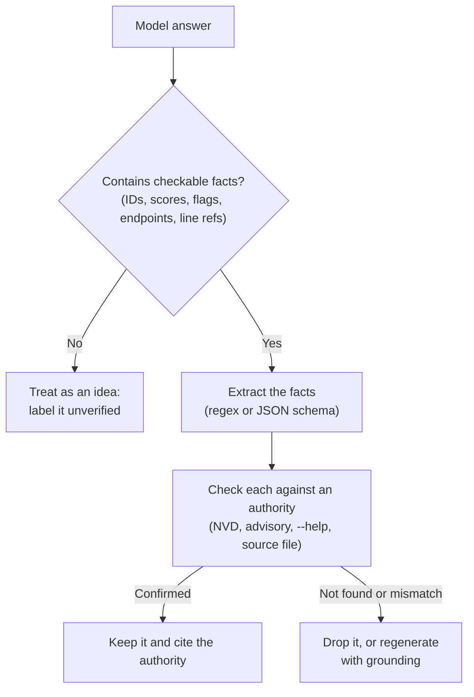

# Trust but verify: hallucinations

Your model will, sooner or later, tell you about a CVE that does not exist, with a CVSS score, an affected version range and a remediation, all invented and all delivered in the same calm tone as its correct answers. This lesson explains why that happens, catalogs the forms it takes in security work, and builds a verification workflow that catches it before it reaches a report.

> [!GOALS]
> - Explain in mechanical terms why language models hallucinate, and why IDs and numbers are the worst case
> - Recognize the security-specific hallucinations: fake CVEs and scores, nonexistent flags, wrong payload syntax, invented endpoints, false-positive findings
> - Apply five verification techniques: grounding, evidence, cross-checking, structured confidence, self-consistency
> - Catch a hallucinated CVE and a hallucinated tool flag in a lab, then fix both with grounding

## Why models hallucinate

> [!CONCEPT] Hallucination
> Output that is fluent and plausible but not true: invented facts, nonexistent references, wrong numbers. The model is not lying (it has no notion of truth); it is producing a likely-looking continuation of the text so far.

The mechanism is the one from [How text gets generated](#/foundations/generation): at each step the model turns the context into a probability distribution over the next token, one token is sampled, it is appended, and the process repeats. Nowhere in that loop is there a lookup. The model never consults a database of CVEs or reads `--help`. Everything it "knows" is compressed into its weights as statistical associations, and generation is pattern completion on top of them.

Most of the time those associations are good enough to be right. Hallucinations appear where they are weak:

- **The fact was rare or absent in training data.** A niche tool's flags, a minor CVE, anything after the knowledge cutoff.
- **The fact is a high-entropy string.** Identifiers, version numbers, scores and hashes are the worst case. Consider the text `CVE-2023-`. The model has seen tens of thousands of CVE IDs, so the distribution over the next digits is close to flat: almost any digits look right. Whatever gets sampled becomes the ID.
- **The model commits.** Generation is autoregressive: once `CVE-2023-91234` is in the context, the model's job is to continue *coherently*, so it writes the most plausible description for "a CVE with that number in a question about that product". The invented ID now has an invented story to match.
- **Training rewards answering.** Instruction-tuned models learned from examples where the assistant helps. Saying "I am not aware of that CVE" is a learned behavior that some models do well and others rarely. Your uncensored model's card does not measure abstention either way, so do not count on it: build "I don't know" into the prompt and, more importantly, into the pipeline.

> [!NOTE]
> Temperature 0 does not fix hallucination. Greedy decoding picks the single most likely token each time, and the most likely continuation can still be false. Low temperature makes a hallucination **repeatable**, not true.

## Security-specific hallucinations

General chatbots hallucinate trivia. In security work the hallucinations land in places that cost you credibility, time or legal exposure.

| Hallucination | What it looks like | How to catch it |
|---|---|---|
| **Fake CVE IDs** | "This is CVE-2025-31842, an RCE in the Express body parser" | Look up every ID (NVD, cve.org). Never cite an ID you have not opened. |
| **Wrong CVSS scores or vectors** | A real CVE with a score off by several points, or a vector that does not compute to the stated score | Copy scores from NVD or the CNA record; compute vectors yourself in the FIRST calculator. |
| **Wrong affected or fixed versions** | "Fixed in 2.4.1" when the fix shipped in 2.4.3 | Vendor advisory, GitHub advisory, changelog, the fix commit. |
| **Nonexistent tool flags** | `httpx -waf-bypass` (there is no such flag) | `tool --help`, the man page, the README of the exact version you run. |
| **Wrong payload syntax** | MySQL comment syntax against MSSQL, a Jinja2 SSTI probe for a Twig app, bash syntax in a Windows context | Test in your own lab; check against the PortSwigger and OWASP references. |
| **Invented endpoints and parameters** | "Try `/api/v1/admin/users`, it usually exists" presented as a finding | Evidence check: the string must appear in the traffic or source. |
| **False-positive code findings** | "SQL injection" on a parameterized query; "command injection" behind strict validation | Demand source and sink line numbers, then read those lines yourself. |
| **Fake references** | A plausible blog post URL, paper title or GitHub repo that does not exist | Open every link before it goes anywhere. |

Each of these has a cheap, deterministic check. That is the core insight of this lesson: you do not have to make the model trustworthy, you have to make its claims **checkable** and then check them.

## The verification workflow



Five techniques feed this workflow. Use them together; each covers gaps in the others.

### 1. Ground the model in real documents

> [!CONCEPT] Grounding
> Putting authoritative text (an advisory, a man page, an NVD record, your notes) into the prompt and instructing the model to answer only from it. The facts then come from the context, which the model reads reliably, instead of from its weights, which it recalls unreliably.

This is the single most effective fix, and it is what [RAG](#/using/rag) automates: retrieve relevant documents, paste them into the prompt, answer from them. For security questions, the documents are usually obvious: the advisory, the tool's help output, the source file. The [explain-an-advisory recipe](#/security/workflows) is grounding in its simplest form.

Grounding needs two prompt rules to work: "answer only from the context" and an explicit escape hatch such as "if the answer is not in the context, reply NOT IN CONTEXT". Without the escape hatch, the model fills gaps from memory.

### 2. Demand evidence, then check it in code

Ask for quotes and line numbers, not just conclusions. A claim with evidence attached can be verified by a script in microseconds: is the quoted string in the file? Does line 42 contain the quoted code? The `js_review.py` and `code_audit.py` recipes in [Security workflows](#/security/workflows) drop every item whose evidence does not check out. That one `if` statement removes most invented endpoints and phantom findings.

### 3. Cross-check against authoritative sources

For each kind of fact there is a source of truth:

| Fact | Authority |
|---|---|
| CVE existence, description, CVSS | [NVD](https://nvd.nist.gov/), [cve.org](https://www.cve.org/), the CNA's own advisory |
| Affected and fixed versions | Vendor advisory, [GitHub Advisory Database](https://github.com/advisories), the fix commit |
| Tool flags and behavior | `tool --help`, `man tool`, the README for your installed version |
| Weakness classification | [CWE](https://cwe.mitre.org/) |
| Payload syntax | Your own lab, PortSwigger and OWASP references |

Automate the most common one. This script looks up CVE IDs (from arguments or extracted from any text on stdin) in the NVD API and falls back to the CVE Services API, so you can pipe a model's answer straight into it:

```python title="verify_cve.py"
#!/usr/bin/env python3
"""Look up CVE IDs and print what the official record says.

usage: python3 verify_cve.py CVE-2024-34359 [CVE-...]
       pbpaste | python3 verify_cve.py -        (extract every CVE ID from text on stdin)
"""
import re
import sys
import time

import requests

NVD = "https://services.nvd.nist.gov/rest/json/cves/2.0"
CVE_ORG = "https://cveawg.mitre.org/api/cve/"
CVE_RE = re.compile(r"CVE-\d{4}-\d{4,}", re.I)


def lookup(cve_id: str) -> str:
    r = requests.get(NVD, params={"cveId": cve_id}, timeout=30)
    r.raise_for_status()
    vulns = r.json().get("vulnerabilities", [])
    if not vulns:
        if requests.get(CVE_ORG + cve_id, timeout=30).ok:
            return f"{cve_id}: not in NVD yet, but a record exists at cve.org; read it there"
        return f"{cve_id}: NOT FOUND in NVD or cve.org (invented, or reserved and unpublished)"
    cve = vulns[0]["cve"]
    desc = next((d["value"] for d in cve.get("descriptions", []) if d["lang"] == "en"), "")
    scores = [f"{e['cvssData']['baseScore']} ({key[10:]}, {e['source']})"
              for key, entries in cve.get("metrics", {}).items()
              if key.startswith("cvssMetric")  # skip non-CVSS metrics such as SSVC
              for e in entries]
    return (f"{cve_id}: status={cve.get('vulnStatus')} published={cve.get('published', '')[:10]}\n"
            f"  CVSS: {', '.join(scores) or 'none listed'}\n  {desc[:300]}")


if __name__ == "__main__":
    args = sys.argv[1:]
    ids = CVE_RE.findall(sys.stdin.read()) if args == ["-"] else args
    for i, cve_id in enumerate(dict.fromkeys(x.upper() for x in ids)):  # dedupe, keep order
        if i:
            time.sleep(6)  # NVD allows about 5 requests per 30 s without an API key
        print(lookup(cve_id))
```

```bash
cd ~/ai-lab/sec && source .venv/bin/activate
python3 verify_cve.py CVE-2024-34359
```

```text
CVE-2024-34359: status=Deferred published=2024-05-14
  CVSS: 9.6 (V31, security-advisories@github.com)
  llama-cpp-python is the Python bindings for llama.cpp. `llama-cpp-python` depends on class `Llama` in `llama.py` to load `.gguf` llama.cpp or Latency Machine Learning Models. ...
```

That record is real (it is the GGUF chat-template vulnerability you will meet in the [threat model lesson](#/security/ai-threat-model)). Note the score came from the GitHub CNA, not NVD; recording **who** scored it is part of verification.

> [!WARNING]
> "Not found" has three meanings: the ID was invented, the ID is reserved but not yet published, or NVD has not processed a brand-new record. The script checks cve.org to separate the last case. For a reserved ID, nobody can tell you what it is yet, which means the model certainly cannot.

### 4. Structured output with confidence and sources

Free text hides uncertainty. A schema exposes it. Ask for each claim as an object with the claim, its evidence, where the evidence came from (`context`, `memory`), and a confidence level. Then route by those fields in code: anything sourced from `memory` that contains an ID or version goes to `verify_cve.py` or a human; anything with `low` confidence is labeled in the output. The mechanics of JSON-schema output are in [Structured output and tool calling](#/using/structured-output-tools).

Confidence levels from a small model are only loosely calibrated: "high" does not mean "right". Their value is relative, as a sorting key for what to check first.

### 5. Self-consistency: ask several times

> [!CONCEPT] Self-consistency
> Sampling the same question several times at a normal temperature and comparing the answers. Facts the model actually learned tend to come back the same way; invented details tend to change between samples.

It is a cheap smoke test that needs no external source:

```python title="consistency.py"
#!/usr/bin/env python3
"""Self-consistency check: ask the same question N times and compare the extracted facts.

usage: python3 consistency.py "What is the CVSS v3.1 base score of CVE-2023-91234?" [n]
"""
import re
import sys
from collections import Counter

from seclib import chat

# CVE IDs, scores like 7.5, and CLI flags like -sc or --rate-limit
FACTS = re.compile(r"CVE-\d{4}-\d{4,}|\b\d{1,2}\.\d\b|(?<![\w-])--?[a-z][a-z0-9-]+")

if __name__ == "__main__":
    question = sys.argv[1]
    n = int(sys.argv[2]) if len(sys.argv) > 2 else 5
    answers = [chat("Answer concisely.", question, temperature=0.7, max_tokens=400) for _ in range(n)]
    for i, answer in enumerate(answers, 1):
        print(f"--- sample {i}\n{answer[:300]}\n")
    counts = Counter(fact for a in answers for fact in set(FACTS.findall(a)))
    print("fact                 seen in")
    for fact, c in counts.most_common(15):
        print(f"{fact:<20} {c}/{n}")
```

Read the table at the end like this: a fact present in 5 of 5 samples may be real or may be a consistent misconception; a fact that appears in 1 of 5, or a score that is different every time, is almost certainly invented. **Inconsistency is strong evidence of hallucination; consistency is only weak evidence of truth.**

## Lab: catch and fix a hallucination

> [!LAB] A CVE that does not exist and a flag that does not exist
> Work in `~/ai-lab/sec` with the venv active, `seclib.py` from [Security workflows](#/security/workflows), and the LM Studio server running.
>
> 1. **Establish ground truth first.** Confirm the CVE ID used in this lab has no record:
>    ```bash
>    python3 verify_cve.py CVE-2023-91234
>    curl -s https://cveawg.mitre.org/api/cve/CVE-2023-91234
>    ```
>    When this lesson was written (November 2026), NVD returned zero results and cve.org returned `CVE_RECORD_DNE`. If it ever returns a real record, pick another unassigned number and confirm it the same way.
> 2. **Ask the bare model.** In the LM Studio chat, with no system prompt: `Explain CVE-2023-91234: affected product, versions, CVSS score and how it is exploited.` Save the answer. Did it invent a product? A score? Did it hedge at all?
> 3. **Measure consistency.** `python3 consistency.py "What product does CVE-2023-91234 affect and what is its CVSS v3.1 base score?" 5`. Do the product and score stay the same across samples?
> 4. **The fake flag.** Ask: `What does the httpx -waf-bypass flag do, and when should I use it?` Then check the source of truth. If you have httpx installed, run `httpx -h > httpx_help.txt`; otherwise `curl -s https://raw.githubusercontent.com/projectdiscovery/httpx/main/README.md -o httpx_help.txt`. Then `grep -i waf httpx_help.txt`. The only match is the `-cdn` flag ("display cdn/waf in use"). There is no `-waf-bypass`.
> 5. **Ground it.** Save the NVD result as context and ask again with the grounded script below:
>    ```bash
>    python3 verify_cve.py CVE-2023-91234 > nvd.txt
>    python3 grounded_ask.py "What is the CVSS score of CVE-2023-91234, and what does httpx -waf-bypass do?" nvd.txt httpx_help.txt
>    ```
>    You want `NOT IN CONTEXT` for both parts, plus a pointer to the right source.
> 6. **Control case.** Make sure grounding did not just teach it to refuse everything: `python3 verify_cve.py CVE-2024-34359 > real.txt` and ask `grounded_ask.py "What is the CVSS score of CVE-2024-34359 and who assigned it?" real.txt`. It should answer 9.6, quote the context and name the GitHub CNA.
> 7. Record your results in a table: question, bare answer correct (y/n), consistent across samples (x/5), grounded answer correct (y/n).

```python title="grounded_ask.py"
#!/usr/bin/env python3
"""Ask a question with authoritative documents in context; force NOT IN CONTEXT when unsupported.

usage: python3 grounded_ask.py "question" doc1.txt [doc2.txt ...]
"""
import sys
from pathlib import Path

from seclib import chat, fence

SYSTEM = """You answer security questions using ONLY the context documents provided.
Rules:
- Support every factual claim with a short quote from the context and the document name.
- If the context does not contain the answer, reply exactly NOT IN CONTEXT for that part,
  then name the authoritative source the user should check (NVD, vendor advisory, --help).
- Never use memory for CVE IDs, CVSS scores, versions, tool flags or endpoints.
Format:
Answer: ...
Evidence: "quote" (document)
Confidence: low | medium | high"""

if __name__ == "__main__":
    question, files = sys.argv[1], sys.argv[2:]
    context = "\n\n".join(f"Document: {Path(f).name}\n" + fence(Path(f).read_text(errors="replace"), "doc")
                          for f in files)
    print(chat(SYSTEM, f"{context}\n\nQuestion: {question}", temperature=0.1, max_tokens=800))
```

Expected grounded output for step 5 (illustrative):

```text
Answer: NOT IN CONTEXT for the CVSS score: nvd.txt states the ID was not found in NVD or cve.org,
so no score exists. NOT IN CONTEXT for -waf-bypass: httpx_help.txt lists no such flag; the only
WAF-related option is -cdn. Check the official httpx README or `httpx -h` for your version.
Evidence: "NOT FOUND in NVD or cve.org" (nvd.txt); "-cdn  display cdn/waf in use" (httpx_help.txt)
Confidence: high
```

What you should take away from the lab: the bare model's answer and the grounded answer came from the **same weights**. The difference is entirely in what was in the context and what the prompt allowed. That is why the fix for hallucination is architectural (grounding, evidence, checks), not a better adjective in the prompt.

> [!TIP]
> Make `verify_cve.py -` a habit. Before any model-assisted text goes into a report, pipe it through: `pbpaste | python3 verify_cve.py -`. Every CVE ID in the text is checked in one command.

## Recap
- Models hallucinate because generation is pattern completion with no lookup; identifiers, versions and scores are the worst case because many values look equally plausible.
- Low temperature makes hallucinations repeatable, not true.
- In security work, watch for fake CVEs and scores, wrong versions, nonexistent flags, wrong payload syntax, invented endpoints, false-positive findings and fake references.
- Verification: ground in real documents with an explicit NOT IN CONTEXT escape hatch, demand checkable evidence, cross-check against authorities (NVD, advisories, `--help`), use structured confidence to prioritize, and use self-consistency as a smoke test.
- Inconsistency across samples strongly suggests invention; consistency is only weak evidence of truth.

## Check yourself
1. Why is a CVE ID more likely to be hallucinated than the name of a vulnerability class like "SQL injection"?
   <details><summary>Answer</summary>

   A vulnerability class name appeared countless times in consistent contexts, so the association is strong. A specific ID is a near-random string of digits; many values look equally plausible to the model, and nothing in generation checks that the chosen one exists.

   </details>
2. Your colleague says "I set temperature to 0, so the answers are deterministic and therefore reliable." What is wrong with that reasoning?
   <details><summary>Answer</summary>

   Temperature 0 makes the output (mostly) deterministic by always choosing the most likely token, but the most likely continuation can still be false. Determinism gives repeatability, not correctness.

   </details>
3. A grounded prompt says "Answer only from the context" but the model still invents a CVSS score when the context lacks one. What is the most likely missing ingredient?
   <details><summary>Answer</summary>

   An explicit escape hatch, such as "If the context does not contain the answer, reply NOT IN CONTEXT". Without an allowed alternative, the model fills the gap from memory to be helpful.

   </details>
4. `verify_cve.py` reports "NOT FOUND" for an ID the model cited. List the possible explanations.
   <details><summary>Answer</summary>

   The ID was invented; or it is reserved by a CNA but not yet published; or it is brand new and NVD has not processed it (the cve.org fallback distinguishes this case). In the first two cases the model cannot know anything real about it.

   </details>
5. In a self-consistency run, a CVSS score appears as 7.5, 9.8, 8.1, 7.5 and 6.5 across five samples. What do you conclude, and what do you do next?
   <details><summary>Answer</summary>

   The score is almost certainly not known to the model; it is being invented each time. Look up the record in NVD or the CNA's advisory, or score the vector yourself.

   </details>

## Go deeper
- [NVD CVE API documentation](https://nvd.nist.gov/developers/vulnerabilities) — parameters, rate limits and API keys for the lookup script
- [CVE Services and cve.org](https://www.cve.org/) — the canonical CVE record, including CNA-provided scores
- [GitHub Advisory Database](https://github.com/advisories) — affected and patched versions for open-source packages
- [Self-Consistency Improves Chain of Thought Reasoning (arXiv 2203.11171)](https://arxiv.org/abs/2203.11171) — the paper behind sampling several times and comparing
- [Why Language Models Hallucinate (arXiv 2509.04664)](https://arxiv.org/abs/2509.04664) — argues that training and evaluation reward guessing over abstaining
