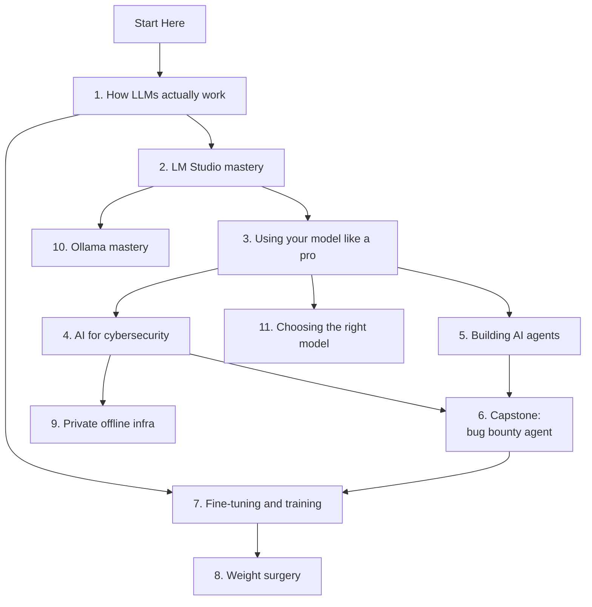

# Welcome and how to use this lab

This is a hands-on course that takes you from "I downloaded a model and chatted with it" to running, tuning, securing, fine-tuning and even editing the weights of a local language model, all on the MacBook Air in front of you. This page explains how the lab works, what the path looks like, and what to do on day one.

> [!GOALS]
> - Understand what this lab covers and how its parts build on each other
> - Know how every lesson is laid out and what each callout box means
> - Set up your workspace at `~/ai-lab` and your lab notebook
> - Finish the Day 1 checklist so your model, runtimes and notes are ready

## What this lab is

Local AI Lab is built around **one machine and one model**: your 16 GB MacBook Air, and `Qwen3.5-9B-Uncensored-HauhauCS-Aggressive` running in LM Studio. That's on purpose. Generic AI tutorials say things like "make sure you have enough VRAM" and leave you to work out what that means for you. Here, every number (file sizes, memory budgets, tokens per second, context limits) is worked out for your setup, with the arithmetic shown, so you can check it on your own machine.

Why bother running a model locally when cloud models are bigger and smarter? For someone in security, the reasons are concrete:

- **Confidentiality.** Scope documents, client traffic, Burp exports, source code and draft findings never leave your laptop. No third-party data processing to explain to a client.
- **No rate limits, no per-token bill.** You can point an agent at 10,000 HTTP responses overnight and it costs electricity.
- **Works offline.** On a plane, in an air-gapped lab, on a client site with a locked-down network.
- **It's yours to open up.** You can inspect the weights, fine-tune them on your own data, and edit them directly. A cloud API will never let you do that, and the last part of this course depends on it.

The trade-off is that a 9-billion-parameter model on a fanless laptop is not a frontier model. A big part of this course is learning exactly where it's strong, where it's weak, and how to build around the weak spots with tools, structure and verification.

## Who it is for

This course is for **you specifically**: a professional security researcher who is completely new to machine learning. It assumes you're very comfortable with terminals, Linux, HTTP, Docker, Python scripting, Burp and recon tooling. It assumes **nothing** about ML.

That leads to one rule that every lesson follows: **every concept is explained before it's used.** You won't read "just set top-p to 0.95" anywhere before you've learned what top-p is, why it exists and what happens when you move it. When a security analogy genuinely helps, you'll get one. For example, a system prompt is a bit like a policy file, and prompt injection is a lot like SQL injection, where data gets executed as instructions.

The goal is mastery, not familiarity. Each lesson starts gently and then goes deep enough that you can *do* the thing and explain *why* it works.

## The journey

The course has a Start Here section, eleven numbered parts and a Reference section. They build on each other like this:



| Part | What you learn | What you walk away with |
|---|---|---|
| Start Here | Your hardware, your model, how to study | A working setup and a lab notebook |
| 1. How LLMs work | Weights, tokens, transformers, sampling, quantization, memory, alignment | A mental model that explains every setting you'll touch |
| 2. LM Studio mastery | Every load and sampling knob, templates, performance, the API and `lms` CLI | Tuned presets for your Mac, plus a local OpenAI-compatible server |
| 3. Using your model | Prompting small models, structured output, tool calling, RAG, MCP | Scripts that get reliable, parseable output from a 9B model |
| 4. AI for cybersecurity | Security workflows, personas, hallucination control, threat-modeling your own AI | A verified, private assistant for real security work |
| 5. Building agents | The agent loop, memory, skills, frameworks, reliability | An agent you wrote from scratch and understand line by line |
| 6. Capstone | Scope guard, recon pipeline, LLM analysis, human-in-the-loop reporting | A local bug bounty assistant that stays in scope |
| 7. Fine-tuning | Datasets, LoRA, MLX on your Mac, Unsloth in the cloud, GGUF export, evaluation | Your own fine-tuned model, loaded in LM Studio |
| 8. Weight surgery | Interpretability, steering, direction ablation, model merging | The ability to find and edit behaviours inside the weights |
| 9. Offline infra | Private stack design, hardening, scaling past 16 GB | A plan for a private AI setup you could defend to a client |
| 10. Ollama mastery | Ollama install, Modelfiles, server tuning, API and security | Your models running in Ollama too, and a fair benchmark against LM Studio |
| 11. Choosing models | Model families, size tiers, the right model per job, benchmarks and your own evals | A tested shortlist of models for each kind of work |

Part 1 is the foundation for everything else. Don't skip it, even when it feels theoretical. When you're debugging a broken agent at 1 a.m. in Part 5, the reason is almost always something from Part 1: a context overflow, a chat-template mismatch, a sampling setting, a hallucinated tool argument.

## How each lesson is laid out

Every lesson uses the same layout, so you always know where to look:

1. **Title and lead.** One to three sentences on what the lesson is and why it matters.
2. **Goals box.** What you'll be able to do by the end. Read it first and come back to it at the end.
3. **Sections.** Concepts explained example first, then the general rule. The "On this page" menu on the right lists the sections.
4. **Labs.** Hands-on exercises with numbered steps. This is where the actual learning happens.
5. **Recap.** The key ideas in a few bullets. Good for revision.
6. **Check yourself.** Three to five questions, each with a hidden answer. Try to answer before you open it.
7. **Go deeper.** A short list of high-quality outside resources.

## The callout legend

Coloured boxes mark different kinds of content. Here is each type, with a real example.

| Callout | Meaning |
|---|---|
| Goals | What the lesson will teach you. Appears once, at the top (see the top of this page). |
| Concept | A new term, defined in plain language the first time it appears |
| Note | Useful side information |
| Tip | A shortcut or practical advice |
| Warning | Something that breaks, eats memory or wastes hours |
| Danger | Legal, safety or data-loss risk |
| Lab | A hands-on exercise. Do it. |
| Mac | Specific to Apple Silicon, macOS or your 16 GB |

> [!CONCEPT] Local LLM
> A large language model whose weights (the billions of learned numbers that make up the model) sit on your own disk and run on your own hardware. Nothing leaves your machine unless you send it somewhere. Think of the difference between submitting samples to an online sandbox and running the analysis tool on your own box.

> [!NOTE]
> The numbers in this course (file sizes, memory, speed) are worked out for Qwen3.5-9B at Q4_K_M on 16 GB. If you switch models later, the methods still work but the numbers change, and every lesson shows you how to redo the arithmetic.

> [!TIP]
> Put LM Studio on one half of the screen and a terminal on the other. Most labs go back and forth between the two, and seeing a setting change next to its effect is how intuition builds.

> [!WARNING]
> Don't load a second model while the first is still loaded. On 16 GB, two 5 GB models plus macOS and a browser will push the machine into swap, and everything (including the model) slows to a crawl. Eject one before loading another.

> [!DANGER]
> The offensive-security labs only ever target your own practice lab, CTFs, or bug bounty assets that are explicitly in scope under the program's rules. An AI agent sends traffic faster and less carefully than you do, so scope checks are built into the code from the start, not added later.

> [!MAC]
> Your MacBook Air has no fan. Long generations heat the chip, and macOS then lowers clock speeds to protect it, so a model that starts at full speed can slow down noticeably after several minutes of continuous work. Keep this in mind whenever you benchmark anything.

> [!LAB] Create your workspace and lab notebook
> 1. Create the workspace, with one folder per module:
>
>    ```bash
>    mkdir -p ~/ai-lab/{foundations,lmstudio,using,security,agents,bugbounty,finetune,weights,infra}
>    ```
>
> 2. Create the notebook with a header and an entry template:
>
>    ```bash
>    cat > ~/ai-lab/NOTES.md <<'EOF'
>    # AI Lab notebook
>
>    ## Machine
>    - Chip:
>    - Memory:
>    - LM Studio version / runtime version:
>
>    ## Entry template
>    ### YYYY-MM-DD - lesson id - what I tried
>    - Model + quant:
>    - Context length:
>    - Sampling (temp / top-p / top-k / min-p):
>    - Prompt:
>    - Result (tok/s, time to first token, quality):
>    - What I learned:
>    EOF
>    ```
>
> 3. Open it in your editor of choice (`open -e ~/ai-lab/NOTES.md` opens TextEdit) and keep it open while you work.

## How to study

**Do every lab.** Reading that temperature "controls randomness" is not the same as watching the model go from robotic to creative to incoherent as you push the slider. The labs are short, and they're the point.

**Keep the notebook.** Treat it like engagement notes on a pentest: if you can't reproduce it, it didn't happen. Each entry records the *settings* (model, quant, context length, sampling values, LM Studio and runtime version) and the *result* (speed, time to first token, what the output looked like). Three weeks from now, "Q4_K_M at 32K context with temp 0.7 did 14 tok/s and stayed on task" is gold. "It worked yesterday" is useless.

**Change one variable at a time.** Same instinct as debugging a flaky exploit. If you change temperature and context length together and the output gets better, you've learned nothing.

**Answer Check yourself before opening the answers.** Retrieval is what makes things stick. If you get two or more wrong, reread the section before moving on, because later lessons assume it.

**Be careful using the model to teach you about itself.** It's tempting to ask your local model "what's my context length?" or "what's top-p?". It will answer confidently and is often wrong about its own settings and internals. That gap is a lesson in itself (you'll meet it in [What is an LLM, really?](#/foundations/what-is-an-llm)). Use the lessons and official docs as the source of truth, and the model as something you experiment on.

> [!TIP]
> When a lab produces a surprising result, write down your guess about *why* before reading on. Being wrong in writing teaches you faster than being vaguely right in your head.

## Realistic time estimates

These are honest estimates for reading every lesson and doing every lab, including the inevitable debugging. Parts 6 to 8 vary the most, because they involve real projects.

| Part | Lessons | Estimated hours |
|---|---|---|
| Start Here | 2 | 2–3 |
| 1. How LLMs work | 8 | 12–16 |
| 2. LM Studio mastery | 7 | 8–10 |
| 3. Using your model | 5 | 8–12 |
| 4. AI for cybersecurity | 5 | 6–8 |
| 5. Building agents | 6 | 10–14 |
| 6. Capstone | 7 | 15–20 |
| 7. Fine-tuning | 7 | 12–18 (plus some cloud GPU time) |
| 8. Weight surgery | 7 | 12–16 |
| 9. Offline infra | 3 | 4–6 |
| 10. Ollama mastery | 4 | 5–7 |
| 11. Choosing models | 3 | 5–7 |
| **Total** | | **roughly 100–135 hours** |

At about 8 hours a week, that's around 14 weeks. The [14-week study plan](#/reference/roadmap) breaks it into weekly goals, with checkpoints where you should be able to demonstrate something before moving on.

## What you'll be able to do at the end

By the end of the course you will be able to:

- Explain, without hand-waving, what happens between pressing Enter and seeing a token appear: tokenization, embeddings, attention, the MLP layers, logits and sampling.
- Predict whether a model, quantization and context length will fit in 16 GB before you download anything, and explain the gap when reality differs.
- Configure LM Studio deliberately (load settings, sampling, templates, thinking mode) instead of by trial and error, and serve the model over its local API.
- Get reliable structured output and tool calls from a 9B model, and give it your own documents through RAG.
- Use the model day to day for authorized security work, with a verification habit that catches hallucinated flags, CVEs and payloads.
- Build an agent from scratch, then a scoped, rate-limited, human-in-the-loop bug bounty assistant.
- Threat-model your own AI setup: prompt injection, tool abuse, data leakage.
- Fine-tune the model on a cybersecurity dataset, convert it to GGUF and run it in LM Studio.
- Open the weights, find a behaviour as a direction inside the model, and edit it out, the same kind of weight surgery behind both "uncensored" models and the [MIT weight-space programming study](#/weights/mit-study).

## Day 1 checklist

Do this today, before starting Part 1. It takes about 30 minutes and saves hours of confusing failures later.

> [!LAB] Day 1 setup
> 1. **Update LM Studio.** LM Studio checks for app updates on launch and offers to install them. Accept the update, or use the update option in the app menu if you dismissed it earlier.
> 2. **Update the runtimes.** Runtimes are the engines that actually run the model (llama.cpp for GGUF files, MLX for MLX files), and LM Studio updates them separately from the app. Press <kbd>Cmd</kbd>+<kbd>Shift</kbd>+<kbd>R</kbd> to open runtime management and update the llama.cpp (Metal) runtime. This matters a lot for your model: Qwen3.5 support in llama.cpp is recent, and older runtimes may fail to load it or run it incorrectly. You can check from the terminal too:
>
>    ```bash
>    lms runtime ls
>    ```
>
>    (`lms` ships with LM Studio. If the command isn't found, launch LM Studio once and open a new terminal window.)
> 3. **Create `~/ai-lab` and your notebook** using the lab in the legend above, if you haven't already.
> 4. **Confirm the model loads.** In LM Studio, load `Qwen3.5-9B-Uncensored-HauhauCS-Aggressive` (Q4_K_M) with default settings and send: `Reply with the single word: ready`. Then check from the terminal that it's loaded:
>
>    ```bash
>    lms ps
>    ```
>
>    Note whether the reply starts with a `<think>...</think>` block. If it does, thinking mode is on. Write that down: sources disagree on whether thinking is on by default for this model, and it changes speed and output length a lot.
> 5. **Record your chip and memory** in the notebook:
>
>    ```bash
>    system_profiler SPHardwareDataType | grep -E "Model Name|Chip|Memory"
>    ```
>
>    ```text
>          Model Name: MacBook Air
>          Chip: Apple M2
>          Memory: 16 GB
>    ```
>
>    Your chip may differ. That one line decides your token speed, as the next lesson shows.
> 6. **Check Python.** The labs need Python 3.11 or newer:
>
>    ```bash
>    python3 --version
>    ```
>
>    If it's older (the Xcode command-line tools ship an older `python3`), install a current one with Homebrew, for example `brew install python@3.12`.

When you're done, you should be able to tick every box:

- [ ] LM Studio and its llama.cpp runtime are up to date
- [ ] `~/ai-lab/` exists with module folders, and `~/ai-lab/NOTES.md` has its template
- [ ] The model loads and replies, and you noted whether thinking is on
- [ ] Chip, memory, LM Studio version and runtime version are in your notebook
- [ ] `python3 --version` shows 3.11 or newer

## Recap

- The lab is built around one setup: a 16 GB fanless MacBook Air running Qwen3.5-9B (Q4_K_M) in LM Studio, and every number is worked out for that setup.
- Local models give you confidentiality, no rate limits, offline use and full access to the weights, in exchange for less raw capability than frontier models.
- Part 1 (how LLMs work) is the foundation for everything that follows.
- Every lesson has goals, concept boxes, labs, a recap and Check yourself questions. Callout colours tell you what kind of content you're reading.
- Do every lab, keep `~/ai-lab/NOTES.md`, record settings and results, and change one variable at a time.
- Budget roughly 100–135 hours, about 14 weeks at 8 hours a week.

## Check yourself

1. Why does this course insist on recording settings, not just results, in your notebook?
   <details><summary>Answer</summary>

   Because a result only means something next to the conditions that produced it. Speed, memory use and output quality all depend on the quantization, context length, sampling values and runtime version. Without those, you can't reproduce a result, compare two runs, or work out what caused a change, just as a pentest finding without request, response and environment details can't be verified.

   </details>
2. Why update the LM Studio runtimes separately from the app, and why does it matter for this model?
   <details><summary>Answer</summary>

   The runtimes (such as llama.cpp) are the engines that run the model, and LM Studio ships and updates them independently of the app. Qwen3.5 uses a new hybrid architecture that llama.cpp supports only in recent builds, so an old runtime may fail to load the model or run it incorrectly.

   </details>
3. Give two reasons a security professional might choose a local 9B model over a much smarter cloud model.
   <details><summary>Answer</summary>

   Any two of: client and engagement data never leaves the machine; there are no rate limits or per-token costs for bulk work; it works offline or in air-gapped environments; and you get full access to the weights, so you can fine-tune or edit them.

   </details>
4. Which part should you never skip, and why?
   <details><summary>Answer</summary>

   Part 1, How LLMs actually work. Every later setting, failure and technique (context limits, sampling, templates, quantization, why agents break, why weight editing works) is explained in terms of what you learn there.

   </details>

## Go deeper

- [LM Studio documentation](https://lmstudio.ai/docs) — the official reference for the app, the `lms` CLI and the local server; keep it bookmarked.
- [Qwen3.5-9B model card](https://huggingface.co/Qwen/Qwen3.5-9B) — the official description of the base model your uncensored version is built on.
- [HauhauCS/Qwen3.5-9B-Uncensored-HauhauCS-Aggressive](https://huggingface.co/HauhauCS/Qwen3.5-9B-Uncensored-HauhauCS-Aggressive) — the exact model you run, with its files, recommended settings and known quirks.
- [Andrej Karpathy: Intro to Large Language Models](https://www.youtube.com/watch?v=zjkBMFhNj_g) — a one-hour, beginner-friendly overview that pairs well with Part 1.
