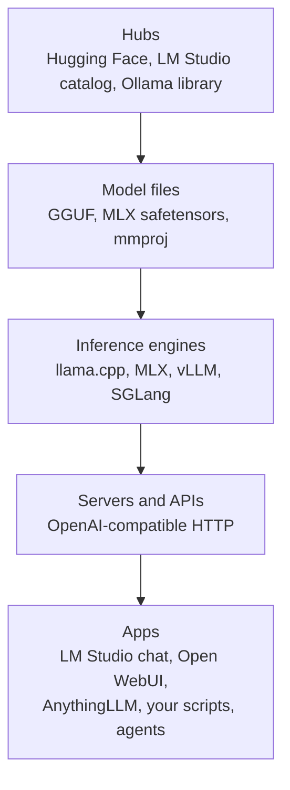

# The local AI ecosystem

LM Studio is one window onto a large, fast-moving ecosystem of engines, servers, apps and model hubs. This lesson maps that world, tells you which pieces make sense on a 16 GB Apple Silicon Mac, shows you how to judge a model repository before you trust it, and ends with you running your existing GGUF directly on llama.cpp's own server.

> [!GOALS]
> - Place every major local-AI tool in a four-layer map: hubs, files, engines, apps
> - Compare llama.cpp, MLX, Ollama, LM Studio, Jan, koboldcpp, vLLM and SGLang, and know which fit a Mac
> - Know what Open WebUI and AnythingLLM add on top of an engine
> - Evaluate a Hugging Face model repo: uploader, lineage, card, licence, file safety
> - Understand where uncensored and abliterated variants come from
> - Install llama.cpp with Homebrew and serve your LM Studio GGUF with `llama-server` and Qwen's sampling settings

## The map: four layers

Almost everything in local AI fits into one of four layers. Once you see the layers, new tools stop being confusing: you just ask "which layer is this, and what does it replace?"



- **Hubs** host the files and the metadata (cards, licences, lineage).
- **Model files** come in formats tied to engines: GGUF for llama.cpp-based tools, MLX format for Apple's MLX, safetensors for PyTorch-based servers (see [Precision, quantization and file formats](#/foundations/quantization)).
- **Engines** do the actual math: load weights, run the forward pass, sample tokens.
- **Servers** wrap an engine in an HTTP API, almost always OpenAI-compatible, which is why your scripts work against LM Studio, llama-server, Ollama and others with only a base-URL change.
- **Apps** are what people interact with. Several products (LM Studio, Ollama, Jan) bundle several layers together.

## Inference engines and runners

> [!CONCEPT] Inference engine
> An **inference engine** is the software that runs a trained model: it loads the weights into memory, executes the forward pass on CPU or GPU, manages the KV cache, and samples output tokens. Products like LM Studio and Ollama are mostly friendly packaging around one or more engines.

| Tool | Layer | Formats | On your Mac | Best for |
|---|---|---|---|---|
| **llama.cpp** (`llama-server`, `llama-cli`) | Engine + server | GGUF | Excellent: Metal GPU backend, the reference for GGUF | Full control, newest model support first, scripting, headless serving |
| **MLX / mlx-lm** | Engine + server (`mlx_lm.server`) | MLX (safetensors + MLX quantization) | Native to Apple Silicon, often very fast | Mac-native inference and fine-tuning ([Fine-tune on your Mac with MLX](#/finetune/mlx-mac)) |
| **LM Studio** | App + server + CLI | GGUF (llama.cpp engine), MLX (MLX engine) | Excellent | GUI exploration, quick setup, MCP host, `lms` automation |
| **Ollama** | Runner + registry + server | GGUF, own registry | Good | `ollama run` simplicity; tools that expect the Ollama API (port 11434) |
| **Jan** | Desktop app + server | GGUF (llama.cpp) | Good | An open-source desktop alternative to LM Studio's GUI |
| **koboldcpp** | Single-file runner + UI | GGUF (llama.cpp fork) | Works | Creative writing and role-play front-ends; KoboldAI and OpenAI-compatible APIs |
| **vLLM** | High-throughput server | safetensors (plus others) | Possible via the `vllm-metal` plugin, but not its home turf | Serving many users at once on NVIDIA GPUs |
| **SGLang** | High-throughput server | safetensors | Not a Mac target | Same niche as vLLM: GPU servers, many concurrent requests |

A few notes that the table cannot hold:

- **llama.cpp is underneath much of this.** LM Studio's GGUF engine, Jan and koboldcpp are built on it, and Ollama runs GGUF models through it too (as of November 2026 Ollama also runs supported models on MLX by default on Apple Silicon; see [Ollama basics](#/ollama/basics)). When a new architecture such as Qwen3.5's hybrid attention appears, llama.cpp support comes first and the apps follow as they update their bundled versions. That is why the setup lesson tells you to keep LM Studio's runtimes current.
- **MLX versus GGUF on the same Mac** is a real choice: MLX builds are often faster on Apple Silicon, while GGUF has the widest range of quantizations and community uploads. The HauhauCS repository you use publishes GGUF only, so on MLX you would need someone else's MLX conversion of an uncensored variant. For Qwen3.5 in MLX, recent `mlx-lm` (text) and `mlx-vlm` (vision) versions are what the community uses; if you see `Model type qwen3_5 not supported`, upgrade the package.
- **Ollama's API is not OpenAI's** at its native endpoints, though Ollama also exposes an OpenAI-compatible endpoint. Many tools support both.

### Why vLLM and SGLang are mostly for NVIDIA servers

vLLM (with its PagedAttention KV-cache manager) and SGLang are designed to serve **many simultaneous users**. Their big wins come from continuous batching: running dozens or hundreds of requests through the GPU together, so each weight read from memory is reused for many tokens at once, plus hand-tuned CUDA kernels.

On your Air with one user, none of that helps. Decoding one stream is limited by how fast you can read the weights, as you calculated in [Prompt engineering for small local models](#/using/prompt-engineering): roughly 120 GB/s ÷ 5.3 GB ≈ 22 tokens/s at best on an M4. Batching only pays off when many requests share each read. Since early 2026 there is an official `vllm-metal` plugin that runs vLLM on Apple Silicon using MLX as the backend, and Docker Model Runner can use it; Docker's own benchmark found llama.cpp consistently about 1.2 times faster on the same Mac. Use vLLM or SGLang when you rent a GPU server for a team, as covered in [Scaling up beyond 16 GB](#/infra/scaling).

## Apps and UIs on top

These do not run models themselves; they connect to an engine's API.

| App | What it adds | How it connects |
|---|---|---|
| **Open WebUI** | A ChatGPT-style web interface, multi-user accounts, document RAG, tools, model switching | Any OpenAI-compatible base URL (LM Studio at `http://localhost:1234/v1`, llama-server, Ollama) |
| **AnythingLLM** | Desktop app or Docker container built around "workspaces" of documents, with RAG and agent features | LM Studio, Ollama and other providers |
| **Jan** | Desktop chat app that can also run models itself | Built-in llama.cpp, or remote APIs |
| **LM Studio's own chat** | Model management, presets, document chat, MCP | Its own engines |

Open WebUI is the one worth trying first if you want a browser UI for your local server, or to share a model with another device on your network (carefully: see [Hardening and air-gapping](#/infra/hardening)). It installs with `pip install open-webui` and starts with `open-webui serve`, or runs as a Docker container; check its docs for the currently supported Python version. It listens on port 8080 by default, so if you also run `llama-server` on 8080 (as in the lab below), give one of them a different port.

## Model hubs

**Hugging Face** is the centre of the open-model world. A model repository is a git repository (large files via Git LFS) with:

- a **model card** (`README.md`): what the model is, how it was made, how to prompt it, licence, known issues;
- **Files and versions**: the actual weights (`.gguf`, `.safetensors`), configs, chat templates, with a SHA-256 hash shown for each large file;
- a **model tree** in the sidebar: the base model it derives from, and the fine-tunes, adapters, merges and quantizations derived from it;
- a **Community** tab with discussions and pull requests;
- metadata such as the licence tag, download counts and likes, and a "Use this model" button that lists compatible apps.

**The LM Studio catalog** (the model search inside LM Studio and lmstudio.ai) surfaces models that work in LM Studio; the `lmstudio-community` organisation on Hugging Face publishes curated GGUF and MLX conversions. **The Ollama library** (ollama.com/library) is Ollama's own registry of packaged models.

## How to evaluate an uploader and a model

Downloading a model is downloading a large binary from a stranger. Apply the judgment you would apply to any dependency.

| Question | Where to look | Good sign | Warning sign |
|---|---|---|---|
| Who published it? | Uploader profile | The original lab (Qwen, Google, Mistral) or a long-standing quantizer with many well-used repos | New account, one repo, big claims |
| What is it derived from? | Model tree, card, `config.json` | Base model linked and named exactly | No lineage, vague "based on a popular model" |
| How was it made? | Card | Method, data and settings described | "Better than GPT" with no method |
| Does it work for others? | Community tab, downloads | Discussions with real usage reports, maintainer replies | Unanswered reports of gibberish or broken templates |
| What licence applies? | Licence tag, card, base model's licence | Licence stated and consistent with the base | Missing licence, or a permissive tag on a restricted base |
| Is the file safe to load? | File list | GGUF or safetensors only | Pickle files (`.bin`, `.pt`, `.pth`) or a requirement to run with `trust_remote_code` |
| Did I get the right bytes? | SHA-256 on the file page | Your local hash matches | Mismatch |

On formats: GGUF and safetensors are data formats, designed so that loading them does not execute code. Python pickle files can execute arbitrary code when loaded, and `trust_remote_code=True` in Hugging Face Transformers runs Python from the repository by design. Parsers can still have bugs, and llama.cpp has fixed memory-safety issues in its GGUF parsing before, which is one more reason to keep runtimes updated.

On licences: a quantization or fine-tune inherits the obligations of its base model. Qwen3.5 is Apache-2.0, which is permissive. Others are not: the Llama community licence has its own terms (for example a clause for services above 700 million monthly active users), Gemma models ship under Google's Gemma terms, and some fine-tunes are non-commercial (CC BY-NC). For a pentest firm using a model in client work, this matters.

Apply the table to your own model, `HauhauCS/Qwen3.5-9B-Uncensored-HauhauCS-Aggressive`:

- The base is `Qwen/Qwen3.5-9B` from the Qwen team, Apache-2.0. Good lineage.
- The files are GGUF (BF16, Q8_0, Q6_K, Q4_K_M) plus an `mmproj` vision file. No code-executing formats.
- The card claims 0/465 refusals and "no capability loss". Those are the author's own tests, not independent results, and the card does not say which uncensoring method was used. Treat the claims as unverified and test on your own tasks (your prompt harness is the tool for that).

You can verify the download itself:

```bash
find ~/.lmstudio/models -name "*HauhauCS-Aggressive-Q4_K_M.gguf" -exec shasum -a 256 {} \;
```

Compare the output with the SHA-256 shown on the file's page under "Files and versions" on Hugging Face.

## Where uncensored and abliterated variants come from

[Alignment, refusals and "uncensored"](#/foundations/alignment-uncensored) explains why models refuse. Variants without refusals are produced in a few ways, and the names on Hugging Face usually tell you which:

1. **Abliteration (direction ablation).** Research such as "Refusal in Language Models Is Mediated by a Single Direction" (Arditi et al., 2024) found that refusal behaviour is largely controlled by one direction in the model's internal activations. Removing that direction from the weights removes most refusals with no training. Repos named "abliterated" use this. The math is covered in [Direction ablation: editing weights](#/weights/direction-ablation).
2. **Fine-tuning on data without refusals.** Training on instruction data where the assistant always complies. The Dolphin series is a long-running example of this approach.
3. **Automated optimisation.** Tools such as Heretic combine abliteration with an automatic parameter search (using the Optuna library) that tries to minimise refusals and, at the same time, the KL divergence from the original model. The project reports results comparable to manual abliteration with less damage; that is the author's own benchmark.
4. **Merges** that blend an uncensored model with others.

> [!CONCEPT] KL divergence
> **KL divergence** measures how different two probability distributions are. Here it compares the next-token probabilities of the modified model with the original on ordinary, harmless prompts. Low KL divergence means the edit changed refusals and little else; high KL divergence means it also disturbed normal behaviour, which usually shows up as lower quality.

Labels like "Aggressive" usually mean a more thorough removal of refusals, often at a higher risk of side effects. The honest summary: these variants differ in quality, their authors' claims are usually self-measured, and removing refusals also removes a safety net, which shifts responsibility to you as the operator.

## Qwen3.5 GGUFs in Ollama: the mmproj question

Qwen3.5 is natively multimodal, so community GGUF repos (Unsloth, bartowski, HauhauCS) ship the language model and the vision encoder as **separate files**: the main `.gguf` and an `mmproj-*.gguf`. llama.cpp and LM Studio load the pair; Ollama historically expected a single file. Where things stand, as of November 2026:

- **Unsloth's Qwen3.5 guide still says** that no Qwen3.5 GGUF currently works in Ollama because of the separate mmproj vision files, and recommends llama.cpp-compatible backends.
- **Ollama's issue tracker tells a newer story.** Issue #14575 ("qwen 3.5 models from HuggingFace don't work") reported load failures on Ollama 0.17.5 in March 2026; a maintainer explained that split text-plus-vision GGUFs need Ollama's llama.cpp engine path and an update for the qwen35 architecture. The issue was closed as completed on 4 August 2026. Users reported Hugging Face Qwen-family GGUFs working on Ollama 0.30 release candidates, and a maintainer said split models are supported through the `ollama create` flow, though pulling directly from Hugging Face cannot merge the parts on the fly (download the files first, then `create`).
- **Ollama's own library tag** (`qwen3.5:9b`) was reported working early on, because Ollama packages it in its own format.

So the Unsloth statement looks outdated for text use on current Ollama, and vision with a separate mmproj from a third-party repo is the part to verify yourself. Test on your installed version before you rely on it. For this course, LM Studio and llama.cpp remain the reference path, and the lab below uses llama.cpp directly.

## Lab: run your GGUF on llama.cpp directly

> [!LAB] Serve the LM Studio model with llama-server
> You will run the exact Q4_K_M file LM Studio already downloaded, under llama.cpp's own server, with Qwen's recommended sampling, and query it with curl. No second download needed.
>
> 1. Install llama.cpp with Homebrew and check the flags exist in your build (flag names do change over time):
>
> ```bash
> brew install llama.cpp
> llama-server --version
> llama-server --help | grep -E -- "--presence-penalty|--chat-template-kwargs|--reasoning|--flash-attn"
> ```
>
> 2. Free the memory. Two copies of a 5.3 GB model plus their KV caches would push a 16 GB Mac into swap. Eject the model in LM Studio, or from the terminal: `lms unload --all` (see `lms unload --help`).
> 3. Find the GGUF in LM Studio's models folder (default `~/.lmstudio/models`; if you changed it, check the path shown in LM Studio's My Models page):
>
> ```bash
> MODEL=$(find ~/.lmstudio/models -name "*HauhauCS-Aggressive-Q4_K_M.gguf" | head -n 1)
> echo "$MODEL"
> ```
>
> 4. Start the server in non-thinking mode with the model card's general-purpose sampling (command and flag table below).
> 5. In a second terminal, check health and send a request with curl.
> 6. Point the prompt harness from [Prompt engineering for small local models](#/using/prompt-engineering) at the new server and compare results with LM Studio.
> 7. Restart in thinking mode and see where the reasoning goes in the response.

Step 4, the server command:

```bash
llama-server \
  -m "$MODEL" \
  --alias qwen3.5-9b \
  --host 127.0.0.1 --port 8080 \
  -c 32768 \
  -ngl 99 \
  -fa on \
  --jinja \
  --chat-template-kwargs '{"enable_thinking":false}' \
  --temp 0.7 --top-p 0.8 --top-k 20 --min-p 0 \
  --presence-penalty 1.5 --repeat-penalty 1.0
```

| Flag | What it does | Why this value |
|---|---|---|
| `-m` | Path to the GGUF | The file LM Studio downloaded |
| `--alias` | Model name reported by the API | Gives scripts a short, stable name |
| `--host`, `--port` | Listen address | Localhost only. Recent builds default to port 9931 (older ones used 8080), so set it explicitly |
| `-c` | Context length in tokens | 32,768 tokens × 32 KiB of KV cache ≈ 1 GiB; see the note on 128K below |
| `-ngl` | Layers offloaded to the GPU | 99 means "all"; recent builds default to `auto`, which does the same on your Mac |
| `-fa on` | Flash attention | Faster and leaner attention. Current builds take `on`/`off`/`auto`; very old builds used a bare `-fa` |
| `--jinja` | Use the model's own Jinja chat template | Needed for Qwen3.5's tool and thinking handling; enabled by default in current builds, harmless to state |
| `--chat-template-kwargs` | Variables passed to the template | `enable_thinking: false` for non-thinking mode |
| `--temp`, `--top-p`, `--top-k`, `--min-p` | Sampling (see [Sampling and inference settings](#/lmstudio/sampling-settings)) | Qwen3.5 card, non-thinking general profile |
| `--presence-penalty` | Penalises tokens already present, discouraging repetition | 1.5 per the card's general profiles; use 0 for precise coding |
| `--repeat-penalty` | Older repetition penalty | 1.0 means off, as Qwen recommends |

These are server defaults: any request that sets `temperature`, `top_p` and so on overrides them.

The Qwen3.5-9B card lists four sampling profiles. Use them as starting points and measure with your harness:

| Mode and task | temperature | top_p | top_k | min_p | presence_penalty |
|---|---|---|---|---|---|
| Thinking, general | 1.0 | 0.95 | 20 | 0 | 1.5 |
| Thinking, precise coding | 0.6 | 0.95 | 20 | 0 | 0 |
| Non-thinking, general | 0.7 | 0.8 | 20 | 0 | 1.5 |
| Non-thinking, reasoning tasks | 1.0 | 1.0 | 40 | 0 | 2.0 |

All four use a repetition penalty of 1.0 (off). The card also suggests keeping at least 128K of context for long thinking tasks. On your Mac that is a real trade-off: 131,072 tokens × 32 KiB = 4 GiB of KV cache on top of about 5.3 GB of weights, close to the roughly 10 to 11 GB Metal will use by default. Q8_0 KV-cache quantization (`-ctk q8_0 -ctv q8_0`) roughly halves the KV cost. Work through it with [Memory math: will it fit?](#/foundations/memory-math) before you try.

<div data-widget="memory"></div>

Step 5, in a second terminal:

```bash
curl -s http://127.0.0.1:8080/health
```

```text
{"status":"ok"}
```

```bash
curl -s http://127.0.0.1:8080/v1/chat/completions \
  -H "Content-Type: application/json" \
  -d '{
    "model": "qwen3.5-9b",
    "messages": [
      {"role": "system", "content": "You are a concise web security assistant."},
      {"role": "user", "content": "In two sentences: what does the HttpOnly cookie flag protect against, and what does it not stop?"}
    ],
    "max_tokens": 200
  }' | python3 -m json.tool
```

The response has the same shape as LM Studio's: `choices[0].message.content`, `finish_reason` and a `usage` block with token counts. llama-server also reports timing information, which is a quick way to read prompt-processing and generation speed. Open `http://127.0.0.1:8080` in a browser too: llama-server includes its own web chat UI.

Step 6: every script in this module talks to an OpenAI-compatible URL, so switching servers is two lines. In `harness.py`:

```python
BASE_URL = "http://127.0.0.1:8080/v1"   # llama-server instead of LM Studio
MODEL = "qwen3.5-9b"                     # the --alias you set
```

Run the same task and compare `results.md` with your LM Studio run. With identical sampling settings the pass rates should be similar; differences point to settings you had not noticed (context length, template, sampling defaults).

Step 7: stop the server with <kbd>Ctrl</kbd>+<kbd>C</kbd> and restart it with `--chat-template-kwargs '{"enable_thinking":true}'` and the "thinking, precise coding" profile (`--temp 0.6 --top-p 0.95 --top-k 20 --min-p 0 --presence-penalty 0`). Send the same curl request with `max_tokens` raised to 2000. Look at where the reasoning appears: depending on the build's `--reasoning-format` setting it comes back in a separate `reasoning_content` field or inline in `<think>` tags. Recent builds also have a `--reasoning on|off|auto` flag; check `llama-server --help` for what yours supports.

> [!TIP] Going further with llama-server
> - Vision: add `--mmproj` with the path to the `mmproj-...gguf` file from the same folder, then send images as `image_url` content parts.
> - Downloading directly: `-hf <user>/<repo>:<quant>` fetches a GGUF (and its mmproj) from Hugging Face; you skipped it here to reuse LM Studio's copy.
> - Embeddings and reranking: `llama-server` can serve an embedding model (`--embedding`) or a reranker (`--rerank`, `/v1/rerank` endpoint) for the RAG pipeline in [RAG: give your model your knowledge](#/using/rag).
> - Security: keep `--host 127.0.0.1`. If you ever expose it on a network, add `--api-key` and read [Hardening and air-gapping](#/infra/hardening) first.

## Recap

- The ecosystem has four layers: hubs, model files, engines (plus their HTTP servers), and apps. Most products bundle several layers.
- llama.cpp (GGUF, Metal) and MLX are the engines that matter on a Mac. LM Studio, Ollama, Jan and koboldcpp package them with different trade-offs.
- vLLM and SGLang win by batching many concurrent requests on GPU servers; a single-user Mac is bandwidth-bound, so they offer little there (vllm-metal exists, and llama.cpp still measured faster in Docker's comparison).
- Open WebUI and AnythingLLM are front ends that connect to any OpenAI-compatible server.
- Judge models like dependencies: uploader, model tree, card, community reports, licence, safe formats, and a SHA-256 check.
- Uncensored variants come from abliteration, refusal-free fine-tuning, automated tools such as Heretic, and merges; quality claims are usually self-reported.
- Qwen3.5 GGUFs with a separate mmproj: Unsloth's guide still says they do not work in Ollama, while Ollama's tracking issue was closed in August 2026 with text use reported working; verify vision yourself.
- `llama-server` can serve the exact GGUF LM Studio downloaded, with the model card's sampling flags, and every script in this module works against it by changing the base URL.

## Check yourself

1. You are told "Ollama runs on llama.cpp, so it is the same as LM Studio." Which layers do the two share, and where do they differ?
   <details><summary>Answer</summary>

   Both are packaged runners that can use llama.cpp as an engine for GGUF files and both expose local HTTP APIs. They differ in the other layers: LM Studio is a GUI app with its own catalog, an MLX engine, presets and MCP hosting, and an OpenAI-compatible server on port 1234; Ollama is a daemon and CLI with its own registry, Modelfile packaging and native API on port 11434 (plus an OpenAI-compatible endpoint). Their engine versions and supported architectures also differ at any given time.

   </details>
2. Why would vLLM not make your single-user chat faster on a MacBook Air?
   <details><summary>Answer</summary>

   vLLM's advantages come from batching many simultaneous requests so each weight read serves many tokens, plus CUDA-optimised kernels. A single chat stream on a Mac is limited by memory bandwidth (about bandwidth ÷ model size tokens per second), and batching cannot help one stream. On Apple Silicon it runs through the vllm-metal plugin, which Docker measured as slower than llama.cpp.

   </details>
3. A repo claims "uncensored, zero quality loss" and ships `pytorch_model.bin` plus a requirement for `trust_remote_code=True`. Name two security concerns and one quality concern.
   <details><summary>Answer</summary>

   Security: the `.bin` file is likely a pickle, which can execute code when loaded; `trust_remote_code=True` runs Python code from the repo by design. Quality: "zero quality loss" is almost certainly a self-reported claim; check the method, look for KL divergence or benchmark evidence, and test on your own tasks.

   </details>
4. Your `llama-server` command uses `-c 131072` and the Mac starts swapping. Explain with numbers and give two fixes.
   <details><summary>Answer</summary>

   131,072 tokens × 32 KiB = 4 GiB of KV cache, plus about 5.3 GB of weights, plus compute buffers, which approaches or exceeds the roughly 10 to 11 GB Metal uses by default and leaves little for macOS. Fixes: lower the context (for example 32K, about 1 GiB of KV), quantize the KV cache to Q8_0 with `-ctk q8_0 -ctv q8_0` (roughly halving it), and make sure LM Studio is not holding a second copy of the model.

   </details>
5. Which sampling flags would you pass to llama-server for Qwen3.5 in thinking mode on a precise code-review task, according to the model card?
   <details><summary>Answer</summary>

   `--temp 0.6 --top-p 0.95 --top-k 20 --min-p 0 --presence-penalty 0 --repeat-penalty 1.0`, with `--chat-template-kwargs '{"enable_thinking":true}'`.

   </details>

## Go deeper

- [llama.cpp](https://github.com/ggml-org/llama.cpp) — the engine under most of the GGUF ecosystem; the `tools/server` README documents every `llama-server` flag and endpoint.
- [MLX LM](https://github.com/ml-explore/mlx-lm) — Apple's LLM package for MLX: generation, serving and fine-tuning on Apple Silicon.
- [Ollama issue #14575](https://github.com/ollama/ollama/issues/14575) — the history of Qwen3.5 Hugging Face GGUF support in Ollama.
- [Open WebUI](https://github.com/open-webui/open-webui) — the most popular self-hosted web front end for local models.
- [Refusal in Language Models Is Mediated by a Single Direction (arXiv 2406.11717)](https://arxiv.org/abs/2406.11717) — the paper behind abliterated models.
- [Heretic](https://github.com/p-e-w/heretic) — automated refusal removal with a KL-divergence-aware parameter search.
