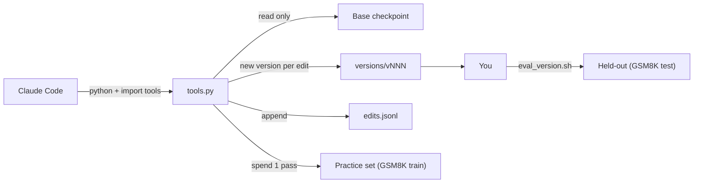

# Lab: Claude as your weight programmer

This is the capstone. You'll build a small version of the MIT harness, put Claude Code in Astra's seat, and let it try to reduce Qwen3.5-0.8B's looping by editing weights directly, under a forward-pass budget, with every edit logged and a held-out set it can't see. Then you'll review its edits like a code reviewer, evaluate them honestly, and port a winner to the 9B you run in LM Studio.

> [!GOALS]
> - Install Claude Code on macOS and run it with sensible permissions
> - Build a harness: checkpoint versioning with automatic backups, an edit log, a forward-pass budget, and a held-out evaluation the editor can't read
> - Write a `CLAUDE.md` and task spec that encode the rules of the experiment
> - Drive Claude through a weight-editing session with good prompts
> - Review its edits with tensor diffs, evaluate on held-out data with multiple seeds, and port a winning edit to the 9B

## Set expectations first

Be clear-eyed about what you're reproducing:

| | MIT study (p50c run) | Your lab |
|---|---|---|
| Editor | GPT-6 Astra at maximum reasoning effort | Claude Code (whatever model your plan provides) |
| Wall-clock | 20.3 hours (including a 4.7-hour outage), 158 turns, 80 Python runs | An evening or a weekend |
| One forward pass | Up to 512 problems generated on GPUs | Up to 16 problems generated on your Mac |
| Token cap | 32,768 | 4,096 |
| Budget | 50 passes | 20 passes (your choice) |
| Result | MATH-500 7.9% → 48.1% | Unknown: that's the experiment |

Claude is not Astra, your passes are 30 times smaller, and a 4,096-token cap truncates healthy answers too. A small, reproducible reduction in loop rate is a real result. A null result with clean controls is also a real result; the Gemma follow-up in the study was exactly that. What you're really building is the **discipline**: budgets, logs, controls, held-out evaluation. Those transfer to everything.

## Install Claude Code

From the official setup docs (November 2026), on macOS 13 or later:

```bash
curl -fsSL https://claude.ai/install.sh | bash
```

or with Homebrew (doesn't auto-update; `claude-code` tracks the stable channel, `claude-code@latest` the newest):

```bash
brew install --cask claude-code
```

Then open a new terminal and check:

```bash
claude --version
claude doctor
```

Claude Code needs a Pro, Max, Team, Enterprise or Console account (the free claude.ai plan doesn't include it). Run `claude` in a project folder and follow the browser login.

> [!NOTE]
> Claude Code is a cloud service: your prompts and the files Claude reads go to Anthropic's API. That's fine for public models and public benchmarks like these; think twice before pointing it at private data. The model being edited, Qwen3.5-0.8B, stays local; only Claude's reasoning about it is remote.

### Permissions, briefly

Claude Code asks before running shell commands or editing files, and you can write **permission rules** in `.claude/settings.json`: `allow`, `ask` and `deny` lists, evaluated deny first. Two facts from the docs shape the harness design:

- `Read(...)`/`Edit(...)` deny rules block Claude's file tools and the shell file commands it recognizes (`cat`, `head`, `sed`, redirections), but **not** a Python script that opens a file itself. For OS-level enforcement, Claude Code has a sandbox mode (see the sandboxing docs).
- `bypassPermissions` mode skips prompts entirely; the docs recommend it only in isolated containers or VMs. Don't use it here.

So the held-out set is protected in layers: it lives **outside** the project folder, it's covered by deny rules, the rules in `CLAUDE.md` forbid touching it, and only *you* run the held-out evaluation.

## The lab layout

```text
~/ai-lab/weights/
├── common.py, loopkit.py, gen.py, score.py, compare_checkpoints.py   (from earlier lessons)
├── models/Qwen3.5-0.8B/                  original, never modified
├── heldout/                              YOU only: held-out evaluation
│   └── eval_version.sh
└── astra-lab/                            Claude works here
    ├── CLAUDE.md                         rules of the experiment
    ├── TASK.md                           the task spec
    ├── tools.py                          the harness (Claude imports it, must not edit it)
    ├── budget.json                       forward-pass budget
    ├── .claude/settings.json             permission rules
    ├── versions/vNNN/overrides.safetensors   edited tensors per version (base is never copied)
    ├── edits.jsonl                       append-only log: every edit, revert and pass
    ├── runs/                             practice transcripts
    └── work/                             Claude's scratch space
```



## The harness: `tools.py`

Design decisions, mirroring the study:

- **Copy-on-write versions.** An edit never modifies anything; it creates `versions/vNNN/` containing only the edited tensors (cumulative over the parent version). The 1.75 GB base is never copied or touched. Reverting is just moving the `CURRENT` pointer.
- **Every action logged** to `edits.jsonl`: timestamp, parent and new version, a mandatory rationale, and per-tensor stats (changed entries, changed columns, relative change, SHA-256).
- **Guardrails like Astra's `save_edit`:** no edits to embeddings, final norm or LM head, and no whole-tensor constant multiplies.
- **A budget.** Two kinds of forward pass, each costing one unit: `generate_practice` (up to 16 GSM8K **train** problems, up to 4,096 new tokens, returns loop rate, finish rate and accuracy) and `read_texts` (teacher-forced log-likelihood of up to 64 texts).
- **No held-out access.** The harness only ever loads the train split.
- **Weight reading is free.** Like Astra's kernel, Claude can analyze tensors as much as it likes; only running the model costs budget.

```python title="astra-lab/tools.py"
"""Weight-editing harness: versioned edits, an append-only log and a forward-pass budget.

Usage from Python inside astra-lab/:
    import tools
    tools.list_tensors("layers.15.mlp")
    W = tools.read_tensor("model.language_model.layers.15.mlp.down_proj.weight")
    v = tools.apply_edit({name: new_W}, rationale="why this edit")
    tools.generate_practice(n=16)          # costs 1 pass
"""
import datetime
import hashlib
import json
import os
import shutil
import sys

import torch
from safetensors import safe_open
from safetensors.torch import load_file, save_file

HERE = os.path.dirname(os.path.abspath(__file__))
sys.path.insert(0, os.path.dirname(HERE))                 # ~/ai-lab/weights: common.py, loopkit.py
from common import BASE_DIR, SHARD, chat, ckpt_to_module, load  # noqa: E402
from loopkit import SUFFIX, gsm8k, is_correct, is_looping       # noqa: E402

BASE_FILE = os.path.join(BASE_DIR, SHARD)
VERSIONS = os.path.join(HERE, "versions")
RUNS = os.path.join(HERE, "runs")
LOG = os.path.join(HERE, "edits.jsonl")
BUDGET = os.path.join(HERE, "budget.json")
CURRENT = os.path.join(HERE, "CURRENT")
MAX_GEN, MAX_READ, MAX_NEW = 16, 64, 4096
PROTECTED = ("embed_tokens", "language_model.norm.weight", "lm_head", "mtp.", "visual.")
os.makedirs(VERSIONS, exist_ok=True)
os.makedirs(RUNS, exist_ok=True)


# ---------- logging and budget ----------
def _log(event: dict) -> None:
    event["time"] = datetime.datetime.now().isoformat(timespec="seconds")
    with open(LOG, "a") as f:
        f.write(json.dumps(event) + "\n")


def _sha(t: torch.Tensor) -> str:
    return hashlib.sha256(t.to(torch.bfloat16).contiguous().view(torch.int16).numpy().tobytes()).hexdigest()


def budget() -> dict:
    with open(BUDGET) as f:
        return json.load(f)


def _spend(kind: str) -> int:
    b = budget()
    if b["used"] >= b["total"]:
        raise RuntimeError("Forward-pass budget exhausted. Submit your best version.")
    b["used"] += 1
    with open(BUDGET, "w") as f:
        json.dump(b, f)
    _log({"event": "pass", "kind": kind, "used": b["used"], "total": b["total"]})
    return b["total"] - b["used"]


# ---------- reading weights (free) ----------
def list_tensors(pattern: str = "") -> list[tuple[str, list[int], str]]:
    with safe_open(BASE_FILE, framework="pt") as f:
        return [(k, f.get_slice(k).get_shape(), f.get_slice(k).get_dtype()) for k in sorted(f.keys()) if pattern in k]


def current_version() -> str:
    return open(CURRENT).read().strip() if os.path.exists(CURRENT) else "v000"


def _overrides(version: str) -> dict:
    if version == "v000":
        return {}
    return load_file(os.path.join(VERSIONS, version, "overrides.safetensors"))


def read_tensor(name: str, version: str | None = None) -> torch.Tensor:
    """Float32 copy of a tensor as it is in `version` (default: current)."""
    ov = _overrides(version or current_version())
    if name in ov:
        return ov[name].float()
    with safe_open(BASE_FILE, framework="pt") as f:
        return f.get_tensor(name).float()


# ---------- editing (free, logged, versioned) ----------
def apply_edit(changes: dict, rationale: str) -> str:
    """Create a new version = current version + `changes` (tensor name -> full new tensor)."""
    if len(rationale.strip()) < 20:
        raise ValueError("Give a real rationale (what, why, expected effect).")
    parent = current_version()
    ov = dict(_overrides(parent))
    stats = []
    for name, new in changes.items():
        if any(p in name for p in PROTECTED):
            raise PermissionError(f"{name} is protected")
        old = read_tensor(name, parent)
        new = new.float().cpu()
        if new.shape != old.shape:
            raise ValueError(f"shape mismatch for {name}")
        c = float((new * old).sum() / (old * old).sum())     # refuse W' = c * W
        if abs(c - 1) > 1e-3 and float((new - c * old).norm()) < 1e-3 * float(new.norm()):
            raise PermissionError("whole-tensor constant multiplies are not allowed")
        new_bf, old_bf = new.to(torch.bfloat16), old.to(torch.bfloat16)
        changed = new_bf != old_bf
        stats.append({
            "name": name,
            "changed_entries": int(changed.sum()),
            "changed_columns": int(changed.any(dim=0).sum()) if changed.dim() == 2 else None,
            "relative_change": float((new - old).norm() / old.norm()),
            "sha256": _sha(new_bf),
        })
        ov[name] = new_bf.contiguous()
    vid = f"v{len([d for d in os.listdir(VERSIONS) if d.startswith('v')]) + 1:03d}"
    os.makedirs(os.path.join(VERSIONS, vid))
    save_file(ov, os.path.join(VERSIONS, vid, "overrides.safetensors"), metadata={"format": "pt"})
    with open(CURRENT, "w") as f:
        f.write(vid)
    _log({"event": "edit", "version": vid, "parent": parent, "rationale": rationale, "tensors": stats})
    return vid


def revert(version: str, reason: str) -> None:
    if version != "v000" and not os.path.isdir(os.path.join(VERSIONS, version)):
        raise ValueError(f"no such version {version}")
    with open(CURRENT, "w") as f:
        f.write(version)
    _log({"event": "revert", "to": version, "reason": reason})


def history() -> list[dict]:
    return [json.loads(l) for l in open(LOG)] if os.path.exists(LOG) else []


# ---------- running the model (costs budget) ----------
_state = {"tok": None, "model": None, "applied": {}, "originals": {}}


def _model_for(version: str):
    if _state["model"] is None:
        _state["tok"], _state["model"] = load()
    model = _state["model"]
    for name in list(_state["applied"]):                      # restore base weights
        model.get_parameter(ckpt_to_module(name)).data.copy_(_state["originals"][name])
    _state["applied"] = {}
    for name, t in _overrides(version).items():               # apply this version's overrides
        p = model.get_parameter(ckpt_to_module(name))
        _state["originals"].setdefault(name, p.data.clone())
        p.data.copy_(t.to(p.device, p.dtype))
        _state["applied"][name] = True
    return _state["tok"], model


@torch.no_grad()
def generate_practice(n: int = 16, version: str | None = None, seed: int = 0,
                      max_new_tokens: int = MAX_NEW) -> dict:
    """Generate answers to n GSM8K *train* problems (thinking on). Costs 1 pass."""
    n, max_new_tokens = min(n, MAX_GEN), min(max_new_tokens, MAX_NEW)
    version = version or current_version()
    left = _spend("generate")
    tok, model = _model_for(version)
    probs = gsm8k("train", n, seed=seed)
    batch = tok([chat(tok, p["question"] + SUFFIX, thinking=True) for p in probs],
                return_tensors="pt", padding=True).to(model.device)
    out = model.generate(**batch, max_new_tokens=max_new_tokens, do_sample=True,
                         temperature=0.6, top_p=0.95, top_k=20)
    eos = model.generation_config.eos_token_id
    eos = set(eos if isinstance(eos, list) else [eos])
    recs = []
    for p, row in zip(probs, out[:, batch.input_ids.shape[1]:]):
        ids = row.tolist()
        finished = any(t in eos for t in ids)
        text = tok.decode(row, skip_special_tokens=True)
        recs.append({**p, "text": text, "finished": finished,
                     "looping": (not finished) and is_looping(text),
                     "correct": finished and is_correct(text, p["gold"])})
    path = os.path.join(RUNS, f"{version}_seed{seed}_{datetime.datetime.now():%H%M%S}.jsonl")
    with open(path, "w") as f:
        f.writelines(json.dumps(r) + "\n" for r in recs)
    summary = {"version": version, "n": n, "finished": sum(r["finished"] for r in recs),
               "looping": sum(r["looping"] for r in recs), "correct": sum(r["correct"] for r in recs),
               "transcripts": path, "passes_left": left}
    _log({"event": "result", **summary})
    return summary


@torch.no_grad()
def read_texts(texts: list[str], version: str | None = None) -> list[float]:
    """Mean per-token log-likelihood of each text (teacher-forced). Costs 1 pass."""
    texts = texts[:MAX_READ]
    version = version or current_version()
    _spend("read")
    tok, model = _model_for(version)
    scores = []
    for t in texts:
        ids = tok(t, return_tensors="pt").input_ids[:, :4096].to(model.device)
        h = model.model(input_ids=ids).last_hidden_state[0]
        total = 0.0
        for chunk in torch.arange(1, ids.shape[1], device=ids.device).split(512):
            logp = torch.log_softmax(model.lm_head(h[chunk - 1]).float(), -1)
            total += float(logp.gather(1, ids[0, chunk].unsqueeze(1)).sum())
        scores.append(total / max(1, ids.shape[1] - 1))
    return scores


# ---------- for the human: build a full checkpoint ----------
def materialize(version: str, out_dir: str) -> str:
    if os.path.exists(out_dir):
        raise SystemExit(f"{out_dir} exists")
    shutil.copytree(BASE_DIR, out_dir, ignore=shutil.ignore_patterns(SHARD, ".cache"))
    tensors = load_file(BASE_FILE)
    tensors.update(_overrides(version))
    save_file(tensors, os.path.join(out_dir, SHARD), metadata={"format": "pt"})
    _log({"event": "materialize", "version": version, "out": out_dir})
    return out_dir
```

Initialize the lab:

```bash
mkdir -p ~/ai-lab/weights/astra-lab/{work,.claude} ~/ai-lab/weights/heldout
cd ~/ai-lab/weights/astra-lab
echo '{"total": 20, "used": 0}' > budget.json
```

Then smoke-test the harness yourself before handing it to Claude (this spends one pass; reset the budget afterwards):

```bash
source ../.venv/bin/activate
python -c "import tools; print(tools.list_tensors('layers.15.mlp')); print(tools.generate_practice(n=2, max_new_tokens=256))"
echo '{"total": 20, "used": 0}' > budget.json && rm -f edits.jsonl runs/*
```

> [!NOTE]
> The harness samples with temperature 0.6, top_p 0.95 and top_k 20 like the study, but transformers' `generate` has no presence penalty, so loop rates here will be higher than with llama-server's `presence_penalty=1.5`. That's fine for comparing versions against each other inside the harness. Your held-out evaluation uses the llama-server path from [Direction ablation](#/weights/direction-ablation) with the study's full settings.

## The rules: `CLAUDE.md`

Claude Code reads `CLAUDE.md` in the project folder at the start of every session. Make it the rules of engagement.

```text title="astra-lab/CLAUDE.md"
# Weight-space programming lab

You are editing the weights of Qwen3.5-0.8B directly, without training, to achieve the goal in TASK.md.

## Hard rules
- No gradient descent, optimizers, fine-tuning or any training. Analysis with torch/numpy on tensors is fine.
- Run the model ONLY through tools.generate_practice() and tools.read_texts(). Each call costs one
  forward pass from budget.json. Never call the model any other way, never edit budget.json.
- Never read, list, search or open anything under ~/ai-lab/weights/heldout/, and never load the
  GSM8K "test" split. Held-out evaluation is done by the human.
- Never modify files outside astra-lab/work/, except through tools.apply_edit() and tools.revert().
  Never edit tools.py, edits.jsonl, budget.json or anything in ../models/.
- Every edit goes through tools.apply_edit() with a rationale: what you changed, why, what you expect.
- If a practice result is worse than the best version so far, revert to the best version with a reason.
- No internet.

## Working style
- Before spending a pass, write down the hypothesis and what result would falsify it.
- Prefer small, interpretable edits (specific directions, columns, heads) over broad ones.
- Use controls: for any direction-based edit, also test a norm-matched random direction.
- Compare versions on the same practice seed; differences of 1-2 problems out of 16 are noise.
- Keep notes in work/notes.md: hypotheses, passes spent, results, decisions.
- When the budget is spent, stop and write work/final_report.md: best version, the exact edit,
  evidence, controls, and what you would try next. Do not overstate results.

## Facts
- Checkpoint names: model.language_model.layers.N.{linear_attn,self_attn,mlp}.*; shapes are [out, in].
- 24 layers; full attention at 3, 7, 11, 15, 19, 23; hidden 1024; MLP 3584.
- tools.read_tensor(name, version) is free. tools.history() shows the log.
- Earlier experiments' scripts exist in ~/ai-lab/weights/ (collect.py, test_edit.py, loopkit.py); you may read
  and import them, but their forward passes would bypass the budget, so do not run their main() functions.
```

## The task spec: `TASK.md`

```text title="astra-lab/TASK.md"
# Task: reduce looping in Qwen3.5-0.8B

Qwen3.5-0.8B in thinking mode often falls into repetition loops on math word problems and never
finishes its answer. Goal: edit its weights so that, under a 4,096-token cap on GSM8K practice
problems, fewer answers loop and more finish, without making correct answers rarer.

Primary metric: looping count on generate_practice (lower is better).
Secondary: finished count and correct count (must not get worse).
Budget: 20 forward passes. Practice data: GSM8K train only (via tools).
Constraints: no training; no edits to embeddings, final norm, LM head, MTP or vision tensors.
Deliverable: the best version id and work/final_report.md.
Background: a published study removed a "loop" direction from the MLP write vectors (down_proj
columns) of two middle layers. You may use or ignore this idea; justify your choices with evidence.
```

> [!TIP]
> Whether to include that last "Background" line is itself an experimental choice. With it, you're testing whether Claude can execute and refine a known recipe; without it, whether it can find one. Run both if you have the patience, and record which you did.

## Permissions: `.claude/settings.json`

```json title="astra-lab/.claude/settings.json"
{
  "permissions": {
    "deny": [
      "Read(~/ai-lab/weights/heldout/**)",
      "Edit(~/ai-lab/weights/heldout/**)",
      "Edit(./tools.py)",
      "Edit(./budget.json)",
      "Edit(./edits.jsonl)",
      "Edit(~/ai-lab/weights/models/**)",
      "Bash(rm *)",
      "WebFetch",
      "WebSearch"
    ]
  }
}
```

Bare `WebFetch` and `WebSearch` in `deny` remove those tools entirely, matching the study's "no internet". Leave everything else on the default ask-before-acting behavior for your first session so you see each command; once you trust the loop, you can allow `Bash(python *)` to stop the prompts. Remember the docs' caveat: these rules don't stop a Python script from opening files, so `CLAUDE.md`, the file location and your review are part of the defense.

## Held-out evaluation: yours alone

```bash title="heldout/eval_version.sh"
#!/bin/zsh
# Usage: ./eval_version.sh v003   -> materialize, convert, serve, evaluate on GSM8K test with 3 seeds
set -euo pipefail
V=$1; W=~/ai-lab/weights; OUT=$W/models/astra-$V; GGUF=$W/gguf/astra-$V-q8_0.gguf
cd $W && source .venv/bin/activate
[[ -d $OUT ]] || python -c "import sys; sys.path.insert(0, 'astra-lab'); import tools; tools.materialize('$V', '$OUT')"
[[ -f $GGUF ]] || ~/ai-lab/llama.cpp/.venv/bin/python ~/ai-lab/llama.cpp/convert_hf_to_gguf.py $OUT --outfile $GGUF --outtype q8_0
llama-server -m $GGUF --port 8081 -ngl 99 -c 20480 -np 4 --reasoning-format none > /tmp/llama-$V.log 2>&1 &
SERVER=$!
trap "kill $SERVER" EXIT
until curl -sf localhost:8081/health > /dev/null; do sleep 2; done
for S in 0 1 2; do
  python gen.py --split test --n 30 --samples 1 --seed $S --out heldout/eval_${V}_s$S.jsonl
done
python score.py heldout/eval_${V}_s*.jsonl
```

```bash
chmod +x ~/ai-lab/weights/heldout/eval_version.sh
~/ai-lab/weights/heldout/eval_version.sh v000     # the unedited baseline, before Claude starts
```

Three seeds × 30 problems gives three different held-out samples; look at all three rows, not just the average. Run the baseline **before** the session so you can't be tempted to pick a favorable baseline afterwards. (`v000` materializes an exact copy of the base model.)

## Running the session

```bash
cd ~/ai-lab/weights/astra-lab
source ../.venv/bin/activate
claude
```

Prompts that work well, in order:

```text
Read CLAUDE.md and TASK.md. Then, without spending any forward passes, inspect the weights with
tools.read_tensor and tools.list_tensors and write work/notes.md with three hypotheses about where
looping could come from, ranked, and the cheapest pass that would test each.
```

```text
Spend one generate_practice pass on v000 (n=16, seed=0) to get a baseline. Read a few looping
transcripts from runs/ and describe what the loops look like (what gets repeated, roughly when).
Update notes.md.
```

```text
Propose your first edit. Before applying it, tell me: which tensors, how many entries, the formula,
the expected effect, and the control you'll run. Wait for my OK.
```

```text
Apply it with tools.apply_edit and test it with read_texts on repetitive vs productive snippets
from the baseline transcripts before spending a generation pass. Report numbers, not adjectives.
```

```text
Budget check: how many passes are left? Given the evidence so far, what's the single most
informative next pass? If the last version was worse than the best so far, revert first.
```

```text
The budget is spent. Write work/final_report.md: best version, exact edit, all evidence for and
against, the controls, and what you'd do with 50 more passes. Be conservative.
```

> [!WARNING]
> Watch for **budget laundering**: if Claude proposes running the model "just once" outside the tools, or importing `collect.py`'s main loop, say no. That's the equivalent of a pentest going out of scope: whatever it finds no longer means what you think. Also watch for the reverse: an editor that spends passes without a hypothesis is doing random search, not weight-space programming.

## Reviewing Claude's edits

Treat every version like a pull request.

1. **Read the log.**
   ```bash
   python -c "import tools, json; [print(json.dumps(e)[:300]) for e in tools.history() if e['event'] in ('edit','revert','result')]"
   ```
   Does each edit's rationale match what it did? Are the changed-entry counts what the rationale claims?
2. **Diff the tensors.** Materialize the version and run the diff tool from [Open and inspect real weights](#/weights/inspect-weights):
   ```bash
   cd ~/ai-lab/weights
   python -c "import sys; sys.path.insert(0,'astra-lab'); import tools; tools.materialize('v004','models/astra-v004')"
   python compare_checkpoints.py models/Qwen3.5-0.8B/model.safetensors-00001-of-00001.safetensors \
     models/astra-v004/model.safetensors-00001-of-00001.safetensors
   ```
   You'll see exactly which tensors and columns changed, whether the change is rank one, and its strength along the removed direction. If Claude said "removed a direction from 64 columns" and the diff says 3,584 columns changed, you've found a bug or a misstatement.
3. **Compare with Astra.** Cosine between Claude's direction and `astra_directions.pt`, and the overlap of chosen columns. Interesting either way: agreement suggests a robust feature; disagreement with similar results suggests several ways to break the loop.
4. **Check the controls happened.** If there's no random-direction comparison in the log, the result isn't established yet.

## Evaluating honestly

Run `heldout/eval_version.sh` on Claude's best version, and only then compare with the baseline you ran first.

- **Pre-register the metric.** Loop rate on held-out, decided before the session. Don't switch to whichever metric looks best afterwards.
- **Seeds and error bars.** With 30 problems per seed, a single seed's accuracy has a standard error around 9 points. Believe a change only if it shows up on all three seeds.
- **Controls on held-out too.** Evaluate a random-direction version of the same edit size. If it also reduces loops, the effect may just be "perturbation makes the model stop earlier".
- **Check for cheating effects.** Did answers get shorter because the model now gives up early? Look at mean tokens and at a few finished transcripts: are they real solutions?
- **One edit, one claim.** Write the result as narrowly as the evidence allows: "v004 reduced held-out looping from X% to Y% across 3 seeds at a 4,096-token cap on GSM8K; accuracy unchanged within noise."

> [!LAB] Run the full capstone
> 1. Build the layout above: `tools.py`, `CLAUDE.md`, `TASK.md`, `.claude/settings.json`, `budget.json`, `heldout/eval_version.sh`.
> 2. Smoke-test the harness, reset the budget, and run the held-out baseline for `v000`.
> 3. Run a Claude Code session with the prompt sequence above until the budget is spent. Approve or reject each proposed edit deliberately.
> 4. Review: log, tensor diffs, comparison with Astra's directions, controls.
> 5. Evaluate Claude's best version and a random-direction control on held-out with three seeds.
> 6. Write `~/ai-lab/weights/capstone.md`: setup, budget, what Claude tried, the best edit, held-out results with all seeds, and your own assessment of how much of the reasoning was Claude's versus the background hint.

## Porting a winning edit to the 9B

A good edit for the 0.8B is a **recipe**, not a file: "remove the repetition direction from the top-k MLP write vectors in two middle full-attention layers, at strength s". The numbers don't transfer (1,024 vs 4,096 dimensions, different learned spaces), so you redo the measurement on the 9B and reuse the form:

1. **Measure the obstacle first.** Run `gen.py` against your 9B in LM Studio on GSM8K train with thinking on. If it rarely loops, stop: there's nothing to fix, exactly like the Gemma control.
2. **Map the layers by depth.** Layers 15 and 19 of 24 are at 62% and 79% depth and are full-attention layers; in the 9B's 32 layers, the full-attention layers at similar depths are 19 and 23 (or 23 and 27). Treat that as a starting hypothesis, not a fact.
3. **Compute a 9B direction** with one of the options in [Direction ablation](#/weights/direction-ablation) (llama.cpp control-vector generator on the GGUF, or a rented GPU running the collection script on bf16 weights).
4. **Edit the official safetensors** shard by shard with `edit_9b.py`, keeping the original download untouched.
5. **Convert, quantize, import:** `convert_hf_to_gguf.py --outtype bf16` → `llama-quantize ... Q4_K_M` → `lms import <file> --copy`.
6. **Evaluate in LM Studio** against the unedited official Qwen3.5-9B quantized the same way (not against HauhauCS, which differs in more than your edit), on held-out data, several seeds.

You could also hand this port to Claude: a second `astra-lab-9b/` with the same rules, where Claude may read the 9B with `safe_open` for free, and "forward passes" are calls to a local llama-server you start for each version. The harness idea carries over unchanged; only the backend differs.

## Safety habits that make this sustainable

- **Never overwrite originals.** Base checkpoints are read-only by convention and by permission rules. Every script in this module refuses to write to an existing output folder.
- **Version everything.** Every edit is a new version with a rationale; reverting is a pointer move. Name materialized checkpoints after their version.
- **Hash what matters.** The log records the SHA-256 of every edited tensor; the diff tool verifies against it. If you can't reproduce a hash, you can't trust the result.
- **Keep the held-out set out of the loop.** Separate folder, deny rules, human-run evaluation, baseline measured first.
- **Watch disk and memory.** The 0.8B workflow needs a few GB; the 9B workflow 60+ GB of disk. Quit LM Studio during heavy PyTorch work on 16 GB.
- **Keep a lab notebook.** Hypotheses, passes, results, decisions. It's what turns a weekend of tinkering into something you can explain, repeat and build on.

## Recap

- Claude Code installs with `curl -fsSL https://claude.ai/install.sh | bash` (or `brew install --cask claude-code`); check with `claude --version` and `claude doctor`; it needs a paid plan.
- The harness enforces the study's discipline: copy-on-write versions, an append-only log with rationales and hashes, protected tensors, a forward-pass budget, practice-only data.
- `CLAUDE.md` holds the rules, `TASK.md` the goal and metric, `.claude/settings.json` the deny rules; deny rules don't stop Python from reading files, so the held-out set also lives outside the project and is evaluated only by you.
- Review edits like pull requests: log, tensor diff, comparison with Astra's direction, controls.
- Evaluate on held-out data with a pre-registered metric, several seeds, a random control and a check for "giving up early".
- Port recipes, not tensors: remeasure on the 9B, compute a 9B direction, stream-edit safetensors, convert, quantize, import.

## Check yourself

1. Why does the harness store only edited tensors per version instead of full checkpoints?
   <details><summary>Answer</summary>

   Edits touch a few tensors; copying 1.75 GB per version would fill the disk and invite mistakes. Storing cumulative overrides keeps every version small, leaves the base untouched, makes reverts a pointer change, and still lets you materialize a full checkpoint when you need one for conversion or diffing.

   </details>
2. A `Read(~/ai-lab/weights/heldout/**)` deny rule is in place. Can Claude still end up seeing held-out data? How do you defend against it?
   <details><summary>Answer</summary>

   Yes: the rule covers Claude's file tools and recognized shell file commands, not arbitrary Python that opens files, and the held-out set here (GSM8K test) is also loadable from Hugging Face. Defenses in layers: keep held-out files outside the project, forbid it in `CLAUDE.md`, have the harness load only the train split, review commands before approving, consider Claude Code's sandbox for OS-level enforcement, and run held-out evaluation yourself.

   </details>
3. Claude's best version reduced practice looping from 12 of 16 to 9 of 16 on one seed. What do you do before calling it a success?
   <details><summary>Answer</summary>

   Treat it as a hint. Check it on other practice seeds if budget allows, compare against a random-direction control of the same size, then run held-out evaluation on three seeds against the pre-recorded baseline, and check mean tokens and transcripts to make sure answers are finishing properly rather than stopping early.

   </details>
4. Why can't you copy Claude's edited `down_proj` columns from the 0.8B into the 9B?
   <details><summary>Answer</summary>

   The tensors have different shapes ([1024, 3584] vs [4096, 12288]) and, more fundamentally, the two models learned different internal coordinate systems. The 0.8B's loop direction has no meaning in the 9B's residual space. What transfers is the recipe (which kind of component, what kind of direction, what strength); the direction and the columns must be measured on the 9B itself.

   </details>
5. Why run the baseline held-out evaluation before the Claude session starts?
   <details><summary>Answer</summary>

   To pre-commit. If you measure the baseline after seeing the edited results, you're tempted (even unconsciously) to rerun it until it looks bad or to change settings. Measuring first fixes the comparison point, just like defining scope before a pentest.

   </details>

## Go deeper
- [Claude Code setup docs](https://code.claude.com/docs/en/setup) — install methods, updates, `claude doctor`.
- [Claude Code permissions](https://code.claude.com/docs/en/permissions) — rule syntax, precedence, and what deny rules do and don't cover.
- [Claude Code sandboxing](https://code.claude.com/docs/en/sandboxing) — OS-level filesystem and network isolation for commands.
- [lm_understand-logs, harness folder](https://github.com/RikiyaT/lm_understand-logs) — the study's actual Codex configuration, instructions and sandbox script, for comparison with yours.
- [Sparks of Weight-Space Programming](https://rikiyat.github.io/blog/weight-space-programming/) — reread the experiment 8 section after your capstone; you'll read it differently now.
