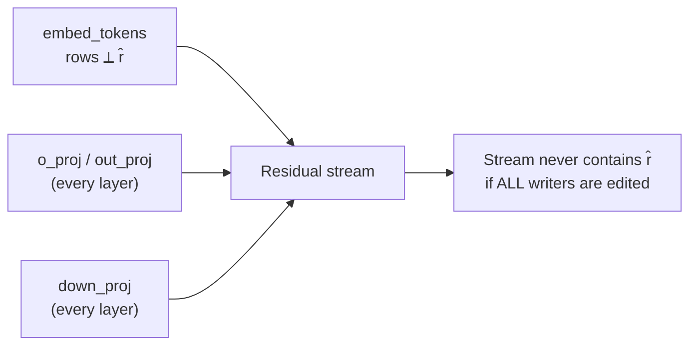
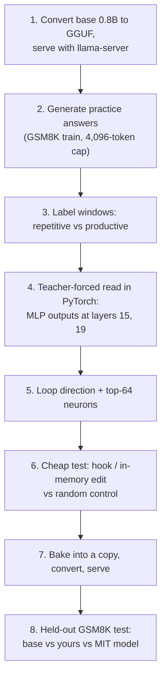

# Direction ablation: editing weights

Steering adds a direction at runtime. Ablation removes one, and the removal can be **baked into the weights** so the model simply can no longer write that direction. This is the exact operation behind the MIT loop fix and behind "abliterated" models. In this lesson you derive the math from scratch, apply it with hooks, bake it into a checkpoint, and then reproduce the spirit of the MIT experiment on Qwen3.5-0.8B: find a loop direction in layers 15 and 19, remove it, and measure. Then you'll learn the path for doing the same to a 9B and loading it in LM Studio.

> [!GOALS]
> - Derive vector projection and direction removal from zero: x' = x − (x·r̂) r̂
> - Apply ablation at inference time with a hook, and bake it into weights with the correct orientation for PyTorch's `[out, in]` layout
> - Explain abliteration (refusal-direction removal) conceptually
> - Find a loop direction in Qwen3.5-0.8B, ablate it, evaluate it on held-out GSM8K, and compare with the MIT model
> - Edit 9B safetensors shard by shard, convert to GGUF, quantize and load in LM Studio

## The math, from zero

A vector is a list of numbers you can picture as an arrow. Use 2-D so you can draw it: x = (3, 4).

**Dot product.** Multiply matching entries and add: (3, 4)·(1, 0) = 3·1 + 4·0 = 3.

**Length.** |x| = √(x·x) = √(9 + 16) = 5.

**Unit vector.** Divide a vector by its length to get length 1: r = (6, 8) has length 10, so r̂ = (0.6, 0.8). Unit vectors are pure directions.

**Projection.** For a unit vector r̂, the number x·r̂ is how far x goes along r̂, and (x·r̂) r̂ is the part of x that points along r̂.

**Removal.** Subtract that part:

```text
x' = x − (x·r̂) r̂
```

Worked example with x = (3, 4) and r̂ = (1, 0) (the horizontal axis):

```text
x·r̂ = 3
(x·r̂) r̂ = (3, 0)
x' = (3, 4) − (3, 0) = (0, 4)       → horizontal component gone, vertical untouched
check: x'·r̂ = 0·1 + 4·0 = 0          → x' has nothing left along r̂
```

With r̂ = (0.6, 0.8): x·r̂ = 1.8 + 3.2 = 5, so x' = (3, 4) − 5·(0.6, 0.8) = (0, 0). This x pointed entirely along r̂, so nothing survives.

**Strength.** Generalize with a factor s: x' = x − s (x·r̂) r̂. Then x'·r̂ = (1 − s)(x·r̂).

| s | Effect on the component along r̂ |
|---|---|
| 0 | Unchanged |
| 0.5 | Halved |
| 1 | Removed exactly (projection) |
| 2 | Flipped (mirror image) |
| 6 | Reversed and amplified 5x (the MIT logs report "strength 6"; you measured what it means in the last lesson) |

**Matrix form.** Removal is a matrix: P = I − r̂ r̂ᵀ, where r̂ r̂ᵀ is the outer product (a d × d matrix). P x = x − r̂(r̂ᵀx), the same formula. Applying it twice changes nothing more (P P = P), which is what makes it a projection.

> [!CONCEPT] Directional ablation
> Removing a direction from activations by projecting it out, so the model can no longer represent (or write) that feature along that axis. Distinct from **zero ablation** (setting a whole component's output to zero) and **mean ablation** (replacing it with its average).

## Ablation at inference time

The hook version: wherever a component writes into the residual stream, subtract the component along r̂.

```python
def make_ablation_hook(r_hat, s=1.0):
    def hook(module, inputs, output):
        h = output[0] if isinstance(output, tuple) else output
        r = r_hat.to(h.device, h.dtype)
        h = h - s * (h @ r).unsqueeze(-1) * r       # x' = x - s (x.r) r, for every token
        return (h, *output[1:]) if isinstance(output, tuple) else h
    return hook

# Example: ablate from what the MLPs of layers 15 and 19 write
# model.model.layers[15].mlp.register_forward_hook(make_ablation_hook(r15))
```

Hooks are perfect for experiments: instant to apply, instant to remove, no files touched. They're useless for LM Studio, which can't run your Python. For that, bake the edit into the weights.

## Baking it into weights

A writer matrix W maps an input to an output that is added to the stream: y = W x. If you want every output to have the direction removed:

```text
y' = P y = (I − r̂ r̂ᵀ) W x      →      W' = W − r̂ (r̂ᵀ W)
```

**Orientation is where people get this wrong.** PyTorch's `nn.Linear` stores weights as `[out, in]`, so for writers the *output* dimension (the residual stream, size 1,024 or 4,096) comes first:

| Tensor | PyTorch shape (0.8B) | Stream dimension is | Edit |
|---|---|---|---|
| `mlp.down_proj.weight` | [1024, 3584] | rows (dim 0) | `W -= torch.outer(r, r @ W)` |
| `self_attn.o_proj.weight` | [1024, 2048] | rows | same |
| `linear_attn.out_proj.weight` | [1024, 2048] | rows | same |
| `embed_tokens.weight` | [248320, 1024] | columns (dim 1): each row is one token's vector | `E -= torch.outer(E @ r, r)` |

In words: for a writer, `r @ W` gives, for each input unit (each neuron, each column), how much it writes along r; subtracting `outer(r, r @ W)` removes exactly that from each column. For the embedding, each row is a vector placed in the stream, so you project each row instead. Qwen3.5 has no biases on these layers (`attention_bias: false`); if a model has a writer bias b, also do b −= (b·r̂) r̂.



Two scopes:

- **Full orthogonalization.** Edit the embeddings and every attention-output and `down_proj` matrix. Since a pre-norm transformer's residual stream is exactly the sum of everything written into it, the stream can then never contain r̂. This matches inference-time ablation at every layer. It is what abliteration does.
- **Targeted ablation.** Edit only the writers you've identified (the MIT edit: 64 columns of two `down_proj` matrices). The concept can still be written elsewhere; you've only cut the main source. Smaller blast radius, smaller side effects.

> [!WARNING]
> Do the math in float32, then cast back to bf16: `W.float()` → edit → `.to(torch.bfloat16)`. Editing in bf16 directly adds rounding error comparable to small edits. And never edit GGUF-layout tensors with this code: GGUF lists dimensions in reverse, so the "rows" above would be the wrong axis.

## Abliteration: the same projection, aimed at refusals

Arditi et al. (2024), "Refusal in Language Models Is Mediated by a Single Direction", found that across 13 open chat models up to 72B parameters, refusing harmful requests is largely controlled by one direction. They computed it by difference of means between activations on harmful and harmless instructions, showed that ablating it stops refusals and adding it makes the model refuse harmless requests, and showed it can be made permanent by orthogonalizing the writer weights exactly as above. The community calls this **abliteration**.

Your HauhauCS model's card doesn't say how it was uncensored. Abliteration-style direction removal (often plus some fine-tuning to repair quality) is the most common recipe for such models, so it's likely related, but that's an inference, not a documented fact. The trade-offs are covered in [Alignment, refusals and "uncensored"](#/foundations/alignment-uncensored): refusals gone, safety net gone, and a typically small quality cost because the removed direction overlaps other features. This lesson's lab targets **repetition loops**, the MIT study's target, because it's a capability fix you can measure objectively; the method transfers to any direction.

## Lab: reproduce the spirit of the MIT fix

The plan mirrors Astra's run, scaled to a laptop:



Why the split: PyTorch on a Mac is fine for reading (one forward pass per text) but slow for generating thousands of thinking tokens. llama.cpp on Metal generates much faster. So generation happens in llama-server, analysis in PyTorch, just like Astra's split between a CPU kernel and a forward-pass service.

> [!MAC]
> Budget roughly 1–2 hours of generation for practice data and another 1–2 hours for evaluation on a MacBook Air, which will throttle under sustained load (it's fanless). Run long steps plugged in, lid open, and consider `caffeinate -i` in front of the command so the Mac doesn't sleep.

### Step 0: tools

```bash
brew install llama.cpp
git clone --depth 1 https://github.com/ggml-org/llama.cpp ~/ai-lab/llama.cpp
python3 -m venv ~/ai-lab/llama.cpp/.venv
~/ai-lab/llama.cpp/.venv/bin/pip install -r ~/ai-lab/llama.cpp/requirements/requirements-convert_hf_to_gguf.txt
cd ~/ai-lab/weights && source .venv/bin/activate && pip install openai
mkdir -p gguf
```

The converter gets its own venv because its pinned requirements can conflict with your weights venv. [Merge, convert to GGUF, load in LM Studio](#/finetune/export-gguf) explains conversion in depth.

### Step 1: a GGUF of the base model

```bash
~/ai-lab/llama.cpp/.venv/bin/python ~/ai-lab/llama.cpp/convert_hf_to_gguf.py \
  models/Qwen3.5-0.8B --outfile gguf/base-q8_0.gguf --outtype q8_0
llama-server -m gguf/base-q8_0.gguf --port 8081 -ngl 99 -c 20480 -np 4 --reasoning-format none
```

`-np 4` gives four parallel slots, each with 20480 / 4 = 5,120 tokens of context: enough for a prompt plus a 4,096-token answer. `--reasoning-format none` keeps the thinking text inside `content`, which you need for loop detection. Q8_0 is used for every model you compare, so quantization affects them all equally.

### Step 2: shared helpers and generation

```python title="loopkit.py"
"""Shared pieces for the loop lab: data, grading, repetition detection."""
import re

from datasets import load_dataset

SUFFIX = "\n\nPlease reason step by step, and put your final answer within \\boxed{}."
CAP = 4096                    # max new tokens (the study used 32,768)
LAYERS = (15, 19)             # where the MIT edit lived
WINDOW, NGRAM = 64, 8         # window size and n-gram size (tokens) for labels
POS_MIN, POS_MAX = 512, 4096  # compare windows only in this response-position band


def gsm8k(split: str, n: int, seed: int = 0) -> list[dict]:
    ds = load_dataset("openai/gsm8k", "main", split=split).shuffle(seed=seed).select(range(n))
    return [{"question": r["question"], "gold": r["answer"].split("####")[-1].strip().replace(",", "")}
            for r in ds]


def final_answer(text: str) -> str | None:
    tail = text.split("</think>")[-1]
    boxed = re.findall(r"\\boxed\{([^{}]*)\}", tail)
    if boxed:
        return boxed[-1]
    nums = re.findall(r"-?\d[\d,]*(?:\.\d+)?", tail)
    return nums[-1] if nums else None


def is_correct(text: str, gold: str) -> bool:
    ans = final_answer(text)
    if ans is None:
        return False
    ans = ans.replace(",", "").replace("$", "").strip()
    try:
        return abs(float(ans) - float(gold)) < 1e-6
    except ValueError:
        return ans == gold


def repeated_flags(seq: list, n: int = NGRAM) -> list[bool]:
    """flags[t] is True when the n-gram ending at position t already appeared earlier."""
    seen, flags = set(), []
    for t in range(len(seq)):
        if t < n - 1:
            flags.append(False)
            continue
        gram = tuple(seq[t - n + 1:t + 1])
        flags.append(gram in seen)
        seen.add(gram)
    return flags


def is_looping(text: str) -> bool:
    """Most of the last 300 words are repeats of earlier 6-word sequences."""
    tail = repeated_flags(text.split(), 6)[-300:]
    return len(tail) >= 100 and sum(tail) / len(tail) > 0.6
```

```python title="gen.py"
"""Generate GSM8K answers from an OpenAI-compatible server (llama-server or LM Studio) into JSONL."""
import argparse
import json
from concurrent.futures import ThreadPoolExecutor

from openai import OpenAI

from loopkit import CAP, SUFFIX, gsm8k, is_correct, is_looping


def run_one(client: OpenAI, model: str, item: dict, seed: int) -> dict:
    r = client.chat.completions.create(
        model=model,
        messages=[{"role": "user", "content": item["question"] + SUFFIX}],
        temperature=0.6, top_p=0.95, presence_penalty=1.5, max_tokens=CAP, seed=seed,  # the study's eval sampling
        extra_body={"top_k": 20, "chat_template_kwargs": {"enable_thinking": True}},
    )
    c = r.choices[0]
    text = c.message.content or ""
    finished = c.finish_reason == "stop"
    return {**item, "seed": seed, "text": text, "finish_reason": c.finish_reason,
            "tokens": r.usage.completion_tokens,
            "looping": (not finished) and is_looping(text),
            "correct": finished and is_correct(text, item["gold"])}


def main() -> None:
    ap = argparse.ArgumentParser()
    ap.add_argument("--split", default="train")
    ap.add_argument("--n", type=int, default=32)
    ap.add_argument("--samples", type=int, default=2)
    ap.add_argument("--port", type=int, default=8081)
    ap.add_argument("--model", default="local")
    ap.add_argument("--seed", type=int, default=0, help="dataset shuffle seed")
    ap.add_argument("--out", required=True)
    a = ap.parse_args()
    client = OpenAI(base_url=f"http://localhost:{a.port}/v1", api_key="lm-studio", timeout=3600)
    jobs = [(item, s) for item in gsm8k(a.split, a.n, a.seed) for s in range(a.samples)]
    with ThreadPoolExecutor(max_workers=4) as pool, open(a.out, "w") as f:
        for i, rec in enumerate(pool.map(lambda j: run_one(client, a.model, *j), jobs), 1):
            f.write(json.dumps(rec) + "\n")
            f.flush()
            print(f"{i}/{len(jobs)} {rec['finish_reason']:6s} looping={rec['looping']} correct={rec['correct']}")


if __name__ == "__main__":
    main()
```

```python title="score.py"
"""Summarize one or more gen.py JSONL files."""
import json
import sys

print(f"{'file':28s} {'runs':>5s} {'finished':>9s} {'looping':>8s} {'cut,other':>9s} {'accuracy':>9s} {'mean tok':>9s}")
for path in sys.argv[1:]:
    rows = [json.loads(line) for line in open(path)]
    n = len(rows)
    fin = sum(r["finish_reason"] == "stop" for r in rows)
    loop = sum(r["looping"] for r in rows)
    acc = sum(r["correct"] for r in rows)
    tok = sum(r["tokens"] for r in rows) / n
    print(f"{path:28s} {n:5d} {fin / n:9.1%} {loop / n:8.1%} {(n - fin - loop) / n:9.1%} {acc / n:9.1%} {tok:9.0f}")
```

Generate practice data from the **train** split (never the test split, which is your held-out set):

```bash
caffeinate -i python gen.py --split train --n 32 --samples 2 --out practice_base.jsonl
python score.py practice_base.jsonl
```

Expect many runs to be cut at 4,096 tokens. Some are true loops; some are healthy reasoning that simply needed more room (the MIT edited model's correct answers had a median of about 9,200 thinking tokens). That's why the lab measures **loop rate** separately from **truncation**.

### Step 3–5: find the loop direction

Now read every practice run back through the PyTorch model (teacher forcing: feed the full text, no generation), and compare repetitive windows against productive windows **at the same response positions** (512 to 4,096) so length and position don't masquerade as "looping".

```python title="collect.py"
"""Teacher-forced read of practice runs: loop direction and top-64 neurons at layers 15 and 19."""
import json
import os
import sys

import torch

from common import chat, load
from loopkit import CAP, LAYERS, NGRAM, POS_MAX, POS_MIN, SUFFIX, WINDOW, repeated_flags


def window_masks(resp_ids: list[int]) -> tuple[torch.Tensor, torch.Tensor]:
    rep = repeated_flags(resp_ids, NGRAM)
    n = len(resp_ids)
    rep_m, prod_m = torch.zeros(n, dtype=torch.bool), torch.zeros(n, dtype=torch.bool)
    for s in range(POS_MIN, min(n, POS_MAX) - WINDOW + 1, WINDOW):
        frac = sum(rep[s:s + WINDOW]) / WINDOW
        if frac > 0.8:
            rep_m[s:s + WINDOW] = True          # window mostly repeats earlier text
        elif frac < 0.1:
            prod_m[s:s + WINDOW] = True         # window is mostly new text
    return rep_m, prod_m


def encode(tok, rec: dict) -> tuple[list[int], list[int]]:
    prompt = tok(chat(tok, rec["question"] + SUFFIX, thinking=True), add_special_tokens=False).input_ids
    resp = tok(rec["text"], add_special_tokens=False).input_ids[:CAP]
    return prompt, resp


@torch.no_grad()
def main(paths: list[str]) -> None:
    tok, model = load()
    layers = model.model.layers
    acc = {L: {c: {"out": torch.zeros(1024, dtype=torch.float64), "in": torch.zeros(3584, dtype=torch.float64), "n": 0}
               for c in ("rep", "prod")} for L in LAYERS}
    grabbed = {}
    hooks = []
    for L in LAYERS:
        hooks.append(layers[L].mlp.register_forward_hook(
            lambda m, i, o, L=L: grabbed.__setitem__(("out", L), o[0].float().cpu())))
        hooks.append(layers[L].mlp.down_proj.register_forward_pre_hook(
            lambda m, i, L=L: grabbed.__setitem__(("in", L), i[0][0].float().cpu())))

    runs = [json.loads(line) for p in paths for line in open(p)]
    for k, rec in enumerate(runs):
        prompt, resp = encode(tok, rec)
        rep_m, prod_m = window_masks(resp)
        if not (rep_m.any() or prod_m.any()):
            continue
        ids = torch.tensor([prompt + resp], device=model.device)
        model.model(input_ids=ids)               # base model only: skips the huge LM-head output
        off = len(prompt)
        for L in LAYERS:
            out, inp = grabbed[("out", L)][off:], grabbed[("in", L)][off:]
            for c, m in (("rep", rep_m), ("prod", prod_m)):
                if m.any():
                    acc[L][c]["out"] += out[m].sum(0).double()
                    acc[L][c]["in"] += inp[m].sum(0).double()
                    acc[L][c]["n"] += int(m.sum())
        print(f"{k + 1}/{len(runs)} rep tokens {int(rep_m.sum())}, prod tokens {int(prod_m.sum())}")
    for h in hooks:
        h.remove()

    result = {"r_hat": {}, "cols": {}, "coverage": {}}
    for L in LAYERS:
        a = acc[L]
        print(f"\nlayer {L}: rep tokens {a['rep']['n']}, prod tokens {a['prod']['n']}")
        d_out = a["rep"]["out"] / a["rep"]["n"] - a["prod"]["out"] / a["prod"]["n"]
        r_hat = (d_out / d_out.norm()).float()
        W = layers[L].mlp.down_proj.weight.float().cpu()          # [1024, 3584]
        d_in = (a["rep"]["in"] / a["rep"]["n"] - a["prod"]["in"] / a["prod"]["n"]).float()
        score = d_in * (r_hat @ W)          # each neuron's contribution to the contrast along r_hat
        top = torch.topk(score, 64).indices
        cov = float(score[top].sum() / score.sum())
        result["r_hat"][L], result["cols"][L], result["coverage"][L] = r_hat, top, cov
        print(f"  |mean difference| {float(d_out.norm()):.3f}; top-64 neurons cover {cov:.0%} of the contrast")
        print(f"  top neurons: {top[:16].tolist()} ...")
    cos = float(result["r_hat"][LAYERS[0]] @ result["r_hat"][LAYERS[1]])
    print(f"\ncosine(layer 15 direction, layer 19 direction) = {cos:+.3f}")
    torch.save(result, "loop_dirs.pt")

    if os.path.exists("astra_directions.pt"):
        astra = torch.load("astra_directions.pt")
        for L in LAYERS:
            ref = astra[f"model.language_model.layers.{L}.mlp.down_proj.weight"]
            overlap = len(set(ref["cols"].tolist()) & set(result["cols"][L].tolist()))
            print(f"layer {L}: |cos| with Astra's direction {abs(float(ref['u'] @ result['r_hat'][L])):.3f}; "
                  f"shared neurons {overlap}/64")


if __name__ == "__main__":
    main(sys.argv[1:] or ["practice_base.jsonl"])
```

```bash
python collect.py practice_base.jsonl | tee collect.txt
```

How to read it:

- **Token counts.** You need a few thousand tokens in each class. If `rep` is tiny, generate more practice runs or lower `POS_MIN`.
- **Coverage.** The fraction of the layer's repetitive-vs-productive contrast written by the top 64 neurons. Astra reported about 91% (layer 15) and 98% (layer 19). Concentrated coverage is what makes a 64-column edit possible.
- **Comparison with Astra.** `astra_directions.pt` comes from the checkpoint diff in [Open and inspect real weights](#/weights/inspect-weights). The absolute cosine is used because a direction found by SVD has an arbitrary sign. Anything well above what two random 1,024-dimensional directions give (around 0.03) means you found related structure; how close you get with 64 runs instead of Astra's thousands is an honest measure of your data budget.

### Step 6: cheap test before you spend generation time

Astra used teacher-forced reads to screen edits before spending generation passes. Do the same: measure how likely the model finds the **repetitive** tokens versus the **productive** ones, with and without the edit, plus a random-direction control.

```python title="test_edit.py"
"""Screen edits by teacher-forced log-likelihood on repetitive vs productive windows."""
import json
from contextlib import contextmanager

import torch

from collect import encode, window_masks
from common import load
from loopkit import LAYERS


@contextmanager
def column_edit(model, r_hats: dict, cols: dict, s: float):
    """Temporarily apply W[:, cols] -= s * r (r^T W[:, cols]) to down_proj at LAYERS."""
    saved = {}
    for L in LAYERS:
        W = model.model.layers[L].mlp.down_proj.weight
        saved[L] = W.data.clone()
        r, c = r_hats[L].to(W.device), cols[L].to(W.device)
        block = W.data[:, c].float()
        W.data[:, c] = (block - s * torch.outer(r, r @ block)).to(W.dtype)
    try:
        yield
    finally:
        for L in LAYERS:
            model.model.layers[L].mlp.down_proj.weight.data.copy_(saved[L])


@torch.no_grad()
def window_logprobs(model, ids: torch.Tensor, off: int, masks) -> list[float]:
    h = model.model(input_ids=ids).last_hidden_state[0]          # already final-normed
    res = []
    for m in masks:
        pos = (torch.where(m)[0] + off).to(ids.device)             # positions of target tokens
        if len(pos) == 0:
            res.append(float("nan"))
            continue
        total = 0.0
        for chunk in pos.split(512):                               # keep the 248k-wide logits small
            logp = torch.log_softmax(model.lm_head(h[chunk - 1]).float(), dim=-1)
            total += float(logp.gather(1, ids[0, chunk].unsqueeze(1)).sum())
        res.append(total / len(pos))
    return res


def main() -> None:
    tok, model = load()
    dirs = torch.load("loop_dirs.pt")
    g = torch.Generator().manual_seed(0)
    rand = {L: (v := torch.randn(1024, generator=g)) / v.norm() for L in LAYERS}
    runs = [json.loads(l) for l in open("practice_base.jsonl")]
    data = []
    for rec in runs:
        prompt, resp = encode(tok, rec)
        rep_m, prod_m = window_masks(resp)
        if rep_m.any() and prod_m.any():
            data.append((torch.tensor([prompt + resp], device=model.device), len(prompt), (rep_m, prod_m)))
    data = data[:12]                                               # enough for a screen
    print(f"screening on {len(data)} runs with both window types\n")

    def measure():
        vals = [window_logprobs(model, ids, off, m) for ids, off, m in data]
        return [sum(v[i] for v in vals) / len(vals) for i in (0, 1)]

    base = measure()
    print(f"{'condition':24s} {'rep logp':>9s} {'prod logp':>10s} {'d rep':>7s} {'d prod':>7s}")
    print(f"{'base':24s} {base[0]:9.3f} {base[1]:10.3f}")
    for label, r_hats, s in [("loop dir, s=1", dirs["r_hat"], 1.0), ("loop dir, s=3", dirs["r_hat"], 3.0),
                             ("loop dir, s=6", dirs["r_hat"], 6.0), ("RANDOM dir, s=6", rand, 6.0)]:
        with column_edit(model, r_hats, dirs["cols"], s):
            rep, prod = measure()
        print(f"{label:24s} {rep:9.3f} {prod:10.3f} {rep - base[0]:+7.3f} {prod - base[1]:+7.3f}")


if __name__ == "__main__":
    main()
```

```bash
python test_edit.py
```

A promising edit lowers the log-probability of repetitive tokens (negative `d rep`) noticeably more than productive ones, and the random control barely moves either. If the random direction does as much as yours, your direction isn't special: go back to data and contrasts before spending generation time. Teacher forcing is only a proxy (the text is given, so copying still works), which is exactly why the final judge is generation.

### Step 7: bake the edit into a copy

```python title="bake.py"
"""Write a copy of Qwen3.5-0.8B with the loop direction removed from down_proj at layers 15 and 19."""
import argparse
import os
import shutil

import torch
from safetensors.torch import load_file, save_file

from common import BASE_DIR, ROOT, SHARD
from loopkit import LAYERS


def main() -> None:
    ap = argparse.ArgumentParser()
    ap.add_argument("--strength", type=float, default=3.0)
    ap.add_argument("--mode", choices=["cols", "full"], default="cols", help="64 neurons, or whole matrix")
    ap.add_argument("--out", default=os.path.join(ROOT, "models", "Qwen3.5-0.8B-myfix"))
    a = ap.parse_args()
    if os.path.exists(a.out):
        raise SystemExit(f"{a.out} already exists; pick a new --out (never overwrite checkpoints)")
    dirs = torch.load("loop_dirs.pt")
    shutil.copytree(BASE_DIR, a.out, ignore=shutil.ignore_patterns(SHARD, ".cache"))   # configs, tokenizer
    tensors = load_file(os.path.join(BASE_DIR, SHARD))                                 # ~1.75 GB in RAM
    for L in LAYERS:
        name = f"model.language_model.layers.{L}.mlp.down_proj.weight"
        W = tensors[name].float()                                       # [1024, 3584], math in fp32
        r = dirs["r_hat"][L].float()
        cols = dirs["cols"][L] if a.mode == "cols" else torch.arange(W.shape[1])
        block = W[:, cols]
        W[:, cols] = block - a.strength * torch.outer(r, r @ block)    # W' = W - s r (r^T W) on chosen columns
        tensors[name] = W.to(torch.bfloat16)
        print(f"edited {name}: {len(cols)} columns, strength {a.strength}")
    save_file(tensors, os.path.join(a.out, SHARD), metadata={"format": "pt"})
    with open(os.path.join(a.out, "EDIT.txt"), "w") as f:
        f.write(f"loop-direction removal, mode={a.mode}, strength={a.strength}, layers={LAYERS}\n")
    print("saved", a.out)


if __name__ == "__main__":
    main()
```

```bash
python bake.py --strength 3 --out models/Qwen3.5-0.8B-myfix-s3
python compare_checkpoints.py models/Qwen3.5-0.8B/model.safetensors-00001-of-00001.safetensors \
  models/Qwen3.5-0.8B-myfix-s3/model.safetensors-00001-of-00001.safetensors
```

The diff tool you wrote to audit Astra now audits you: exactly two tensors, 64 columns each, a rank-one change, and a strength estimate matching what you asked for. (The hash check will say `False`, correctly: it's not Astra's edit.) Use `--mode full` with strength 1–2 for the whole-matrix variant; strength 6 on a full matrix is a sledgehammer.

### Step 8: evaluate on held-out data

Convert both your model and the MIT model the same way as the base, then serve and test each in turn on the GSM8K **test** split:

```bash
for m in Qwen3.5-0.8B-myfix-s3 Qwen3.5-0.8B-wsp; do
  ~/ai-lab/llama.cpp/.venv/bin/python ~/ai-lab/llama.cpp/convert_hf_to_gguf.py \
    models/$m --outfile gguf/$m-q8_0.gguf --outtype q8_0
done
```

For each of `base-q8_0.gguf`, `Qwen3.5-0.8B-myfix-s3-q8_0.gguf` and `Qwen3.5-0.8B-wsp-q8_0.gguf`: start llama-server with the same flags as Step 1, then run (in another terminal) the matching line, then stop the server with <kbd>Ctrl</kbd>+<kbd>C</kbd>:

```bash
caffeinate -i python gen.py --split test --n 40 --samples 1 --out eval_base.jsonl
caffeinate -i python gen.py --split test --n 40 --samples 1 --out eval_myfix.jsonl
caffeinate -i python gen.py --split test --n 40 --samples 1 --out eval_wsp.jsonl
python score.py eval_base.jsonl eval_myfix.jsonl eval_wsp.jsonl
```

Read the result honestly:

- **Sampling noise.** With 40 problems, a 50% accuracy has a standard error of about √(0.5 × 0.5 / 40) ≈ 8 points. Differences under ~15 points are not established. Rerun with `--seed 1` and `--seed 2` (different problems) before believing a gap.
- **The cap.** At 4,096 tokens, even a fixed model gets truncated often. Loop rate is your primary metric here; accuracy is secondary. For a closer replication, raise `CAP` to 16,384 (and `-c` to `-np` × 17,000) and run overnight.
- **What a win looks like.** Loop rate clearly below the base, more finished answers, accuracy at least as good, and the random control (bake one with a random direction if you want to be thorough) showing none of this.
- **Expect the MIT model to beat yours.** Astra used thousands of practice generations, a 32K cap and 50 targeted experiments; you used 64 runs. Getting a measurable loop reduction is a success.

> [!LAB] Make it yours
> 1. Run the full pipeline above once with defaults and record the table in `notes.md`.
> 2. Try strengths 1, 3 and 6 (three `bake.py` outputs) and plot loop rate against strength. Is there a dose-response?
> 3. Bake a random-direction control (edit `bake.py` to load `rand` instead of `r_hat`) and evaluate it. This is the experiment that makes the others meaningful.
> 4. Try layers other than 15 and 19: rerun `collect.py` with `LAYERS = (11, 15, 19, 23)` and compare coverage. Did Astra pick the strongest writers?

## The 9B path

Everything above scales to the 9B, with three changes: you edit the **official** `Qwen/Qwen3.5-9B` safetensors, you never load the whole model, and you need a 9B-specific direction.

### Why the official safetensors, not your GGUF

The HauhauCS model is published only as GGUF files, so there is no safetensors checkpoint of it to edit; an edited 9B made this way is official Qwen3.5-9B plus your edit, without the uncensoring. Why not edit the Q4_K_M GGUF directly?

- **No place to compute the direction.** You find directions with PyTorch hooks; you can't hook the GGUF inside LM Studio.
- **No K-quant writer.** The `gguf` Python package can dequantize `Q4_K`/`Q6_K` but can't re-encode them. You'd have to store edited tensors at higher precision or round-trip through llama.cpp's quantizer.
- **Double quantization.** A Q4_K_M weight is already an approximation; editing it and re-quantizing compounds error, and 4-bit block error can be as large as a surgical edit.
- **Blocks, not weights.** K-quants encode 256-weight blocks with shared scales, so changing 64 columns forces re-encoding every block they touch.
- **Layout.** GGUF renames tensors and reverses dimension order (and for some architectures permutes tensors during conversion), so PyTorch-layout edit code would hit the wrong axis.

The clean pipeline is: edit bf16 safetensors → convert to GGUF → quantize. (The HauhauCS BF16 GGUF could in principle be edited with `gguf`'s BF16 support, but you'd need a direction computed on that exact model and you'd be writing a 17 GB file by hand. An advanced project, not this one.)

### Step 1: does your 9B even loop?

The Gemma control taught the key lesson: no obstacle, no gain. Before editing anything, measure. Load the 9B in LM Studio with thinking on and run the same generator against it:

```bash
caffeinate -i python gen.py --port 1234 --model qwen3.5-9b-uncensored-hauhaucs-aggressive \
  --split train --n 20 --samples 1 --out practice_9b.jsonl
python score.py practice_9b.jsonl
```

(The 9B generates several times slower than the 0.8B; 20 problems can take an hour or more.) If the loop rate is low, the honest conclusion is "nothing to fix here"; consider style directions instead.

### Step 2: a 9B direction

The 0.8B direction is 1,024-dimensional and lives in a different learned space; it's meaningless for the 9B's 4,096 dimensions. Options:

| Option | How | Trade-off |
|---|---|---|
| llama.cpp on your Mac | `llama-cvector-generator --method mean` on the 9B GGUF, with repetitive text windows as positive lines and productive windows as negative lines (see [Activation steering](#/weights/steering) for the file format) | Runs on Metal; gives a residual-stream direction per layer (not per MLP); measured on the quantized HauhauCS model, applied to official weights |
| Rent a GPU | Run `collect.py` on bf16 Qwen3.5-9B on a 40+ GB GPU for an hour (change 1024/3584 to 4096/12288 and pick layers) | Most faithful; costs a few dollars |
| CPU/disk offload on the Mac | `device_map="auto"` with an offload folder in transformers | Works for short teacher-forced reads, very slow |

Whichever you choose, save the result as an edits file mapping tensor names to `{"r": tensor[4096], "cols": LongTensor or None, "strength": float}`. For example, from a llama.cpp control vector:

```python title="cvec_to_edits.py"
"""Turn a llama.cpp control vector into a down_proj edit spec for the 9B (targeted, whole matrix)."""
import sys

import torch
from gguf import GGUFReader

LAYERS = [int(x) for x in sys.argv[2].split(",")]       # e.g. "15,19"
r = GGUFReader(sys.argv[1])
vecs = {int(t.name.split(".")[1]): torch.tensor(t.data.copy()) for t in r.tensors if t.name.startswith("direction.")}
edits = {}
for L in LAYERS:
    v = vecs[L] / vecs[L].norm()                         # direction.N = layer N's output, llama.cpp convention
    edits[f"model.language_model.layers.{L}.mlp.down_proj.weight"] = {"r": v, "cols": None, "strength": 1.0}
torch.save(edits, "edits_9b.pt")
print("layers available:", sorted(vecs), "| wrote edits for", LAYERS)
```

### Step 3: streaming per-shard edit

```bash
cd ~/ai-lab/weights
hf download Qwen/Qwen3.5-9B --local-dir models/Qwen3.5-9B      # 19.3 GB
```

```python title="edit_9b.py"
"""Edit Qwen3.5-9B safetensors shard by shard; untouched shards are hard-linked, never rewritten."""
import argparse
import json
import os
import shutil
from collections import defaultdict

import torch
from safetensors import safe_open
from safetensors.torch import save_file

SRC = os.path.expanduser("~/ai-lab/weights/models/Qwen3.5-9B")
INDEX = "model.safetensors.index.json"


def main() -> None:
    ap = argparse.ArgumentParser()
    ap.add_argument("--edits", default="edits_9b.pt")
    ap.add_argument("--out", required=True)
    a = ap.parse_args()
    if os.path.exists(a.out):
        raise SystemExit("output exists; refusing to overwrite")
    edits = torch.load(a.edits)
    weight_map = json.load(open(os.path.join(SRC, INDEX)))["weight_map"]
    by_shard = defaultdict(list)
    for name in edits:
        by_shard[weight_map[name]].append(name)            # KeyError here = wrong tensor name

    os.makedirs(a.out)
    for fn in os.listdir(SRC):                             # configs, tokenizer, index: plain copies
        p = os.path.join(SRC, fn)
        if os.path.isfile(p) and not fn.endswith(".safetensors"):
            shutil.copy2(p, a.out)

    for shard in sorted(set(weight_map.values())):
        src, dst = os.path.join(SRC, shard), os.path.join(a.out, shard)
        if shard not in by_shard:
            os.link(src, dst)                              # same bytes, no extra disk
            print("linked ", shard)
            continue
        with safe_open(src, framework="pt") as f:          # one shard (~5.3 GB) in RAM at a time
            meta = f.metadata() or {"format": "pt"}
            tensors = {k: f.get_tensor(k) for k in f.keys()}
        for name in by_shard[shard]:
            e = edits[name]
            W = tensors[name].float()                      # e.g. [4096, 12288]
            r = e["r"].float() / e["r"].float().norm()
            cols = torch.arange(W.shape[1]) if e["cols"] is None else e["cols"]
            block = W[:, cols]
            W[:, cols] = block - e["strength"] * torch.outer(r, r @ block)
            tensors[name] = W.to(torch.bfloat16)
            print(f"edited {name} ({len(cols)} columns, s={e['strength']})")
        save_file(tensors, dst, metadata=meta)
        del tensors
        print("rewrote", shard)


if __name__ == "__main__":
    main()
```

```bash
python edit_9b.py --edits edits_9b.pt --out models/Qwen3.5-9B-noloop
```

> [!DANGER]
> Hard links share the same bytes on disk. That's safe here because nothing writes into those files, but never open a hard-linked shard for in-place modification: you'd silently alter the original too. If in doubt, replace `os.link` with `shutil.copy2` and pay the disk cost. Keep the original download untouched and verify it later with `hf download` (it re-checks files) or by hashing.

> [!MAC]
> Peak RAM is about one shard (≈5.3 GB) plus one float32 copy of the edited matrix (≈200 MB for a 4096 × 12288 `down_proj`). Quit LM Studio first. Disk is the real cost: 19.3 GB original + edited shards + an 18 GB bf16 GGUF + a 5.3 GB Q4_K_M. Delete the bf16 GGUF after quantizing.

### Step 4: convert, quantize, load in LM Studio

```bash
~/ai-lab/llama.cpp/.venv/bin/python ~/ai-lab/llama.cpp/convert_hf_to_gguf.py \
  models/Qwen3.5-9B-noloop --outfile gguf/qwen3.5-9b-noloop-bf16.gguf --outtype bf16
llama-quantize gguf/qwen3.5-9b-noloop-bf16.gguf gguf/qwen3.5-9b-noloop-Q4_K_M.gguf Q4_K_M
lms import gguf/qwen3.5-9b-noloop-Q4_K_M.gguf --copy
```

`lms import` **moves** the file by default; `--copy` keeps yours in place. For image input you'd also produce a vision projector with the converter's `--mmproj` option; text-only work doesn't need it. Then evaluate exactly as for the 0.8B: `gen.py` against LM Studio for the original official 9B quant and your edited one, same settings, held-out split, several seeds.

## Recap

- Removing a direction: x' = x − s (x·r̂) r̂; s = 1 projects it out, s > 1 reverses it. Matrix form P = I − r̂r̂ᵀ.
- Inference-time ablation uses a hook on what components write; baking it in uses W' = W − r̂(r̂ᵀW) for `[out, in]` writers and E' = E − (E r̂) r̂ᵀ for embeddings. Do the math in fp32.
- Orthogonalizing every writer removes the direction from the residual stream entirely (abliteration's approach to refusal); targeted edits (like the MIT 64 columns) cut the main source only.
- The lab pipeline: generate in llama-server, read in PyTorch, label windows at matched positions, compute the direction and top neurons, screen with teacher-forced likelihood and a random control, bake into a copy, evaluate on held-out data with honest error bars.
- For the 9B: measure first, compute a 9B-specific direction, edit official safetensors shard by shard, then convert → quantize → `lms import --copy`. Don't edit the Q4_K_M GGUF directly.

## Check yourself

1. Apply x' = x − (x·r̂) r̂ to x = (2, 1) with r̂ = (0, 1). What's x', and how do you check it?
   <details><summary>Answer</summary>

   x·r̂ = 1, so x' = (2, 1) − 1·(0, 1) = (2, 0). Check: x'·r̂ = 0, so nothing is left along r̂, and the other component (2) is unchanged.

   </details>
2. Why is the update for `down_proj` `W -= outer(r, r @ W)` but for the embedding `E -= outer(E @ r, r)`?
   <details><summary>Answer</summary>

   `down_proj` is `[out=hidden, in=neurons]`: its outputs (columns' contents) live in the stream, so you project along dim 0: `r @ W` is each column's component along r. The embedding is `[vocab, hidden]`: each row is a vector placed into the stream, so you project each row: `E @ r` is each row's component along r.

   </details>
3. What does a random-direction control tell you, and what would it mean if it worked as well as your loop direction?
   <details><summary>Answer</summary>

   It tells you whether your specific direction matters or whether any perturbation of that size produces the effect (for example, by generally disrupting the model so it stops early). If the random edit worked just as well, your "loop direction" isn't capturing anything special, and the improvement can't be attributed to it.

   </details>
4. Why compare repetitive and productive windows only within the same response-position band?
   <details><summary>Answer</summary>

   Repetition happens late in long answers. Without matching positions, the difference of means would also capture "late in a long answer" (position, length), and removing that could just make the model stop early or behave strangely, rather than specifically stop looping.

   </details>
5. Give three reasons you edit the official Qwen3.5-9B safetensors rather than your Q4_K_M GGUF.
   <details><summary>Answer</summary>

   Any three of: you can't run hooks on the GGUF to find the direction; `gguf` can't write K-quants; re-quantizing already-quantized weights compounds error that can swamp a small edit; K-quants share scales across 256-weight blocks, so column edits force re-encoding whole blocks; GGUF renames and reverses (sometimes permutes) tensors. Also, the HauhauCS model has no safetensors release to edit.

   </details>

## Go deeper
- [Refusal in Language Models Is Mediated by a Single Direction](https://arxiv.org/abs/2406.11717) — the abliteration paper: difference of means, ablation, weight orthogonalization.
- [Uncensor any LLM with abliteration (Maxime Labonne)](https://huggingface.co/blog/mlabonne/abliteration) — a practical walkthrough of the technique and its quality costs.
- [lm_understand-logs, experiment 8](https://github.com/RikiyaT/lm_understand-logs) — Astra's explanations, dose-response tests and controls for the loop edit.
- [llama.cpp](https://github.com/ggml-org/llama.cpp) — `convert_hf_to_gguf.py`, `llama-quantize` and `llama-server`.
