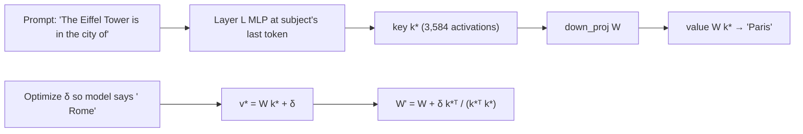

# Knowledge editing and model merging

Direction ablation removes something. This lesson covers the two other big families of weight surgery: **knowledge editing**, which rewrites a specific fact with a tiny, targeted update (ROME, MEMIT), and **weight arithmetic**, which treats whole fine-tunes as vectors you can add, subtract and blend (task arithmetic, model merging with mergekit, LoRA merging). You'll do task arithmetic on the MIT edit itself, verify a mergekit merge against your own math, and write a rank-one fact edit from scratch.

> [!GOALS]
> - Explain MLPs as key–value memories and how ROME rewrites one association with a rank-one update
> - Know what MEMIT adds, and the real limitations of knowledge editing
> - Compute, scale and negate a task vector, and evaluate the result
> - Merge models with mergekit (linear, SLERP, TIES, DARE) and know its Qwen3.5 caveats
> - Decide when merging or editing beats fine-tuning

## MLPs as key–value memories

Recall the MLP block from [Inside the transformer](#/foundations/transformer): `gate_proj`/`up_proj` read the residual stream into 3,584 neurons, `down_proj` writes back 1,024 numbers. Geva et al. (2021) gave this a memorable reading:

> [!CONCEPT] MLP as key–value memory
> Each neuron's input weights act as a **key** (a pattern to match in the stream) and its `down_proj` column acts as the **value** (what to write when it matches). The MLP is a giant lookup table: "if the stream looks like *Eiffel Tower, location?*, write *Paris-ish*". Writing it as one matrix: `down_proj` maps a key vector k (the 3,584 neuron activations) to a value vector v = W k.

You already used this view: Astra's 64 columns were 64 values that wrote "keep repeating". ROME uses it to change a fact.

## ROME: rewrite one fact with a rank-one update

**ROME** (Rank-One Model Editing, Meng et al., 2022) has two halves.

1. **Locate** with causal tracing (the activation-patching idea from [Interpretability 101](#/weights/interpretability-101)): corrupt the subject's embeddings with noise, then restore single layers' states and see which restorations bring the fact back. In GPT-style models the decisive site was the **MLPs of middle-early layers at the subject's last token**.
2. **Edit** one `down_proj` at that layer so that the key for the subject maps to a new value:
   - **k\*** = the MLP's neuron activations at the subject's last token (averaged over a few prompt variants);
   - **v\*** = the output vector that makes the model say the new object, found by optimizing a single vector (the model itself stays frozen);
   - update `W' = W + (v* − W k*) (C⁻¹ k*)ᵀ / (k*ᵀ C⁻¹ k*)`, where C is the covariance of typical keys.

That update is **rank one** (an outer product of two vectors), and it guarantees `W' k* = v*`. The covariance C is what makes ROME specific: it steers the change toward directions that typical other keys don't use, so unrelated facts are disturbed less. With C = I (identity) you get a simpler, leakier version, which is what you'll build.



Note the "no gradient descent" fine print: ROME uses a few gradient steps to find **v\*** (one 1,024-number vector), but the weight change itself is closed-form. That's different from training, where the optimizer moves millions of weights.

### MEMIT: many facts at once

**MEMIT** (Meng et al., 2022) extends ROME to thousands of edits by spreading each change across a range of MLP layers and solving one least-squares problem for all facts together. ROME applied sequentially degrades the model after a few dozen edits; MEMIT holds up far longer.

### Limitations you should know

| Problem | What happens |
|---|---|
| Ripple effects | Edit "Eiffel Tower is in Rome" and the model may still say the tower is in France, or that you take the Paris metro to see it. Related facts don't update (Cohen et al., 2023, "Evaluating the Ripple Effects of Knowledge Editing"). |
| Specificity | The edit can bleed into neighbors: "The Louvre is in Rome". Worse without the covariance term. |
| Paraphrase | Works on the prompt form you edited, weaker on rephrasings. |
| Accumulation | Many sequential edits destabilize the model. |
| Evaluation | "It says Rome now" is not enough; you need efficacy, paraphrase, neighborhood and fluency checks. |

**EasyEdit** (zjunlp) packages ROME, MEMIT, AlphaEdit, WISE, GRACE, MEND and more behind one API, with evaluation. Its July 2026 update added transformers 5 compatibility, and its repo includes `hparams/ROME/qwen3.5-9b.yaml` (edit layer 5, subject's last token, rewrite module `model.layers.{}.mlp.down_proj`, 25 optimization steps at learning rate 0.5 for v\*, covariance adjustment off). It's built around CUDA GPUs; the 9B won't fit on your Mac in bf16 anyway, so EasyEdit on the 9B is a cloud-GPU exercise. Check its README for the current `editor.edit(...)` arguments before scripting it.

> [!LAB] A rank-one fact edit from scratch (0.8B)
> This is ROME with C = I: simple, educational, and leakier than the real thing.
> 1. Save as `~/ai-lab/weights/rank_one_edit.py`:
> ```python title="rank_one_edit.py"
> """ROME-style rank-one edit with identity covariance on Qwen3.5-0.8B (in memory only)."""
> import torch
>
> from common import load
>
> LAYER = 4                                  # try 2, 4, 6, 8: pick with causal tracing
> SUBJECT = "Eiffel Tower"
> EDIT_PROMPTS = ["The Eiffel Tower is located in the city of",
>                 "The Eiffel Tower, a famous landmark, is in the city of",
>                 "Tourists visit the Eiffel Tower, which stands in the city of"]
> TARGET = " Rome"
> PARAPHRASES = ["Where is the Eiffel Tower? It is in the city of", "The city where you can see the Eiffel Tower is"]
> NEIGHBORS = ["The Louvre is located in the city of", "The Colosseum is located in the city of",
>              "Big Ben is located in the city of"]
>
>
> def subject_last(tok, prompt: str) -> int:
>     end = prompt.index(SUBJECT) + len(SUBJECT)
>     return len(tok(prompt[:end]).input_ids) - 1
>
>
> @torch.no_grad()
> def top_tokens(model, tok, prompt: str, k: int = 3) -> str:
>     ids = tok(prompt, return_tensors="pt").to(model.device)
>     p = torch.softmax(model(**ids).logits[0, -1].float(), -1)
>     v, i = p.topk(k)
>     return "  ".join(f"{tok.decode([int(t)])!r}:{float(q):.2f}" for q, t in zip(v, i))
>
>
> def main() -> None:
>     tok, model = load(dtype=torch.float32)             # fp32 for stable optimization
>     for p in model.parameters():
>         p.requires_grad_(False)
>     mlp = model.model.layers[LAYER].mlp
>     W = mlp.down_proj.weight                            # [1024, 3584]
>     target_id = tok(TARGET).input_ids[0]
>
>     # 1) key k*: down_proj input at the subject's last token, averaged over prompts
>     keys = []
>     for prompt in EDIT_PROMPTS:
>         idx = subject_last(tok, prompt)
>         h = mlp.down_proj.register_forward_pre_hook(lambda m, i, idx=idx: keys.append(i[0][0, idx].detach()))
>         with torch.no_grad():
>             model(**tok(prompt, return_tensors="pt").to(model.device))
>         h.remove()
>     k = torch.stack(keys).mean(0)                       # [3584]
>
>     # 2) value delta: optimize one vector added to the MLP output at that position
>     delta = torch.zeros(W.shape[0], device=model.device, requires_grad=True)
>     opt = torch.optim.Adam([delta], lr=0.5)
>     max_norm = 4 * float((W @ k).norm())                # ROME-style clamp
>     for step in range(25):
>         loss = 0.0
>         for prompt in EDIT_PROMPTS:
>             idx = subject_last(tok, prompt)
>             def add(m, i, o, idx=idx):
>                 o = o.clone()
>                 o[:, idx] = o[:, idx] + delta
>                 return o
>             h = mlp.register_forward_hook(add)
>             logits = model(**tok(prompt, return_tensors="pt").to(model.device)).logits[0, -1]
>             h.remove()
>             loss = loss - torch.log_softmax(logits, -1)[target_id]
>         loss = loss / len(EDIT_PROMPTS) + 1e-3 * delta.pow(2).sum()
>         opt.zero_grad()
>         loss.backward()
>         opt.step()
>         with torch.no_grad():
>             if delta.norm() > max_norm:
>                 delta.mul_(max_norm / delta.norm())
>     print(f"optimized delta: |delta| = {float(delta.norm()):.2f}, final loss {float(loss):.3f}")
>
>     print("\nBEFORE")
>     for p in EDIT_PROMPTS[:1] + PARAPHRASES + NEIGHBORS:
>         print(f"  {p[:55]:55s} {top_tokens(model, tok, p)}")
>     # 3) rank-one update: W' k* = W k* + delta
>     with torch.no_grad():
>         W += torch.outer(delta.detach(), k) / (k @ k)
>     print("\nAFTER (layer", LAYER, ")")
>     for p in EDIT_PROMPTS[:1] + PARAPHRASES + NEIGHBORS:
>         print(f"  {p[:55]:55s} {top_tokens(model, tok, p)}")
>
>
> if __name__ == "__main__":
>     main()
> ```
> 2. Run `python rank_one_edit.py`. It needs about 3.5 GB of RAM in fp32 and a minute or two.
> 3. Score it like a researcher: **efficacy** (edit prompt now says Rome), **generalization** (paraphrases), **specificity** (neighbors unchanged). Expect the identity-covariance version to leak into neighbors more than real ROME.
> 4. Sweep `LAYER` over 2, 4, 6, 8, 12. Where is the edit both effective and specific? Compare with your activation-patching grid from Interpretability 101.
> 5. Ripple test: ask "The Eiffel Tower is in the country of" after the edit. Did "France" change?

## Task arithmetic: fine-tunes as vectors

> [!CONCEPT] Task vector
> The difference between a fine-tuned model and its base, tensor by tensor: τ = θ_finetuned − θ_base. Ilharco et al. (2022) showed you can **add** task vectors to gain skills, **negate** one to remove a behavior, and **combine** several. A model becomes θ_base + α·τ, with α a dial.

The MIT edit is the smallest task vector you'll ever see: nonzero in two tensors, 64 columns each. That makes it perfect for exploring the dial.

| α | Meaning |
|---|---|
| 0 | Base model |
| 0.5 | Half the edit |
| 1 | The released model |
| 1.5 | Extrapolate past it |
| −1 | Negate: push toward looping (a good sanity check that the vector "means" something) |

> [!LAB] Turn the MIT edit into a dial
> 1. Save as `~/ai-lab/weights/task_vector.py` (it reuses the screening code from [Direction ablation](#/weights/direction-ablation)):
> ```python title="task_vector.py"
> """Scale the MIT task vector (edited - base) and screen each alpha with teacher-forced likelihood."""
> import json
> import os
> import shutil
> import sys
>
> import torch
> from safetensors import safe_open
> from safetensors.torch import load_file, save_file
>
> from collect import encode, window_masks
> from common import BASE_DIR, EDITED_DIR, ROOT, SHARD, ckpt_to_module, load
> from test_edit import window_logprobs
>
> NAMES = [f"model.language_model.layers.{L}.mlp.down_proj.weight" for L in (15, 19)]
>
>
> def task_vector() -> dict:
>     with safe_open(f"{BASE_DIR}/{SHARD}", framework="pt") as b, safe_open(f"{EDITED_DIR}/{SHARD}", framework="pt") as e:
>         return {n: e.get_tensor(n).float() - b.get_tensor(n).float() for n in NAMES}
>
>
> def write_checkpoint(alpha: float, tau: dict) -> str:
>     out = os.path.join(ROOT, "models", f"Qwen3.5-0.8B-tau{alpha:+.1f}")
>     if os.path.exists(out):
>         raise SystemExit(f"{out} exists")
>     shutil.copytree(BASE_DIR, out, ignore=shutil.ignore_patterns(SHARD, ".cache"))
>     tensors = load_file(f"{BASE_DIR}/{SHARD}")
>     for n in NAMES:
>         tensors[n] = (tensors[n].float() + alpha * tau[n]).to(torch.bfloat16)
>     save_file(tensors, os.path.join(out, SHARD), metadata={"format": "pt"})
>     return out
>
>
> def main() -> None:
>     tau = task_vector()
>     for n in NAMES:
>         print(f"{n}: nonzero {int((tau[n] != 0).sum()):,}, |tau| {float(tau[n].norm()):.3f}")
>     if len(sys.argv) > 1:                                    # e.g. python task_vector.py 1.5
>         print("wrote", write_checkpoint(float(sys.argv[1]), tau))
>         return
>     tok, model = load()
>     params = {n: model.get_parameter(ckpt_to_module(n)) for n in NAMES}
>     originals = {n: p.data.clone() for n, p in params.items()}
>     runs = [json.loads(l) for l in open("practice_base.jsonl")]
>     data = []
>     for rec in runs:
>         prompt, resp = encode(tok, rec)
>         m = window_masks(resp)
>         if m[0].any() and m[1].any():
>             data.append((torch.tensor([prompt + resp], device=model.device), len(prompt), m))
>     data = data[:12]
>     print(f"\n{'alpha':>6s} {'rep logp':>9s} {'prod logp':>10s}")
>     for alpha in (-1.0, 0.0, 0.5, 1.0, 1.5, 2.0):
>         for n, p in params.items():
>             p.data.copy_((originals[n].float() + alpha * tau[n].to(p.device)).to(p.dtype))
>         vals = [window_logprobs(model, ids, off, m) for ids, off, m in data]
>         rep, prod = (sum(v[i] for v in vals) / len(vals) for i in (0, 1))
>         print(f"{alpha:+6.1f} {rep:9.3f} {prod:10.3f}")
>
>
> if __name__ == "__main__":
>     main()
> ```
> 2. Run `python task_vector.py` for the screen. Does repetitive-token likelihood fall smoothly as α rises from 0 to 1? Does α = −1 make repetition *more* likely? Where does productive likelihood start to suffer?
> 3. Write the most interesting α as a real checkpoint (`python task_vector.py 1.5`), convert it to GGUF and evaluate it with `gen.py` exactly as in the previous lesson. Is "more than Astra's edit" better, or did Astra already sit near the sweet spot?

## Model merging

Merging generalizes task arithmetic to several fine-tunes of the **same base**: average them, or combine their task vectors cleverly, to get one model with several skills and no extra inference cost.

| Method | Idea | Needs base model? |
|---|---|---|
| Linear (model soups) | Weighted average of the weights | No |
| SLERP | Interpolate two models along the sphere instead of a straight line, preserving weight norms | No (two models) |
| Task arithmetic | base + Σ αᵢ τᵢ | Yes |
| TIES | Trim each τ to its largest entries, resolve sign conflicts by majority vote, then merge | Yes |
| DARE | Randomly drop most entries of each τ and rescale the rest, then merge (often combined with TIES) | Yes |
| Model Stock | Choose interpolation weights from the geometry of several fine-tunes | Yes |

**mergekit** (Arcee) implements all of these and more (`linear`, `slerp`, `nuslerp`, `task_arithmetic`, `ties`, `dare_linear`, `dare_ties`, `della`, `breadcrumbs`, `model_stock`, `passthrough` and others), driven by a YAML file. Install it in its own venv, since it pins its own dependency versions:

```bash
python3 -m venv ~/ai-lab/mergekit-venv
~/ai-lab/mergekit-venv/bin/pip install mergekit
~/ai-lab/mergekit-venv/bin/mergekit-yaml --help
```

> [!WARNING]
> **Qwen3.5 status (November 2026).** mergekit's repository has no dedicated `qwen3_5` architecture definition; community Qwen3.5 merges rely on mergekit's automatic architecture inference. Reported gotchas: the optional MTP head is dropped if not every input model has it (and a config still declaring `mtp_num_hidden_layers: 1` then breaks GGUF conversion; set it to 0), and DELLA fails on the linear-attention `conv1d` weights (size-1 middle dimension gives NaNs). Verify every merge with the diff tool before trusting it.

> [!LAB] Check mergekit against your own arithmetic
> A linear merge of the base and the edited model at 0.5/0.5 should equal base + 0.5·τ. Prove it.
> 1. Save `~/ai-lab/weights/merge-linear.yml`:
> ```yaml title="merge-linear.yml"
> merge_method: linear
> models:
>   - model: models/Qwen3.5-0.8B
>     parameters:
>       weight: 0.5
>   - model: models/Qwen3.5-0.8B-wsp
>     parameters:
>       weight: 0.5
> dtype: bfloat16
> ```
> 2. Run the merge (no `--cuda` on a Mac) and write your own α = 0.5 checkpoint:
> ```bash
> cd ~/ai-lab/weights
> ~/ai-lab/mergekit-venv/bin/mergekit-yaml merge-linear.yml models/merged-linear --lazy-unpickle
> python task_vector.py 0.5
> ls models/merged-linear
> ```
> 3. Diff them. mergekit may write differently named shard files, so point `compare_checkpoints.py` at whatever `.safetensors` file it produced:
> ```bash
> python compare_checkpoints.py models/Qwen3.5-0.8B-tau+0.5/model.safetensors-00001-of-00001.safetensors \
>   "$(ls models/merged-linear/*.safetensors | head -1)"
> ```
> 4. Expected: only the two `down_proj` tensors could differ, and only by bf16 rounding (a handful of entries). Also check the tensor counts: did mergekit keep the vision tower and `mtp.*` tensors? If the merged model has fewer tensors, you've reproduced the "optional tensors dropped" caveat yourself. If it has more than two different tensors, mergekit did something you didn't expect, and you know to investigate before shipping a merge.

A TIES or DARE configuration for real fine-tunes of the 9B looks like this (illustrative: substitute models that actually share the `Qwen/Qwen3.5-9B` base):

```yaml title="merge-ties.yml"
merge_method: ties
base_model: Qwen/Qwen3.5-9B
models:
  - model: your-org/qwen3.5-9b-security-sft      # placeholder name
    parameters:
      density: 0.5      # keep the top 50% of each task vector's entries
      weight: 0.6
  - model: your-org/qwen3.5-9b-concise-sft       # placeholder name
    parameters:
      density: 0.5
      weight: 0.4
parameters:
  normalize: true
dtype: bfloat16
```

Merging 9B models needs the bf16 safetensors of each input (19.3 GB apiece) and mergekit's lazy loading keeps RAM manageable, but plan for the disk and time; then convert and quantize as in [Direction ablation](#/weights/direction-ablation).

### LoRA merging

A LoRA adapter (see [Training 101](#/finetune/concepts)) is a low-rank task vector: for each adapted matrix it stores two thin matrices A and B, and the update is ΔW = (α/r)·B A. **Merging** a LoRA means computing that product and adding it into W, producing a normal checkpoint you can convert to GGUF ([Merge, convert to GGUF](#/finetune/export-gguf) does exactly this). Once merged, a LoRA is just another task vector: you can scale it, negate it, or combine several with the methods above. mergekit can also go the other way with `mergekit-extract-lora`, approximating a full fine-tune's task vector as a LoRA.

## When merging or editing beats fine-tuning

| Situation | Best tool | Why |
|---|---|---|
| Change one or a few facts | ROME / MEMIT | Seconds, targeted, no dataset (but check ripple effects) |
| Remove one behavior you can contrast (loops, refusals, a style) | Direction ablation | Rank-one, interpretable, reversible by keeping the original |
| Nudge style at runtime, switchable | Steering / control vectors | No new model file |
| Combine two existing fine-tunes of the same base | Merging (TIES, DARE, SLERP) | No training, no data, one model at inference |
| Dial a fine-tune's strength up or down | Task arithmetic (scale τ) | One multiplication per tensor |
| Teach a new skill or format | Fine-tuning (LoRA) | Edits and merges can only recombine what's already in the weights |

The pattern from the MIT Gemma control generalizes: surgery can remove obstacles and recombine abilities; it rarely creates new ones.

## Recap

- MLPs act like key–value memories: neuron input weights are keys, `down_proj` columns are values.
- ROME locates a fact with causal tracing and rewrites it with a rank-one update so W' k\* = v\*; the covariance term keeps it specific; MEMIT scales this to many facts.
- Knowledge edits suffer from ripple effects, leakage to neighbors and weak paraphrase generalization; evaluate efficacy, generalization and specificity.
- A task vector is fine-tuned minus base; scale, negate and add them. The MIT edit is a two-tensor task vector you can dial.
- mergekit implements linear, SLERP, TIES, DARE, model stock and more; for Qwen3.5 it relies on architecture inference, may drop the MTP head, and DELLA breaks on `conv1d` weights.
- Use editing and merging to remove or recombine; use fine-tuning to add.

## Check yourself

1. In ROME, what are k\* and v\*, and why is the update rank one?
   <details><summary>Answer</summary>

   k\* is the MLP's neuron activation vector at the subject's last token (the key); v\* is the output vector that makes the model produce the new fact (the value). The update adds an outer product of two vectors, (v\* − W k\*) times a transformed k\*, which is a rank-one matrix: it changes what W outputs mainly for inputs that resemble k\*.

   </details>
2. Your edit makes "The Eiffel Tower is in the city of" answer Rome, but "The Louvre is in the city of" now also says Rome. What property failed, and what in real ROME is designed to prevent it?
   <details><summary>Answer</summary>

   Specificity (locality) failed: the edit leaked to a neighboring subject. Real ROME uses the covariance C of typical keys (the C⁻¹ k\* term) so the update targets directions that other subjects' keys rarely use; your identity-covariance version lacks that.

   </details>
3. What should happen at α = −1 for the MIT task vector, and why is it a useful test?
   <details><summary>Answer</summary>

   Negating the edit should push the component along the loop direction the other way, making repetition more likely (or at least not less). If it does, that's evidence the vector encodes the behavior you think it does; if ±1 behave the same, the effect isn't specific to the direction.

   </details>
4. Why does TIES trim and sign-resolve task vectors before merging?
   <details><summary>Answer</summary>

   Task vectors from different fine-tunes contain many small, noisy changes and often disagree in sign on the same weights. Averaging them makes conflicting changes cancel and noise accumulate. TIES keeps only each vector's largest entries and, per weight, keeps only changes agreeing with the majority sign, which reduces interference.

   </details>
5. Your teammate wants to merge two Qwen3.5-9B fine-tunes, one with the MTP head and one without, then convert to GGUF. What do you warn them about?
   <details><summary>Answer</summary>

   mergekit drops optional tensors not present in every input, so the merge will lack the MTP head; if the config still declares `mtp_num_hidden_layers: 1`, GGUF conversion can produce an unloadable file, so set it to 0. Also, Qwen3.5 has no explicit mergekit definition (it relies on inference), so diff the result and avoid DELLA, which fails on the linear-attention `conv1d` weights.

   </details>

## Go deeper
- [Transformer Feed-Forward Layers Are Key-Value Memories](https://arxiv.org/abs/2012.14913) — the key–value view of MLPs.
- [Locating and Editing Factual Associations in GPT (ROME)](https://arxiv.org/abs/2202.05262) — causal tracing and rank-one editing.
- [Mass-Editing Memory in a Transformer (MEMIT)](https://arxiv.org/abs/2210.07229) — thousands of edits across layers.
- [Editing Models with Task Arithmetic](https://arxiv.org/abs/2212.04089) — task vectors: add, negate, combine.
- [TIES-Merging](https://arxiv.org/abs/2306.01708) and [DARE (Language Models are Super Mario)](https://arxiv.org/abs/2311.03099) — the two most used interference-reducing merge methods.
- [mergekit](https://github.com/arcee-ai/mergekit) and [EasyEdit](https://github.com/zjunlp/EasyEdit) — the merging toolkit and the knowledge-editing framework.
