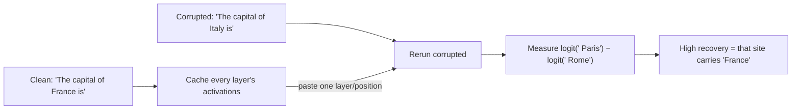

# Mechanistic interpretability 101

Before you can edit a model on purpose, you need to be able to look inside it and say "this vector means X, and this component writes it". That is mechanistic interpretability: reverse engineering a trained network into parts you can name. This lesson gives you the core toolkit Astra used in the MIT study and you will use for the rest of the module, then has you run two classic experiments on Qwen3.5-0.8B with nothing but PyTorch hooks.

> [!GOALS]
> - Treat the residual stream as a vector space and explain "features are directions"
> - Explain superposition and why single neurons are hard to read
> - Find directions with difference of means and linear probes, and know their pitfalls
> - Use the logit lens, attention patterns and activation patching, and know what each can and can't tell you
> - Know what sparse autoencoders are and what tooling exists for Qwen3.5
> - Run a logit lens and an activation-patching experiment on Qwen3.5-0.8B

## The residual stream is a vector space

Quick reminder from [Inside the transformer](#/foundations/transformer): every token position carries a vector through the model, the **residual stream**. In Qwen3.5-0.8B it has 1,024 numbers; in your 9B it has 4,096. Each layer reads that vector, computes something, and **adds** its result back:

```text
x_0          = embedding(token)                 # 1,024 numbers
x_1          = x_0 + attn_0(x_0) + mlp_0(...)    # every block adds, nothing overwrites
...
x_24         = x_23 + ...
logits       = unembed(norm(x_24))               # 248,320 scores, one per vocabulary token
```

Because blocks only ever add, the stream behaves like a **shared bus**: every component can read everything written before it, and everything it writes is visible downstream. If you've debugged a system where many services publish to one message queue, that is the right mental model. Interpretability asks: what is written on the bus, by whom, and who reads it?

The key move is to stop thinking of those 1,024 numbers as 1,024 separate meanings and start thinking of the vector as a **point in a 1,024-dimensional space**, where *directions* carry meaning.

## Features are directions

> [!CONCEPT] Feature
> A property of the input the model represents internally: "this text is French", "we're inside a code block", "the answer is a number", "I am repeating myself". A **feature** is what the model knows; a **direction** is how it stores it.

> [!CONCEPT] Linear representation hypothesis
> The working assumption that many features are stored as **directions** in activation space: to check how much feature f is present, take the dot product of the activation with f's direction. More French → bigger projection onto the "French" direction.

The dot product is the only math you need:

```text
a · d = a_1·d_1 + a_2·d_2 + ... + a_1024·d_1024
```

If `d` is a **unit vector** (length 1), `a · d` is "how far `a` points along `d`", a single number. Projections are how you *read* a feature, and adding or removing multiples of `d` is how you *write* one. [Activation steering](#/weights/steering) adds a direction; [Direction ablation](#/weights/direction-ablation) removes one. Astra's loop fix was exactly "remove the repetition direction from what layers 15 and 19 write".

Evidence for the hypothesis is strong but not universal. Many concepts (sentiment, truthfulness, refusal, language, many factual attributes) have been found as directions, and edits along them change behavior in the predicted way. Some features are non-linear or spread across many directions. Treat "it's a direction" as a hypothesis you test, not a law.

## Superposition: more features than dimensions

A model with a 1,024-wide residual stream knows far more than 1,024 things. How?

> [!CONCEPT] Superposition
> Storing more features than there are dimensions by giving each feature a direction that is **almost** (not exactly) orthogonal to the others. In high-dimensional spaces you can fit vastly more nearly-orthogonal directions than exactly orthogonal ones. The price is **interference**: reading one feature picks up a little noise from others. It works because most features are rarely active at the same time.

Two consequences matter to you:

1. **Neurons are polysemantic.** Because features are directions that don't line up with the axes, a single MLP neuron usually responds to several unrelated things. "Neuron 920 fires on numbers" is the exception, not the rule. That's why Astra worked with *directions* and then asked which neurons write along them, rather than reading neurons one by one.
2. **Edits leak.** Removing a direction also slightly affects every feature that overlaps with it. Good editors measure side effects; you will too.

## Finding a direction

### Difference of means

The workhorse. Collect activations at some layer for two sets of inputs that differ in one property, average each set, subtract:

```text
d = mean(activations | repetitive text) − mean(activations | productive text)
d̂ = d / |d|        # unit vector
```

This is what you'll use for steering vectors, refusal directions and the loop direction. It's cheap, needs no training, and is surprisingly robust.

> [!WARNING]
> Difference of means captures **everything** that differs between your two sets, not just the property you care about. If your "repetitive" examples are all late in long answers and your "productive" ones are early, `d` will partly encode *position* and *length*. Control for confounds: match problems, positions and lengths where you can, and always test a **random direction of the same size** as a control (Astra did; the random edit did nothing).

### Linear probes

A **linear probe** is a tiny classifier (usually logistic regression) trained on activations to predict a label. If a probe reaches high accuracy from layer 12 activations, the information is linearly readable there. The probe's weight vector is another candidate direction.

Probes answer "is the information *there*?", not "does the model *use* it?". A probe can find a feature the model computes and then ignores. To show the model uses a direction, you must **intervene** (ablate or add it) and watch behavior change. Correlation vs causation, same as in any investigation.

| Method | Needs | Gives | Typical use |
|---|---|---|---|
| Difference of means | Two contrasting sets of inputs | One direction per layer | Steering, ablation, quick hypotheses |
| Linear probe | Labeled activations, a small classifier | Accuracy per layer + a direction | "At which layer is X readable?" |
| PCA on paired differences | Many contrast pairs | Top principal directions | Noisy contrasts (used by `repeng` and llama.cpp's control-vector tool) |

## The logit lens

The model turns its final residual vector into next-token predictions with `unembed(norm(x))`. The **logit lens** applies that same final step to the residual stream at *every* layer, as if the model stopped early. Watching the top prediction evolve layer by layer shows roughly when the model "knows" the answer.

> [!CONCEPT] Logit lens
> Decoding an intermediate residual-stream vector with the model's own final norm and unembedding matrix to see what it would predict at that depth. Introduced informally by nostalgebraist in 2020. It's a rough lens: early layers aren't "trying" to be decodable, so their readouts are often junk. The **tuned lens** (Belrose et al., 2023) trains a small translator per layer to fix this.

You'll build one in the lab below.

## Attention-pattern analysis

In a softmax-attention layer, each head produces a matrix of weights saying how much each position looks at every earlier position. Visualizing those patterns finds heads that copy the previous token, attend to the subject of a sentence, or (in the sycophancy experiment) attend to the user's suggested answer instead of the question.

Qwen3.5 adds a twist: **only the full-attention layers have attention patterns.** In the 0.8B that's layers 3, 7, 11, 15, 19 and 23. The other 18 layers are Gated DeltaNet linear-attention layers that keep a compressed running state instead of an explicit position-by-position matrix, so there's no pattern to plot. In transformers you also need `attn_implementation="eager"` and `output_attentions=True` to get the weights back, because the fast attention kernels don't materialize them.

## Activation patching and causal tracing

Logit lens and probes are observational. **Activation patching** is the causal experiment.

> [!CONCEPT] Activation patching
> Run the model on a **clean** input and a **corrupted** input that differ in one key detail. Then rerun the corrupted input, but **paste in** one activation (one layer, one position) from the clean run. If the output flips back toward the clean answer, that activation carries the information that matters. **Causal tracing** (from the ROME paper) is the same idea with noise added to the subject's embeddings as the corruption.



The pentest analogy is fault injection: change one value in one place and see whether the outcome changes. A full sweep over layers × positions gives a map of where the information flows. You'll run this in the second lab.

## Sparse autoencoders

Superposition makes raw directions messy. **Sparse autoencoders (SAEs)** try to untangle them.

> [!CONCEPT] Sparse autoencoder (SAE)
> A small network trained to rewrite each activation vector as a combination of a much larger set of "dictionary" directions (for example 65,536 for a 4,096-wide stream), with the constraint that only a few are active at once. Each dictionary direction tends to correspond to one human-interpretable feature. It's like decompiling a blob of packed data into named fields.

Anthropic's "Towards Monosemanticity" (2023) and "Scaling Monosemanticity" (2024) popularized the approach; Google released Gemma Scope for Gemma 2. For your model family, Qwen released **Qwen-Scope** (2026), SAEs for several Qwen3 and Qwen3.5 models, including `Qwen/SAE-Res-Qwen3.5-9B-Base-W64K-L0_50` (65,536 features per layer for all 32 layers of **Qwen3.5-9B-Base**). Two caveats: those SAEs were trained on the *base* model, so they're an approximation for the instruct model and further for an uncensored derivative; and check the Qwen organization on Hugging Face for which sizes are covered (I could not confirm a 0.8B SAE). SAEs are a next step after this module, not a prerequisite.

## Tooling for Qwen3.5 (as of November 2026)

| Tool | Status for Qwen3.5 | Use in this module |
|---|---|---|
| Plain PyTorch forward hooks | Works with anything transformers can load | **Primary**: every lab uses them |
| transformers | Qwen3.5 support since **v5.2.0**; current is 5.22.x | Loads the models; `Qwen3_5ForCausalLM` for text-only |
| TransformerLens (TransformerBridge) | Has a `Qwen3_5ArchitectureAdapter` (text-only); its docs don't list hook points for the linear-attention layers | Optional; verify hooks before relying on it |
| nnsight | Wraps arbitrary PyTorch models, so it should work, but I found no Qwen3.5-specific documentation | Optional; test before use |
| Qwen-Scope SAEs | Released for several Qwen3 / Qwen3.5 models (trained on base models) | Further study |

> [!MAC]
> The fast Gated DeltaNet kernels (`fla` and `causal_conv1d`) are CUDA-only. On Apple Silicon, transformers silently falls back to a pure-PyTorch implementation that is slower and uses more memory. For a 0.8B model and short prompts that's fine. If an operation isn't implemented on the Metal (MPS) backend, setting `PYTORCH_ENABLE_MPS_FALLBACK=1` lets PyTorch run just that op on the CPU instead of crashing.

PyTorch hooks are all you need, and they never go out of date. A **forward hook** is a function PyTorch calls right after a module runs, with its inputs and output. Return nothing to just observe; return a new tensor to replace the output. It's the neural-network equivalent of an instrumentation hook or a Frida script: attach to a function, log or rewrite its return value.

## Lab setup

The next lesson, [Open and inspect real weights](#/weights/inspect-weights), explains each package in detail. For now, a minimal environment:

```bash
mkdir -p ~/ai-lab/weights && cd ~/ai-lab/weights
python3 -m venv .venv && source .venv/bin/activate
pip install --upgrade pip
pip install torch "transformers>=5.3" accelerate safetensors huggingface_hub
```

```bash
python -c "import torch, transformers; print(torch.__version__, transformers.__version__, 'mps:', torch.backends.mps.is_available())"
```

You want a transformers version of 5.3 or later (Qwen3.5 landed in 5.2.0) and `mps: True`. The first script run downloads Qwen3.5-0.8B (about 1.75 GB) into the Hugging Face cache.

> [!LAB] Logit lens on Qwen3.5-0.8B
> 1. Save this as `~/ai-lab/weights/logit_lens.py`:
> ```python title="logit_lens.py"
> """Logit lens: decode the residual stream after every layer of Qwen3.5-0.8B."""
> import os
> import sys
>
> os.environ.setdefault("PYTORCH_ENABLE_MPS_FALLBACK", "1")  # must be set before torch loads
> import torch
> from transformers import AutoModelForCausalLM, AutoTokenizer
>
> MODEL_ID = "Qwen/Qwen3.5-0.8B"
> DEVICE = "mps" if torch.backends.mps.is_available() else "cpu"
>
>
> def main(prompt: str, top_k: int = 5) -> None:
>     tok = AutoTokenizer.from_pretrained(MODEL_ID)
>     model = AutoModelForCausalLM.from_pretrained(MODEL_ID, dtype=torch.bfloat16)
>     model.to(DEVICE).eval()
>     layers = model.model.layers            # 24 decoder layers
>     kinds = model.config.layer_types       # "linear_attention" or "full_attention"
>
>     captured: dict[int, torch.Tensor] = {}
>
>     def make_hook(i: int):
>         def hook(module, inputs, output):
>             h = output[0] if isinstance(output, tuple) else output
>             captured[i] = h[:, -1, :].detach()   # residual stream at the last position
>         return hook
>
>     handles = [layer.register_forward_hook(make_hook(i)) for i, layer in enumerate(layers)]
>     ids = tok(prompt, return_tensors="pt").to(DEVICE)   # raw text, no chat template
>     with torch.no_grad():
>         real_logits = model(**ids).logits[0, -1]
>     for h in handles:
>         h.remove()
>
>     print(f"Prompt: {prompt!r}\n")
>     with torch.no_grad():
>         for i in range(len(layers)):
>             # The lens: final norm + unembedding applied to an intermediate layer
>             logits = model.lm_head(model.model.norm(captured[i]))[0]
>             probs = torch.softmax(logits.float(), dim=-1)
>             p, idx = probs.topk(top_k)
>             tops = "  ".join(f"{tok.decode([int(t)])!r}:{float(q):.2f}" for q, t in zip(p, idx))
>             tag = "FULL" if kinds[i] == "full_attention" else "lin "
>             print(f"layer {i:2d} [{tag}]  {tops}")
>         real_top = tok.decode([int(real_logits.argmax())])
>         print(f"\nModel's actual next token: {real_top!r}")
>
>
> if __name__ == "__main__":
>     main(sys.argv[1] if len(sys.argv) > 1 else "The capital of France is")
> ```
> 2. Run it:
> ```bash
> cd ~/ai-lab/weights && source .venv/bin/activate
> python logit_lens.py
> ```
> 3. Read the output. The last layer's lens must match "Model's actual next token" (it's the same computation). Look for the layer where `' Paris'` first enters the top 5 and where it becomes top 1. Early layers usually show junk or tokens related to the *current* word; the answer typically surfaces somewhere in the second half.
> 4. Try prompts where the answer needs an extra step: `python logit_lens.py "The Eiffel Tower is in the city of"` (subject → country → city) or `python logit_lens.py "Two plus three equals"`. Does the right token appear later than for the direct fact?
> 5. Note whether the answer tends to appear right after a `FULL` (full-attention) layer. Don't over-read one prompt: try five before forming a hypothesis.

> [!LAB] Activation patching: where does "France" live?
> 1. Save as `~/ai-lab/weights/patching.py`:
> ```python title="patching.py"
> """Activation patching: paste clean residuals into a corrupted run, layer by layer, position by position."""
> import os
>
> os.environ.setdefault("PYTORCH_ENABLE_MPS_FALLBACK", "1")
> import torch
> from transformers import AutoModelForCausalLM, AutoTokenizer
>
> MODEL_ID = "Qwen/Qwen3.5-0.8B"
> DEVICE = "mps" if torch.backends.mps.is_available() else "cpu"
> CLEAN, CORRUPT = "The capital of France is", "The capital of Italy is"
> GOOD, BAD = " Paris", " Rome"
>
>
> def main() -> None:
>     tok = AutoTokenizer.from_pretrained(MODEL_ID)
>     model = AutoModelForCausalLM.from_pretrained(MODEL_ID, dtype=torch.float32)  # fp32: cleaner differences
>     model.to(DEVICE).eval()
>     layers = model.model.layers
>
>     clean = tok(CLEAN, return_tensors="pt").to(DEVICE)
>     corrupt = tok(CORRUPT, return_tensors="pt").to(DEVICE)
>     assert clean.input_ids.shape == corrupt.input_ids.shape, "prompts must tokenize to the same length"
>     good_id, bad_id = tok.encode(GOOD)[0], tok.encode(BAD)[0]
>     if len(tok.encode(GOOD)) > 1 or len(tok.encode(BAD)) > 1:
>         print("warning: answer is multi-token; using its first token")
>
>     # 1) Cache every layer's output on the clean run
>     cache: dict[int, torch.Tensor] = {}
>     def save(i):
>         def hook(m, inp, out):
>             cache[i] = (out[0] if isinstance(out, tuple) else out).detach().clone()
>         return hook
>     hs = [l.register_forward_hook(save(i)) for i, l in enumerate(layers)]
>     with torch.no_grad():
>         clean_logits = model(**clean).logits[0, -1]
>     for h in hs:
>         h.remove()
>     with torch.no_grad():
>         corrupt_logits = model(**corrupt).logits[0, -1]
>
>     def diff(logits):  # how much the model prefers the clean answer
>         return float(logits[good_id] - logits[bad_id])
>     d_clean, d_corrupt = diff(clean_logits), diff(corrupt_logits)
>     print(f"clean diff {d_clean:+.2f}   corrupt diff {d_corrupt:+.2f}\n")
>
>     # 2) For each (layer, position), rerun corrupt with that one activation pasted from clean
>     tokens = [tok.decode([int(t)]) for t in clean.input_ids[0]]
>     print("layer " + "".join(f"{t!r:>12}" for t in tokens))
>     for i, layer in enumerate(layers):
>         row = []
>         for pos in range(len(tokens)):
>             def patch(m, inp, out, i=i, pos=pos):
>                 h = (out[0] if isinstance(out, tuple) else out).clone()
>                 h[:, pos, :] = cache[i][:, pos, :]
>                 return (h, *out[1:]) if isinstance(out, tuple) else h
>             handle = layer.register_forward_hook(patch)
>             with torch.no_grad():
>                 d = diff(model(**corrupt).logits[0, -1])
>             handle.remove()
>             row.append((d - d_corrupt) / (d_clean - d_corrupt))  # 0 = no effect, 1 = full recovery
>         print(f"{i:5d} " + "".join(f"{r:12.2f}" for r in row))
>
>
> if __name__ == "__main__":
>     main()
> ```
> 2. Run `python patching.py` (24 layers × 6 or so positions ≈ 150 short forward passes; a minute or two).
> 3. Read the grid. Each number is the fraction of the clean answer recovered by patching that single site. The classic pattern: in early layers the information sits at the **country token's position**; in later layers it has been moved to the **last position**, where the prediction is made. Find the layer range where it "hops".
> 4. Write down: at which layers does patching the last position start to recover most of the effect? Those are the layers that have already pulled "France" into the prediction site. This is the same reasoning ROME uses to pick which layer to edit.

> [!TIP]
> Make the outputs survive your terminal scrollback: `python patching.py | tee patching.txt`. Keep a `notes.md` in `~/ai-lab/weights/` with what you tried and what you saw. Interpretability is an investigation; your notes are the case file.

## What Astra actually did, in these terms

Mapping the study onto the toolkit:

| Astra's step | Toolkit term |
|---|---|
| Compare matched productive vs repetitive continuations | Difference of means on contrast pairs |
| Find that MLP outputs in layers 15 and 19 write the shared direction | Attribution: which components write along a direction |
| Rank neurons by contribution along the direction, keep top 64 | Neuron-level attribution (columns of `down_proj`) |
| Check repetitive-tail likelihood with teacher-forced reads | Intervention + measurement on a cheap proxy |
| Norm-matched random direction control | Causal control |
| Remove the direction from 64 columns | Directional ablation baked into weights |

You now know every term in that table. The next lessons give you the hands to do each step.

## Recap

- The residual stream is a vector per token that every block reads and adds to; think of it as a shared bus.
- Features are (often) directions; read them with dot products, write them by adding or removing multiples of a unit vector.
- Superposition packs more features than dimensions using nearly-orthogonal directions, which makes single neurons polysemantic and edits slightly leaky.
- Difference of means and linear probes find candidate directions; only interventions show the model uses them. Always control for confounds and compare against random directions.
- Logit lens decodes intermediate layers; activation patching tests causally where information lives; SAEs decompose activations into many sparse features.
- For Qwen3.5, plain PyTorch hooks work everywhere; only the full-attention layers have attention patterns to inspect.

## Check yourself

1. Why is the dot product with a unit vector a natural way to "read" a feature?
   <details><summary>Answer</summary>

   If features are stored as directions, the dot product of an activation with the feature's unit vector gives the component of the activation along that direction: one number saying how strongly the feature is present. Using a unit vector makes the number a pure "amount", independent of the direction's arbitrary length.

   </details>
2. A linear probe reads "the answer is negative" from layer 10 with 97% accuracy. Can you conclude the model uses that feature to produce its answer?
   <details><summary>Answer</summary>

   No. The probe shows the information is linearly readable at layer 10, which is correlation. The model might compute it and never use it. To show use, intervene: ablate or add that direction and check that the model's output changes in the predicted way, with a random-direction control.

   </details>
3. Your "loop direction" was computed from looping runs (late in long answers) and productive runs (early in short answers). What's wrong, and how do you fix it?
   <details><summary>Answer</summary>

   The difference of means will also encode position and length, because those differ systematically between the sets. Fix it by matching: compare windows at the same positions, from the same problems where possible, and verify with a random-direction control and by checking that the edit doesn't just shorten all answers.

   </details>
4. Why can't you plot attention patterns for most layers of Qwen3.5?
   <details><summary>Answer</summary>

   Three of every four layers are Gated DeltaNet linear-attention layers. They compress the past into a fixed-size running state rather than computing a position-by-position softmax attention matrix, so there's no pattern to visualize. Only the full-attention layers (3, 7, 11, 15, 19, 23 in the 0.8B) have one.

   </details>
5. In activation patching, what does a recovery score near 1.0 at (layer 4, country-token position) and near 0 at (layer 4, last position) tell you?
   <details><summary>Answer</summary>

   At layer 4, the information that distinguishes France from Italy is carried at the country token's position and hasn't yet been moved to the last position, where the prediction happens. Pasting the clean country-token activation restores the clean answer because later layers will move that information forward themselves.

   </details>

## Go deeper
- [A Mathematical Framework for Transformer Circuits](https://transformer-circuits.pub/2021/framework/index.html) — the residual stream as a communication channel; the foundation of the field's vocabulary.
- [Toy Models of Superposition](https://transformer-circuits.pub/2022/toy_model/index.html) — why networks pack more features than dimensions, with clear visuals.
- [Locating and Editing Factual Associations in GPT (ROME)](https://arxiv.org/abs/2202.05262) — introduces causal tracing; you'll use its editing half later.
- [How to use and interpret activation patching](https://arxiv.org/abs/2404.15255) — practical pitfalls of patching experiments.
- [Eliciting Latent Predictions with the Tuned Lens](https://arxiv.org/abs/2303.08112) — what's wrong with the raw logit lens and how to fix it.
- [Scaling Monosemanticity](https://transformer-circuits.pub/2024/scaling-monosemanticity/index.html) — sparse autoencoders on a production model.
