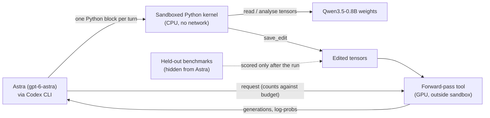
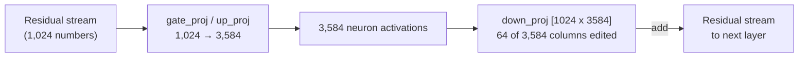

# The MIT weight-space programming study

In November 2026 a team at MIT CSAIL reported that a frontier LLM could open another neural network's weight files, work out what was wrong, and fix it by editing numbers directly, with no training at all. This lesson takes the study apart: what was actually done, what the numbers do and don't mean, and why it is the perfect starting point for the rest of this module, where you will do a small version of it yourself on your Mac.

> [!GOALS]
> - Explain "weight-space programming" in plain words and how it differs from training
> - Describe the harness the editor model worked inside (sandbox, forward-pass budget, rules)
> - Walk through the Qwen3.5-0.8B edit exactly: which layers, which tensors, how many weights, and why
> - Read the "6x" headline critically: obstacle removal vs new ability, and the Gemma control
> - Know what was released and how you can verify it yourself

> [!NOTE]
> **Source status.** "Sparks of Weight-Space Programming" by Rikiya Takehi and Jayden Teoh (co-first authors), Alex Zhang and Omar Khattab, all MIT CSAIL, was published as a blog post on **2026-11-02**. Everything below comes from that post and its public logs. The results are **self-reported, early, and not independently replicated**. One person has re-run the evaluation of the released checkpoint (details below), which is not the same as repeating the method.

## The one-paragraph version

The researchers gave an LLM they call **Astra** (OpenAI's `gpt-6-astra`) the weights of small neural networks and a Python sandbox, and asked it to understand or improve them. In the headline experiment Astra looked at **Qwen3.5-0.8B**, a tiny sibling of the 9B model you run in LM Studio, and noticed it was terrible at math mostly because it **looped**: it repeated itself until it hit the 32,768-token limit and never wrote an answer. Astra traced the looping to one direction in the model's internal activation space, written mainly by the MLP blocks of layers 15 and 19, and removed it from 64 columns of each of those two weight matrices. That is **131,072 numbers out of roughly 0.8 billion (about 0.016%)**. With a budget of 50 test runs, MATH-500 accuracy went from **7.9% to 48.1%**. With 10 or 25 test runs, the gains were small.

Most of this lesson is about why that sentence is both genuinely impressive and easy to over-read.

## What "weight-space programming" means

You already know from [What is an LLM, really?](#/foundations/what-is-an-llm) that a model is a big pile of numbers (weights) plus a fixed program that multiplies inputs through them. Normally those numbers are set by **training**: show the model examples, measure the error, and let an optimizer nudge every weight a tiny bit, billions of times (covered in [Training 101](#/finetune/concepts)).

> [!CONCEPT] Weight-space programming
> Having a general-purpose LLM **read and write a network's weights directly**, guided by a natural-language goal, without an optimizer or gradient descent. The editor inspects tensors, forms hypotheses about what parts of the network do, and writes specific new values, the way an engineer patches code.

The security analogy is close to exact:

| | Building software | Changing a neural network |
|---|---|---|
| Normal path | Edit source, recompile | Collect data, retrain or fine-tune |
| What you touch | Source code | Training data and hyperparameters |
| The other path | Open the binary in a disassembler, find the bad branch, patch the bytes | **Open the weights, find the circuit, patch the numbers** |
| Skill needed | Reverse engineering | **Mechanistic interpretability** |

Training is like recompiling: robust and general, but you only control the inputs. Weight-space programming is like hex-patching a binary: surgical, cheap, and only as good as your understanding of what the bytes do. Humans have done "binary patching" of neural networks for years under names like ROME, steering vectors and abliteration (you will learn all three in this module). The new part is that **an LLM agent did the reverse engineering and the patch itself**, inside a budget, and wrote down its reasoning.

## The harness: how Astra was allowed to work

The logs repository spells out the setup. Read this like the rules of engagement for a pentest: what the tester could touch determines how impressive the result is.



- **Driver.** Each turn was one `codex exec` call (OpenAI's Codex CLI), with **every built-in Codex tool disabled** (no shell, no file editing, no web search). The system instructions were a single neutral line. An audit of the event streams found all 1,125 turns across the study tool-free. Astra could act only through the harness.
- **Python kernel.** Astra wrote one Python block per turn. The harness ran it in a **bubblewrap** sandbox with **no network**, a working folder that persisted between runs, and a per-run time limit. For the math experiment the kernel was CPU-only and capped at **300 code runs**.
- **Forward-pass budget.** Astra could not run the model inside its kernel. To see the model behave, it had to request a **forward pass** from a separate tool, and the budget was **10, 25 or 50 passes** depending on the run. One pass could be a generation pass (up to 512 practice problems), a paired "both" pass (256 samples each from the original and edited weights), or a teacher-forced read (log-probabilities for up to 1,024 texts). Failed requests didn't count.
- **Practice data only.** Astra worked on 7,469 GSM8K training problems and 7,275 MATH training problems (plus 714 AIME problems with answers only), never the test sets.
- **Forbidden.** Gradient descent or any training, running the model in the kernel, and internet access. The `save_edit` function refused edits to the final norm, the embedding/output layer, and whole-tensor constant multiplies (so "just scale everything" was off the table).
- **Effort and length.** Reasoning effort was set to `max` for the math experiment. A long run was split into several conversations, with a fresh "handoff" every 40 turns.

> [!CONCEPT] Forward pass
> One run of inputs through the network to get outputs. For an LLM, generating a 1,000-token answer takes about 1,000 forward passes in the strict sense. The study uses "forward pass" loosely to mean **one batched request to the model-running tool**, whatever its size (a notice in the logs confirms "a pass costs one pass at any size"). Think of it as an API call quota, not a FLOP count.

Two things matter here. First, the budget is the core experimental variable: it measures how much **empirical feedback** the editor needed on top of pure reasoning about weights. Second, the evaluation sets were never visible to Astra, which is what makes the final numbers meaningful at all. You will copy both ideas into your own harness in [the capstone lab](#/weights/claude-lab).

## All eight experiments at a glance

The math result gets the headlines, but the post is a ladder of increasingly hard tasks. "Tools" means what Astra had beyond reading the weights.

| # | Task | Network | Tools | Result |
|---|---|---|---|---|
| 1 | Which game was this policy trained on? | 4 tiny game policies (17,253 weights) | None | Correct for all 4 |
| 2 | What shape does this diffusion model draw? | 3 tiny diffusion models | None, no forward passes | Correct for all 3 (drew outlines, though the models draw filled shapes) |
| 3 | What language was this transformer trained on? Which heads copy? | 3 character-level transformers, middle blocks only | Python, cannot run the network | Correct language in all 6 attempts; copying heads matched ground truth |
| 4 | Fix a car policy that stalls on a ramp | 171,664-weight policy | None, one shot | Added a "back up" side path; success in 1,024 of 1,024 episodes (3.5% of weights changed) |
| 5 | Write game-playing networks from scratch | 600→32→32→6 MLPs, all zeros | None, one reply | Breakout 517.4 vs PPO-500M 25.3; below PPO on Seaquest, close on Asterix |
| 6 | Write a 9x9 Go network from scratch | 1,480,274 weights | Python + 0–50 passes | At 50 passes, beat an equal-size PPO net trained on 20M games |
| 7 | Which of two fine-tunes is sycophantic? | Gemma 3 270M pairs | Weights only, then an attention-pattern tool | Failed from weights alone; succeeded on all 3 pairs with attention patterns |
| 8 | Make Qwen3.5-0.8B better at math | Qwen3.5-0.8B (24 layers) | Python + 10/25/50 passes | MATH-500 7.9% → 48.1% at 50 passes |

Notice experiment 7: from raw weights alone, Astra **could not** tell which model was sycophantic. It needed to watch the models run (attention patterns). Reading weights is powerful for some questions and nearly useless for others. That pattern repeats in experiment 8.

## Deep dive: the Qwen3.5-0.8B edit

### The patient

Qwen3.5-0.8B shares the architecture family of your 9B model, scaled down (all numbers from its `config.json`, explained in [Inside the transformer](#/foundations/transformer)):

| | Qwen3.5-0.8B | Qwen3.5-9B (your model's base) |
|---|---|---|
| Layers | 24 | 32 |
| Hidden size (width of the residual stream) | 1,024 | 4,096 |
| MLP intermediate size | 3,584 | 12,288 |
| Layout | 3 linear-attention + 1 full-attention, repeated | same |
| Full-attention layers (0-indexed) | 3, 7, 11, 15, 19, 23 | 3, 7, ..., 31 |
| Embeddings | tied (input and output share one matrix) | untied |

The model card itself warns that in thinking mode the 0.8B is "more prone to entering thinking loops" than its bigger siblings. Astra found out the hard way: in its first diagnostic batch, **85 of 96 practice answers ran all the way to the 32,768-token limit**, and every answer that did finish was correct. The model wasn't failing at arithmetic. It was failing to stop.

### Three runs, three different edits

Each budget was one run, and each run ended with a different edit (from the `exp8_math` README):

| Run | Passes | Wall-clock hours | Final edit |
|---|---|---|---|
| `p10c` | 10 | 11.6 | Removed a "repetition" direction from 30 output matrices (attention and MLP) in layers 8–22, rank-one: W' = W − 1.5·u(uᵀW). Nearly every entry of those matrices changed. |
| `p25c` | 25 | 8.5 | Switched off attention head 7 of layer 15 (zeroed its 256 output columns). |
| `p50c` | 50 | 20.3 (includes a 4.7-hour wait when the model API was unreachable) | Subtracted the loop direction from 64 output columns in each MLP of layers 15 and 19. |

The `p50c` edit is the one in the headlines and the released model. Hold on to the formula from `p10c`, though: W' = W − s·u(uᵀW) is the "direction removal" you will derive from scratch in [Direction ablation](#/weights/direction-ablation).

### The p50c edit, exactly

The manifest in the logs lists two tensors:

```text
model.language_model.layers.15.mlp.down_proj.weight   bf16  [1024, 3584]
model.language_model.layers.19.mlp.down_proj.weight   bf16  [1024, 3584]
```

`down_proj` is the last matrix of each MLP block: it takes the 3,584 "neuron" activations and writes a 1,024-number vector back into the residual stream. In PyTorch's `[out, in]` layout, **each column is one neuron's write vector**: 1,024 numbers saying "when neuron j fires, add this to the stream".



The arithmetic:

```text
64 columns × 1,024 rows = 65,536 weights per tensor
65,536 × 2 tensors       = 131,072 weights
131,072 / ~0.8 B         ≈ 0.016% of the model
```

Because of bfloat16 rounding, 130,188 of those 131,072 entries actually changed bits (65,260 in layer 15, 64,928 in layer 19). Everything else in the 1.75 GB checkpoint is byte-identical to the original.

How Astra chose them, per its own explanations file:

1. **Contrast.** It compared matched continuations of the same problem: productive ones (useful checking) versus repetitive ones (restating the same doubt over and over). Activation analysis pointed to the **MLP outputs of layers 15 and 19** as the main writers of a shared repetition direction.
2. **Neuron ranking.** Within each MLP, it ranked neurons by how much they write along that direction in repetitive contexts and kept the **top 64** per layer. Those 64 columns captured about **91% (layer 15) and 98% (layer 19)** of the repetitive-vs-productive contrast.
3. **Dose.** Early tests removed the direction from whole matrices at increasing "strength" (1, 2, 3). The final edit restricted it to the 64 columns at **strength 6**, which produced fewer whitespace degenerations than a full-matrix version at similar gains.
4. **Controls.** A norm-matched **random direction** edit changed accuracy by only +1.6 points and did not reduce cutoffs. A single-neuron ablation and two attention-head edits were tried and dropped.

> [!NOTE]
> Curiosity worth having: layers 15 and 19 are both **full-attention** layers in the 0.8B's 3:1 layout, but the edit touched their **MLPs**, not the attention. Each layer has both an attention-type block and an MLP block. You will see this when you list the tensors yourself in [Open and inspect real weights](#/weights/inspect-weights).

### Results by budget

Held-out benchmark scores (in %; thinking on, temperature 0.6, top_p 0.95, top_k 20, presence penalty 1.5, up to 32,768 new tokens, scored by vLLM-based evaluation that Astra never saw):

| Qwen3.5-0.8B | MATH-500 | GSM8K | IFEval | MATH-500 answers cut at token limit |
|---|---|---|---|---|
| Unedited | 7.9 | 13.8 | 21.0 | 93.0 |
| Edited, 10 passes | 12.3 | 25.7 | 49.0 | 87.2 |
| Edited, 25 passes | 14.1 | 25.1 | 39.9 | 86.4 |
| Edited, 50 passes | **48.1** | **67.1** | **62.3** | **33.1** |

The README also reports benchmarks the post leaves out of its main table:

| | Unedited | 10 passes | 25 passes | 50 passes |
|---|---|---|---|---|
| AMC23 | 0.5 | 1.1 | 1.1 | 23.4 |
| Minerva Math | 1.5 | 3.9 | 3.5 | 25.4 |
| OlympiadBench | 1.3 | 2.4 | 3.9 | 21.8 |
| MMLU-Pro | 40.3 | 40.0 | 44.7 | 45.5 |
| GPQA Diamond | 22.7 | 29.4 | 30.1 | 36.6 |

(The post's figure shows 24.5 for unedited GPQA; the README says that was an interim value and the final is 22.7.)

On Astra's own held-out practice split (1,152 problems), the final edit went from 10.6% to 60.4%: **579 problems rescued, 5 broken**, and **576 of the 579 rescues were answers that had originally been cut off**. Accuracy on answers that originally finished was essentially unchanged.

## Reading the "6x" honestly

48.1 / 7.9 ≈ 6.1, so "6x better at math" is arithmetically true for MATH-500 at 50 passes. Here is how to read it like a reviewer.

**1. It removed an obstacle; it did not add knowledge.** Almost every rescued answer was one the base model would have gotten right if it had stopped looping. Think of a web app that returns 500 errors on 93% of requests because of a crash bug: fix the crash and "successful responses" jump 6x, but the business logic didn't get smarter. The IFEval jump (21.0 → 62.3) fits the same story: instruction-following is graded after the thinking block closes, so an answer that never closes its thinking fails no matter how good it would have been.

**2. The control says the same thing.** The team repeated the experiment on **Gemma 3 270M**, a model that rarely loops (8.5% of its answers hit the limit versus 93% for Qwen). Budgets of 5, 10, 25 and 50 passes gave MATH-500 scores of 7.0, 7.6, 7.7 and 7.0 against 6.8 unedited. Astra itself reported most of those gains as not established. Its diagnosis: ordinary arithmetic and algebra mistakes, with no single component to switch off. In the authors' framing, editing could remove an obstacle but could not add an ability the model lacked.

**3. The base number depends on settings.** The evaluation used temperature 0.6. The Qwen3.5-0.8B model card recommends temperature 1.0 for thinking mode and explicitly warns that this size loops more. That doesn't invalidate anything (the same settings were used before and after the edit), but it does mean "93% loop" describes the model under those settings, and a sampler change alone might move the baseline. Questioning the baseline is standard practice; you'll do it with your own experiments.

**4. Budget effects rest on one run each.** 10 → 25 passes made IFEval go *down* (49.0 → 39.9). Each budget was a single run, and each found a different edit, so you can't separate "more budget helps" from "this run got lucky". The fair summary: with 50 passes, one run found a large fix; with 10 or 25, the runs found weaker ones.

**5. Reproduction vs replication.** Ahsen Khaliq rebuilt the released checkpoint from the published diff and re-ran the full MATH-500 evaluation: **51.0%**, with 31.6% of answers hitting the limit (vLLM 0.33.0, transformers 5.20.2, 2,000 generations on an H200). That confirms the released weights do what was claimed. It does not show that the *method* (an LLM finding such edits) works reliably. Nobody has published an independent replication of that yet.

> [!WARNING]
> The bad headline version is "AI made another AI 6x smarter at math". The accurate version is "an AI agent diagnosed a looping failure in a tiny model, located the components writing it, and patched 0.016% of the weights so the model could finish its answers; on a model that didn't loop, it found nothing to fix". The accurate version is still remarkable.

## Limitations the authors and logs acknowledge

- **Very early results.** The authors call capabilities "still limited" by context length and harness inefficiencies, and say a benchmark and harness for this are still being built.
- **Weights alone weren't enough** for subtle behaviors (the sycophancy experiment).
- **Small n.** One run per budget; three budgets; two models.
- **Messy logs.** Astra's explanations note that several generation runs failed at startup and some pass counts in the record are inconsistent; the final report's figures are the reference.
- **Residual problems.** Math errors, missing boxed answers and some whitespace degeneration remain in the edited model.
- **Cost.** The winning run took 20.3 wall-clock hours (about 4.7 of them waiting on an outage) with a frontier model at maximum reasoning effort.

## How this connects to earlier work

None of the individual techniques are new. What's new is the operator.

| Technique | What it does | Where you'll learn it |
|---|---|---|
| Logit lens, probes, activation patching | Find where information lives inside a model | [Interpretability 101](#/weights/interpretability-101) |
| Activation steering (ActAdd, CAA, RepE) | Add a direction to activations at inference time | [Activation steering](#/weights/steering) |
| Directional ablation / abliteration (Arditi et al., 2024) | Remove a direction from activations or bake its removal into weights | [Direction ablation](#/weights/direction-ablation) |
| ROME and MEMIT | Rewrite a fact with a rank-one update to an MLP matrix | [Knowledge editing and merging](#/weights/editing-merging) |
| Task arithmetic and model merging | Add and subtract whole weight differences | [Knowledge editing and merging](#/weights/editing-merging) |

The `p50c` edit is directional ablation applied to a handful of MLP columns, the same family of math used to remove refusal behavior in "abliterated" models. The study's contribution is showing that an LLM can run the full loop (hypothesis, measurement, edit, control experiment) with limited feedback.

## What was released

- **Blog post:** [rikiyat.github.io/blog/weight-space-programming](https://rikiyat.github.io/blog/weight-space-programming/)
- **Logs:** [github.com/RikiyaT/lm_understand-logs](https://github.com/RikiyaT/lm_understand-logs), with every prompt, response, code run and evaluation. For experiment 8, the weight edits are stored as exact diffs (`edit/manifest.json` + `edit/edit.npz`) plus `code/apply_edit.py`, which rebuilds the edited tensors bit for bit from `Qwen/Qwen3.5-0.8B` at revision `2fc06364715b967f1860aea9cf38778875588b17` and checks every SHA-256. Logs and data are CC BY 4.0, scripts MIT.
- **Edited model:** [RikiyaT/Qwen3.5-0.8B-weight-space-programming](https://huggingface.co/RikiyaT/Qwen3.5-0.8B-weight-space-programming), a full 1.75 GB safetensors checkpoint (Apache-2.0) with the vision tower intact. Its card lists the SHA-256 of the two edited tensors so you can verify them.
- **Demo:** [huggingface.co/spaces/akhaliq/weight-space-programming-demo](https://huggingface.co/spaces/akhaliq/weight-space-programming-demo)

> [!LAB] Read the evidence yourself (20 minutes)
> Don't take the summary (or this lesson) on trust. Pull just the experiment 8 files from the logs repo.
> 1. Make a workspace and do a sparse, shallow clone so you don't download every experiment:
> ```bash
> mkdir -p ~/ai-lab/weights && cd ~/ai-lab/weights
> git clone --depth 1 --filter=blob:none --sparse https://github.com/RikiyaT/lm_understand-logs.git
> cd lm_understand-logs
> git sparse-checkout set exp8_math/code exp8_math/runs/p50c/edit exp8_math/gemma_followup
> ```
> 2. Read `exp8_math/README.md` (cone-mode sparse checkout includes files in parent folders). Find the runs table and confirm the hours and the three different edits.
> 3. Print the manifest of the winning edit:
> ```bash
> python3 -c "import json; m=json.load(open('exp8_math/runs/p50c/edit/manifest.json')); t=m['tensors']; t=t.values() if isinstance(t, dict) else t; [print(x['name'], x['shape'], x['changed_entries'], x['changed_columns'], round(x['relative_change'], 3)) for x in t]; print('total', m['changed_entries_total'])"
> ```
> 4. Open `exp8_math/gemma_followup/README.md` and write down, in one sentence each, what Astra changed at 5, 10, 25 and 50 passes and what happened.
> 5. If you're curious about Astra's reasoning, browse `exp8_math/runs/p50c/explanations.md` and `final_answer.md` on GitHub (they're large; skim the headings).
>
> You'll come back to `apply_edit.py` and the edited model in [Open and inspect real weights](#/weights/inspect-weights), where you'll find the 64 changed columns yourself.

## What this means for you

You can't run GPT-6 Astra, and you don't need to. Everything in the study fits your setup in miniature:

- **Qwen3.5-0.8B in bf16 is about 1.75 GB.** It loads comfortably in PyTorch on a 16 GB Mac, so you can read, hook and edit it directly.
- **Your 9B model's base, Qwen3.5-9B, is about 19.3 GB in bf16**, which does not fit in 16 GB. You'll edit it tensor-by-tensor without loading the whole thing, then convert to GGUF for LM Studio.
- **Claude Code can play Astra's role** inside a harness you build, with the same discipline: a forward-pass budget, practice data only, a hidden held-out set, an edit log, and controls.

The plan for the module:

1. [Interpretability 101](#/weights/interpretability-101): the ideas Astra used (directions, logit lens, patching).
2. [Open and inspect real weights](#/weights/inspect-weights): load Qwen3.5-0.8B and find the MIT edit by diffing checkpoints.
3. [Activation steering](#/weights/steering): add directions at inference time.
4. [Direction ablation](#/weights/direction-ablation): remove a direction and bake it into weights; reproduce the spirit of the MIT fix.
5. [Knowledge editing and merging](#/weights/editing-merging): ROME, task vectors, mergekit.
6. [Lab: Claude as your weight programmer](#/weights/claude-lab): the capstone.

## Recap

- Weight-space programming means an LLM edits another network's weights directly, without gradient descent, guided by a goal in plain language.
- Astra worked through a sandboxed, offline Python kernel, could only run the model through a budgeted forward-pass tool (10, 25 or 50 requests), used practice data only, and was scored on hidden benchmarks.
- The winning Qwen3.5-0.8B edit subtracted one "loop" direction from 64 columns of `down_proj` in layers 15 and 19: 131,072 weights, about 0.016% of the model.
- MATH-500 went 7.9% → 48.1% at 50 passes, mostly because answers stopped looping and could finish; 10 and 25 passes gave small gains, one run each.
- A Gemma 3 270M control that rarely looped showed no real gain: editing removed an obstacle, it didn't add ability.
- Self-reported and early; the released checkpoint's evaluation has been reproduced, the method has not been independently replicated.

## Check yourself

1. In your own words, what is the difference between fine-tuning a model and weight-space programming?
   <details><summary>Answer</summary>

   Fine-tuning changes weights indirectly: you supply examples and an optimizer adjusts (usually) many weights by gradient descent. Weight-space programming changes weights directly: an editor inspects the tensors, forms a hypothesis about what specific parts do, and writes new values for chosen entries, with no optimizer. It's the difference between recompiling from source and hex-patching a binary.

   </details>
2. Why does it matter that Astra could only run the model through a forward-pass tool with a budget?
   <details><summary>Answer</summary>

   The budget measures how much empirical feedback the editor needed. With unlimited runs, an agent could just try random edits and keep the best (a crude search). Limiting passes forces it to reason from the weights and from a few targeted experiments. It also lets the study compare budgets (10/25/50) and see that the big fix only appeared with more feedback.

   </details>
3. How many weights did the `p50c` edit change, and how do you get that number?
   <details><summary>Answer</summary>

   131,072: each `down_proj` is [1024, 3584] (out, in), so one column is 1,024 numbers. 64 columns × 1,024 = 65,536 per layer, times 2 layers (15 and 19) = 131,072. After bf16 rounding, 130,188 entries actually changed.

   </details>
4. Give two pieces of evidence that the gain came from removing looping rather than adding math ability.
   <details><summary>Answer</summary>

   (a) On Astra's held-out practice split, 576 of 579 rescued problems were answers that had originally been cut off at the token limit, and accuracy on answers that already finished didn't change. (b) On Gemma 3 270M, which rarely loops, the same approach produced no meaningful gain. Also: the share of MATH-500 answers hitting the limit fell from 93.0% to 33.1%.

   </details>
5. Someone re-ran MATH-500 on the released model and got 51.0%. Does that mean the study has been replicated?
   <details><summary>Answer</summary>

   No. It reproduces the evaluation of the released weights (the checkpoint really scores around 48–51%). Replicating the method would mean an independent team running an LLM editor under similar constraints and finding comparable fixes, ideally across several runs and models. That hasn't been published yet.

   </details>

## Go deeper
- [Sparks of Weight-Space Programming (blog post)](https://rikiyat.github.io/blog/weight-space-programming/) — the primary source; read the experiment 8 section and the Gemma follow-up.
- [lm_understand-logs on GitHub](https://github.com/RikiyaT/lm_understand-logs) — every prompt, code run, edit diff and evaluation; `exp8_math/README.md` is the most information-dense page.
- [RikiyaT/Qwen3.5-0.8B-weight-space-programming](https://huggingface.co/RikiyaT/Qwen3.5-0.8B-weight-space-programming) — the edited checkpoint, tensor hashes and an independent re-run.
- [Qwen/Qwen3.5-0.8B model card](https://huggingface.co/Qwen/Qwen3.5-0.8B) — the official sampling advice and the warning about thinking loops.
- [Refusal in Language Models Is Mediated by a Single Direction (Arditi et al., 2024)](https://arxiv.org/abs/2406.11717) — the closest prior technique to the `p50c` edit.
