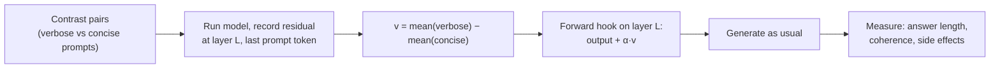

# Activation steering

Steering is the gentlest form of weight surgery: you don't change a single weight. You compute a direction that means "be more concise" (or formal, or cautious), and while the model generates, you add a multiple of it to the residual stream. Behavior shifts, and when you stop adding it, the model is exactly as it was. This lesson builds a steering vector from scratch on Qwen3.5-0.8B, measures what it does and what it breaks, and then shows how to use the same idea on your 9B GGUF through llama.cpp control vectors.

> [!GOALS]
> - Explain activation steering and how it relates to features as directions
> - Build a steering vector from contrastive prompt pairs (difference of means) and apply it with a forward hook
> - Sweep layer and strength, and measure both the intended effect and side effects
> - Compare steering with prompting and fine-tuning
> - Generate and apply control vectors on your 9B GGUF with llama.cpp

## The idea

From [Interpretability 101](#/weights/interpretability-101): many features are directions in the residual stream. If "verbose answer coming" is a direction `v`, then pushing the stream along `v` should make the model more verbose, and pushing against it should make it terser.

> [!CONCEPT] Steering vector (control vector)
> A vector you **add** to the residual stream at one or more layers during inference, scaled by a coefficient α, to push the model's behavior in a chosen direction. Positive α pushes toward the feature, negative α away from it. llama.cpp calls these **control vectors**; the research literature says activation addition, representation engineering or contrastive activation addition.

For a security engineer: steering is **runtime hooking**. Like `LD_PRELOAD` or a Frida script that tweaks a function's return value, it changes behavior without touching the binary on disk. Remove the hook and the original behavior returns. Ablation baked into weights (next lesson) is the on-disk patch.



The lineage, briefly: **ActAdd** (Turner et al., 2023) added the difference of two prompts' activations; **Inference-Time Intervention** (Li et al., 2023) steered specific attention heads toward truthfulness; **Representation Engineering** (Zou et al., 2023) generalized the approach and used PCA over many pairs; **Contrastive Activation Addition** (Panickssery et al., 2023) averaged over many contrast pairs, which is what you'll do. The `repeng` library and llama.cpp's control-vector tools package the same recipe.

## Building a vector: the recipe

1. **Contrast pairs.** Write prompts that are identical except for the property you want. Here: the same question with a system instruction "Answer in one short sentence" versus "Answer at length, with detail and examples".
2. **Record.** Run each prompt and record the residual stream (the output of decoder layer L) at the **last prompt token**, the position where the model is about to start answering. That vector summarizes "what kind of answer am I about to write".
3. **Average and subtract.** `v_L = mean(verbose) − mean(concise)`. Keep it in raw model units (don't normalize), so α = 1 means "one average difference".
4. **Apply.** At generation time, *without* the system instruction, add `α · v_L` to layer L's output at every position.
5. **Measure.** Pick an objective metric for the intended effect (here: answer length in tokens) and one for collateral damage (here: how surprised the model is by a neutral paragraph).

> [!CONCEPT] Contrast pair
> Two inputs that differ only in the property you want to isolate. The quality of a steering vector is mostly the quality of its pairs: if your "verbose" prompts are also all about history and the "concise" ones about math, you've built a history-vs-math vector.

## Lab: a concise-vs-verbose vector for Qwen3.5-0.8B

This uses `common.py` from [Open and inspect real weights](#/weights/inspect-weights) and the downloaded `models/Qwen3.5-0.8B`. Thinking mode stays off (the 0.8B's default), so answers start immediately.

> [!LAB] Build, apply and sweep a steering vector
> 1. Save as `~/ai-lab/weights/steer.py`:
> ```python title="steer.py"
> """Build a verbose-vs-concise steering vector for Qwen3.5-0.8B and sweep layer x strength."""
> import torch
>
> from common import chat, load
>
> TRAIN_QUESTIONS = [
>     "What is DNS?", "Why is the sky blue?", "What does a firewall do?", "How do vaccines work?",
>     "What is a hash function?", "Why do we have seasons?", "What is TLS?", "How does a compiler work?",
>     "What is inflation?", "What causes earthquakes?", "What is a race condition?", "How do batteries store energy?",
>     "What is SQL injection?", "Why do cats purr?", "What is a VPN?", "How does GPS find your location?",
> ]
> TEST_QUESTIONS = ["What is a CPU cache?", "How do airplanes fly?", "What is a reverse proxy?"]
> CONCISE = "Answer in one short sentence. No lists, no detail."
> VERBOSE = "Answer at length, with detailed explanations, background and several examples."
> NEUTRAL = ("The committee met on Tuesday to review the budget. After a short discussion, "
>            "members agreed to postpone the vote until the next meeting in March.")
>
>
> def prompt(tok, system: str | None, question: str) -> str:
>     msgs = ([{"role": "system", "content": system}] if system else []) + [{"role": "user", "content": question}]
>     return tok.apply_chat_template(msgs, tokenize=False, add_generation_prompt=True, enable_thinking=False)
>
>
> @torch.no_grad()
> def last_token_residuals(model, tok, texts: list[str]) -> torch.Tensor:
>     """Return [n_layers, n_texts, hidden]: each layer's output at the final prompt token."""
>     layers, store = model.model.layers, []
>     for text in texts:
>         grabbed = []
>         hooks = [l.register_forward_hook(lambda m, i, o: grabbed.append((o[0] if isinstance(o, tuple) else o)[0, -1].float().cpu()))
>                  for l in layers]
>         model(**tok(text, return_tensors="pt").to(model.device))
>         for h in hooks:
>             h.remove()
>         store.append(torch.stack(grabbed))           # [n_layers, hidden]
>     return torch.stack(store, dim=1)                 # [n_layers, n_texts, hidden]
>
>
> class Steer:
>     """Context manager: add alpha * v to one decoder layer's output while active."""
>     def __init__(self, layer, v: torch.Tensor, alpha: float):
>         self.layer, self.alpha = layer, alpha
>         self.v = v.to(next(layer.parameters()).device, next(layer.parameters()).dtype)
>     def hook(self, module, inputs, output):
>         if isinstance(output, tuple):
>             return (output[0] + self.alpha * self.v, *output[1:])
>         return output + self.alpha * self.v
>     def __enter__(self):
>         self.handle = self.layer.register_forward_hook(self.hook)
>     def __exit__(self, *exc):
>         self.handle.remove()
>
>
> @torch.no_grad()
> def answer_len(model, tok, question: str) -> tuple[int, str]:
>     ids = tok(chat(tok, question), return_tensors="pt").to(model.device)
>     out = model.generate(**ids, max_new_tokens=160, do_sample=False)
>     new = out[0, ids.input_ids.shape[1]:]
>     return len(new), tok.decode(new, skip_special_tokens=True)
>
>
> @torch.no_grad()
> def neutral_nll(model, tok) -> float:
>     """Average next-token loss on a neutral paragraph: a cheap side-effect meter."""
>     ids = tok(NEUTRAL, return_tensors="pt").to(model.device)
>     return float(model(**ids, labels=ids.input_ids).loss)
>
>
> def main() -> None:
>     tok, model = load()
>     verbose = last_token_residuals(model, tok, [prompt(tok, VERBOSE, q) for q in TRAIN_QUESTIONS])
>     concise = last_token_residuals(model, tok, [prompt(tok, CONCISE, q) for q in TRAIN_QUESTIONS])
>     vectors = verbose.mean(1) - concise.mean(1)      # [n_layers, hidden]
>     torch.save(vectors, "verbose_vectors.pt")
>     resid_norm = verbose.norm(dim=-1).mean(1)        # typical stream size per layer, for scale
>     for i in range(0, len(vectors), 3):
>         print(f"layer {i:2d}: |v| = {vectors[i].norm():7.2f}   typical |residual| = {resid_norm[i]:7.2f}")
>
>     base_nll = neutral_nll(model, tok)
>     print(f"\nbaseline neutral NLL {base_nll:.3f}\n\nlayer  alpha  mean_len  dNLL   sample")
>     for L in (6, 12, 18):
>         for alpha in (-6.0, -3.0, 0.0, 3.0, 6.0):
>             with Steer(model.model.layers[L], vectors[L], alpha):
>                 lens, texts = zip(*(answer_len(model, tok, q) for q in TEST_QUESTIONS))
>                 d_nll = neutral_nll(model, tok) - base_nll
>             sample = texts[0].replace("\n", " ")[:70]
>             print(f"{L:5d}  {alpha:+5.1f}  {sum(lens) / len(lens):8.1f}  {d_nll:+.3f}  {sample!r}")
>
>
> if __name__ == "__main__":
>     main()
> ```
> 2. Run it (a few minutes on an M-series Air; it generates 45 short answers):
> ```bash
> cd ~/ai-lab/weights && source .venv/bin/activate
> python steer.py | tee steer.txt
> ```
> 3. **Read the scale table first.** Compare `|v|` with the typical residual norm at each layer. A vector that's 5% of the stream's size needs a larger α than one that's 30%.
> 4. **Read the sweep.** For each layer, does mean length rise with positive α and fall with negative α? Where's the "sweet spot" (clear effect, small `dNLL`)? Where does output turn into repetition, another language, or nonsense?
> 5. **Read the samples, not just the numbers.** Length can go up because the model starts looping. A steering result only counts if the text is still good.
> 6. Keep `verbose_vectors.pt`; the export section below uses it.

> [!TIP]
> If `generate` is slow, cut `max_new_tokens` to 100 and test one layer at a time. If outputs from a steered run look identical to unsteered ones, print `vectors[L].norm()` and try a larger α: the needed scale varies a lot by layer.

### What you'll typically see

These are patterns reported across the steering literature and what to look for, not guaranteed numbers for your run:

- **Middle layers steer best.** Very early layers mostly encode the surface of the current token; very late layers are busy producing the next token. Behavioral "intent" tends to be most steerable in the middle third (layers 6–16 of 24 here).
- **There's a cliff.** Effects grow smoothly with α until the added vector dominates the residual stream, then coherence collapses. The neutral-paragraph loss (`dNLL`) usually starts rising before the text visibly breaks, which makes it a useful early warning.
- **Asymmetry.** Pushing toward "concise" often works better than pushing toward "verbose" for a small model (it's easier to stop than to know more).

> [!LAB] Your own direction
> 1. Replace `CONCISE`/`VERBOSE` with a formal-vs-casual pair ("Respond in formal, professional English." vs "Respond casually, like texting a friend."), or a "plain English" vs "jargon-heavy" pair.
> 2. Replace the length metric with something that fits: count of contractions and slang words for casual, average word length for jargon.
> 3. Check that your vector isn't just the length vector again: compute the cosine between it and `verbose_vectors.pt` at the same layer. Low cosine (say below 0.3) means a genuinely different direction.

## Side effects and failure modes

| Symptom | Likely cause | What to do |
|---|---|---|
| Gibberish, language switching, repeated tokens | α too large for that layer | Lower α, or spread a smaller α over several layers |
| No effect | Wrong layer, α too small, or the feature isn't a clean direction | Sweep wider; check `|v|` vs residual norm |
| Intended effect plus topic drift | Contrast pairs had a confound | Rebuild pairs that differ only in the target property |
| Works on your test prompts, not on others | Vector overfit to the phrasing of your pairs | More varied pairs; test on a held-out prompt set |
| Hurts unrelated skills | The direction overlaps other features (superposition) | Measure side effects explicitly; accept or reduce α |

Research backs the caution: studies of steering reliability find that for some behaviors a single direction steers inconsistently across inputs, or not at all, especially when the behavior isn't represented as one coherent direction. Treat each vector as a hypothesis with an evaluation, not a magic dial.

## Steering vs prompting vs fine-tuning

| | Prompting | Steering | Fine-tuning (LoRA) |
|---|---|---|---|
| Changes weights? | No | No | Yes (or adds an adapter) |
| Cost to create | Minutes | Minutes (a few hundred forward passes) | Hours, a dataset, often a GPU |
| Uses context tokens? | Yes | No | No |
| Can the user override it? | Easily (it's just text) | Not from the prompt | Not from the prompt |
| Precision | Coarse, model may ignore it | One behavioral axis at a time | Can teach new formats and skills |
| Risk | Prompt injection, drift over long chats | Coherence loss at high α | Forgetting, overfitting |
| Best for | Most tasks | Tone, style, persona, nudging a known behavior | New skills, consistent formats, domain knowledge |

A practical rule: prompt first. Steer when a behavior keeps leaking through prompts (for example, verbosity in a 9B agent that burns your context), or when you want a behavior that can't be talked out of by user input. Fine-tune when you need the model to *know* or *do* something new (see [Training 101](#/finetune/concepts)).

## Bringing it to your 9B: llama.cpp control vectors

Your 9B runs as a GGUF in LM Studio. As of this writing I found no control-vector option in LM Studio's documentation or UI, so check its release notes if that changes. **llama.cpp's own server does support them**, and it runs the same GGUF file.

```bash
brew install llama.cpp
llama-server --help | grep -A1 control-vector
```

You should see three flags (verified against llama.cpp's argument parser, November 2026):

| Flag | Meaning |
|---|---|
| `--control-vector FNAME` | Add a control vector at scale 1.0 (comma-separate several files) |
| `--control-vector-scaled FNAME:SCALE,...` | Add with your own scale; negative scales push the other way |
| `--control-vector-layer-range START END` | Only apply to layers START..END, inclusive |

> [!WARNING]
> Some older docs (including the cvector-generator README example) show `--control-vector-scaled file.gguf 0.8` with a space. The current parser expects `FNAME:SCALE`, for example `concise.gguf:0.8`. Trust `--help` on your installed version.

### The control-vector file format

A control vector is a small GGUF file:

- `general.architecture` = `controlvector`, plus `controlvector.model_hint` and `controlvector.layer_count` metadata
- one float32 tensor per layer named `direction.N`, of length `n_embd` (4,096 for your 9B, 1,024 for the 0.8B)
- `direction.N` is added to the **output of layer N** (0-indexed); llama.cpp rejects `direction.0`, so the first layer's output can't be steered

The vector must match the model's width: your 0.8B vector cannot steer the 9B. For the 9B you need activations from the 9B itself, and llama.cpp can collect them directly from the GGUF on your Mac.

### Path A: generate a vector from the 9B GGUF with `llama-cvector-generator`

`llama-cvector-generator` runs paired prompts through the model, takes positive-minus-negative residual differences at every layer, and reduces them with PCA (default) or a plain mean (`--method mean`). Its key options, from the source:

| Option | Meaning |
|---|---|
| `-m FILE` | The GGUF model |
| `--positive-file FILE`, `--negative-file FILE` | One prompt per line; same number of lines; pairs matched by line |
| `--method pca` or `--method mean` | How to reduce the differences (default `pca`) |
| `--pca-iter N`, `--pca-batch N` | PCA tuning |
| `-o FILE` | Output file (default `control_vector.gguf`) |
| `-ngl N` | Layers to offload to the GPU (Metal) |

First check you have the binary:

```bash
ls "$(brew --prefix)/bin" | grep -i cvector
```

If it isn't there, build it from source (Xcode command-line tools and `cmake` from Homebrew needed):

```bash
git clone --depth 1 https://github.com/ggml-org/llama.cpp ~/ai-lab/llama.cpp
cd ~/ai-lab/llama.cpp
cmake -B build && cmake --build build --config Release -j --target llama-cvector-generator llama-server
ls build/bin
```

The prompts must be in the model's raw chat format with newlines escaped as `\n`. Generate them from the official tokenizer so the template is exactly right:

```bash
cd ~/ai-lab/weights
hf download Qwen/Qwen3.5-9B tokenizer.json tokenizer_config.json chat_template.jinja vocab.json merges.txt \
  --local-dir models/Qwen3.5-9B-tokenizer
```

```python title="make_cvec_prompts.py"
"""Write positive/negative prompt files for llama-cvector-generator (verbose = positive)."""
from transformers import AutoTokenizer

from steer import CONCISE, TRAIN_QUESTIONS, VERBOSE

tok = AutoTokenizer.from_pretrained("models/Qwen3.5-9B-tokenizer")


def line(system: str, question: str) -> str:
    text = tok.apply_chat_template(
        [{"role": "system", "content": system}, {"role": "user", "content": question}],
        tokenize=False, add_generation_prompt=True, enable_thinking=False,
    )
    return text.replace("\n", "\\n")          # one prompt per line, escaped newlines


with open("verbose_pos.txt", "w") as pos, open("verbose_neg.txt", "w") as neg:
    for q in TRAIN_QUESTIONS:
        pos.write(line(VERBOSE, q) + "\n")
        neg.write(line(CONCISE, q) + "\n")
print("wrote", len(TRAIN_QUESTIONS), "pairs")
```

```bash
python make_cvec_prompts.py
MODEL="$(find ~/.lmstudio/models -name '*Q4_K_M*.gguf' | grep -i 'qwen3.5-9b' | head -1)"
llama-cvector-generator -m "$MODEL" -ngl 99 \
  --positive-file verbose_pos.txt --negative-file verbose_neg.txt \
  --method mean -o verbose_9b.gguf
```

Unload the model in LM Studio first so the two don't compete for memory. Then inspect what you got:

```bash
gguf-dump verbose_9b.gguf | head -40
```

> [!NOTE]
> Two caveats to verify on your build. First, the generator pads each pair to the same length and uses every token position, so keep pairs' wording parallel (as above) so padding doesn't dominate. Second, Qwen3.5's hybrid architecture is recent; llama.cpp's Qwen3.5 graph does apply control vectors at every layer (it calls the control-vector hook after each layer's residual add), but if the generator errors on your model, update llama.cpp before debugging further.

### Apply it with llama-server

```bash
llama-server -m "$MODEL" -ngl 99 -c 8192 --port 8080 \
  --chat-template-kwargs '{"enable_thinking":false}' \
  --control-vector-scaled verbose_9b.gguf:-0.6 \
  --control-vector-layer-range 8 24
```

A negative scale on the "verbose" vector pushes toward concise. Test it with the same client code you use for LM Studio, pointed at port 8080:

```python title="test_cvec.py"
"""Compare answer lengths from a steered llama-server against LM Studio."""
from openai import OpenAI

QUESTIONS = ["What is a CPU cache?", "How do airplanes fly?", "What is a reverse proxy?"]
SERVERS = {
    "steered (llama-server)": ("http://localhost:8080/v1", "local"),
    "plain (LM Studio)": ("http://localhost:1234/v1", "qwen3.5-9b-uncensored-hauhaucs-aggressive"),
}


def main() -> None:
    for label, (url, model) in SERVERS.items():
        client = OpenAI(base_url=url, api_key="lm-studio")
        lengths = []
        for q in QUESTIONS:
            r = client.chat.completions.create(
                model=model, messages=[{"role": "user", "content": q}],
                temperature=0.7, top_p=0.8, max_tokens=400,
            )
            lengths.append(r.usage.completion_tokens)
        print(f"{label:24s} completion tokens: {lengths}")


if __name__ == "__main__":
    main()
```

Run the plain comparison only if you have memory for both servers at once (two copies of a 5.3 GB model plus KV caches is tight on 16 GB); otherwise run them one after the other. Sweep the scale (−0.3, −0.6, −1.0) and the layer range just like the PyTorch lab, and keep reading samples. Note that the control vector is fixed when the server starts; the server docs list no endpoint to change it at runtime, so restart to try a new scale.

> [!MAC]
> Control vectors cost almost nothing at inference: one vector addition per layer per token. The memory cost is the llama-server process itself, the same as LM Studio's. Don't run LM Studio's copy of the model and llama-server's at the same time on 16 GB unless the context sizes are small.

### Path B: export your own vector from PyTorch

For the 0.8B (or any model you can run in PyTorch), you can write the file yourself with the `gguf` package. This is also the cleanest way to understand the format:

```python title="export_cvec.py"
"""Export steer.py's vectors as a llama.cpp control vector (for the 0.8B GGUF)."""
import numpy as np
import torch
from gguf import GGUFWriter

LAYERS = range(6, 19)          # which layers' outputs to steer (0-indexed, must be >= 1)

vectors = torch.load("verbose_vectors.pt")            # [n_layers, hidden] in model units
writer = GGUFWriter("verbose_0.8b.gguf", "controlvector")
writer.add_string("controlvector.model_hint", "qwen35")   # informational; check your model with gguf-dump
writer.add_uint32("controlvector.layer_count", len(LAYERS))
for layer in LAYERS:
    writer.add_tensor(f"direction.{layer}", vectors[layer].numpy().astype(np.float32))
writer.write_header_to_file()
writer.write_kv_data_to_file()
writer.write_tensors_to_file()
writer.close()
print("wrote verbose_0.8b.gguf")
```

This mirrors what the `repeng` library's `export_gguf` does. One subtlety: your PyTorch lab added the vector at *one* layer; this file adds it at 13 layers, so the equivalent scale is much smaller (start around 0.2). You'll build a GGUF of the 0.8B in [Direction ablation](#/weights/direction-ablation); come back then and try `--control-vector-scaled verbose_0.8b.gguf:-0.3`.

> [!NOTE]
> **repeng** (`pip install repeng`, latest 0.4.0 from December 2024) trains vectors with PCA over many pairs and exports llama.cpp-compatible GGUF files. It predates transformers 5 and Qwen3.5, so expect to patch it; the from-scratch code above is less fragile and teaches more.

## Recap

- Steering adds α·v to the residual stream at chosen layers during inference; no weights change, and removing the hook restores the model.
- Build v by difference of means over contrast pairs at the last prompt token; quality depends on clean, parallel pairs.
- Sweep layer and α; middle layers usually steer best; there's a coherence cliff at high α.
- Measure the intended effect objectively (length, style counts) and side effects (loss on neutral text, reading samples).
- Prompt first, steer for persistent style or behavior nudges, fine-tune for new skills.
- For the 9B GGUF: generate with `llama-cvector-generator` (`--positive-file`, `--negative-file`, `--method`, `-o`), apply with `llama-server --control-vector-scaled FILE:SCALE --control-vector-layer-range START END`; LM Studio doesn't expose this.

## Check yourself

1. Why record the residual at the last prompt token rather than averaging over all tokens of the prompt?
   <details><summary>Answer</summary>

   The last prompt token is where the model decides how to begin its answer, so its residual summarizes "what kind of response is coming". Averaging over all tokens mixes in representations of the system instruction's words themselves, which would make the vector partly encode the literal instruction text rather than the behavioral intent.

   </details>
2. Your steered model writes much longer answers, and `dNLL` is +0.9. Is the steering a success?
   <details><summary>Answer</summary>

   Probably not. A large rise in loss on a neutral paragraph means the vector is disrupting general language modeling. Longer answers might be loops or rambling. Read the samples; reduce α or move to a different layer until the length effect holds with a small `dNLL`.

   </details>
3. Can you use a control vector built from Qwen3.5-0.8B on your 9B in llama-server? Why or why not?
   <details><summary>Answer</summary>

   No. The vector lives in the 0.8B's 1,024-dimensional residual space; the 9B's stream is 4,096-dimensional, with different learned directions. llama.cpp rejects vectors whose length doesn't match `n_embd`, and even a padded vector would mean nothing. Build the 9B's vector from the 9B's own activations.

   </details>
4. What does `--control-vector-scaled verbose_9b.gguf:-0.6 --control-vector-layer-range 8 24` do?
   <details><summary>Answer</summary>

   It loads the control vector, multiplies it by −0.6 (pushing away from "verbose", i.e. toward concise), and adds the corresponding `direction.N` to the output of each layer N from 8 to 24 inclusive, for every token processed.

   </details>
5. When would you choose steering over a system prompt for your bug bounty agent?
   <details><summary>Answer</summary>

   When a behavior keeps leaking through despite prompting (for example verbose, padded responses that waste context in long agent loops), when you want the behavior to hold regardless of what's injected into the context, or when you want to save the context tokens a long style prompt costs. You'd still evaluate the agent's task performance to make sure the vector doesn't hurt reasoning.

   </details>

## Go deeper
- [Steering Language Models With Activation Engineering (ActAdd)](https://arxiv.org/abs/2308.10248) — the paper that made activation addition popular.
- [Representation Engineering: A Top-Down Approach to AI Transparency](https://arxiv.org/abs/2310.01405) — reading and controlling concepts with population-level directions.
- [Steering Llama 2 via Contrastive Activation Addition](https://arxiv.org/abs/2312.06681) — difference of means over many pairs, with careful evaluation.
- [Understanding (Un)Reliability of Steering Vectors in Language Models](https://arxiv.org/abs/2505.22637) — when steering fails and why.
- [repeng](https://github.com/vgel/repeng) — a compact library for training control vectors and exporting them to llama.cpp.
- [llama.cpp server README](https://github.com/ggml-org/llama.cpp/blob/master/tools/server/README.md) — every server flag, including the control-vector options.
